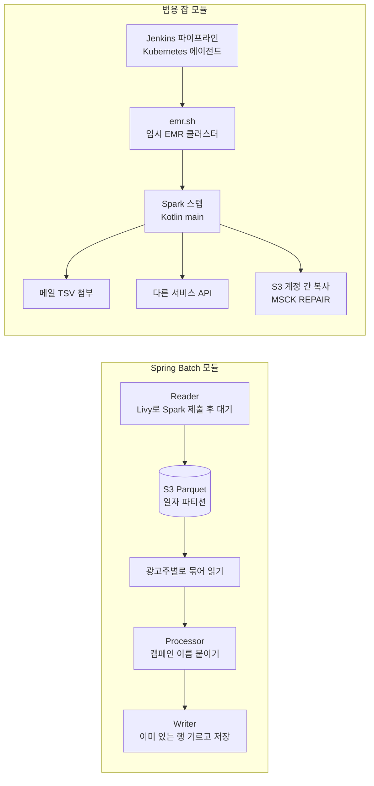

이전 회사의 커머스 광고 플랫폼에서 광고 리포트 배치를 맡았다. 광고주별 하루 사용 내역을 DB에 쌓는 잡은 Spring Batch로 만들었고, 쿼리 결과를 메일과 다른 서비스 API로 보내거나 외부 파트너의 리포트 파일을 옮기는 잡은 EMR에 Spark 스텝으로 올리는 Kotlin 잡으로 만들었다. Spring Batch 쪽은 실행 기록을 DB에 남기지 않고, 다시 돌리는 일을 Writer의 중복 필터에 맡겼다. 회사 내부 이름과 경로는 뺐다.



## 메모리에만 있는 JobRepository와 Writer의 중복 필터

일간 사용 내역 집계는 Spring Boot 애플리케이션이다. `JobRepositoryConfig`는 `DefaultBatchConfigurer`를 상속하고 `setDataSource`를 빈 메서드로 덮어썼다. 주석에도 DataSource를 일부러 무시한다고 적었다.

Spring Batch 4.x의 `DefaultBatchConfigurer`는 DataSource가 없으면 경고를 남기고 `MapJobRepositoryFactoryBean`과 `ResourcelessTransactionManager`로 메모리 안의 JobRepository를 만든다. 그래서 이 애플리케이션은 JPA로 업무 DB를 쓰면서도, 잡 실행 메타데이터 테이블은 그 DB에 만들지 않는다.

실행 기록이 프로세스와 함께 사라지므로, 실패한 청크부터 이어 가는 재시작이나 같은 파라미터로 이미 끝난 잡을 막는 확인은 쓸 수 없다. 같은 날짜를 다시 돌리는 일은 Writer가 맡는다. Writer는 저장 전에 이미 있는 내역을 걸러 낸다. 이미 저장된 행은 건너뛰므로 겹쳐 쌓이지는 않지만, 값이 바뀌었어도 기존 행은 갱신되지 않는다.

Spark 실행 건너뛰기 파라미터를 켜면 S3에 이미 있는 결과만 다시 읽어 넣을 수 있다.

## 광고주 한 명의 행 묶음이 아이템 하나

애플리케이션은 웹 서버 없이 뜨고, `spring.batch.job.names`로 실행할 잡을 고른다. 값을 주지 않으면 기본값 `NONE`이라 아무 잡도 돌지 않는다. 컨테이너는 `JOB_NAME`과 `JOB_PARAMS` 환경 변수로 잡과 파라미터를 받고, 끝나면 `SpringApplication.exit`의 종료 코드로 프로세스를 끝낸다.

일간 잡은 스텝 하나짜리 청크 지향 잡이고, 아이템 타입은 `List<DailyReport>`다. 리포트 행 하나가 아니라 광고주 한 명의 행 묶음을 아이템 하나로 다룬다.

| 단계 | 하는 일 |
|---|---|
| 파라미터 | 연·월·일(없으면 어제), Spark 실행 건너뛰기, 집계 건너뛰기, dry run |
| Reader `open()` | Livy `/batches`에 Spark jar를 제출하고 끝날 때까지 기다린 뒤, S3의 그날 파티션을 연다 |
| Reader `read()` | Parquet 행을 차례로 읽다가 광고주 ID가 바뀌면 그때까지 모은 묶음을 돌려준다 |
| Processor | 광고주마다 외부 광고 API로 캠페인 이름 맵을 한 번 받아, 리포트 행을 저장용 엔티티로 바꾼다. 수동 정산 행은 따로 표시한 캠페인 ID로 구분해 정산 금액만 담는다 |
| Writer | 청크 안의 묶음을 펼치고, 이미 저장된 내역을 걸러 낸 뒤 저장한다. dry run이면 저장하지 않는다 |

Livy 클라이언트는 `RestTemplate`으로 배치를 제출하고 2초마다 상태를 조회한다. `success`면 빠져나오고, `dead`, `killed`, `shutting_down`이나 404면 예외를 던져 스텝을 실패시킨다. 집계 계산은 Spark 쪽에서 하고, Spring Batch는 그 결과를 읽어 DB에 넣는 역할만 한다.

Parquet 파일은 Spark 클러스터 없이 읽는다. Hadoop `FileSystem`으로 `s3a://` 경로의 파일 목록을 받고, 이름이 `_`로 시작하는 파일은 건너뛴다. 파일마다 `AvroParquetReader`로 `GenericRecord`를 읽어 데이터 클래스로 옮긴다.

```kotlin
// 구조만 보여 주는 스케치
override fun read(): List<Row>? {
    while (rows.hasNext()) {
        val r = rows.next()
        if (buf.isNotEmpty() && r.owner != buf[0].owner) {
            return buf.toList().also { buf.clear(); buf += r }
        }
        buf += r
    }
    return buf.takeIf { it.isNotEmpty() }?.toList().also { buf.clear() }
}
```

이 묶음 방식은 Spark가 쓴 파일이 광고주 ID 순서로 모여 있다고 가정한다. 같은 광고주의 행이 여러 파일에 흩어져 있으면 묶음이 둘로 나뉜다. 그래도 Processor가 캠페인 이름을 한 번 더 조회할 뿐, 저장되는 행은 같다.

## 잡 하나가 Kotlin object 하나

범용 잡 모듈에는 잡이 세 개 있다. 각각 `@JvmStatic main`을 가진 Kotlin `object`이고, 실행 인자를 순서대로 읽는다. 인자가 비어 있으면 기본값을 쓴다.

| 잡 | 입력 | 하는 일 |
|---|---|---|
| 쿼리 → 메일 | 메일 계정, 수신자, 제목, 헤더, SQL | Spark SQL 결과를 TSV 파일로 만들어 메일에 첨부한다 |
| 쿼리 → API | 메일 계정, API 주소, 필드 이름, 수신자, 제목, SQL | 결과 행을 필드 이름과 짝지어 JSON 배열로 POST하고, 같은 행을 메일로도 보낸다 |
| S3 get/put | 원본·대상 계정의 키와 리전, 버킷과 키, DB와 테이블, 날짜 범위 | 날짜마다 원본 객체를 읽어 대상 계정에 쓰고, 끝나면 테이블 파티션을 다시 등록한다 |

SQL은 따로 받지 않는다. 인자 목록의 정해진 위치부터 끝까지를 공백으로 이어 붙여 SQL로 쓴다.

쿼리 → 메일 잡은 SQL을 세미콜론으로 나눠 여러 개 받을 수 있다. 헤더도 세미콜론으로 나눈다. 헤더가 하나뿐이면 모든 쿼리 결과를 한 파일로 합쳐 메일 한 통을 보내고, 헤더가 여러 개면 쿼리마다 메일을 따로 보낸다.

메일 유틸은 JavaMail로 만들었다. 첨부 파일이 정해 둔 크기를 넘으면 파일을 나누고, 제목에 `(1/3)` 같은 번호를 붙여 여러 통으로 보낸다.

쿼리 → API 잡에서 API 호출이 실패하면 예외를 로그와 메신저 알림으로 남기고, 보내려던 JSON도 함께 붙인다. 그 뒤 메일은 그대로 보낸다. 결과가 비었거나 수신자가 없으면 메일은 건너뛴다.

## S3 get/put과 파티션 등록

S3 get/put 잡은 원본과 대상의 자격 증명을 따로 받아 각자 S3 클라이언트를 만든다. 원본에서 `getObject`로 받은 스트림과 메타데이터를 그대로 대상의 `putObject`에 넘기므로 로컬 디스크를 거치지 않는다. 날짜마다 객체 하나를 복사하고, 한 날짜가 실패해도 예외를 로그로만 남기고 다음 날짜로 넘어간다.

복사가 끝나고 DB와 테이블 인자가 enum에 있는 값이면 `MSCK REPAIR TABLE`을 실행해 새로 들어온 날짜 디렉터리를 테이블 파티션으로 등록한다. DB와 테이블 이름은 문자열을 그대로 쓰지 않고 enum으로 받고, 없는 이름이면 `NONE`이 되어 등록을 건너뛴다. 쿼리에 들어가는 이름이 정해진 값으로만 제한된다.

## 잡마다 임시 EMR 클러스터

잡은 Jenkins 파이프라인에서 시작한다. Kubernetes 에이전트 컨테이너가 `emr.sh`를 부르고, 이 스크립트가 `aws emr create-cluster`로 클러스터를 새로 만든다. 클러스터는 스팟 인스턴스로 띄우고, `--auto-terminate`로 스텝이 끝나면 내리며, 스텝이 실패해도 클러스터를 종료한다. 잡 클래스 이름이 곧 클러스터 이름이고 스텝 이름이다.

## Kotlin에서 SparkSession 만들기

세 잡은 모두 `SparkUtil.make()`로 세션을 얻는다. 프로필이 로컬이면 `local[*]` 마스터를 쓰고, 로컬이 아니면 `enableHiveSupport()`를 켠다. 설정은 리소스의 `spark.yaml`을 평평한 키로 읽은 다음, 호출할 때 넘긴 맵으로 덮어쓴다. 맵의 값은 `Long`, `String`, `Double`, `Boolean` 타입에 따라 갈라서 `config`에 넣는다.

이 분기가 번거로워서 Spark에 `config(Map)`을 직접 넣었다([글](/posts/spark-session-config-map/)).

쿼리 결과는 `spark.sql(query).collectAsList()`로 드라이버에 모은 뒤 각 행을 구분자로 이어 문자열 목록으로 만든다. 결과 전체가 드라이버 메모리에 올라가므로, 메일 첨부나 API 본문처럼 결과가 작은 잡에만 맞는 방식이다.

## English summary

At a previous company I built ad report batch jobs for a commerce ad platform in two styles. A Spring Batch job submits a Spark job through Livy, reads the Parquet output from S3 grouped by advertiser, and writes daily usage rows after filtering ones that already exist. A separate module holds small Kotlin jobs that run as Spark steps on a short-lived EMR cluster started from Jenkins: query to mail, query to API, and a cross-account S3 copy followed by MSCK REPAIR. The Spring Batch job keeps its job repository in memory only, so safe reruns rely on the writer's duplicate filter rather than on Spring Batch restart.
