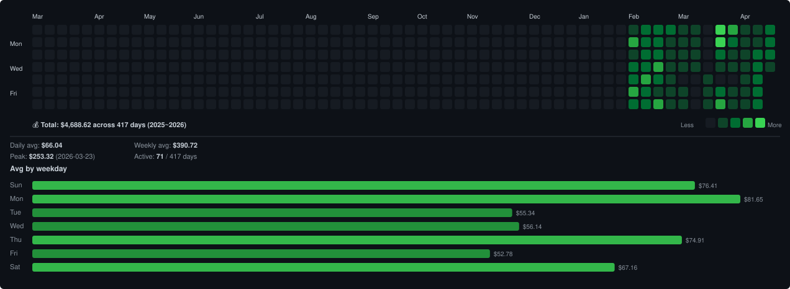
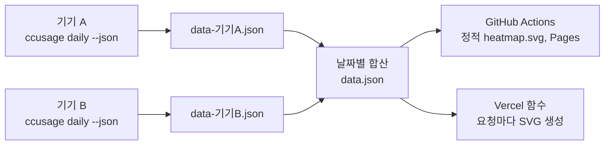

GitHub 프로필의 잔디처럼, 하루하루 AI에 쓴 비용을 칸 하나씩 색으로 칠한 그림이다. [ai-heatmap](https://github.com/seunggabi/ai-heatmap)으로 만들었다. 로컬의 Claude Code 사용 기록을 [ccusage](https://github.com/ryoppippi/ccusage)로 뽑고, [react-activity-calendar](https://github.com/grubersjoe/react-activity-calendar)로 그린다. npm 패키지로 올려 두어서, gh에 로그인돼 있다면 `npx ai-heatmap init` 한 줄로 내 저장소와 GitHub Pages가 만들어진다.

처음에는 그림 하나 그리는 스크립트였다. 여러 기기의 사용량을 합치는 기능을 넣으면서 데이터를 모으고 합치는 일이 생겼고, 커밋 기록을 다시 보면 그 뒤에 고친 버그 대부분이 데이터 쪽이었다.

## 흐름

`ai-heatmap update`를 실행하면 이 순서로 돈다.

1. 내 heatmap 저장소에서 다른 기기의 `data-<기기ID>.json`을 GitHub API로 받아 온다.
2. 이 기기에서 `ccusage daily --json`을 돌려 일별 비용과 토큰 수를 뽑는다.
3. 최근 365일을 채워 이 기기 파일을 만든다. 사용 기록이 없는 날은 0으로 넣는다.
4. 모든 기기 파일을 날짜별로 더해 `data.json`을 만든다.
5. 이 기기 파일과 `data.json`을 GitHub 콘텐츠 API로 저장소에 올린다.

저장소에 `data.json`이 올라가면 GitHub Actions가 정적 SVG를 다시 만들어 Pages에 배포한다. Vercel에 배포했다면 `/api/heatmap` 함수가 요청마다 `data.json`을 읽어 SVG를 만든다. 쿼리 파라미터로 테마, 날짜 범위, 통계 표시 여부를 바꿀 수 있다.

## 기기별로 파일을 나눈 이유

두 기기가 같은 `data.json`을 덮어쓰면 마지막에 올린 쪽이 이긴다. 그래서 기기마다 자기 파일만 쓰고, 합치는 건 매번 처음부터 다시 한다. 합산 결과는 기기 파일만 있으면 언제든 다시 만든다.

기기 ID는 OS가 주는 기기 식별자로 정하고, 그게 안 되면 호스트 이름을 쓴다. 처음에는 CLI와 생성 스크립트가 각자 기기 이름을 구하다가 값이 어긋나서, CLI가 구한 이름을 생성 스크립트에 넘기도록 고쳤다(#77).

합칠 때 비용, 입력·출력 토큰, 캐시 토큰은 더한다. 처음에는 합칠 때 사용 모델 목록이 빠져 있어서 합집합으로 넣었다(#69). 모델별 비용은 모델 이름을 키로 더한다.

색 단계는 최대 비용 대비 비율로 정한다. 0이면 0단계, 최댓값의 25% 이하면 1단계, 50% 이하면 2단계, 75% 이하면 3단계, 그 위는 4단계다. 캐시 적중률은 캐시 읽기 토큰을 캐시 읽기·생성 토큰 합으로 나눠 날마다 계산한다.

## 데이터 쪽 버그들

커밋 기록에서 데이터와 관련된 수정만 뽑으면 이렇다.

| 이슈 | 문제 | 고친 방법 |
|---|---|---|
| #79 | 날짜를 `toISOString()`으로 만들어서 UTC 기준이 됐다. 한국 시간 오전 9시 전에 돌리면 365일 범위가 하루 밀려 오늘 칸이 빠졌다 | 로컬 시간대의 연·월·일로 날짜 문자열을 만든다 |
| #79 | 디렉터리 목록 API 응답에는 파일 내용이 없는데 그걸 읽으려 했다 | 파일마다 따로 내용을 받아 온다 |
| #101 | 다른 기기 파일 목록을 가져오는 `jq` 식의 이스케이프가 잘못돼 목록 자체를 못 읽었다 | 식을 고쳤다 |
| #95 | ccusage 일별 출력에 같은 날짜가 두 번 나오는 경우가 있었다 | 같은 날짜는 비용과 토큰을 더해 한 줄로 합친다 |
| #99 | 다른 기기 파일 하나를 못 받으면 나머지 파일도 건너뛰고 "첫 실행"으로 찍혔다 | 파일마다 실패를 따로 처리한다 |

## English summary

ai-heatmap draws a GitHub-style heatmap of daily AI usage costs from ccusage data and deploys it to GitHub Pages or Vercel. Each machine writes its own `data-<machine id>.json`, and every update rebuilds the merged `data.json` by summing costs and tokens per date and taking the union of models. Most bugs I fixed were data bugs: dates built in UTC instead of local time, duplicate dates in the source output, and one failed file download skipping all the other machines' files.
