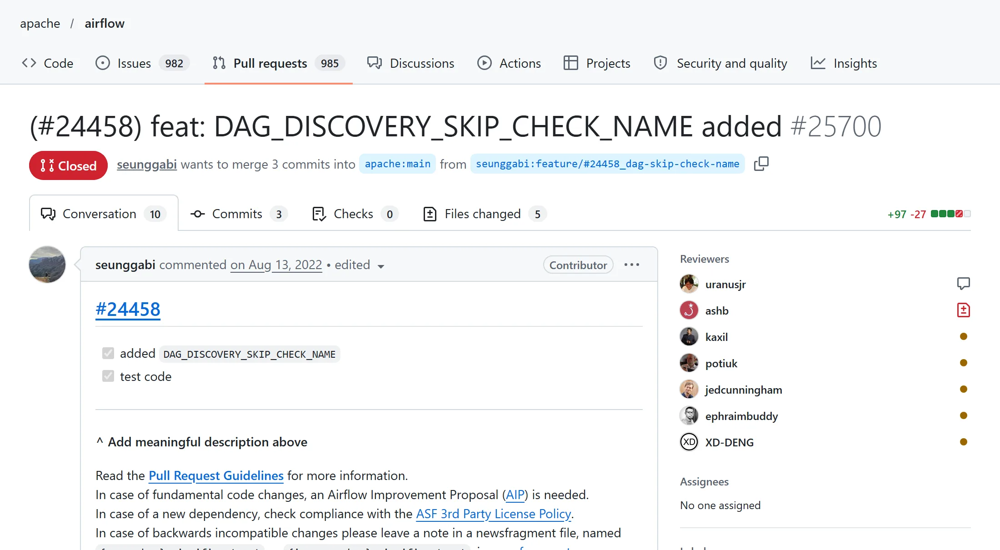

2022년 여름부터 2023년 여름까지 Apache Airflow에 PR을 다섯 개 보냈다. 머지된 건 하나다. [TableauOperator에 template_fields를 넣은 PR](/posts/airflow-tableau-template-fields/)이 그 하나고, 나머지 넷은 닫혔다.

| PR | 시기 | 하려던 것 | 결과 |
|---|---|---|---|
| [#25700](https://github.com/apache/airflow/pull/25700) | 2022-08 | DAG 탐색에 파일 이름 조건 추가 | 닫힘 |
| [#28020](https://github.com/apache/airflow/pull/28020) | 2022-11 | `default_args`로 `catchup` 설정 | 닫힘 |
| [#29360](https://github.com/apache/airflow/pull/29360) | 2023-02 | `TableauOperator` 템플릿 필드 | 머지 |
| [#31357](https://github.com/apache/airflow/pull/31357) | 2023-05 | PyCharm에서 pytest 실행 | 닫힘 |
| [#31358](https://github.com/apache/airflow/pull/31358) | 2023-05 | EMR 스텝 추가 시 클러스터 id와 이름 둘 다 받기 | 닫힘 (stale) |

닫힌 PR에는 리뷰어들이 왜 안 되는지 적어 둔 말이 남아 있다.

_Airflow에 처음 보낸 PR [#25700](https://github.com/apache/airflow/pull/25700)_

## 기능은 이미 있었다 (#25700)

Airflow 스케줄러는 `dags` 폴더의 파일을 전부 파싱하지 않는다. 기본값인 safe mode에서는 파일 내용에 `airflow`와 `dag`라는 문자열이 둘 다 있어야 DAG 파일로 본다.

문제는 공통 DAG 클래스를 따로 모듈로 빼서 쓸 때였다. 그 클래스를 상속한 DAG 파일에는 `airflow`라는 단어가 없을 수 있다. 그래서 `# airflow` 같은 주석을 억지로 넣어야 했다. 이게 싫어서 파일이나 폴더 이름에 `dag`가 있으면 통과시키는 `DAG_DISCOVERY_SKIP_CHECK_NAME` 설정을 만들었다.

새 설정을 만들기보다 기존 설정을 넓히는 게 낫다는 의견이 먼저 달렸다. 이어서 커미터 ashb가 PR을 닫았다. 이미 `DAG_DISCOVERY_SAFE_MODE`라는 설정이 있고, 이걸 끄면 내용 검사를 안 한다. 다만 설정 파일 주석 말고는 문서화가 안 돼 있으니 문서 PR을 대신 올려 달라고 했다. DAG가 아닌 파일은 애초에 `dags` 폴더에 두지 말라는 말도 덧붙였다.

결국 필요한 건 코드가 아니라 문서였다.

## 설명이 없으면 리뷰도 없다 (#28020)

여러 DAG에서 같은 설정을 쓰려고 `default_args`에 `catchup: False`를 넣었는데 먹지 않았다. 그래서 `default_args`로 DAG 인자도 받게 `DAG` 클래스를 고쳤다.

PR 제목은 "DAG.default_args.catchup is not working..."이었고, 설명은 몇 줄짜리 메모였다. 한 달쯤 지나 potiuk이 제목과 설명을 고쳐 달라고 했다. 지금 상태로는 뭘 리뷰해야 할지 모르겠다는 것이었다. uranusjr은 DAG 인자와 `default_args`는 다른 것이고, 이 변경은 불필요한 복잡도를 더한다고 했다. 내가 `params` 처리 코드를 들어 반론을 달았지만, potiuk은 의도를 문장으로 설명하기 전까지 닫아 두겠다며 PR을 닫았다.

`default_args`는 이름 그대로 태스크(오퍼레이터)에 넘기는 기본 인자다. `catchup`은 DAG 객체의 인자라서 `default_args`에 넣어도 DAG에는 전달되지 않는다. 공통 DAG 설정이 필요하면 DAG를 만드는 함수나 클래스를 따로 두는 게 맞다.

설계도 받아들여지지 않았지만, 그 전에 설명이 없어서 리뷰 자체가 시작되지 못했다. 닫힌 뒤에 긴 설명을 달았지만 다시 열리지는 않았다.

## dev extra를 안 깔았다 (#31357)

PyCharm에서 Airflow 테스트를 돌리려는데 `unrecognized arguments: --asyncio-mode=strict` 에러가 났다. pytest 설정에서 이 옵션을 빼고 필요한 라이브러리를 적은 `dev/requirements.txt`를 추가했다.

potiuk이 같은 날 닫았다. `CONTRIBUTING.rst`와 `LOCAL_VIRTUALENV.rst`를 읽고 `[dev]` extra를 설치하라는 답이었다. `--asyncio-mode`는 pytest-asyncio 플러그인의 옵션이라 플러그인이 없으면 pytest가 이 인자를 모른다. 개발 의존성을 제대로 깔았다면 생기지 않을 에러였다.

## 둘 다 받으면 하나는 무시된다 (#31358)

`EmrAddStepsOperator`는 스텝을 추가할 EMR 클러스터를 `job_flow_id`나 `job_flow_name` 중 하나로 받는다. 실행할 때 상황에 따라 둘 중 하나를 고르고 싶어서, 둘 다 받으면 id를 먼저 쓰고 없으면 이름을 쓰도록 바꿨다.

리뷰어 두 명이 같은 지점을 짚었다. 둘 다 넘기면 `job_flow_name`은 결국 무시되는데, 사용자 입장에서는 넣은 값이 안 쓰이는 게 헷갈린다는 것이다. 정말 필요하면 둘 다 들어왔을 때 경고 로그를 남기고 문서도 고치라고 했다. 테스트 이름이 맞지 않는다는 지적은 바로 고쳤다. 그 뒤로 더 진행하지 않았고, 7주쯤 지나 stale 봇이 PR을 닫았다.

인자 두 개 중 하나만 쓰이는 API라면, 조용히 우선순위를 정하기보다 둘 다 들어왔을 때 막거나 경고하는 쪽이 맞다.

## 머지된 하나

머지된 [#29360](https://github.com/apache/airflow/pull/29360)은 추가 6줄, 삭제 2줄짜리 변경이었다. 본문에는 바꾸기 전과 후의 DAG 코드를 나란히 적어 두었다. 리뷰 코멘트 없이 4시간 만에 머지됐다.

## English summary

I sent five pull requests to Apache Airflow between 2022 and 2023, and one was merged. One PR added a setting that already existed, so the committer asked for a docs PR instead. Another had no clear description, and reviewers said DAG arguments and `default_args` are different things. A third failed because I had not installed the dev extras, and the last one went stale after reviewers pointed out that one of two arguments would be silently ignored. The one that was merged was a small change with before and after code in the description.
