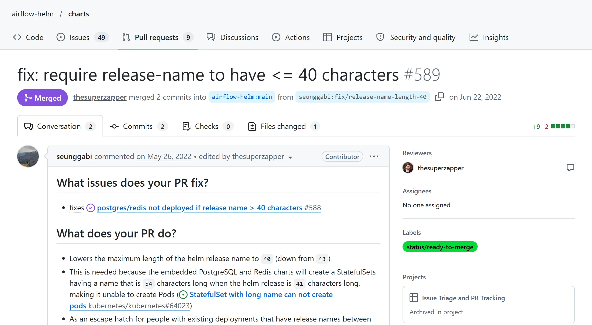

커뮤니티 Airflow Helm 차트(`airflow-helm/charts`)로 Airflow를 띄웠는데 Airflow가 DB에 붙지 못했다.

```text
sqlalchemy.exc.OperationalError: (psycopg2.OperationalError)
connection to server at "airflow-test-long-long-long-long-long-long-postgresql" ... port 5432 failed: Connection refused
```

release 이름은 42자였다. 이름만 40자로 줄였더니 PostgreSQL 파드가 정상으로 떴다. 이름 길이가 문제였다.

이슈는 [#588](https://github.com/airflow-helm/charts/issues/588)에 남겼다.


_[airflow-helm/charts#589](https://github.com/airflow-helm/charts/pull/589)_

## 63자 제한이 어디서 걸리나

Kubernetes에서 라벨 값과 일부 리소스 이름은 63자를 넘을 수 없다. 차트는 release 이름을 43자까지만 받았고, 검증 메시지에도 63자 제한 때문이라고 적혀 있었다.

그런데 StatefulSet에는 숨은 길이가 하나 더 있다. StatefulSet 컨트롤러는 파드에 `controller-revision-hash` 라벨을 붙이는데, 값이 `<StatefulSet 이름>-<해시>` 형태다. StatefulSet 이름이 길면 이 라벨 값이 63자를 넘고, 파드가 만들어지지 않는다([kubernetes/kubernetes#64023](https://github.com/kubernetes/kubernetes/issues/64023)). StatefulSet 자체는 생성되지만 파드는 생기지 않는다.

이 차트는 PostgreSQL과 Redis를 서브차트로 같이 띄운다. 둘 다 StatefulSet이다. Redis는 release 이름 뒤에 `-redis-master`(13자)를, PostgreSQL은 `-postgresql`(11자)을 붙인다.

| release 이름 길이 | 차트 검증 (수정 전) | Redis StatefulSet 이름 | PostgreSQL StatefulSet 이름 |
|---|---|---|---|
| 40자 | 통과 | 53자 | 51자 |
| 41자 | 통과 | 54자 | 52자 |
| 42자 | 통과 | 55자 | 53자 |
| 43자 | 통과 | 56자 | 54자 |
| 44자 이상 | 거부 | 해당 없음 | 해당 없음 |

PR 설명에는 release 이름이 41자면 54자짜리 StatefulSet이 생겨 파드를 만들 수 없다고 적혀 있다. 위 표에서 54자가 되는 건 Redis다. 내가 겪은 42자 이름에서는 PostgreSQL 파드도 뜨지 않았고, 40자로 줄이자 떴다. 해시 접미사(10자 안팎)까지 합쳐 63자 안에 들어가려면 StatefulSet 이름은 52자 정도가 한계다. 그래서 Redis는 release 이름 41자(54자)부터, PostgreSQL은 42자(53자)부터 걸린다. 41자부터 43자 사이가 구멍이었다. 차트 검증은 통과하는데 파드는 안 뜬다.

## 40자로 낮추고 탈출구를 뒀다

PR([#589](https://github.com/airflow-helm/charts/pull/589))의 첫 커밋은 차트의 값 검증 템플릿(`validate-values.tpl`)에서 release 이름 상한을 43자에서 40자로 낮추는 것이었다.

메인테이너 thesuperzapper가 커밋을 하나 더 얹었다. 이미 41~43자 이름으로 배포해서 쓰고 있는 사람들을 위한 탈출구다. 숨은 값 `allowLongReleaseName`을 켜면 예전 상한 43자로 돌아간다. PR 설명도 메인테이너가 이 내용으로 다시 정리했다.


```yaml
{{/* NOTE: `allowLongReleaseName` was added when the max length dropped from 43 to 40, and is NOT intended for new deployments */}}
{{- if .Values.allowLongReleaseName }}
  {{- if gt (len .Release.Name) 43 }}
  {{ required "The `.Release.name` must be <= 43 characters (due to the 63 character limit for names in Kubernetes)!" nil }}
  {{- end }}
{{- else }}
  {{- if gt (len .Release.Name) 40 }}
  {{ required "The `.Release.name` must be <= 40 characters (due to the 63 character limit for names in Kubernetes)!" nil }}
  {{- end }}
{{- end }}
```


`required`에 `nil`을 넘기는 건 Helm 템플릿에서 원하는 메시지로 렌더링을 실패시킬 때 자주 쓰는 방법이다. 설치 단계에서 바로 막히니 파드가 안 뜨는 걸 나중에 발견하는 것보다 훨씬 낫다.

StatefulSet이 있는 차트라면 이름 길이는 63자가 아니라 해시 몫을 뺀 길이로 계산해야 한다. 이 차트의 43자 상한은 그 몫을 놓치고 있었다.

이슈를 올리고 한 달쯤 지나 머지됐고, 같은 날 차트 8.6.1로 릴리스됐다. 릴리스 노트에는 이 PR이 내 첫 기여로 적혀 있다.

## English summary

When the Helm release name for the community Airflow chart was longer than 40 characters, the Redis pod could not start, and from 42 characters the PostgreSQL pod could not start either. Long StatefulSet names push the `controller-revision-hash` label on the pods over the 63 character limit in Kubernetes. The chart allowed names up to 43 characters, so names from 41 to 43 passed validation but broke the pods. My PR lowered the limit to 40, and the maintainer added a hidden `allowLongReleaseName` value for existing deployments. The fix shipped in chart version 8.6.1 in June 2022.
