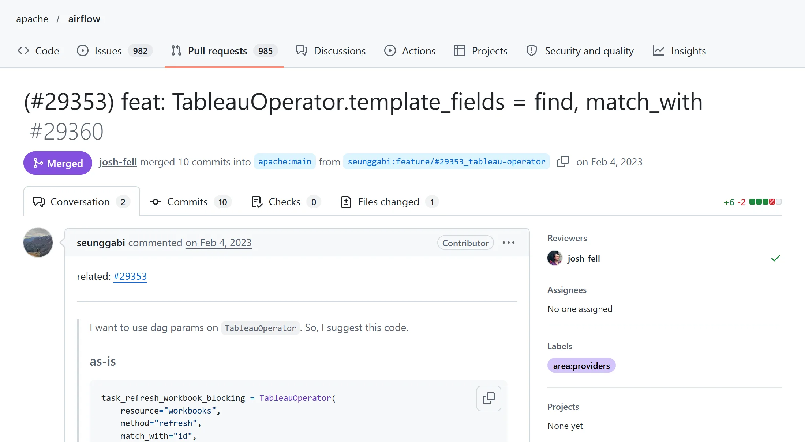

Tableau 워크북 새로고침을 Airflow에서 돌리면서, 대상 워크북을 DAG params로 넘기고 싶었다. 그래야 실행할 때마다 다른 워크북을 지정할 수 있다.


```python
TableauOperator(
    resource="workbooks",
    method="refresh",
    match_with="{{ params.match_with }}",
    find="{{ params.find }}",
    blocking_refresh=True,
    task_id="refresh_tableau_workbook_blocking",
)
```


이렇게 쓰면 Tableau에는 `{{ params.find }}`라는 문자열이 그대로 넘어갔다. 템플릿이 렌더링되지 않았다.


_[apache/airflow#29360](https://github.com/apache/airflow/pull/29360)_

## 왜 문자열이 그대로 넘어갔나

Airflow는 오퍼레이터 인자 중 `template_fields`에 이름이 올라간 속성만 Jinja로 렌더링한다. 나머지 인자는 `{{ }}`가 들어 있어도 그냥 문자열이다.

렌더링 시점은 DAG 파일을 파싱할 때가 아니다. 태스크 인스턴스가 실행될 때 `execute()`가 불리기 직전에 렌더링한다. 그래서 `params`나 `dag_run.conf`처럼 실행할 때 정해지는 값을 넣을 수 있다.

당시 `TableauOperator`에는 `template_fields`가 없었다. 그러니 `find`와 `match_with`에 무엇을 넣든 그대로 Tableau API로 갔다.

`find`는 찾을 값이고, `match_with`는 그 값을 어떤 필드(`id`, `name` 등)에서 찾을지 정한다. 둘 다 실행할 때 바꾸고 싶은 값이었다.

## 바꾼 코드

파일 하나, 추가 6줄과 삭제 2줄이다. 핵심은 이 부분이다.

```python
template_fields: Sequence[str] = (
    "find",
    "match_with",
)
```

`template_fields`에 적는 이름은 `__init__`에서 `self.find = find`처럼 저장한 속성 이름과 같아야 한다. 이름이 다르면 렌더링할 때 그 속성을 찾지 못해 `AttributeError`가 난다. 이 오퍼레이터는 인자 이름과 속성 이름이 같아서 문제가 없었다.

## 머지와 그 뒤

이 PR은 Apache Airflow에 처음 머지된 내 PR이다. 커미터 josh-fell이 4시간쯤 뒤에 승인하고 바로 머지했다. 리뷰 코멘트는 없었다. 첫 머지 축하 댓글이 봇과 josh-fell에게서 하나씩 달렸다. 이 변경은 `apache-airflow-providers-tableau` 4.1.0 변경 기록에 들어갔다.

커밋은 10개였는데 기능 커밋은 하나뿐이다. 8개는 main을 받아오는 머지 커밋이었고, 하나는 pre-commit 수정이었다. Airflow는 PR을 squash로 머지해서 본 저장소에는 커밋 하나만 남는다. 결과는 같지만 PR 화면의 커밋 목록은 지저분했다.

현재 Airflow main의 `TableauOperator`에는 필드가 하나 더 있다.

```python
template_fields: Sequence[str] = (
    "find",
    "match_with",
    "tableau_conn_id",
)
```

`tableau_conn_id`는 2026년 9월에 들어갔다. provider 오퍼레이터들의 connection id를 한꺼번에 템플릿 필드로 만든 PR([#73286](https://github.com/apache/airflow/pull/73286))에서 같이 추가됐다.

오퍼레이터 인자에 템플릿을 넣었는데 렌더링이 안 되면 `TableauOperator.template_fields`처럼 그 클래스의 `template_fields`를 출력해 보면 바로 안다. 빠져 있으면 상속해서 `template_fields`를 늘려 쓰면 된다.

## English summary

I wanted to pass the Tableau workbook name to `TableauOperator` through DAG params, but the Jinja template was not rendered. Airflow only renders attributes listed in an operator's `template_fields`, and `TableauOperator` had none. My PR added `find` and `match_with` to `template_fields`. It was my first merged pull request in Apache Airflow and shipped in the Tableau provider 4.1.0. In September 2026, `tableau_conn_id` was also added to the list.
