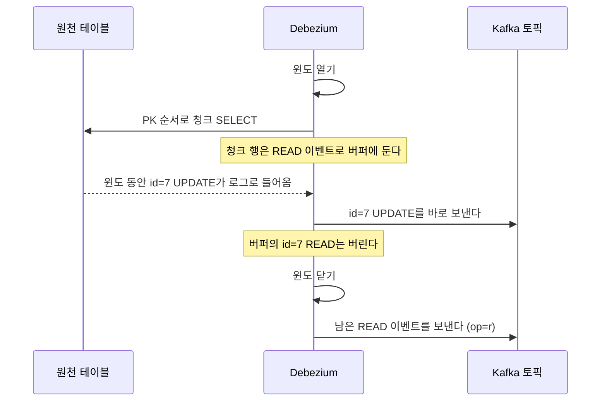

`WHERE updated_at > :last_run`으로 한 시간마다 원천 테이블을 읽어 오는 배치가 있다. 원천에서 지운 주문이 레이크 테이블에는 계속 남아 있고, 한 시간 안에 두 번 바뀐 주문은 마지막 값만 있다. 쿼리로는 지금 상태만 보이기 때문이다. 이 글에서는 MySQL binlog를 Debezium으로 읽어 Kafka를 거쳐 Iceberg 테이블에 넣는 파이프라인을 예로 든다.

버전은 Debezium 3.7, MySQL 8.4, PostgreSQL 19, Kafka 4.4, Iceberg 1.12 기준이다.

## 쿼리 기반 CDC는 폴링 사이의 일을 모른다

쿼리 기반 CDC는 마지막으로 읽은 시각이나 ID를 기억해 두고 그 뒤의 행만 다시 읽는다. 테이블에 `updated_at` 같은 컬럼이 있어야 하고, 폴링 간격이 짧을수록 원천 DB에 쿼리 부하가 붙는다.

| 놓치는 것 | 이유 |
|---|---|
| 하드 삭제 | 지운 행은 쿼리 결과에 나오지 않는다 |
| 폴링 사이의 중간 상태 | 두 번 바뀐 행은 마지막 값만, 넣었다 지운 행은 아예 안 보인다 |
| 커밋이 늦은 행 | `updated_at`은 문장이 실행된 시각이고, 다른 세션에 보이는 시점은 커밋 뒤다. 그 사이 폴링이 그 시각을 지나가면 다음 폴링 조건에도 안 걸린다 |
| 시계가 다른 쓰기 | 애플리케이션 서버가 시각을 채우면 서버 간 시계 차이만큼 경계 근처 행이 빠질 수 있다 |
| 바뀌기 전 값 | 지금 행 하나만 읽으니 무엇에서 무엇으로 바뀌었는지 모른다 |

경계 문제는 조건을 `updated_at > :last_run - 겹침 구간`으로 넓히고 중복을 키로 지워서 줄인다. 삭제와 중간 상태는 이 방식으로 되살릴 수 없다. 원천에 soft delete 컬럼을 두는 수밖에 없다.

## 로그 기반 CDC는 DB가 복제용으로 남기는 로그를 읽는다

MySQL은 binlog를, PostgreSQL은 WAL을 logical decoding으로 읽는다. 커밋된 변경이 커밋 순서대로 나오고, 삭제도 하나의 이벤트다.

| | MySQL binlog | PostgreSQL logical decoding |
|---|---|---|
| 원천 설정 | `binlog_format=ROW`, `binlog_row_image=FULL` | `wal_level=logical`, 출력 플러그인 `pgoutput` |
| 바뀌기 전 값 | `FULL`이면 모든 컬럼 | 기본 `REPLICA IDENTITY`면 PK 컬럼만, `FULL`이면 모든 컬럼 |
| DDL | row 형식이어도 `CREATE TABLE`, `ALTER TABLE`은 문장으로 남는다 | logical decoding이 DDL을 내보내지 않는다 |
| 커넥터가 멈추면 | `binlog_expire_logs_seconds`(기본 30일)가 지나면 로그가 지워진다 | replication slot이 필요한 WAL을 지우지 못하게 잡고 있어 디스크가 찬다 |

멈췄을 때의 모양이 서로 반대다. MySQL은 원천이 자기 로그를 지우고, 커넥터는 다시 붙을 때 읽던 파일을 못 찾는다. source가 멈춘 사이 binlog가 purge되면 다시 붙을 때 MySQL 에러 1236이 나고, `snapshot.mode=when_needed`라면 스냅샷부터 다시 받는다. PostgreSQL은 slot이 WAL을 계속 붙잡아서 원천 DB의 디스크가 위험해진다. 변경이 드문 DB에서는 `heartbeat.interval.ms`로 slot 위치를 앞으로 밀어 준다.

`REPLICA IDENTITY DEFAULT`에서는 바뀌지 않은 TOAST 컬럼도 UPDATE 이벤트에 오지 않는다. Debezium은 그 자리에 `unavailable.value.placeholder` 값을 넣으므로, 이 값을 그대로 덮어쓰는 sink는 컬럼을 망친다.

## 스냅샷에서 스트림으로 넘어가는 자리

로그는 보존 기간만큼만 남는다. 테이블 전체를 가지려면 한 번은 테이블을 읽어야 하고, 그 읽기와 로그 스트림이 겹치는 지점에서 같은 행의 옛 값이 새 값을 덮지 않아야 한다.

`snapshot.mode=initial`은 커넥터가 처음 뜰 때 대상 테이블을 모두 읽은 뒤 기록해 둔 로그 위치부터 스트리밍한다. 큰 테이블이면 그동안 스트리밍이 시작되지 않는다. incremental snapshot은 스트리밍을 멈추지 않고 테이블을 PK 순서의 청크(기본 1024행)로 읽는다. 청크마다 윈도를 열고, 그 사이 들어온 스트림 이벤트와 PK가 겹치는 청크 행은 버린다.



스트림 이벤트가 청크를 읽은 시점보다 새 값이니 버퍼 쪽을 버린다. 윈도 밖에서 바뀐 키는 청크 행이 먼저 나가거나 청크 SELECT가 이미 그 변경을 보고 읽는다. 그래서 키 하나만 놓고 보면 이벤트 순서가 원천의 변경 순서와 어긋나지 않는다(알고리즘에서 따라 나오는 추론이다). MySQL에서 GTID를 켜면 signal 테이블에 쓰지 않고 실행된 GTID 집합을 워터마크로 쓰는 read-only 방식도 있다.

예를 들어 source를 `snapshot.mode=no_data`로 두면 현재 binlog 위치부터 스트리밍하고, 기존 행은 signal 테이블로 incremental snapshot을 걸어 받을 수 있다.

## 키가 같은 파티션에 모여야 순서가 남는다

Debezium 이벤트의 Kafka 키는 그 행의 PK다. PK가 없으면 유니크 키를 쓰고, `message.key.columns`로 바꿀 수 있다. 키가 PK이니 같은 행의 변경은 같은 파티션에 순서대로 쌓인다. Kafka가 보장하는 순서는 파티션 안의 순서뿐이다. 행 하나의 상태를 맞추는 데는 키별 순서면 되지만, 여러 테이블에 걸친 트랜잭션의 순서는 이것만으로 지켜지지 않는다.

[Kafka 파티션 글](/posts/kafka-partitions-and-lag/)에 적었듯 파티션 수를 늘리면 해시 나머지가 바뀌어 같은 키의 새 이벤트가 다른 파티션으로 갈 수 있다. 그러면 offset으로 키의 최신 이벤트를 고르는 로직이 깨진다. offset은 파티션 안에서만 비교할 수 있기 때문이다.

## 삭제는 이벤트 두 개로 온다

행을 지우면 Debezium은 `op=d`인 삭제 이벤트를 보내고, 이어서 같은 키에 값이 `null`인 tombstone을 보낸다(`tombstones.on.delete` 기본값 `true`). 삭제 이벤트에는 `before`에 지운 행이 있고, tombstone은 Kafka 로그 컴팩션을 위한 것이다.

컴팩션된 토픽은 키마다 적어도 마지막 값 하나를 남기고, 값이 `null`인 레코드는 그 키의 삭제 표시로 본다. 이 표시도 `delete.retention.ms`(기본 1일)가 지나면 지워진다. 컨슈머가 토픽을 처음부터 읽기 시작해 이 시간 안에 끝까지 따라잡으면 최종 상태와 삭제를 모두 본다. 더 오래 걸리면 삭제된 키는 아무 흔적 없이 사라져 있다. 이미 그 행을 들고 있는 sink라면 지우라는 신호를 받지 못한다.

레이크 테이블에 반영할 때 필요한 것은 tombstone보다 `op=d` 이벤트다. tombstone에는 키만 있고, 삭제 이벤트에는 원천 위치와 시각이 있다.

## 스키마 이력은 커넥터가 과거 이벤트를 해석하는 데 쓴다

MySQL 커넥터는 binlog row 이벤트를 해석할 때 자기가 들고 있는 테이블 구조를 쓴다. 그 구조를 만들려고 binlog에 문장으로 남은 DDL을 스키마 이력 토픽(`schema.history.internal.kafka.topic`)에 쌓아 두고, 재시작하면 이를 다시 읽어 그 위치의 구조를 맞춘다. 이 토픽은 파티션을 나누면 안 된다. 파티션이 여럿이면 DDL을 쌓은 순서대로 다시 읽는다는 보장이 없다. 커넥터가 `schema isn't known to this connector` 에러를 낸다면 이 이력에 그 테이블 구조가 없는지부터 의심해 볼 만하다(추론이다).

원천의 DDL은 Kafka 쪽 스키마로도 이어진다. 바뀐 컬럼 타입을 Schema Registry가 거절해 source 태스크가 멈춘 경우는 [Kafka Connect 글](/posts/kafka-connect-workers-tasks/)에서 컨버터 단계로 설명했다.

## 레이크하우스에 적용할 때 중복은 전제다

Debezium은 at-least-once다. 커넥터가 비정상 종료되면 마지막으로 기록한 offset부터 다시 읽어, 직전에 보낸 이벤트를 또 보낸다. PostgreSQL의 slot도 크래시 뒤에는 이전 LSN으로 돌아가 최근 변경을 다시 보낼 수 있다. 스냅샷을 다시 돌려도 같은 키가 또 온다. 적용하는 쪽은 같은 이벤트를 두 번 받아도 결과가 같아야 한다.

Iceberg에 Spark SQL `MERGE INTO`로 적용한다면 모양은 이렇다. 한 배치 안에서 키마다 offset이 가장 큰 이벤트 하나만 남기고, 테이블에 있는 offset보다 새 이벤트만 반영한다.

```sql
-- 구조만 보여 주는 스케치
MERGE INTO lake.shop.orders t
USING (
  SELECT id, status, amount, op, src_offset
  FROM (
    SELECT *, row_number() OVER (PARTITION BY id ORDER BY src_offset DESC) AS rn
    FROM staged_changes
  ) x
  WHERE rn = 1
) s
ON t.id = s.id
WHEN MATCHED AND s.op = 'd' AND s.src_offset > t.src_offset THEN DELETE
WHEN MATCHED AND s.src_offset > t.src_offset THEN
  UPDATE SET t.status = s.status, t.amount = s.amount, t.src_offset = s.src_offset
WHEN NOT MATCHED AND s.op <> 'd' THEN
  INSERT (id, status, amount, src_offset) VALUES (s.id, s.status, s.amount, s.src_offset)
```

`USING` 안의 중복 제거는 빼면 안 된다. Iceberg의 MERGE는 원천 행 여러 개가 대상 행 하나를 갱신하려 하면 에러를 낸다. `MATCHED` 절은 위에서부터 처음 맞는 것 하나만 적용된다.

이 모양에도 한계가 있다. 행을 실제로 지우면 그 키의 마지막 offset도 같이 사라진다. 그 뒤에 지우기 전의 insert 이벤트가 다시 들어오면 `NOT MATCHED`로 행이 되살아난다. 막으려면 삭제를 행으로 남기는 soft delete로 offset을 보존해야 하고, 그만큼 읽는 쪽이 삭제 표시를 걸러야 한다.

예를 들어 MySQL CDC를 Iceberg에 upsert로 적재하는 파이프라인이라면 MERGE 대신 upsert 모드의 Iceberg sink가 equality delete를 쌓으며 반영한다([Iceberg 행 단위 변경 글](/posts/iceberg-row-level-deletes/)). 그래도 스냅샷을 다시 돌리면 같은 PK가 다른 offset으로 들어와 여러 행이 남을 수 있다. 그러면 주기적인 Spark 잡이 키마다 offset이 가장 큰 행 하나를 남기고, 읽은 스냅샷 ID로 충돌 검사를 걸어 테이블 전체를 덮어쓰는 식으로 정리한다. 적용 시점에는 sink에 맡기고 정합성은 뒤에서 일괄로 맞추는 구성이다. Debezium 키가 PK이고 파티션 수가 그대로라면 키마다 offset 최댓값이 곧 최신 변경이다(앞의 동작에서 나온 추론이다).

## 참고 자료

- [Debezium 3.7 MySQL connector (binlog 설정, 이벤트 키, tombstone, 스키마 이력 토픽, incremental snapshot)](https://debezium.io/documentation/reference/stable/connectors/mysql.html)
- [Debezium 3.7 PostgreSQL connector (wal_level, pgoutput, REPLICA IDENTITY, WAL 디스크 사용, TOAST)](https://debezium.io/documentation/reference/stable/connectors/postgresql.html)
- [MySQL 8.4 Binary Logging Options and Variables](https://dev.mysql.com/doc/refman/8.4/en/replication-options-binary-log.html)
- [PostgreSQL: Logical Decoding Concepts](https://www.postgresql.org/docs/current/logicaldecoding-explanation.html)
- [Apache Kafka 4.4 Design: Log Compaction](https://kafka.apache.org/44/design/design/)
- [Apache Kafka 4.4 Topic Configs (delete.retention.ms)](https://kafka.apache.org/44/configuration/topic-configs/)
- [Apache Iceberg Spark Writes (MERGE INTO)](https://iceberg.apache.org/docs/latest/spark-writes/)

## English summary

Query-based CDC polls a timestamp or ID column, so it cannot see hard deletes, changes between polls, or rows that commit after the poll has moved past their timestamp. Log-based CDC reads the MySQL binlog or the PostgreSQL WAL through logical decoding and gets every committed change, but MySQL can purge the log while the connector is down and PostgreSQL keeps WAL until the slot moves. Debezium's incremental snapshot reads a table in chunks while streaming and drops chunk rows that collide with streamed events, so per-key order holds, and the primary key as the Kafka key keeps each row's changes in one partition. In a MySQL to Iceberg pipeline, for example, the source can stream from the current binlog position, backfill tables with snapshot signals, and write through an upsert sink, while a separate Spark job keeps the latest offset per key. That design accepts duplicates at write time and fixes them in a batch, which keeps the sink simple at the cost of a periodic full rewrite.
