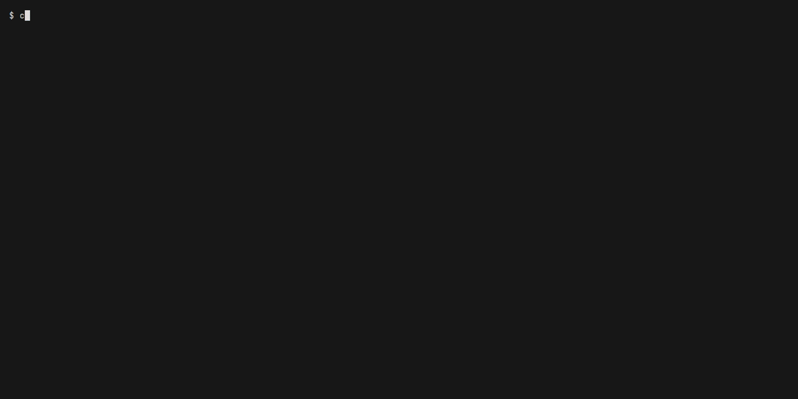
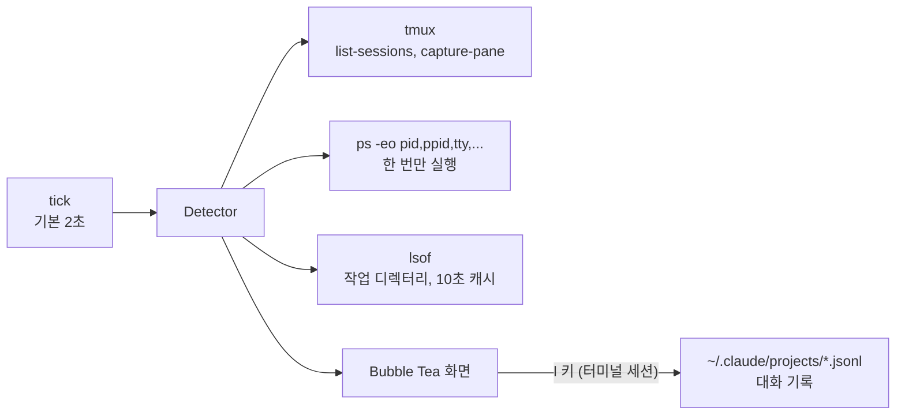

_데모 녹화에서는 `claude` 대신 스텁 프로그램이 돈다_

Claude Code를 tmux 세션 여러 개에 띄워 두면 어느 세션이 일하는 중이고 어느 세션이 내 대답을 기다리는지 한눈에 안 보인다. 세션마다 들어가서 확인해야 한다.

[claude-dashboard](https://github.com/seunggabi/claude-dashboard)는 이걸 k9s처럼 표 하나로 보여 주는 터미널 UI다. Go로 썼고, 2월에 처음 올린 뒤 지금 v0.15.0이다.

## tick마다 세션 목록을 새로 만든다

화면은 [Bubble Tea](https://github.com/charmbracelet/bubbletea)로 그린다. 정해진 주기(기본 2초)마다 tick 메시지가 오면 세션 목록을 처음부터 다시 만든다. 목록은 tmux, `ps`, `lsof` 출력으로 만든다.

| 패키지 | 하는 일 |
|---|---|
| `internal/tmux` | tmux 명령 실행과 출력 파싱 |
| `internal/monitor` | `ps` 결과로 프로세스 표 만들기, CPU·메모리 합산 |
| `internal/session` | 세션 찾기, 상태 판정, 만들기와 종료 |
| `internal/conversation` | Claude Code 대화 기록(JSONL) 읽기 |
| `internal/ui`, `internal/app` | 화면과 키 입력 |
| `internal/setup` | 첫 실행 때 tmux 설정과 보조 스크립트 설치 |

## 어떤 tmux 세션이 Claude 세션인가

tmux에는 Claude와 상관없는 세션도 있다. 아래 중 하나에 걸리면 Claude 세션으로 본다.

1. 이름이 `cd-`로 시작한다. claude-dashboard로 만든 세션이 이렇다.
2. 이름에 `claude`가 들어 있다.
3. pane에서 `claude`가 돌고 있다. 먼저 `pane_current_command`를 보고, 아니면 그 pane의 PID 아래 프로세스 트리를 따라 내려가며 찾는다.

tmux 밖에서 그냥 터미널로 띄운 Claude도 잡는다. 프로세스 표에서 실행 파일 이름이 `claude`인 것을 찾고, TTY가 없는 백그라운드 프로세스와 이미 잡은 tmux pane 아래에 있는 프로세스는 뺀다. 이런 세션은 `terminal/<tty>`라는 이름으로 표에 들어간다.

## 상태는 화면 내용으로 추정한다

상태는 tmux가 주는 마지막 활동 시각과 pane 화면 내용만 보고 정한다.

| 상태 | 판단 기준 |
|---|---|
| active | 마지막 출력이 2초 이내 |
| waiting | 화면 마지막 20줄 중에 `?`로 끝나는 줄이나 `Y/n`, `y/N`, `(y/n)`이 있음 |
| idle | 그 밖의 경우 |

문자열 규칙이라 놓치는 경우가 있다. 데모의 `waiting` 세션은 스텁이 `Do you want to proceed? (y/n)`을 찍어서 이 규칙에 걸렸다.

## ps는 한 번만 부른다

세션마다 CPU와 메모리를 보여 주려면 프로세스 정보가 필요하다. 세션마다 `ps`를 부르면 세션 수만큼 프로세스가 뜬다. 그래서 갱신할 때마다 `ps -eo pid,ppid,tty,%cpu,%mem,args`를 한 번만 실행해 PID를 키로 하는 표를 만들고, 모든 단계가 이 표를 같이 쓴다.

CPU와 메모리는 세션의 PID에서 시작해 자식 프로세스를 BFS로 돌며 더한다. 그래야 Claude Code가 띄운 하위 프로세스 사용량도 잡힌다.

작업 디렉터리는 `ps`로 안 나와서 `lsof -a -p <pid> -d cwd`로 구하고, 결과는 PID별로 10초 동안 캐시한다.

## 터미널 세션은 대화 기록을 읽는다

Claude Code는 대화를 `~/.claude/projects/` 아래 JSONL 파일로 남긴다. 작업 경로에서 영문자와 숫자 말고는 전부 `-`로 바꾼 것이 디렉터리 이름이다. `/Users/foo/my.app`이면 `-Users-foo-my-app`이 된다.

tmux 밖의 터미널 세션에서 `l`을 누르면 작업 경로를 이 규칙으로 바꿔 가장 최근에 수정된 `.jsonl` 파일을 찾고, 대화 내용을 보여 준다. tmux 세션에서 `l`을 누르면 pane 화면을 캡처해서 보여 준다. 터미널 세션은 tmux처럼 화면을 가져올 방법이 없어서 대화 기록을 읽는다.

설치는 Homebrew(`brew install seunggabi/tap/claude-dashboard`), 설치 스크립트, `go install` 중 하나로 하면 된다. 처음 실행하면 보조 스크립트를 `~/.local/bin`에 깔고 `~/.tmux.conf`에 설정 블록을 덧붙인다. F12 마우스 토글, `Ctrl+S` pane 기록 저장, 상태 표시줄 버전 표시가 들어간다.

## English summary

claude-dashboard is a terminal UI, written in Go with Bubble Tea, that lists Claude Code sessions running in tmux and in plain terminals. Every refresh it runs `ps` once, builds a process table, and uses tmux output and pane content to decide whether each session is active, waiting for input, or idle. It finds Claude sessions by name or by walking the process tree under each tmux pane. For sessions outside tmux, it reads Claude Code's JSONL conversation logs instead of a pane capture.
