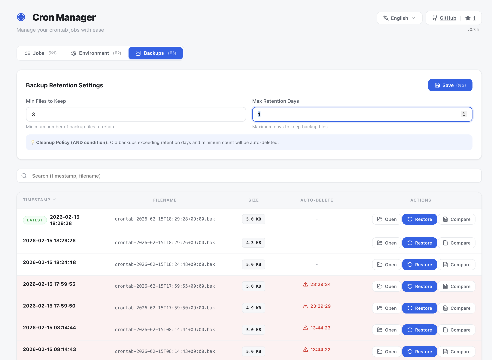
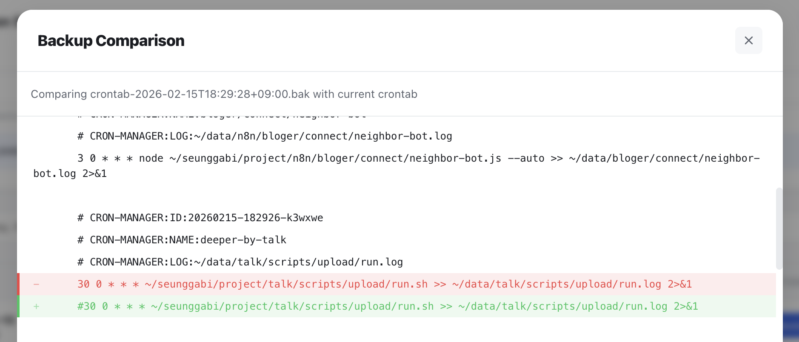

crontab은 사용자마다 파일 한 장이다. 고치는 방법은 `crontab -e`로 편집기를 열거나 `crontab <파일>`로 새 내용을 통째로 설치하는 것뿐이고, 이전 내용은 어디에도 남지 않는다. 작업 이름, 설명, 로그 경로를 적어 둘 자리도 따로 없다.

[cron-manager](https://github.com/seunggabi/cron-manager)는 이 파일을 GUI로 다루는 Electron 데스크톱 앱이다. macOS와 Linux에서는 `crontab`을 바로 부르고, Windows에서는 WSL 안의 `crontab`을 부른다. 2026-02-14에 첫 커밋을 했고, 2026-03-30 커밋까지 릴리스가 58개 나왔다.

앱이 crontab을 고치는 방식도 "읽고, 전부 다시 써서, 통째로 설치"다. 이 글은 그 한 번의 교체를 어떻게 감쌌는지 적는다.

## 메타데이터는 crontab 안에 주석으로

앱은 작업 정보를 별도 DB에 두지 않는다. crontab 안에 `# CRON-MANAGER:` 접두어가 붙은 주석으로 적는다. 작업 하나를 저장하면 이런 모양이 된다.

```text
# CRON-MANAGER:ID:complex-job
# CRON-MANAGER:NAME:Complex Job
# CRON-MANAGER:DESC:A complex test job
# CRON-MANAGER:ENV:{"NODE_ENV":"test"}
# CRON-MANAGER:TAGS:test,automated
# CRON-MANAGER:LOG:/var/log/app.log
# CRON-MANAGER:LOGERR:/var/log/app.err
# CRON-MANAGER:WORKDIR:/app
*/15 * * * * NODE_ENV='test' cd '/app' && node script.js >> '/var/log/app.log' 2>> '/var/log/app.err'
```

끄기는 줄 앞에 `#`을 붙이는 것으로 처리한다. 파일 맨 위의 `KEY=VALUE` 줄은 전역 환경 변수로 읽는다.

이렇게 하면 앱이 읽는 원본은 언제나 `crontab -l` 출력 하나다. 동기화 버튼도 `crontab -l`을 다시 읽어 파싱할 뿐이다. 마커가 없는 줄을 만나면 새 ID를 만들고 이름은 명령에서 뽑는다. 손으로 넣은 작업도 목록에는 나온다.

## 한 번 쓸 때 일어나는 일

작업을 추가하든 순서를 바꾸든, 모든 변경은 같은 경로를 탄다. 전체 작업 목록을 읽고, 바꾸고, 파일 전체를 다시 직렬화해서 설치한다. 실제 설치는 `doWriteCrontab`이 한다.

```ts
const currentContent = await this.readCrontab();
const hasChanged = currentContent.trim() !== content.trim();
if (hasChanged) {
  await this.backupCrontab();
}

const tmpDir = await fs.mkdtemp(path.join(os.tmpdir(), 'crontab-'));
const tempFile = path.join(tmpDir, 'crontab.tmp');
try {
  await fs.writeFile(tempFile, content, { mode: 0o600 });
  await execAsync(this.cronCmd(crontabArg));
} finally {
  await fs.remove(tmpDir);
}
```

1. 설치 직전에 현재 crontab을 한 번 더 읽는다.
2. 새 내용과 다르면 현재 내용을 백업 파일로 남긴다.
3. `mkdtemp`로 만든 새 임시 디렉터리에 권한 `0600` 파일을 쓰고 `crontab <파일>`로 설치한다.
4. 성공하든 실패하든 임시 디렉터리를 지운다.

임시 파일 부분은 [PR #10](https://github.com/seunggabi/cron-manager/pull/10)에서 들어왔다. PR 본문은 이 변경을 TOCTOU 경쟁 조건 수정으로 적었다. 예측할 수 있는 고정 경로 대신 매번 새 디렉터리를 만들고, 다른 사용자가 읽을 수 없는 권한으로 쓴다.

1번 단계에는 부수 효과가 하나 있다. 앱이 목록을 읽은 뒤 누군가 `crontab -e`로 파일을 고쳤다면, 앱의 쓰기가 그 변경을 덮어쓴다. 다만 덮어쓰기 직전에 읽은 내용이 새 내용과 다르니, 손으로 고친 내용은 백업 파일에 남는다. 충돌을 막지는 못하지만 되돌릴 수는 있다.

쓰기에는 1초 스로틀도 있다. 직전 쓰기에서 1초가 안 지났으면 내용을 들고 있다가 남은 시간 뒤에 쓴다. 앱이 끝날 때는 `will-quit`에서 `flush()`로 들고 있던 내용을 먼저 쓴다.

## 1초마다 쌓이던 백업

처음에는 쓰기가 일어날 때마다 무조건 백업을 만들었다. [이슈 #25](https://github.com/seunggabi/cron-manager/issues/25)가 그 결과를 적고 있다. 앱을 켤 때 도는 자동 동기화와 권한 확인이 내용이 같은 쓰기를 했고, 그때마다 백업 파일이 생겨 1초마다 쌓였다.

[PR #26](https://github.com/seunggabi/cron-manager/pull/26)은 위 코드의 `hasChanged` 비교를 넣었다. 앞뒤 공백을 뗀 현재 내용과 새 내용이 같으면 백업을 건너뛴다. 변경은 9줄 추가, 3줄 삭제였고 v0.7.13으로 나갔다.


_README의 v0.7.5 화면. #26보다 앞선 버전이라 몇 초 간격으로 찍힌 백업이 보인다._

## 백업을 얼마나 남길지

백업은 `~/.cron-manager/backups/`에 `crontab-<타임스탬프>.bak`로 쌓인다. 파일 이름에는 사용자 시간대 오프셋이 들어간다. 지금 코드는 `2024-05-20T19_25_05+09_00`처럼 시각의 구분자로 밑줄을 쓴다. 처음에는 KST로 고정돼 있었고, [PR #28](https://github.com/seunggabi/cron-manager/pull/28)에서 사용자 시간대로 바뀌었다.

정리 규칙은 두 조건을 모두 만족할 때만 지운다.

| 설정 | 기본값 | 의미 |
|---|---|---|
| `maxBackups` | 10 | 최신 N개는 날짜와 상관없이 남긴다 |
| `maxBackupDays` | 7 | N개를 넘는 것 중 이 날짜보다 오래된 것만 지운다 |

오래 손대지 않은 crontab이어도 최근 백업 N개는 항상 남는다. #28은 일수 최솟값을 1에서 0으로 낮췄다. 0으로 두면 사실상 "최근 N개만 남기기"가 된다. 위 화면은 최소 3개, 1일로 설정한 상태라 네 번째 줄부터 삭제 예정 시각이 붙어 있다.

## 복원과 비교

복원은 백업 파일을 다시 `crontab <파일>`로 설치한다. 설치 전에 현재 내용을 한 번 더 백업하니, 복원도 되돌릴 수 있다. IPC 핸들러는 넘어온 경로를 `path.resolve`로 풀어서 백업 디렉터리 아래인지 먼저 확인한다.


_README의 비교 화면. 작업 하나를 끈 차이가 `#` 한 글자로 보인다._

비교는 같은 줄 번호끼리 맞대 보는 방식이다. 한 줄을 끈 위 화면 같은 경우에는 잘 보인다. 대신 중간에 줄이 하나 끼면 그 아래 줄이 전부 바뀐 것으로 나온다. LCS 같은 diff 알고리즘은 쓰지 않았다.

## 즉시 실행의 잠금

"지금 실행" 버튼은 cron을 거치지 않고 앱이 명령을 직접 돌린다. 여기에는 중복 실행 문제가 따라왔고, 세 번에 걸쳐 고쳤다.

| PR | 변경 |
|---|---|
| [#88](https://github.com/seunggabi/cron-manager/pull/88) | 메모리의 `activeJobs` Set과 `~/.cron-manager/locks/<id>.lock` 파일 잠금을 같이 둔다. 잠금은 5분이 지나면 낡은 것으로 보고 지운다 |
| [#94](https://github.com/seunggabi/cron-manager/pull/94) | 실행 중에 앱이 강제로 꺼지면 잠금 파일이 남는다. 앱 시작 시 잠금 파일을 전부 지운다 |
| [#98](https://github.com/seunggabi/cron-manager/pull/98) | 그 정리가 비동기였고 생성자에서 기다리지 않아, 시작 직후 누르면 남은 잠금에 걸렸다. `readdirSync`, `unlinkSync`로 바꿔 생성자 안에서 끝낸다 |

#94의 근거는 PR 본문에 있다. 앱이 막 켜졌다면 이전 세션의 즉시 실행은 돌고 있을 수 없으니, 잠금을 전부 지워도 안전하다는 것이다. 잠금 TTL 5분은 즉시 실행의 `exec` 타임아웃 300000ms와 같은 길이다.

## English summary

I built Cron Manager, an Electron desktop app that edits the user's crontab through a GUI on macOS, Linux, and Windows through WSL. It stores job names, logs, and other metadata as `# CRON-MANAGER:` comments inside the crontab, so `crontab -l` stays the only source of truth. Every change rewrites and installs the whole file, so before each install it reads the current crontab again, backs it up only if the content changed, and writes the new content to a private temp file. The Run Now button uses an in-memory set plus lock files that are cleared on startup. Backups follow a keep-N rule: the newest N always stay, and an older backup is deleted only when it is also past the day limit.
