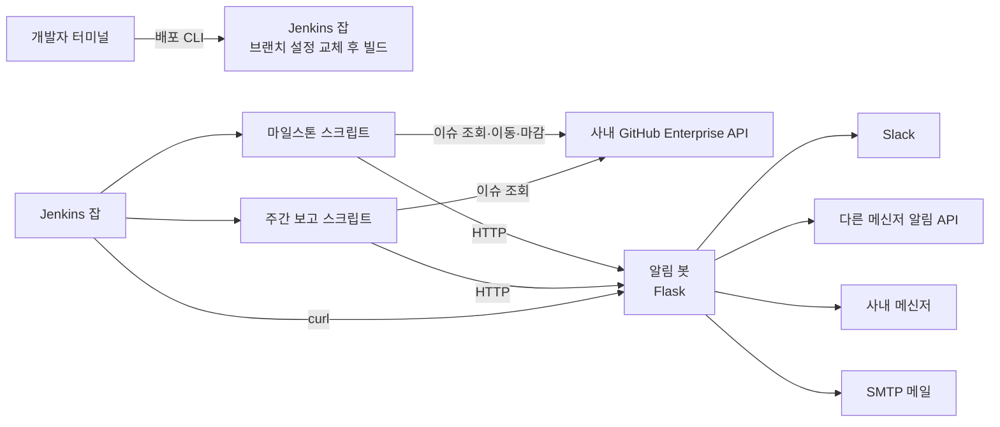

여러 프로젝트를 같은 브랜치로 여러 환경에 배포하려면 Jenkins 잡마다 브랜치 설정을 바꾸고, 빌드를 걸고, 끝나기를 기다려야 한다. 같은 공지를 Slack, 다른 메신저, 사내 메신저, 메일에 따로 보내는 일도 있고, 주마다 마일스톤에 남은 이슈를 챙기는 일도 있다. 이전 회사에서 음악·오디오 서비스의 데이터 쪽을 맡으면서 배포와 알림을 돕는 도구를 파이썬으로 만들었다.

회사 내부 이름과 주소는 뺐다.



## 잡 설정의 브랜치를 바꿔 끼우는 배포 CLI

배포 CLI는 `click`으로 옵션을 받고 `jenkinsapi`로 Jenkins를 부른다. 옵션은 네 개다.

| 옵션 | 값 | 여러 번 줄 때 |
|---|---|---|
| `-p` 프로젝트 | 프로젝트 이름 | 필수, 여러 개 가능 |
| `-e` 환경 | dev, test, stage, real 중 하나 | 하나만 주면 모든 프로젝트에 적용, 아니면 프로젝트 수와 같아야 한다 |
| `-s` 목표 상태 | completed, running, success, failure | 위와 같다. 기본값은 completed |
| `-b` 브랜치 | 브랜치 이름이나 커밋 | 하나 |

환경과 목표 상태의 개수 검사는 click 콜백에서 한다. 프로젝트 옵션에 `is_eager=True`를 달아 두었기 때문에, 콜백이 돌 때는 프로젝트 목록이 이미 들어와 있다. 값이 하나면 프로젝트 수만큼 복제하고, 개수가 다르면 `BadParameter`를 던진다.

Jenkins에 붙기 전에 브랜치부터 확인한다. 로컬 저장소에서 `git ls-remote --heads origin <브랜치>`가 비어 있지 않거나 `git rev-parse --verify <값>`이 성공하면 통과다. 그래서 브랜치 이름 대신 커밋 해시를 줘도 된다.

그다음 프로젝트마다 순서대로 이렇게 돈다.

```python
# 구조만 보여 주는 스케치
for project, env, target in zip(projects, envs, targets):
    if project not in ALLOWED[env]:
        log(f"{project} is not allowed in {env}, skip")
        continue

    job = jenkins.get_job(job_name(project, env))

    root = ElementTree.fromstring(job.get_config())
    root.find("scm/branches/hudson.plugins.git.BranchSpec/name").text = branch
    job.update_config(ElementTree.tostring(root, encoding="unicode"))

    queued = job.invoke(build_params=BUILD_PARAMS, block=False)
    queued.block_until_building()
    wait_until(queued, target)  # 결과를 주기적으로 확인, 시간 초과면 로그만 남기고 다음으로
```

잡 이름은 프로젝트와 환경을 이어 붙인 규칙으로 만든다. 환경마다 배포를 허용하는 프로젝트 목록이 설정에 있다. dev가 가장 길고, 운영 환경 목록이 가장 짧다. 목록에 없는 조합은 에러 없이 건너뛴다.

목표 상태는 다음 프로젝트로 넘어가기 전에 앞 빌드가 어디까지 가야 하는지를 정한다. `running`이면 빌드가 시작되자마자 다음 프로젝트를 건다. `completed`는 정규식 `^(success|failure)$`로 비교하므로 성공이든 실패든 끝나기만 하면 넘어간다. Jenkins 빌드 결과가 아직 없으면 `running`으로 보고 일정 간격으로 다시 묻는다. 반복이 끝나면 배포 시스템의 이력 페이지 주소를 출력한다.

브랜치는 빌드 파라미터로 넘기지 않고, 잡의 XML 설정에서 Git 브랜치 스펙을 직접 바꾼 뒤 빌드를 건다. 기존 잡을 파라미터 빌드로 바꾸지 않고도 아무 브랜치나 빌드할 수 있는 방식이다. 대신 잡 설정 자체를 고쳐 쓰는 비용이 있다. 바꾼 브랜치를 원래대로 돌려놓지 않으므로, 다른 사람이 Jenkins 화면에서 같은 잡을 그냥 돌리면 마지막으로 CLI가 넣은 브랜치가 빌드된다. 두 사람이 같은 잡에 동시에 CLI를 돌리면 설정을 서로 덮어쓸 수도 있다.

## 메신저 셋과 메일을 같은 모양의 HTTP API로

알림 봇은 Flask와 `flask_restplus`로 만든 HTTP 서버다. 채널마다 네임스페이스를 하나씩 두고, 모두 `/<채널>/v1/send` 경로에 GET과 POST를 같은 핸들러로 받는다. 루트 경로는 Swagger UI로 리다이렉트한다. Jenkins 잡이든 다른 스크립트든 `curl` 한 줄로 알림을 보낼 수 있는 모양이다.

채널별로 다른 부분은 모듈 안에 숨겼다.

| 채널 | 받는 곳 정하기 | 긴 메시지 | 그 밖에 |
|---|---|---|---|
| Slack | `channel`이 없으면 `test` 값에 따라 테스트 채널이나 실제 채널 | 그대로 보냄 | 이미지 URL을 주면 Pillow로 받아 PNG로 저장하고 파일 업로드 후 지움 |
| 다른 메신저 알림 API | `token`이 없으면 `test` 값에 따라 테스트 토큰이나 실제 토큰 | 조각으로 나눠 여러 번 보냄 | 이미지 파일 첨부 |
| 사내 메신저 | `accountId`가 있으면 그 사람, 없으면 `test`면 테스트 방, 아니면 `roomId` 방 | 조각으로 나눠 여러 번 보냄 | 대화방을 만들고 방 번호를 붙인 첫 메시지를 보내는 `/create` |
| 메일 | `to`, `cc`, `bcc` | 해당 없음 | `html`이 있으면 HTML 본문, 없으면 텍스트 본문 |

`/all/v1/send`는 같은 메시지를 네 채널에 차례로 보낸다. 메일 제목을 따로 주지 않으면 메시지를 제목으로 쓴다.

메신저 API마다 한 번에 받는 글자 수가 달라서, 긴 메시지는 `MessageIterator`로 나눈다. 정해진 길이 안에서 마지막 줄바꿈이나 공백 위치를 찾아 거기서 끊는 이터레이터다. pytest로 길이를 바꿔 가며 잘린 결과를 확인하는 테스트가 있다.

`curl`로 넘어온 메시지 안의 `\n` 두 글자는 보내기 직전에 실제 줄바꿈으로 바꾼다. 셸 스크립트에서 여러 줄 메시지를 쉽게 보내려는 처리다.

메일은 `smtplib`과 `MIMEMultipart("alternative")`로 만든다. 받는 주소는 `py3-validate-email`의 `validate_email`로 거르는데, 배포 목록 주소처럼 정해진 접두어로 시작하면 검증과 상관없이 남긴다. 팀 배포 목록은 항상 참조에 들어가고 봉투 발신자로도 쓰인다.

예외 처리는 앱에 하나로 모았다. `KeyError`는 "그 필드가 없다"는 400으로 바꾸고, HTTP 예외는 그대로, 나머지는 500으로 돌려준다.

## 금요일 마일스톤을 닫는 스크립트

사내 GitHub Enterprise 쪽 자동화는 `requests`로 REST API를 직접 부르는 스크립트 몇 개다. 마일스톤은 금요일 날짜를 제목으로 하나씩 만들고, 만드는 스크립트는 날짜를 인자로 받아 그 날짜를 제목과 마감일에 넣는다.

마감 스크립트는 이번 주 금요일과 다음 주 금요일을 `dateutil`의 `relativedelta(weekday=FR)`로 구한 뒤, 이번 주 마일스톤을 보고 셋 중 하나를 한다. 이미 닫혔거나 열린 목록에 없는 마일스톤이면 아무것도 하지 않고 끝난다.

| 상황 | 하는 일 |
|---|---|
| 열린 이슈와 PR이 없다 | 마일스톤을 닫고 태그 스크립트를 실행한다 |
| 실행 시각이 23시 59분이다 | 열린 이슈와 PR을 다음 주 마일스톤으로 옮기고, 이번 주 마일스톤을 닫고, 태그 스크립트를 실행한다 |
| 그 밖의 시각 | 열린 항목을 담당자별로 묶어 알림을 보낸다 |

23시 59분 조건은 분 단위로 맞아야 하고 요일은 보지 않으므로, 어느 요일 몇 시에 돌릴지는 스케줄러 설정이 정한다.

알림은 담당자 로그인 ID로 사용자 API를 불러 표시 이름을 얻고, `@이름` 아래에 그 사람의 이슈 제목과 링크를 적는다. 텍스트 본문은 봇을 거쳐 사내 메신저와 다른 메신저로, HTML 본문은 메일로 보낸다. Jenkins 잡 이름을 첫 인자로 받아 메시지 머리에 붙인다.

주간 보고 스크립트는 같은 이슈 조회 코드를 쓴다. 마일스톤의 이슈를 닫힌 것(Finish)과 열린 것(Going)으로 나누고, 그 안을 라벨별로 묶는다. 라벨이 여러 개인 이슈는 각 묶음에 중복해서 나온다. 정해진 라벨이 하나도 없는 이슈는 공통 묶음에 들어간다. 담당자는 팀 멤버 API로 받은 목록과 교집합을 남겨 팀 밖 사람을 뺀다. 결과 HTML 맨 위에 그 주 보고서 위키 페이지 링크를 붙여 메일로 보낸다.

## English summary

At a previous company I built small Python tools for deployment and notifications. A click-based CLI rewrote the Git branch in each Jenkins job's XML config, started the build with jenkinsapi, and waited for a target status per project before moving on. A Flask bot gave Slack, another messenger, the in-house messenger, and SMTP mail the same send API and split long messages at line breaks or spaces. Scripts for the in-house GitHub Enterprise closed weekly Friday milestones, moved open issues to the next week at 23:59, and mailed a weekly report grouped by label. Jenkins jobs, scripts, and shell one-liners all reached the four channels through the same HTTP call.
