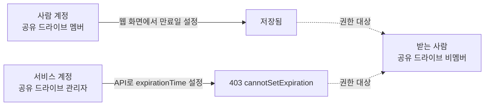

서비스 계정으로 공유 드라이브에 파일을 올리고, 사내 사용자 한 명에게 만료일이 있는 읽기 권한을 주려고 했다(1일, 14일로 시험). Drive API v3의 `permissions.create`에 `expirationTime`을 넣으면 되는 일이다. 결과는 403이었다.

```json
{
  "error": {
    "code": 403,
    "message": "Expiration dates cannot be set on this item.",
    "errors": [
      {
        "message": "Expiration dates cannot be set on this item.",
        "domain": "global",
        "reason": "cannotSetExpiration"
      }
    ]
  }
}
```

같은 권한에 웹 화면에서는 만료일이 들어간다. 그래서 Google Issue Tracker에 버그로 제보했다([586747253](https://issuetracker.google.com/issues/586747253)).

## 되는 것과 안 되는 것

| 시도 | 결과 |
|---|---|
| 서비스 계정, `permissions.create` (reader, 만료 없음) | 200 |
| 웹 화면에서 그 권한에 만료일 설정 (공유 드라이브 멤버인 사람 계정) | 저장됨 |
| 서비스 계정, `permissions.create`에 `expirationTime` (1일, 14일) | 403 `cannotSetExpiration` |
| 서비스 계정, 만료 없이 만든 뒤 `permissions.update`로 `expirationTime` 추가 | 403 |
| 서비스 계정, Drive API v2 `permissions.patch`에 `expirationDate` | 403 |
| 역할을 reader나 commenter로, 서비스 계정 역할을 콘텐츠 관리자나 관리자로 바꿔 봄 | 차이 없음 |

웹에서 만료일을 넣은 뒤 `permissions.list`로 보면 `role=reader`, `expirationTime`은 30일 뒤, `permissionDetails[].permissionType=file`로 정상적으로 들어가 있다. 데이터 모델 자체가 막는 것은 아닌 듯하다.



조건을 정리하면 이렇다. 파일은 공유 드라이브에 있고, 권한을 받는 사람은 그 공유 드라이브의 멤버가 아니다. 이 조합에서 서비스 계정이 API로 만료를 걸면 막힌다.

## 기대한 동작

Google은 [2023년 5월 Workspace 업데이트](https://workspaceupdates.googleblog.com/2023/05/set-expirations-for-files-in-shared-google-drives.html)에서 공유 드라이브 파일의 만료를 Drive API로도 만들고, 읽고, 바꾸고, 지울 수 있다고 알렸다. 그 말대로라면 서비스 계정에서도 같은 호출이 통해야 한다.

## 재현 순서

1. 공유 드라이브를 만들고 서비스 계정을 관리자로 추가한다.
2. 서비스 계정으로 파일을 올린다(`parents=[<driveId>]`, `supportsAllDrives=true`).
3. 공유 드라이브 멤버가 아닌 사내 사용자에게 `role=reader`와 `expirationTime`을 넣어 `permissions.create`를 부른다. 403이 난다.
4. 만료 없이 권한을 만들고, 웹 화면에서 만료일을 넣는다. 저장된다.

```http
POST https://www.googleapis.com/drive/v3/files/{fileId}/permissions?supportsAllDrives=true&sendNotificationEmail=false

{"type": "user", "role": "reader", "emailAddress": "<공유 드라이브 멤버가 아닌 사용자>", "expirationTime": "<지금부터 14일 뒤, RFC 3339>"}
```

## 제보하면서 물은 것

1. 서비스 계정이 호출하거나 받는 사람이 비멤버일 때 이렇게 동작하는 게 의도인가. 그렇다면 어디에 문서화돼 있나.
2. 사용자 OAuth 토큰이나, 멤버를 대신하는 도메인 전체 위임(domain-wide delegation)으로 부르면 같은 호출이 통하나.
3. 서비스 계정에서 공유 드라이브 파일의 비멤버 접근을 기한부로 주는 공식적인 방법이 있나.

[구글 개발자 포럼](https://discuss.google.dev/t/cannot-set-sharing-expiration-date-on-shared-drive-folder/128431)에도 공유 드라이브 폴더에 만료일을 못 건다는 비슷한 질문이 있었는데, 답이 달려 있지 않았다.

## 지금 상태

11월 17일에 제보했고, 다음 날 자동으로 요약과 태그가 붙은 뒤 담당 엔지니어가 자동 배정됐다. 상태는 Assigned, P2, S3다. 2026년 11월 20일 현재 아직 답은 없다.

## English summary

A service account got a 403 `cannotSetExpiration` when it tried to set `expirationTime` on a reader permission for a file in a shared drive, when the recipient was not a member of that drive. The same expiration could be set on the same permission from the Drive web UI by a human member, and `permissions.list` then showed it correctly. Creating with an expiration, updating it later, and the v2 API all failed the same way, regardless of roles. I filed it on the Google Issue Tracker, where it was auto-assigned to an engineer (P2, S3).
