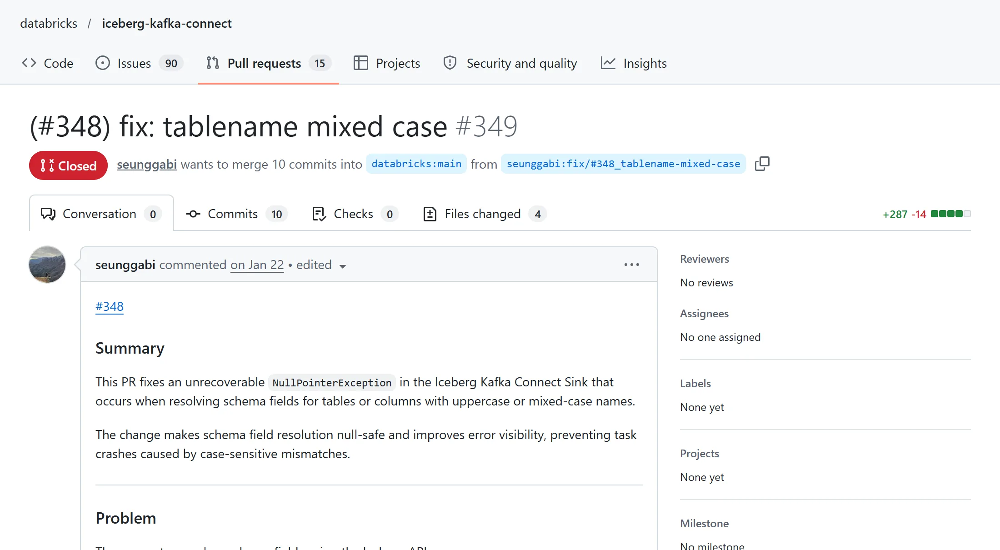
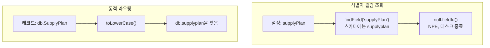

Iceberg Kafka Connect 싱크 태스크가 `NullPointerException` 한 줄을 남기고 죽었다. 어느 테이블인지, 어느 컬럼인지는 로그 어디에도 없었다. 태스크는 손으로 재시작해야 했고, 그 태스크가 맡은 다른 테이블도 같이 멈췄다.

파고들어 보니 대문자가 섞인 이름이 원인이었다. 이슈는 [#348](https://github.com/databricks/iceberg-kafka-connect/issues/348), 고친 코드는 [#349](https://github.com/databricks/iceberg-kafka-connect/pull/349)에 있다.


_[databricks/iceberg-kafka-connect#349](https://github.com/databricks/iceberg-kafka-connect/pull/349)_

## NPE는 식별자 컬럼 조회에서 났다

upsert나 delete를 하려면 커넥터가 어떤 컬럼이 키인지 알아야 한다. 설정에 적힌 식별자 컬럼(id columns) 이름으로 Iceberg 스키마에서 필드를 찾는데, 코드가 이랬다.

```java
identifierFieldIds =
    idCols.stream()
        .map(colName -> table.schema().findField(colName).fieldId())
        .collect(toSet());
```

`Schema.findField(String)`는 대소문자를 구분한다. 설정에는 `supplyPlan`이라고 썼는데 스키마에는 `supplyplan`으로 들어가 있으면 `null`이 돌아온다. 거기에 바로 `.fieldId()`를 부르니 NPE가 난다.

CDC 파이프라인에서는 원천 DB의 이름 규칙이 정리되지 않은 채 넘어오는 경우가 흔하다. 이름을 한쪽으로 통일해 두지 않았다면 언제든 만날 수 있다.

## 테이블 이름은 소문자로 바뀌고 있었다

조사하다가 다른 문제도 하나 찾았다. 동적 라우팅은 레코드의 특정 필드 값으로 적재할 테이블을 고르는 기능이다. 커넥터가 이 값을 무조건 소문자로 바꾸고 있었다.

```java
String tableName = routeValue.toLowerCase();
```

레코드에 `db.SupplyPlan`이 들어 있어도 커넥터는 `db.supplyplan`을 찾는다. 대문자를 살려 만든 테이블은 찾지 못한다.

두 문제는 따로 터진다. 둘 다 대소문자에서 시작해서 한 번에 겪으면 원인을 가려내기가 더 어렵다.



## PR에서 바꾼 것

식별자 컬럼 조회에는 null 체크를 넣었다. 컬럼을 못 찾으면 NPE 대신 어떤 컬럼이 어떤 테이블에 없는지, 그 테이블에 실제로 있는 컬럼은 무엇인지 남기고 실패한다.

```java
NestedField field = table.schema().findField(colName);
if (field == null) {
  String errorMsg = String.format(
      "Identifier column '%s' not found in table '%s'. Available columns: [%s]",
      colName, tableName, availableFields);
  LOG.error(errorMsg);
  throw new IllegalArgumentException(errorMsg);
}
```

실패하는 건 똑같다. 다만 로그만 보고 설정의 어느 줄을 고쳐야 하는지 바로 알 수 있다.

동적 라우팅의 소문자 변환은 설정으로 끌 수 있게 했다.

```properties
# 기본값 true: 지금처럼 소문자로 바꾼다
iceberg.tables.table-name-case-insensitive=false
```

중간 커밋에서는 소문자 변환을 아예 뺀 적도 있다. 그런데 그러면 레코드에는 대문자가 들어오고 테이블은 소문자로 만들어 쓰던 사람들이 바로 깨진다. 그래서 하위 호환을 위해 기존 동작을 기본값으로 두고 옵션을 추가했다. 처음엔 `dynamic-table-name-case-sensitive`(기본 false)라는 이름이었다가 `table-name-case-insensitive`(기본 true)로 바꿨다.

컬럼 이름에는 원래 `iceberg.tables.schema-case-insensitive` 옵션이 있다. 그런데 이 옵션은 레코드 필드를 테이블 컬럼에 맞출 때(`RecordConverter`)만 쓰이고, 식별자 컬럼 조회는 이 옵션을 타지 않았다. 테이블 이름에는 그런 옵션 자체가 없었다.

그 밖에 레코드를 쓰다 실패하면 토픽, 파티션, 오프셋, 테이블 이름을 로그에 남기게 했다. 테스트는 `WorkerTest`에 대소문자를 유지하는 경우와 소문자로 바꾸는 경우를 나눠 추가했다.

## 저장소가 Apache Iceberg로 옮겨 갔다

이 PR은 머지되지 않았다. 저장소가 더 이상 관리되지 않아서 올린 날 닫았다. 저장소 README 맨 위에는 이런 안내가 있다. 코드를 Apache Iceberg 프로젝트에 기증했고, 이 저장소는 더 이상 관리하지 않는다. 지금 커넥터 코드는 `apache/iceberg`의 `kafka-connect` 모듈에 있다.

2026년 11월 `apache/iceberg` main을 확인해 보니 반만 고쳐져 있었다.

| 문제 | Apache Iceberg main |
|---|---|
| 식별자 컬럼을 못 찾으면 NPE | 고쳐짐. `ID column not found: <컬럼>`으로 실패한다 |
| 동적 라우팅이 테이블 이름을 무조건 소문자로 바꿈 | 그대로. `routeValue.toLowerCase(Locale.ROOT)` |

NPE는 사라졌지만 대소문자 문제 자체는 남아 있었다. 에러 메시지에는 테이블 이름과 실제 컬럼 목록이 없고, 식별자 컬럼 조회는 여전히 `schema-case-insensitive`를 타지 않았다.

## Apache Iceberg에 다시 올린 PR

그래서 식별자 컬럼 쪽을 [apache/iceberg#19042](https://github.com/apache/iceberg/pull/19042)로 다시 올렸다. 제목은 "Kafka Connect: Honor schema-case-insensitive for id-columns"다. databricks 때와 달리 새 옵션을 만들지 않고, 이미 있는 옵션이 식별자 컬럼에도 적용되게 했다.

| 바꾼 곳 | 내용 |
|---|---|
| `RecordUtils.createTableWriter` | `iceberg.tables.schema-case-insensitive=true`면 `id-columns`를 `Schema.caseInsensitiveFindField`로 찾는다. 기본값(대소문자 구분)은 그대로다 |
| 에러 메시지 | `ID column not found: ID (table: default.events, columns: id, data, id2)`. 앞부분은 예전 문구 그대로라 기존 로그 검색이 계속 걸린다 |
| 문서 | `schema-case-insensitive` 설명에 식별자 컬럼에도 적용된다고 적었다 |
| 테스트 | `TestRecordUtils`에 대소문자가 다를 때 실패하는 경우와, 옵션을 켜면 `ID`가 `id`로 찾아지는 경우를 추가했다 |

옵션을 켜면 레코드의 `ID` 필드는 이미 `id` 컬럼에 써지는데, `id-columns=ID`만 실패하던 어긋남을 맞춘 것이다. 2026년 11월 20일에 올렸고, 지금은 리뷰를 기다리고 있다. 동적 라우팅의 소문자 변환은 이 PR에 넣지 않았다.

## English summary

The Iceberg Kafka Connect sink crashed with a NullPointerException when an identifier column name differed only by case, because the lookup was case sensitive and had no null check. I also found that dynamic routing always lowercased table names. My first PR added a clear error message, an option to keep table name case, and better logs. I closed it because the repository is no longer maintained, and the code now lives in Apache Iceberg. Apache Iceberg already fixed the NPE, so I opened apache/iceberg#19042 for the rest of the identifier column problem. Instead of adding a new option, it makes the existing schema-case-insensitive option also apply to id-columns, and the error now shows the table and its columns.
