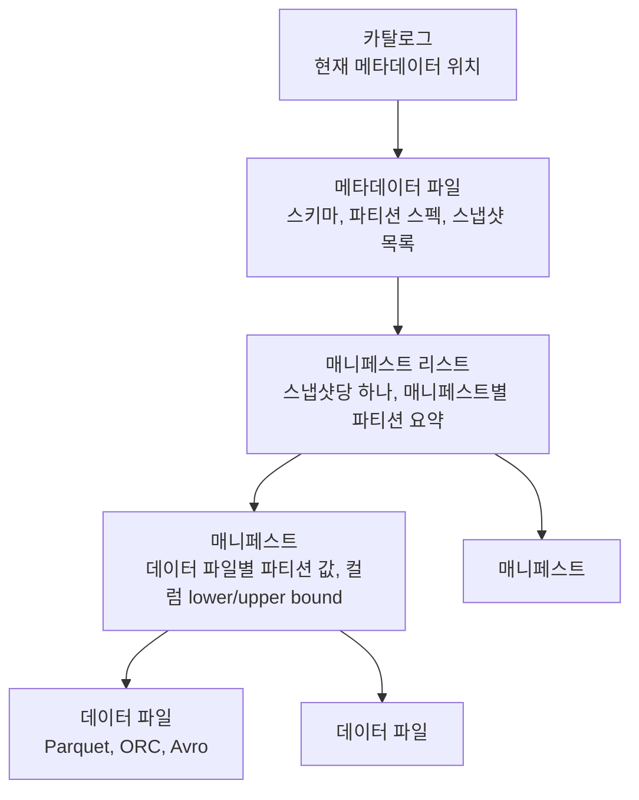

BIGINT 마이크로초 컬럼에 Iceberg `day` 파티션을 걸 수는 없다. 스펙의 `day` 변환은 `date`와 timestamp 계열만 받는다. 정수 epoch를 그대로 쌓아 둔 테이블이라면 파티션을 정하는 순간부터 선택지가 줄어든다.

이 차이를 이해하려면 Iceberg가 테이블을 어떻게 기록하는지부터 봐야 한다.

버전은 Iceberg 1.12와 스펙 main 기준이다.

## 테이블은 파일 목록을 가리키는 트리다

Iceberg 테이블의 상태는 메타데이터 파일에 있다. 테이블이 바뀔 때마다 새 메타데이터 파일을 만들고, 카탈로그가 가리키는 포인터를 원자적으로 바꾼다. 스펙 v1~v3 기준으로 층은 네 개다.



쿼리 엔진은 위에서부터 걸러 내려온다. 매니페스트 리스트의 파티션 요약으로 읽을 필요가 없는 매니페스트를 건너뛰고, 매니페스트의 파티션 값과 컬럼 통계로 데이터 파일을 건너뛴다. 디렉터리를 나열하지 않아도 읽을 파일 목록이 나온다.

커밋은 낙관적이다. 작성자는 기준 버전이 그대로라고 가정하고 새 메타데이터를 만든 뒤, 포인터를 기준 버전에서 새 버전으로 바꾼다. 그사이 다른 커밋이 끼어들면 포인터 교체가 실패하고 다시 시도한다. 읽는 쪽은 테이블을 불러온 시점의 스냅샷을 계속 보고, 새로 고치기 전까지 다른 커밋의 영향을 받지 않는다.

## 스냅샷과 시간 여행

스냅샷은 어느 시점의 테이블 상태, 즉 그 시점에 유효한 데이터 파일 전체다. 메타데이터 파일이 스냅샷 목록과 현재 스냅샷 ID를 갖고 있으니, 과거 스냅샷 ID나 시각을 지정하면 그때의 파일 목록으로 읽을 수 있다. Spark에서는 이렇게 쓴다.

```sql
SELECT * FROM prod.db.events VERSION AS OF 10963874102873;
SELECT * FROM prod.db.events TIMESTAMP AS OF '2026-11-19 00:00:00';

-- 스냅샷 목록과 요약은 메타데이터 테이블로 본다
SELECT committed_at, snapshot_id, operation, summary FROM prod.db.events.snapshots;
```

시간 여행에는 한계가 있다. 스냅샷 만료(expire snapshots)를 돌리면 지워진 스냅샷으로는 돌아갈 수 없다. 테이블 속성 `history.expire.max-snapshot-age-ms`의 기본값은 5일이다.

## hidden partitioning은 원본 컬럼 조건에서만 효과가 난다

Hive는 `event_date` 같은 파티션 컬럼을 사용자가 직접 채우고, 쿼리에도 그 컬럼 조건을 따로 넣어야 한다. 빠뜨리면 전체를 읽는다. Iceberg는 원본 컬럼에 변환(transform)을 걸어 파티션 값을 스스로 만들고, 원본 컬럼에 대한 조건을 파티션 조건으로 바꿔 준다. 쿼리를 쓰는 사람은 파티션 컬럼을 몰라도 된다.

변환마다 받는 타입이 정해져 있다.

| 변환 | 받는 타입 | 결과 |
|---|---|---|
| `year`, `month`, `day` | `date`, `timestamp`, `timestamptz`, `timestamp_ns`, `timestamptz_ns` | 1970년부터 센 년/월/일 |
| `hour` | timestamp 계열 네 가지 | 1970-01-01 00:00부터 센 시간 |
| `bucket[N]` | `int`, `long`, `decimal`, `date`, `time`, timestamp 계열, `string`, `uuid`, `fixed`, `binary` | Murmur3 해시 mod N |
| `truncate[W]` | `int`, `long`, `decimal`, `string`, `binary` | 폭 W로 자른 값 |

`long`은 `day`, `hour` 칸에 없다. BIGINT epoch 컬럼으로 시간 파티션을 만들려면 `truncate`로 구간을 자르는 방법이 남는데, 여기에도 함정이 있다. 레퍼런스 구현(Java)의 truncate 폭은 `int`다. 밀리초 하루(86,400,000)는 들어가지만 마이크로초 하루(86,400,000,000)는 int 범위를 넘는다. 마이크로초 한 시간(3,600,000,000)도 넘는다.

```sql
-- timestamp 컬럼이면 이렇게 끝난다
CREATE TABLE prod.db.events (id bigint, ts timestamp, payload string)
USING iceberg
PARTITIONED BY (days(ts), bucket(16, id));

-- 밀리초 BIGINT라면 UTC 하루 단위 구간으로 자를 수는 있다
ALTER TABLE prod.db.events_ms ADD PARTITION FIELD truncate(86400000, created_ms);
```

또 하나는 조건의 모양이다. Iceberg가 파티션 조건으로 바꿔 주는 건 원본 컬럼에 대한 비교다. [Superset epoch_us 글](/posts/superset-epoch-us/)에서 계산 컬럼 `from_unixtime(created_at / 1000000)`을 시간 컬럼으로 쓰면 WHERE 절에 함수가 씌워졌고, 원하는 건 `created_at >= 1789344000000000` 같은 정수 비교였다. 원본이 BIGINT로 남아 있는 한 이 차이는 파티션이 무엇이든 따라온다.

timestamp 컬럼으로 바꿔 쌓을 수 있다면 정밀도는 걱정할 게 적다. Iceberg `timestamp`, `timestamptz`는 마이크로초 정밀도이고 Parquet에는 `TIMESTAMP_MICROS`로 저장된다. Debezium `MicroTimestamp` 값과 단위가 같다. 나노초가 필요하면 v3의 `timestamp_ns`, `timestamptz_ns`를 써야 한다. 이 타입은 v3 테이블에서 쓰고, 읽는 엔진이 v3를 지원하는지 먼저 확인해야 한다. v3를 모르는 리더는 이 타입이 들어간 테이블을 읽지 못할 수 있다.

파티션 스펙은 나중에 바꿀 수 있다. 기존 파일은 옛 스펙으로 남고 새 데이터만 새 스펙으로 쓰이며, 파일을 다시 쓰지 않는 메타데이터 작업이다.

## 컬럼은 이름이 아니라 필드 ID로 찾는다

Iceberg 스키마의 모든 필드에는 ID가 붙는다. 데이터 파일에서 컬럼을 고를 때도 이름이 아니라 ID를 쓴다. 그래서 이름을 바꿔도 기존 파일을 다시 쓸 필요가 없고, 새 컬럼은 새 ID를 받으니 지웠던 컬럼과 같은 이름으로 다시 추가해도 옛 값이 되살아나지 않는다. 매니페스트의 컬럼 통계도 필드 ID를 키로 저장된다.

예를 들어 `1: a int, 2: b string, 3: c double`로 쓴 파일을 `3: measurement, 2: name, 4: a`로 읽으면 `c`가 `measurement`로, `b`가 `name`으로 나오고 `a`는 null 컬럼이 된다. 이름 `a`가 같아도 ID 1과 4는 다른 컬럼이다.

이름은 바깥 경계에서 문제가 된다. [Kafka Connect 대소문자 글](/posts/iceberg-kafka-connect-mixed-case/)의 NPE는 설정에 적힌 식별자 컬럼 이름으로 `findField(colName).fieldId()`를 부르다 났다. 이름 조회가 대소문자를 구분해서 `null`이 돌아왔다. 테이블 안쪽은 ID로 움직이지만, 설정과 레코드는 이름으로 들어오니 이름을 ID로 바꾸는 지점이 항상 생긴다.

## Kafka Connect 싱크는 코디네이터가 주기적으로 한 번에 커밋한다

Apache Iceberg Kafka Connect 싱크에서 각 태스크는 데이터 파일을 쓰기만 하고, 커밋은 코디네이터 하나가 맡는다. 둘은 컨트롤 토픽(기본 `control-iceberg`)으로 이벤트를 주고받는다. 코디네이터 소스 기준 흐름은 이렇다.

1. 커밋 주기(`iceberg.control.commit.interval-ms`, 기본 5분)가 되면 코디네이터가 `START_COMMIT`을 보낸다.
2. 각 태스크는 쓰던 파일을 닫고, 테이블별 파일 목록(`DATA_WRITTEN`)과 맡은 파티션의 오프셋(`DATA_COMPLETE`)을 보낸다. 이 전송과 소스 오프셋 커밋은 Kafka 트랜잭션 하나로 묶인다.
3. 모든 파티션의 응답이 모이면 코디네이터가 테이블마다 append를 커밋한다. 삭제 파일이 있으면 row delta로 커밋한다. 커밋 타임아웃(기본 30초)이 지나면 모인 것만 커밋한다.
4. 같은 커밋에서 스냅샷 요약에 `kafka.connect.offsets.<컨트롤 토픽>.<그룹 ID>`와 `kafka.connect.commit-id`를 남긴다. 앞의 값은 소스 토픽이 아니라 컨트롤 토픽의 오프셋이다. 다음 커밋 때 이 값보다 앞선 `DATA_WRITTEN` 이벤트는 이미 커밋된 것으로 보고 건너뛴다.

이 구조로 싱크는 exactly-once 전달을 제공하고, 그 전제로 Kafka 2.5 이상(KIP-447)이 필요하다.

결과적으로 데이터는 커밋 주기마다 보이고, 테이블마다 그때마다 스냅샷이 하나씩 생긴다. 기본 5분 주기에 데이터가 끊이지 않으면 하루 288개다. 쓸 파일이 없는 주기는 건너뛴다. 커밋 한 번에 파티션별로 파일이 생기니 작은 파일 정리(compaction)와 스냅샷 만료를 같이 돌려야 메타데이터 트리가 계속 커지지 않는다. 앞의 `snapshots` 메타데이터 테이블에서 `summary['kafka.connect.commit-id']`를 보면 어느 스냅샷이 커넥터 커밋인지 확인할 수 있다.

CDC를 upsert로 쓰면 비용이 하나 더 붙는다. 갱신과 삭제마다 equality delete 파일이 쌓이고, 읽는 엔진은 데이터 파일을 읽을 때마다 이 삭제 파일을 맞춰 봐야 하니 쌓일수록 읽기가 느려진다. `rewrite_data_files`로 삭제를 반영해 데이터 파일을 다시 써야 이 비용이 줄어든다.

## 참고 자료

- [Apache Iceberg Table Spec](https://iceberg.apache.org/spec/)
- [Iceberg Partitioning](https://iceberg.apache.org/docs/latest/partitioning/)
- [Iceberg Evolution](https://iceberg.apache.org/docs/latest/evolution/)
- [Iceberg Spark Queries (time travel, metadata tables)](https://iceberg.apache.org/docs/latest/spark-queries/)
- [Iceberg Spark DDL](https://iceberg.apache.org/docs/latest/spark-ddl/)
- [Iceberg Configuration](https://iceberg.apache.org/docs/latest/configuration/)
- [Iceberg Spark Procedures (rewrite_data_files)](https://iceberg.apache.org/docs/latest/spark-procedures/)
- [Iceberg Kafka Connect](https://iceberg.apache.org/docs/latest/kafka-connect/)
- [apache/iceberg Truncate.java](https://github.com/apache/iceberg/blob/main/api/src/main/java/org/apache/iceberg/transforms/Truncate.java)
- [apache/iceberg Kafka Connect Coordinator.java](https://github.com/apache/iceberg/blob/main/kafka-connect/kafka-connect/src/main/java/org/apache/iceberg/connect/channel/Coordinator.java)

## English summary

An Iceberg table is a tree of metadata: a metadata file, one manifest list per snapshot, manifests, and data files, and each commit swaps a pointer to new metadata. Hidden partitioning derives partition values from a source column, but `day` and `hour` do not accept `long`, and the Java `truncate` width is an `int`, so a microsecond BIGINT column cannot be cut into days that way. Columns are tracked by field ID, so renames are safe. In my Kafka Connect fix, the crash came from the edge, where a config column name had to be mapped to an ID. The sink commits through one coordinator every five minutes by default, which trades freshness for fewer snapshots and fewer small files.
