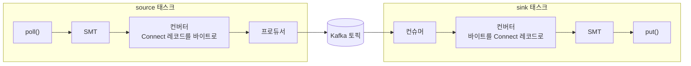

커넥터 상태는 RUNNING인데 sink 컨슈머 그룹에 멤버가 하나도 없다. Kafka Connect는 커넥터와 태스크의 상태를 따로 기록하고, 예외로 죽은 태스크를 스스로 다시 띄우지 않는다. 그래서 CDC 파이프라인을 진단할 때는 커넥터 상태보다 sink 컨슈머 그룹부터 보는 편이 낫다.

버전은 Apache Kafka 4.4 기준이다.

## 워커, 커넥터, 태스크

| 단위 | 하는 일 |
|---|---|
| 워커 | JVM 프로세스. 커넥터와 태스크를 스레드로 띄운다 |
| 커넥터 | 설정을 읽고 일을 최대 `tasks.max`개의 태스크 설정으로 나눈다. 데이터는 직접 옮기지 않는다 |
| 태스크 | 실제로 복사한다. source는 `poll()`로 외부에서 읽어 Kafka에 쓰고, sink는 Kafka에서 읽은 묶음을 `put()`으로 외부에 쓴다 |

병렬성은 커넥터가 일을 얼마나 나눌 수 있느냐에 달려 있다. Debezium MySQL 커넥터는 태스크 하나로만 돈다. `tasks.max`를 1보다 크게 두면 `Only a single connector task may be started`로 태스크 구성이 실패한다. sink 태스크는 `connect-<커넥터 이름>` 컨슈머 그룹의 멤버라서, 파티션 수보다 많은 태스크는 놀게 된다.

## 분산 모드는 상태를 내부 토픽 세 개에 둔다

분산 모드에서는 같은 `group.id`를 쓰는 워커들이 한 Connect 클러스터가 된다. 워커는 상태를 로컬에 두지 않고 compaction을 건 Kafka 토픽에 쓴다.

| 워커 설정 | 담는 것 | 기본 파티션 | 기본 복제 계수 |
|---|---|---|---|
| `config.storage.topic` | 커넥터와 태스크 설정 | 1 (반드시 1) | 3 |
| `offset.storage.topic` | source 오프셋 | 25 | 3 |
| `status.storage.topic` | 커넥터와 태스크 상태 | 5 | 3 |

MSK Connect는 커넥터를 만들 때마다 `__amazon_msk_connect_<offsets|status|configs>_<커넥터 이름>_<커넥터 ID>` 형식으로 내부 토픽을 새로 만든다. config와 status 토픽은 커넥터끼리 공유할 수 없고, offset 토픽만 워커 설정의 `offset.storage.topic`으로 고정할 수 있다. 워커 설정에 고정 offset 토픽을 넣어 두면, Debezium 커넥터를 지우고 다시 만들어도 이전 binlog 위치를 찾아 이어 읽는다.

## 리밸런스는 옮길 태스크만 멈춘다

워커가 들어오거나 나가면 리밸런스가 일어난다. 2.3.0부터 기본 프로토콜은 incremental cooperative rebalancing이다(KIP-415). 리더 워커가 옮겨야 하는 커넥터와 태스크만 회수하고, 나머지는 멈추지 않고 계속 돈다. 4.4의 `connect.protocol` 기본값은 `sessioned`이고 이것도 이 방식 위에 있다.

워커 하나가 빠지면 Connect는 바로 재배치하지 않고 `scheduled.rebalance.max.delay.ms`(기본 5분)만큼 기다린다. 그 안에 워커가 돌아오면 원래 태스크를 그대로 돌려받는다. 롤링 재시작에는 유리하지만, 정말로 죽은 워커의 태스크는 그 시간 동안 아무 워커에도 배정되지 않는다. 리밸런스 중에 태스크 재시작을 요청하면 409(Conflict)가 돌아온다.

## source 오프셋과 sink 오프셋은 사는 곳이 다르다

| | source | sink |
|---|---|---|
| 오프셋의 모양 | 커넥터가 정한 맵 (Debezium MySQL이면 binlog 위치) | 토픽 파티션의 Kafka 오프셋 |
| 저장 위치 | `offset.storage.topic` | `__consumer_offsets`, 그룹 `connect-<커넥터 이름>` |
| 커밋 주기 | `offset.flush.interval.ms` (기본 60초) | 같은 설정. 커넥터가 `preCommit()`으로 커밋할 오프셋을 정할 수 있다 |

source 태스크는 프로듀서가 확인한 레코드의 오프셋만 주기적으로 기록한다. 레코드는 Kafka에 들어갔는데 오프셋을 쓰기 전에 죽으면, 재시작 뒤 같은 레코드를 다시 보낸다. 오프셋 커밋 순서가 전달 보장을 정한다는 이야기는 [Kafka 전달 보장 글](/posts/kafka-delivery-guarantees/)에 있다.

sink 쪽 lag도 이 커밋된 오프셋 기준이다. Iceberg sink는 커밋 주기(`iceberg.control.commit.interval-ms`, 기본 5분)마다 파일 정보를 control 토픽에 보내면서 같은 트랜잭션으로 오프셋을 커밋한다. 그래서 sink lag 그래프는 커밋 주기를 따라 톱니 모양을 그린다.

## 컨버터와 SMT는 태스크 안에서 레코드마다 돈다



컨버터는 Connect 내부 레코드와 Kafka에 저장되는 바이트 사이를 오간다. 워커 설정에 기본값을 두고 커넥터 설정에서 덮어쓸 수 있다. MSK Connect의 기본 워커 설정은 키와 값 모두 `StringConverter`다.

```properties
# sink 커넥터 설정 예시
key.converter=io.confluent.connect.avro.AvroConverter
key.converter.schema.registry.url=http://schema-registry:8081
value.converter=io.confluent.connect.avro.AvroConverter
value.converter.schema.registry.url=http://schema-registry:8081
errors.tolerance=all
errors.log.enable=true
errors.deadletterqueue.topic.name=dlq-orders
errors.deadletterqueue.context.headers.enable=true
```

예를 들어 원천 컬럼 타입이 바뀌어 새 스키마를 레지스트리가 `BACKWARD` 호환성으로 거절하면(409), source 태스크는 `Tolerance exceeded in error handler`로 죽는다. 레지스트리 등록은 컨버터가 하므로 컨버터 단계의 실패로 보인다(추론이다). 호환성 모드가 무엇을 막는지는 [Avro 스키마 진화 글](/posts/schema-evolution/)에 있다.

SMT는 레코드 하나를 받아 하나를 돌려주는 가벼운 변환이다. 여러 개를 이어 걸 수 있고, predicate로 조건에 맞는 레코드에만 적용할 수 있다.

## errors.tolerance가 덮지 않는 자리

`errors.tolerance` 기본값은 `none`이라 첫 오류에서 태스크가 실패한다. `all`로 두면 컨버터와 SMT 단계에서 실패한 레코드를 건너뛴다. DLQ(`errors.deadletterqueue.topic.name`)는 sink 커넥터에만 있고, 실패한 원래 레코드를 그 토픽에 쓴다. `put()` 안의 예외는 이 설정을 타지 않는다.

| `put()`이 던진 것 | 워커가 하는 일 |
|---|---|
| `RetriableException` | 모든 파티션을 멈추고 같은 묶음을 다시 `put()` |
| 그 밖의 예외 | `Task is being killed and will not recover until manually restarted` 로그와 함께 태스크 종료 |
| 커넥터가 `ErrantRecordReporter`로 넘긴 레코드 | DLQ에 기록 (2.6부터, 커넥터가 이 기능을 써야 한다) |

그래서 DLQ를 걸어도 커넥터 내부 로직에서 나는 오류는 커넥터 구현에 달려 있다. Iceberg sink의 `Cannot convert to boolean`이나 식별자 컬럼 조회 NPE가 그런 예로, 둘 다 `put()` 안에서 레코드를 행으로 바꾸거나 식별자 컬럼을 찾다가 나는 예외로 보인다(추론이다). 그 NPE의 원인은 [Iceberg Kafka Connect NPE 글](/posts/iceberg-kafka-connect-mixed-case/)에 있다.

## source exactly-once는 KIP-618이다

3.3부터 source 커넥터도 exactly-once로 쓸 수 있고, 분산 모드에서만 된다. 태스크의 프로듀서가 레코드와 그 source 오프셋을 한 트랜잭션에 넣어서, 레코드만 남고 오프셋이 빠지는 일이 없어진다. 워커에 `exactly.once.source.support=enabled`(기존 클러스터는 `preparing`으로 한 번 롤링한 뒤), source 커넥터에 `exactly.once.support=required`를 둔다.

태스크 프로듀서의 transactional ID는 `${groupId}-${connector}-${taskId}`이고, 새 세대의 태스크가 뜨기 전에 리더가 이전 세대 프로듀서를 fence해 좀비 태스크의 쓰기를 막는다. 이 보장이 Kafka 안에서 끝난다는 점은 전달 보장 글에 있다. 커넥터가 지원하지 않으면 워커 설정만으로는 얻을 수 없다.

sink 쪽 exactly-once는 커넥터 몫이다. Iceberg sink는 커밋을 한 곳에서 조정해 exactly-once 적재를 내세운다. 스냅샷을 다시 돌려 원천에서 새로 만든 레코드는 이 보장의 범위 밖이고, 그 중복을 적용 단계에서 다루는 방법은 [CDC 개념 글](/posts/change-data-capture/)에 있다.

## RUNNING 커넥터와 FAILED 태스크

커넥터 인스턴스는 설정을 나눠 주는 일만 하므로 태스크가 죽어도 RUNNING으로 남는다. 둘은 각자 UNASSIGNED, RUNNING, PAUSED, STOPPED, FAILED, RESTARTING 가운데 하나의 상태를 status 토픽에 쓰고, 둘이 갈리는 대표적인 경우가 태스크 실패다. Connect는 실패한 태스크를 자동으로 재시작하지 않으니, `POST /connectors/<이름>/restart?includeTasks=true&onlyFailed=true`로 죽은 태스크만 다시 띄운다.

MSK Connect 커넥터 상태(RUNNING, CREATING, UPDATING, DELETING, FAILED)도 태스크 상태를 따라가지 않는다. MSK Connect는 일시적인 오류로 실패한 태스크를 자동으로 복구할 수 있지만, 앞의 409처럼 같은 레코드에서 다시 실패하는 오류는 재시작으로 풀리지 않는다. 그래서 알람은 sink 태스크가 죽는 경우를 consumer lag로, source가 RUNNING인 채 아무것도 쓰지 않는 경우를 `SourceRecordWriteRate`로 잡는 방법이 있다. MSK Connect는 `ErroredTaskCount`도 내보낸다.

## 참고 자료

- [Apache Kafka 4.4 Kafka Connect User Guide (distributed mode, error reporting, exactly-once source)](https://kafka.apache.org/44/kafka-connect/user-guide/)
- [Apache Kafka 4.4 Kafka Connect Administration (rebalancing, connector and task status)](https://kafka.apache.org/44/kafka-connect/administration/)
- [Apache Kafka 4.4 Connector Development Guide (ErrantRecordReporter)](https://kafka.apache.org/44/kafka-connect/connector-development-guide/)
- [Apache Kafka 4.4 Kafka Connect Configs](https://kafka.apache.org/44/configuration/kafka-connect-configs/)
- [WorkerSinkTask.java (apache/kafka)](https://github.com/apache/kafka/blob/trunk/connect/runtime/src/main/java/org/apache/kafka/connect/runtime/WorkerSinkTask.java)
- [KIP-298: Error Handling in Connect](https://cwiki.apache.org/confluence/display/KAFKA/KIP-298%3A+Error+Handling+in+Connect)
- [KIP-415: Incremental Cooperative Rebalancing in Kafka Connect](https://cwiki.apache.org/confluence/display/KAFKA/KIP-415%3A+Incremental+Cooperative+Rebalancing+in+Kafka+Connect)
- [KIP-610: Error Reporting in Sink Connectors](https://cwiki.apache.org/confluence/display/KAFKA/KIP-610%3A+Error+Reporting+in+Sink+Connectors)
- [KIP-618: Exactly-Once Support for Source Connectors](https://cwiki.apache.org/confluence/display/KAFKA/KIP-618%3A+Exactly-Once+Support+for+Source+Connectors)
- [Confluent: Using Kafka Connect with Schema Registry](https://docs.confluent.io/platform/current/schema-registry/connect.html)
- [Apache Iceberg 1.12 Kafka Connect](https://iceberg.apache.org/docs/latest/kafka-connect/)
- [Understand MSK Connect](https://docs.aws.amazon.com/msk/latest/developerguide/msk-connect.html)
- [Understand MSK Connect workers](https://docs.aws.amazon.com/msk/latest/developerguide/msk-connect-workers.html)
- [Manage source connector offsets using offset.storage.topic (MSK Connect)](https://docs.aws.amazon.com/msk/latest/developerguide/msk-connect-manage-connector-offsets.html)

## English summary

In Kafka Connect a connector only splits work into task configs, and tasks do the copying, so a connector can stay RUNNING while its only task has FAILED and Connect will not restart it. In distributed mode the workers keep configs, source offsets and status in three internal topics, and on MSK Connect pinning the offset topic in the worker config lets a recreated Debezium connector resume from its binlog position. `errors.tolerance` and the sink DLQ cover converters and SMTs, but an exception inside `put()` still kills the task unless the connector reports the record itself. For a CDC pipeline it is safer to check the sink consumer group and alarm on the source write rate than to trust the connector state. Exactly-once in Connect covers redelivered records but not the new copies a re-run snapshot creates, so a pipeline that re-runs snapshots per table may need a periodic dedup job, trading an extra batch for that flexibility.
