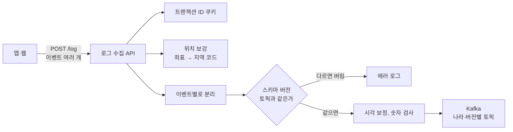

음악·오디오 서비스의 앱과 웹이 보내는 행동 로그를 받는 API를 맡았다. Spring Boot로 만든 HTTP API가 로그를 받아 몇 가지를 확인하고 덧붙인 뒤 Kafka로 보낸다. 지표 배치는 이 로그가 Hive에 쌓인 것을 읽는다. 그래서 이 API는 받은 로그를 그냥 넘기지 않고, 몇 가지를 확인하고 고친 뒤에 넘겼다.

회사 내부 이름과 토픽 이름은 뺐다.

## 나라와 버전별 엔드포인트

엔드포인트는 나라와 로그 스키마 버전으로 나눴다. 국내, 해외, 다른 서비스가 각자 `/v1/log` 같은 경로를 갖고, 각각 정해진 Kafka 토픽으로 보낸다. 스키마를 바꿀 일이 생기면 새 버전 경로와 새 토픽을 만들고, 옛 버전은 클라이언트가 다 옮겨 갈 때까지 그대로 둔다.

요청 헤더를 쓰지 않는 `/log/proxy` 경로도 따로 있었다.

## 한 요청에 이벤트 여러 개, Kafka에는 하나씩

요청 하나에는 이벤트가 여러 개 담겨 온다. API는 이벤트마다 메시지 하나로 나눈다. 헤더와 클라이언트 정보는 각 메시지에 그대로 복사한다. 이벤트 하나가 메시지 하나가 되니, 소비하는 쪽은 배열을 풀 필요가 없다.

## 버리는 것, 고치는 것, 남기기만 하는 것

메시지마다 세 가지를 확인했다. 확인 결과에 따라 처리 방식이 다르다.

| 확인 | 기준 | 처리 |
|---|---|---|
| 스키마 버전 | 로그 헤더의 버전이 토픽의 버전과 같은가 | 다르면 Kafka로 보내지 않고 에러 로그만 남긴다 |
| 이벤트 시각 | 지금 기준 7일 전부터 1일 뒤 사이인가 | 벗어나면 서버 시각으로 바꾸고, 원래 값은 에러 로그에 남긴다 |
| 재생 시간 숫자 | 재생 시간과 전체 길이가 0 이상인가, 재생 시간이 전체 길이를 크게 넘지 않는가 | 보내되 에러 로그를 남긴다 |

버리는 건 버전 검사 하나뿐이다. 나머지는 고치거나 표시만 하고 보낸다. 세 경우 모두 원래 로그를 에러 로그에 같이 남겼다.

## 트랜잭션 ID 쿠키

요청에 트랜잭션 ID 쿠키가 없으면 새 UUID를 만들고, 있으면 그대로 쓴다. 어느 쪽이든 만료 시간을 30분으로 다시 설정해서 응답에 쿠키를 붙인다. 30분 안에 다시 로그가 오면 같은 ID가 이어진다. 로그인하지 않은 사용자의 행동도 이 ID로 묶어 볼 수 있다.

## 위치는 바꾸고, 좌표는 지운다

국내 로그 중 위치 이벤트에는 경도와 위도가 들어 있다. API는 이 좌표로 지도 API를 불러 지역 코드를 받고, 그 지역의 현재 날씨 코드도 받아 이벤트에 붙인다. 지역 코드는 사내 키 관리 서비스로 암호화해서 넣고, 원래 경도와 위도는 지운 뒤 Kafka로 보낸다.

실패하는 경로는 이렇다. 지도 API가 지역 코드를 주지 못하면 보강도 좌표 삭제도 하지 않고 그대로 보내고, 그 요청에 남은 위치 이벤트도 처리하지 않는다. 날씨 API 호출이 실패하면 요청 전체가 실패한다. 좌표가 남는 경로가 있다는 점은 위의 "좌표는 지운다"는 원칙과 맞지 않아서 고쳐야 할 부분이다.

## English summary

I built the HTTP log collection API for music and audio services with Spring Boot and Kafka. Endpoints were split by country and log schema version, each mapped to its own topic, and a batched request was split into one Kafka message per event. Each message was checked: a schema version mismatch was dropped, an event time outside seven days before to one day after now was replaced with the server time, and impossible playback numbers were sent but logged, always with the original log kept for debugging. The API also issued a 30-minute transaction ID cookie, and for location events it replaced the coordinates with an encrypted region code and a weather code, although a failed map lookup still let the raw coordinates through.
