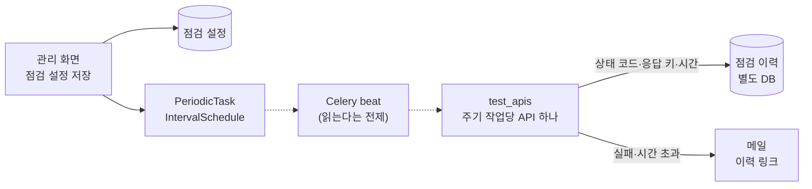

지표 배치가 MySQL에 넣는 테이블은 지표마다 하나씩이라 수십 개였다. 대시보드는 이 테이블들을 날짜 범위, 서비스, 플랫폼 구분으로 잘라서 보여 줘야 했고, API가 느려지거나 응답 모양이 바뀌면 누군가 화면을 열기 전에 알아야 했다. 이전 회사에서 음악·오디오 서비스의 데이터 쪽을 맡으며 만든 대시보드의 백엔드(Django REST Framework), 프런트엔드(Vue), 감시와 배포 구성을 적는다.

배치 쪽 구조는 [PySpark 지표 배치 글](/posts/pyspark-indicator-batch/)에 있고, 여기서는 테이블을 읽는 쪽만 다룬다. 회사 내부 이름과 테이블, 컬럼 이름은 뺐다. 버전은 Django 3.2, DRF 3.12, django-filter 2.4, Celery 5.2, Vue 2, ECharts 5 기준이다.

## 테이블 하나에 세 조각

지표 테이블 하나는 API에서 세 조각이 된다.

| 조각 | 하는 일 |
|---|---|
| 모델 | `managed = False`. 테이블은 배치가 만들고, Django는 마이그레이션을 하지 않고 읽기만 한다 |
| FilterSet | 쿼리 파라미터를 조건으로 바꾼다. 날짜 조건은 공통 부모 클래스에 있다 |
| ViewSet | `ReadOnlyModelViewSet`. 목록과 단건 조회만 열고, 정렬 가능한 컬럼을 정해 둔다 |

ViewSet은 DRF `DefaultRouter`에 등록했고, 나라별 지표는 나라마다 Django 앱을 따로 두어 URL 접두어로 나눴다. 응답 직렬화는 marshmallow 스키마로 했다. 테이블은 달라도 응답 모양은 거의 같아서, 활성 사용자와 재생 수를 담는 지표 여럿이 스키마 하나를 같이 썼다.

아래 스케치의 `PlayMetric`, `play_metric`은 설명을 위해 지어낸 이름이다.

```python
# 구조만 보여 주는 스케치 (PlayMetric, play_metric은 예로 지은 이름)
class DateRangeFilter(filters.FilterSet):
    start = filters.CharFilter(field_name="date", lookup_expr="gte")
    end = filters.CharFilter(field_name="date", lookup_expr="lte")
    dates = filters.CharFilter(method="filter_dates")

    def filter_dates(self, qs, name, value):
        return qs.filter(date__in=value.split(","))

class PlayMetricFilter(DateRangeFilter):
    class Meta:
        model = PlayMetric
        fields = ["start", "end", "dates", "service", "type"]

@alert_latency(from_db("play_metric"))
class PlayMetricViewSet(ReadOnlyModelViewSet):
    queryset = PlayMetric.objects.all()
    serializer_class = PlayMetricSchema()
    filterset_class = PlayMetricFilter
    ordering_fields = ["date"]
```

새 지표가 생기면 모델, FilterSet, ViewSet을 하나씩 추가하고 라우터에 한 줄 등록한다. 제네릭 뷰 하나로 모든 테이블을 받는 방법도 있지만, 이렇게 두면 테이블마다 허용하는 필터와 정렬 컬럼이 코드에 드러난다. 목록에 없는 컬럼으로 정렬하거나 거르는 파라미터는 DRF와 django-filter가 조용히 무시한다.

## 쿼리 파라미터로 자르는 범위

모든 날짜 필터는 시작일·종료일 범위와 쉼표로 이은 날짜 목록을 받는다. 날짜 목록을 쓰면 띄엄띄엄 떨어진 날짜를 한 번의 요청으로 가져올 수 있다. 그 위에 테이블마다 서비스, 웹·앱 타입, 나라, 순위 범위 같은 조건이 붙는다.

일간·주간·월간 값을 한 테이블에 함께 넣는 지표도 있었다. 이런 테이블은 집계 시작일 컬럼을 같이 갖고 있어서, `period` 파라미터를 필수로 받는 필터가 기준일과 시작일의 차이로 행을 골랐다. 같은 날이면 일간, 6일 차이면 주간, 그보다 길면 월간이다.

페이지 크기는 DRF `PageNumberPagination`에 `page_size_query_param`을 열어 클라이언트가 정하게 했고 상한을 두었다. 한 달 치를 그리는 차트 컴포넌트는 큰 `page_size`를 넘겨 한 번에 받는다. 정렬은 `OrderingFilter`가 맡고, 허용 컬럼은 ViewSet의 `ordering_fields`로 제한했다.

몇몇 요약 API는 `list`를 덮어써서, 같은 날짜의 여러 행을 파이썬에서 한 행으로 모았다. 유료 유형별 행을 날짜 하나 아래 열로 펼치고 합계와 비율을 붙이는 식이다. CSV 내려받기는 지표 이름으로 exporter 클래스를 고르는 함수 뷰로 따로 두었다.

## 캐시는 브라우저에

서버 쪽에는 캐시 계층을 두지 않았다. 지표 테이블은 배치가 하루 단위로 채우고, API는 그 테이블을 날짜 범위로 잘라 읽기만 한다.

대신 프런트엔드의 axios 인스턴스에 `axios-extensions`의 `cacheAdapterEnhancer`를 붙이고 `enabledByDefault`를 켰다. 이 어댑터는 GET 요청을 URL과 파라미터 기준으로 메모리 LRU 캐시에 담는다. 한 화면의 여러 차트가 같은 조건으로 같은 API를 부르거나, 탭을 오가며 같은 날짜를 다시 열면 서버까지 가지 않는다. 캐시는 새로고침하면 사라지고, 기본 캐시가 항목 수와 유효 시간이 정해진 LRU라 배치가 새 날짜를 넣은 뒤에도 오래 남지 않는다.

인증은 만료 시간이 있는 토큰이고, 모든 API에 `IsAuthenticated`를 기본으로 걸었다. 프런트엔드는 401을 받으면 현재 경로를 붙여 로그인 화면으로 보낸다.

## 차트는 공용 컴포넌트에 데이터만 넘긴다

화면은 Vue 2와 Vuetify, 차트는 vue-echarts로 그린 ECharts다. 선, 막대+선, 막대, 파이, 히트맵 차트를 공용 컴포넌트로 만들고, 지표별 컴포넌트는 API를 불러 행을 계열별 배열로 나눈 뒤 props로 넘긴다.

| 지표 컴포넌트가 넘기는 것 | 공용 차트가 정하는 것 |
|---|---|
| x축 라벨, 계열 이름, 계열별 숫자 배열 | 툴팁 형식, 범례, 축 |
| 단위, y축 이름, 영역 채우기 여부 | 확대, 데이터 보기, 원래대로, 이미지 저장 도구 |
| 이벤트 표시 여부와 대상 | 이벤트 구간 표시와 클릭 동작 |

공용 차트는 props로 ECharts option을 계산하고, option이 바뀌면 타이머로 잠깐 미뤘다가 `setOption`을 한 번 부른다. 날짜와 서비스를 연달아 바꿔도 다시 그리기는 마지막 한 번만 일어난다.

"이벤트"는 지표가 튄 날에 남기는 주석이다. 기간, 내용, 나라, 종류를 저장하고, 관리자가 검토해 승인한 것만 차트에 `markArea` 계열로 깔린다. 구간을 누르면 해당 날짜의 이벤트 목록이 대화상자로 뜬다.

## 감시는 두 겹

느린 응답은 요청 단위로 잡는다. 요청 기록 도구인 django-silk의 미들웨어를 상속해서, silk가 기록한 요청 중 응답 시간이 뷰별 허용치를 넘는 것을 Celery 작업으로 메신저에 보냈다. 메시지에는 경로, 걸린 시간, silk 상세 링크가 들어간다. 500 에러도 핸들러에서 경로, 메서드, 파라미터, 스택 트레이스를 메신저로 보냈다.

뷰별 허용치는 `@alert_latency(from_db(...))` 데코레이터로 붙인다. 값은 DB 설정 테이블에서 읽고, 없으면 기본값을 쓴다. 미들웨어는 시작할 때 URL 패턴을 모두 돌며 함수 뷰, APIView의 메서드, ViewSet의 액션마다 허용치를 표로 만들어 둔다.

코드로 보면 허용치는 클래스를 불러올 때 한 번 읽으므로, DB 값을 바꾸면 프로세스를 다시 띄워야 반영될 것이다. 그 대신 요청을 처리할 때마다 설정 테이블을 다시 읽지 않는다.

API가 살아 있는지와 응답 모양은 주기적으로 직접 불러서 확인했다. 관리 화면에서 점검 설정을 저장하면 그 설정이 django-celery-beat의 `PeriodicTask`와 분 단위 `IntervalSchedule`로 바뀐다. 저장소에는 beat 프로세스를 띄우는 설정이 없고 `celery multi`는 워커만 띄운다. 그래서 아래 흐름은 beat이 이 테이블을 읽는다는 전제 위에 있다.



점검 설정에는 URL, 메서드, 파라미터나 본문, 기대 상태 코드, 기대 응답 JSON, 허용 시간, 주기, 받을 메일 주소가 들어간다. 주기 작업 하나는 API 하나를 맡는다. 작업 안에서 Celery `group`으로 하위 작업을 띄우지만, 넘기는 목록에는 그 API 하나만 들어 있다. 결과는 통과, 실패, 시간 초과 셋 중 하나로 매기고, 응답은 값이 아니라 키 구조만 기대 JSON과 비교한다.

결과는 묶음 ID와 함께 이력 테이블에 쌓고, 응답 본문은 별도 테이블에 둔다. 점검 테이블들은 DB 라우터로 지표 DB와 다른 DB에 썼다. 실패하면 이력 화면 링크를 담은 메일이 간다.

주기 작업에는 설정을 저장한 사람의 토큰이 들어간다. 401이 오면 그때만 점검 계정으로 다시 로그인하고, 새 토큰으로 주기 작업을 갱신한 뒤 한 번 더 부른다.

## uwsgi, nginx, systemd

API 서버는 uwsgi가 띄우고 nginx가 유닉스 소켓으로 받으며, 둘 다 systemd 서비스로 등록했다. uwsgi는 master 모드에서 요청 수, 수명, 메모리 기준으로 워커를 주기적으로 교체하고, Celery 워커는 같은 코드를 `celery multi`로 띄운다. 설정 값은 뺐다.

배포는 서버에서 `git pull`을 하고 uwsgi ini 파일을 `touch`하는 것으로 끝난다. systemd 유닛이 `--touch-reload`로 그 파일을 보고 있어서, 파일 수정 시각 하나로 uwsgi를 다시 올릴 수 있다.

## 참고 자료

- [DRF ViewSets](https://www.django-rest-framework.org/api-guide/viewsets/)
- [DRF Pagination](https://www.django-rest-framework.org/api-guide/pagination/)
- [django-filter Filter reference (method)](https://django-filter.readthedocs.io/en/stable/ref/filters.html)
- [django-celery-beat](https://django-celery-beat.readthedocs.io/en/latest/)
- [axios-extensions v3.1.3 README](https://github.com/kuitos/axios-extensions/tree/v3.1.3)
- [uWSGI Options](https://uwsgi-docs.readthedocs.io/en/latest/Options.html)
- [django-silk](https://github.com/jazzband/django-silk)

## English summary

At a previous company I built the dashboard that read dozens of indicator tables for music and audio services. Each table became an unmanaged Django model, a FilterSet that inherited shared date range and date list filters, and a read-only DRF ViewSet with an explicit list of sortable columns. The browser cached GET responses in memory instead of adding a server cache. A django-silk middleware sent slow recorded requests to a messenger, and saved check settings became Celery periodic tasks that call one API each and compare status codes and response keys, assuming a beat process reads them. One small class per table meant more files, but every allowed filter and sort column stayed visible in code.
