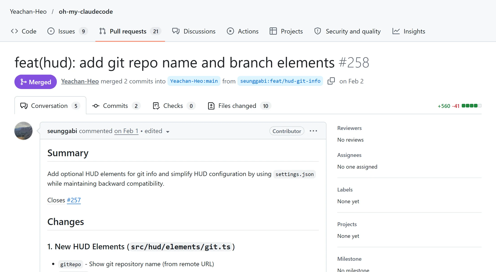

[oh-my-claudecode](https://github.com/Yeachan-Heo/oh-my-claudecode)는 Claude Code 위에서 여러 에이전트를 묶어 돌리는 플러그인이다. 2026년 11월 기준 GitHub 스타가 4만 개가 넘는다. Claude Code 화면 아래 상태 줄에 HUD를 띄워 컨텍스트 사용량, 돌고 있는 에이전트 수 같은 걸 보여 준다.

이 HUD에 기능 두 개를 넣었고, 세 번째는 브랜치를 잘못 잡아 닫혔다.

| PR | 내용 | 결과 |
|---|---|---|
| [#258](https://github.com/Yeachan-Heo/oh-my-claudecode/pull/258) | git 저장소 이름과 브랜치 표시, HUD 설정을 `settings.json`으로 | 2026-02 머지 |
| [#527](https://github.com/Yeachan-Heo/oh-my-claudecode/pull/527) | 설치된 버전 표시와 업데이트 알림 | 2026-02 머지 |
| [#1727](https://github.com/Yeachan-Heo/oh-my-claudecode/pull/1727) | 터미널 폭 자동 감지 | 대상 브랜치가 달라 닫힘 |


_[oh-my-claudecode#258](https://github.com/Yeachan-Heo/oh-my-claudecode/pull/258)_

## 저장소와 브랜치 표시 (#258)

HUD 위에 한 줄을 더 두고 작업 디렉터리, 저장소 이름, 브랜치를 보여 주게 했다.

```text
📁 n8n | repo:my-repo | branch:feature-branch
[OMC] ctx:67% | agents:2 | todos:3/5
```

저장소 이름은 git remote URL에서 뽑는다. 같은 PR에서 HUD 설정을 읽는 순서도 정리했다. `~/.claude/settings.json`의 `omcHud` 키를 먼저 보고, 없으면 예전 위치인 `~/.claude/.omc/hud-config.json`, 그것도 없으면 기본값이다. 예전 파일을 쓰던 사람도 그대로 동작한다.

메인테이너가 두 가지를 요청했다. 새 요소를 켜고 끌 수 있게 해 달라는 것, 그리고 실제로 돌려 봤냐는 것이었다. 설정으로 켜고 끄게 바꿨고, 다시 확인하겠다고 답한 뒤 켠 상태와 끈 상태의 실제 HUD 출력을 댓글로 붙였다. PR은 올리고 다섯 시간 남짓 만에 머지됐다.

테스트는 git 요소 파싱과 오류 처리 18개, 설정 우선순위 8개를 새로 붙였고, 기본값 테스트에도 14개를 더했다.

## 버전 표시와 업데이트 알림 (#527)

HUD 앞의 `[OMC]` 표시에 설치된 버전을 붙여 `[OMC#4.1.10]`처럼 보이게 했다. 새 버전이 있으면 `[OMC#X.Y.Z] -> A.B.C omc update`처럼 업데이트 명령까지 보여 준다.

이 PR에는 CI 수정도 같이 들어갔다. 포크에서 올린 PR은 GitHub Actions 토큰에 쓰기 권한이 없어서, PR 검사 워크플로가 라벨이나 댓글을 달려다 권한 오류로 실패했다. 포크 PR이면 쓰기 작업을 건너뛰게 했다. 그 밖에 빈 `catch` 블록 린트 오류도 고쳤다.

## 터미널 폭 감지 (#1727)

Claude Code는 상태 줄 프로그램을 하위 프로세스로 실행하고 표준 출력을 파이프로 받는다. 그러면 `process.stdout.columns`가 `undefined`가 돼서 HUD는 폭을 모른 채 한 줄로 길게 그리고, Claude Code가 끝을 `...`으로 잘라 버린다.

그래서 폭을 이 순서로 찾게 했다.

1. `process.env.COLUMNS`
2. `process.stderr.columns` (표준 출력이 파이프여도 표준 에러는 TTY인 경우가 많다)
3. `process.stdout.columns`

폭을 찾으면 그 폭에 맞춰 줄을 나눠 그리고, 설정에 `maxWidth`가 있으면 그 값을 따른다.

이 PR은 `main`을 대상으로 올렸는데, 저장소 규칙은 모든 PR을 `dev` 브랜치로 받는 것이었다. 저장소 주인 계정의 봇이 `dev`로 다시 올려 달라는 댓글을 달았고, PR은 2분 만에 닫혔다.

## English summary

oh-my-claudecode is a Claude Code plugin with more than 40,000 GitHub stars, and it shows a HUD in the status line. I added git repository and branch elements to the HUD, with settings read from `settings.json` and the old config file still supported, and I added a version label with an update notice plus a CI fix for fork PRs. Both were merged. A third PR detected the terminal width from `COLUMNS` or stderr when stdout is a pipe, but it was closed because it targeted `main` instead of the `dev` branch.
