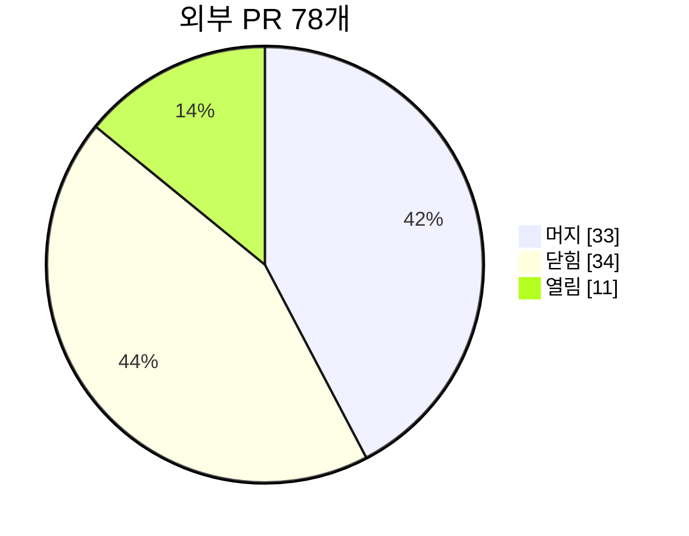

블로그에 오픈소스 기여 글을 쓰려고 내가 보낸 PR을 모으다가, 아예 전부 뽑아서 숫자로 보기로 했다. 대상은 내 저장소가 아닌 곳에 보낸 PR이다. 2018년부터 2026년 11월까지 47개 저장소에 78개였다.

## 뽑은 방법

GitHub 검색 API(`gh search prs`)로 먼저 해 봤는데 빠지는 PR이 많았다. GraphQL의 `user.pullRequests`를 상태별(`MERGED`, `CLOSED`, `OPEN`)로 나눠 페이지를 넘기며 받고, 내 계정 소유 저장소는 뺐다.

```bash
gh api graphql --paginate -f query='
query($endCursor: String) {
  user(login: "seunggabi") {
    pullRequests(first: 50, states: [MERGED], after: $endCursor) {
      pageInfo { hasNextPage endCursor }
      nodes {
        state createdAt mergedAt closedAt additions deletions number
        repository { nameWithOwner stargazerCount owner { login } }
      }
    }
  }
}'
```

한 가지는 손으로 고쳤다. Apache Spark는 GitHub 머지 버튼 대신 머지 스크립트로 커밋을 넣고 PR을 닫는다. 그래서 [Spark 3.4.0에 들어간 PR](/posts/spark-session-config-map/)도 API에서는 `CLOSED`로 나온다. 이 하나는 머지로 바꿔 셌다.

## 전체



닫힌 34개 중 리뷰어가 거절한 건 일부다. 내가 직접 닫은 것, 저장소가 이관돼서 닫은 것, stale 봇이 닫은 것, 대상 브랜치를 잘못 잡아 닫힌 것이 섞여 있다.

## 해마다

| 연도 | PR | 머지 | 닫힘 | 열림 |
|---|---|---|---|---|
| 2018 | 4 | 0 | 4 | 0 |
| 2019 | 3 | 1 | 1 | 1 |
| 2020 | 3 | 3 | 0 | 0 |
| 2021 | 2 | 0 | 2 | 0 |
| 2022 | 26 | 13 | 12 | 1 |
| 2023 | 19 | 8 | 8 | 3 |
| 2024 | 1 | 1 | 0 | 0 |
| 2025 | 0 | 0 | 0 | 0 |
| 2026 | 20 | 7 | 7 | 6 |

2018년의 4개는 React, Angular, axios에 보낸 오타 수정과 작은 리팩터링이었고 모두 닫혔다. 2022년부터 Airflow, Spark, Docker Compose처럼 일하면서 쓰던 도구로 옮겨 갔다. 2026년에는 oh-my-claudecode(8개)와 Superset·Iceberg·PyAthena(8개)가 대부분이다. 아직 열려 있는 6개 중 4개가 Superset과 Iceberg다.

## 저장소 크기별

| 저장소 스타 수 | PR | 머지 | 머지 비율 |
|---|---|---|---|
| 1만 이상 | 30 | 9 | 30% |
| 1천~1만 | 8 | 2 | 25% |
| 100~1천 | 20 | 9 | 45% |
| 100 미만 | 20 | 13 | 65% |

1천 스타 이상 저장소는 머지 비율이 25~30%, 1천 미만은 45~65%다. 1만 스타 이상 저장소에 보낸 30개 중 머지는 9개인데, 4개가 oh-my-claudecode, 나머지는 Superset 2개와 Spark, Airflow, Pinpoint다. 스타 수는 PR을 보낸 시점이 아니라 지금 기준이다.

Apache 프로젝트(Airflow, Airflow 문서 사이트, Spark, Superset, Iceberg)만 보면 13개 중 5개가 머지됐고 4개가 열려 있다.

## 머지까지 걸린 시간

머지된 33개를 PR을 연 시각부터 머지까지 재면 중앙값이 1.4일이다.

| 걸린 시간 | PR 수 |
|---|---|
| 하루 이내 | 13 |
| 일주일 이내(누적) | 21 |
| 30일 넘게 | 4 |

가장 오래 걸린 건 git-flow 치트시트의 한국어 번역 오타를 고친 PR(262일)이었고, 그다음이 Spring Cloud Config 문서에 기본값 한 줄을 적은 PR(196일)이었다. 머지된 PR의 3분의 2 가까이(21개)는 일주일 안에 머지됐다.

## 데이터 도구만

Spark, Airflow, Superset, Iceberg, PyAthena, Airflow Helm 차트, AWS 문서와 CLI처럼 데이터 엔지니어링 도구에 보낸 PR만 추리면 24개다. 머지 10개, 닫힘 8개, 열림 6개다. PR별 이야기는 이 블로그의 [오픈소스 태그](/tags/open-source/)에 모아 두었다.

## English summary

I collected every pull request I sent to repositories I do not own, using the GitHub GraphQL `user.pullRequests` API split by state, because the search API missed some. There were 78 PRs to 47 repositories from 2018 to November 2026: 33 merged, 34 closed and 11 open, counting one Apache Spark PR as merged because Spark merges with a script. Repositories under 1,000 stars merged a larger share, while 9 of 30 PRs to repositories with more than 10,000 stars were merged. The median time from opening to merge was 1.4 days, and 24 of the PRs went to data engineering tools.
