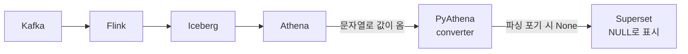
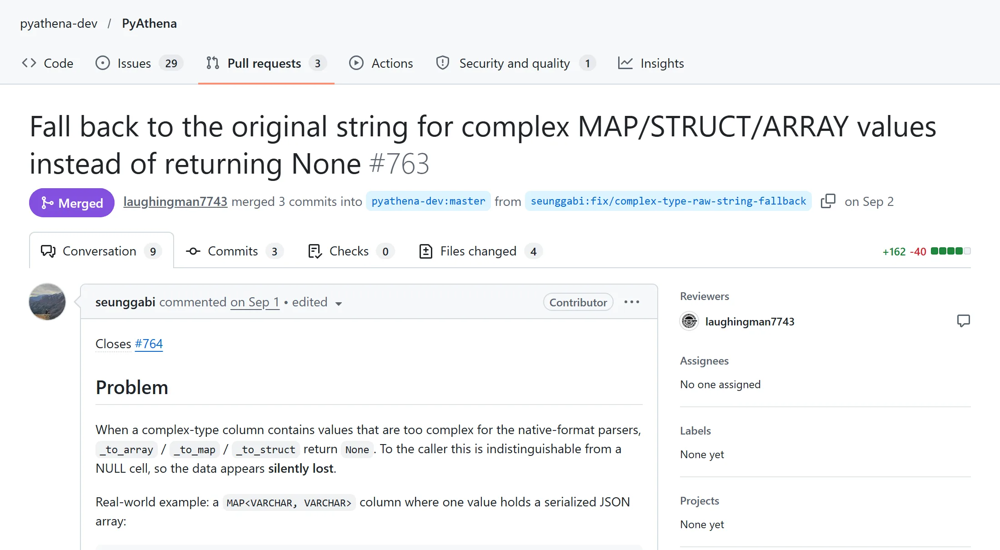

Superset 차트에서 `MAP<VARCHAR, VARCHAR>` 컬럼 일부가 NULL로 나왔다. 같은 테이블에서 어떤 행은 값이 잘 보이고 어떤 행은 비어 있었다. 데이터가 파이프라인 어딘가에서 빠졌다고 생각했다.

그래서 Kafka, Flink, Iceberg 순서로 데이터를 따라가며 디버깅에 한참을 썼다. 데이터는 전부 멀쩡했고, Athena도 값을 제대로 돌려주고 있었다. 값을 버리고 있던 건 Superset이 Athena에 붙을 때 쓰는 Python 드라이버 PyAthena였다.




_[pyathena-dev/PyAthena#763](https://github.com/pyathena-dev/PyAthena/pull/763)_

## PyAthena가 MAP을 읽는 방식

Athena는 MAP, ARRAY, STRUCT 같은 복합 타입 값을 `{push=Y}`처럼 Athena 고유 형식의 문자열로 돌려준다. PyAthena의 converter는 이 문자열을 파이썬 `dict`나 `list`로 바꿔 준다.

단순한 값은 잘 바뀐다. 문제는 값 안에 JSON 같은 구조가 또 들어 있을 때다.

```text
{items=[{"product_id":285,"option_id":6049}], url=/webview/checkout, brand_id=75}
```

이 형식은 값을 따옴표로 묶거나 이스케이프하지 않아서 중첩된 구조를 안전하게 나눌 방법이 없다. 그래서 converter는 이런 값을 만나면 파싱을 포기하고 `None`을 돌려줬다.

```python
_to_map('{push=Y}')                      # {'push': 'Y'}
_to_map('{items=[{...}], brand_id=75}')  # None
```

호출하는 쪽에서 `None`은 NULL과 구분이 안 된다. Superset 화면에서는 값이 없는 것처럼 보인다.

`_to_map` 안에는 원래 이런 주석이 있었다.

```python
# But for complex structures, return None to keep as string
```

문자열을 그대로 두겠다고 써 놓고 실제로는 `None`을 돌려주고 있었다.

## 처음 고친 것

파싱을 포기하는 경로에서 `None` 대신 원래 문자열을 돌려주게 했다. `_to_array`, `_to_map`, `_to_struct` 세 함수 모두 같은 방식이다.

바뀌지 않는 것도 분명히 했다. 입력이 `None`이면 `None`이고, 아예 그 타입처럼 생기지 않은 값도 `None`이다. 파싱할 수 있는 값은 예전처럼 `dict`나 `list`로 나온다. 구조가 꼭 필요하면 쿼리에서 `CAST(col AS JSON)`으로 받는 게 여전히 정석이다. 이 변경은 파싱에 실패해도 값이 사라지지 않게 할 뿐이다.

## 리뷰에서 더 나아간 것

메인테이너 laughingman7743이 같은 종류의 구멍을 네 개 더 찾아 줬다.

- `{a={b=1}}`처럼 중괄호만 중첩된 MAP은 내가 고친 경로를 비껴가서 여전히 `None`이 됐다.
- ARRAY도 모든 항목이 안전 검사에 걸리면 `None`이 됐다.
- 이름 있는 STRUCT도 같은 이유로 `None`이 될 수 있었다.
- 네 번째가 제일 중요했다. 일부 키만 안전 검사에 걸리면 그 키만 조용히 빠진 dict가 나왔다.

```python
_to_map('{a="x", b=1}')  # {'b': '1'}  a는 조용히 사라짐
```

리뷰어 말대로 이건 `None`보다 나쁠 수 있다. `None`은 적어도 뭔가 이상하다는 걸 보여 주지만, 일부만 남은 dict는 멀쩡해 보인다.

그래서 규칙을 바꿨다. 내부 파서는 하나라도 건너뛴 항목이 있으면 `None`을 돌려주고, 바깥 함수는 그걸 받으면 원래 문자열을 돌려준다. 결과는 항상 완전히 파싱된 값이거나, 손대지 않은 원래 문자열 둘 중 하나다.

지적 네 개는 다음 날 커밋 하나로 반영했다. 포크에서 올린 PR은 이 저장소의 AWS 연동 CI를 돌릴 수 없다. 메인테이너가 로컬에서 전체 테스트를 돌렸고, 예전 동작을 기대하던 통합 테스트 두 개도 고쳐서 PR에 올려 줬다. 그리고 9월 2일에 머지됐다.

## 다음에 NULL을 보면

BI 화면에서 NULL이 보이면 파이프라인을 따라가기 전에 같은 쿼리를 Athena 콘솔에서 먼저 돌려 보는 게 빠르다. 콘솔에는 값이 있는데 화면에만 없다면 원인은 드라이버나 BI 도구 쪽이다. 이번에는 원인이 드라이버였는데 파이프라인부터 확인하느라 시간을 많이 썼다.

## English summary

Some values in a `MAP<VARCHAR, VARCHAR>` column showed up as NULL in Superset, and I first traced the whole pipeline from Kafka through Flink to Iceberg. The data was fine; PyAthena's converter returned `None` when a complex value was too nested to parse. My PR made it return the original string instead. The maintainer found more cases, including partial dicts that silently dropped keys, so the final rule is that a value is either fully parsed or kept as the raw string.
