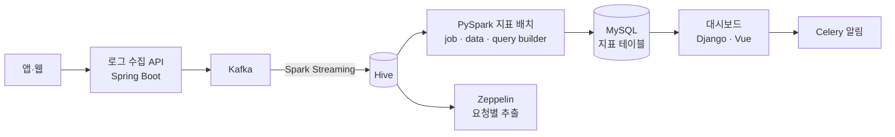

이전 회사에서 음악·오디오 서비스의 데이터 쪽을 맡았다. 로그를 받아 Kafka로 보내는 수집 API, Hive에 쌓인 로그로 지표를 만드는 Spark 배치, 그 지표를 보여 주는 대시보드, 배포와 알림을 돕는 도구까지였다. 이 글은 그중 지표 배치를 어떻게 나눠 관리했는지 적는다. 회사 내부 이름과 테이블은 뺐다.



## 지표가 늘어나는 방식

지표는 서비스별로, 나라별로, 주기별로 늘어난다. 재생 수, 좋아요, 구독자, 멤버십, 플레이리스트, 신규·기존 사용자 비율, 일간·주간 리텐션 같은 것들이 국내와 해외 서비스마다 따로 있었다. 배치 파일이 수십 개가 되면, 날짜 처리나 DB 연결 같은 코드가 파일마다 조금씩 다르게 복사되기 시작한다.

지표 하나는 세 조각으로 나뉘어 있었다.

| 조각 | 하는 일 |
|---|---|
| job | 실행 진입점. 인자로 나라, 환경, 시작일, 종료일을 받고 날짜를 하루씩 돌며 data를 부른다 |
| data | 지표 하나. query builder에서 SQL을 받아 `spark.sql`로 계산하고 MySQL 지표 테이블에 넣는다 |
| query builder | SQL 생성. 설정에서 Hive DB와 테이블을 고르고, 웹과 앱을 가르는 조건 같은 공통 조건을 붙인다 |

날짜 파싱, 주의 시작·끝 계산, Spark 세션, MySQL 연결, 인자 파싱은 공용 패키지로 뺐다. 새 지표는 data 클래스 하나와 query builder 메서드 하나, 그리고 짧은 job 파일을 추가하면 된다.

```python
# 구조만 보여 주는 스케치
def main(args):
    spark = spark_session()
    conf = config(country=args.country, env=args.env)
    qb = QueryBuilder(conf)
    for dt in date_range(args.start, args.end):
        WeeklyRetention(spark, qb, mysql(args), dt).insert()
```

## 시작일과 종료일을 받는 이유

job은 항상 날짜 범위를 받는다. 매일 도는 스케줄에서는 시작일과 종료일이 같은 하루다. 지표 정의가 바뀌었거나 원천 로그가 늦게 들어와 과거 지표를 다시 만들어야 할 때는 범위를 넓혀서 같은 job을 그대로 돌린다. 백필을 위한 코드를 따로 만들 필요가 없다.

다시 돌렸을 때의 결과는 공용 MySQL 코드가 챙겼다. insert가 테이블 unique 키로 겹치는 행을 먼저 지우고 넣기 때문에, 같은 날짜를 다시 돌려도 행이 두 번 들어가지 않는다.

## 웹과 앱을 가르는 조건

같은 지표를 웹과 앱으로 나눠 보는 경우가 많다. 원천마다 가르는 방법이 달랐다. 로그 테이블은 user agent로, 다른 테이블은 서비스 타입 컬럼으로 갈라야 했다. 이 조건을 query builder의 메서드 두 개로 두었고, 웹·앱으로 나누는 지표는 대부분 그 메서드를 거쳤다. 메서드를 거치는 지표는 정의가 바뀌어도 한 곳만 고치면 된다.

## 대시보드와 그때그때 요청

지표 테이블은 Django REST API가 읽고 Vue 화면이 그린다. Celery로 대시보드 API를 주기적으로 호출해 실패하면 메일을 보냈고, 응답이 느린 API는 메신저로 알렸다. 서버는 uwsgi와 nginx를 systemd 서비스로 띄웠다.

정해진 대시보드에 없는 추출 요청은 Zeppelin 노트북으로 처리했다. 노트북 이름에는 요청 티켓 번호를 붙여 두었다.

## English summary

At a previous company I handled data for music and audio services: a Spring Boot log API that sent logs to Kafka, Spark batches over Hive, a Django and Vue dashboard, and deployment and alert tools. Dozens of indicator batches were split into a job entry point that loops over a date range, a data class that runs one query with Spark and writes to MySQL, and a query builder that adds shared conditions such as how to separate web from app traffic. Taking a date range made backfills use the same job as the daily run, and the shared insert removed overlapping rows by unique key first. Ad hoc extraction requests went to Zeppelin notebooks named after their ticket numbers.
