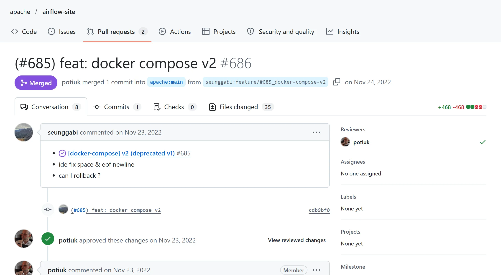

기능 PR 말고 문서 한 줄, 링크 하나 고친 PR도 꽤 보냈다. 머지되기까지 하루가 걸린 것도 있고 반년이 걸린 것도 있다.

| PR | 바꾼 것 | 올린 날 | 머지 |
|---|---|---|---|
| [awsdocs/amazon-athena-user-guide#89](https://github.com/awsdocs/amazon-athena-user-guide/pull/89) | `SHOW PARTITIONS` 문서의 정렬 예제에 DB 이름 추가 | 2022-12-28 | 다음 날 |
| [apache/airflow-site#686](https://github.com/apache/airflow-site/pull/686) | 문서 전체의 `docker-compose`를 `docker compose`로 | 2022-11-23 | 다음 날 |
| [toshimaru/auto-author-assign#79](https://github.com/toshimaru/auto-author-assign/pull/79) | PR뿐 아니라 이슈에도 작성자 자동 지정 | 2022-07-22 | 6일 뒤, v1.6.0 |
| [jkklee/pymysql-pool#20](https://github.com/jkklee/pymysql-pool/pull/20) | 커넥션 풀 싱글턴 클래스 추가 | 2023-08-17 | 3주 뒤 |
| [airflow-helm/charts#733](https://github.com/airflow-helm/charts/pull/733) | 404가 나던 External Secrets 문서 링크 수정 | 2023-04-25 | 3주 뒤 |
| [spring-cloud/spring-cloud-config#2079](https://github.com/spring-cloud/spring-cloud-config/pull/2079) | `git.timeout` 기본값(5초)을 문서에 명시 | 2022-04-20 | 6개월 반 뒤 |


_[apache/airflow-site#686](https://github.com/apache/airflow-site/pull/686)_

## Athena 문서의 `$partitions` 예제

Athena 문서는 파티션 목록을 정렬해서 보려면 `SHOW PARTITIONS` 대신 이렇게 쓰라고 안내했다.

```sql
SELECT * FROM "table_name$partitions" ORDER BY column_name
```

이 예제에 DB 이름을 붙였다.

```sql
SELECT * FROM db_name."table_name$partitions" ORDER BY column_name
```

`$partitions`는 Athena가 파티션 메타데이터를 테이블처럼 보여 주는 숨은 테이블이다. 테이블 이름에 `$`가 들어가서 큰따옴표로 감싸야 하고, DB 이름은 따옴표 밖에 둔다.

## `docker compose`로 바꾸다 468줄

Docker Compose v2부터는 별도 실행 파일 `docker-compose` 대신 Docker CLI 플러그인 `docker compose`를 쓴다. Airflow 문서 사이트에 남아 있던 `docker-compose`를 바꾼 건 59줄이다. IDE가 공백과 파일 끝 줄바꿈까지 고쳐서 추가와 삭제가 468줄씩 나왔다.

커미터 potiuk은 이제 다들 `docker compose`를 쓸 만큼 시간이 지났다고 했다. 다만 colima처럼 다른 Docker 런타임에서도 잘 되는지 물었다. Compose 저장소에 달린 하위 호환 설명을 링크로 답했더니 colima도 되는지 한 번 더 물었다. Docker 포럼에 물어보니 대부분은 되지만 전부는 아니라는 답이 왔고, potiuk은 "Let's see :)"라며 다음 날 머지했다.

## 6개월 반 걸린 한 줄

Spring Cloud Config 문서에 Git 백엔드의 HTTP 연결 타임아웃 기본값이 5초라는 걸 적는 PR이었다. 바꾼 건 한 줄이다. CLA(기여자 라이선스 동의)에 먼저 서명해야 했고, 그 뒤로 반년 넘게 그대로 있다가 11월에 머지됐다.

## 작성자 자동 지정 액션

`auto-author-assign`은 PR을 연 사람을 담당자로 자동 지정해 주는 GitHub Action이다. 이슈에도 같은 동작을 넣고 YAML 따옴표 스타일을 맞추는 PR을 보냈다. 메인테이너가 6일 뒤 머지하고 v1.6.0 프리릴리스로 바로 내보냈다.

## English summary

Besides larger feature PRs, I sent several small documentation and tooling fixes. They included a database name in an Athena `$partitions` example, `docker compose` v2 commands across the Airflow docs site, issue support in the auto-author-assign GitHub Action, a singleton class for pymysql-pool, broken links in the Airflow Helm chart docs, and a documented default timeout in Spring Cloud Config. Two were merged the next day, and the one-line Spring Cloud Config change took about six and a half months.
