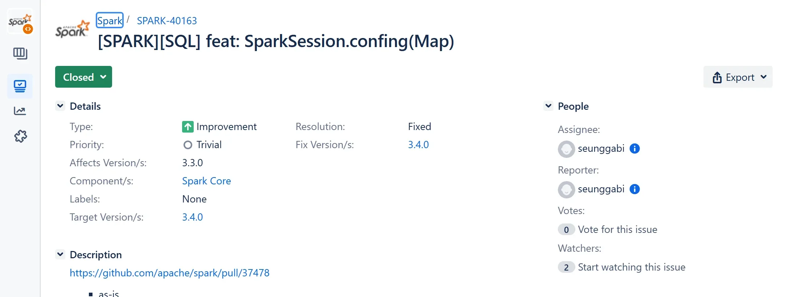

Spark 설정을 YAML 파일에 모아 두고 Kotlin으로 `SparkSession`을 만들던 코드가 있었다. 파일에서 읽은 맵을 빌더에 넣으려면 값의 타입마다 분기를 해야 했다.

```kotlin
map.keys.forEach {
    val v = map[it]
    b = when (v) {
        is Long -> b.config(it, v)
        is String -> b.config(it, v)
        is Double -> b.config(it, v)
        is Boolean -> b.config(it, v)
        else -> b
    }
}
```

`SparkSession.Builder.config`가 `String`, `Long`, `Double`, `Boolean` 네 가지 오버로드만 있어서다. 맵을 통째로 받는 메서드가 있으면 이 분기가 한 줄로 줄어든다.

```kotlin
return builder.config(map)
```

이걸 Spark에 PR([#37478](https://github.com/apache/spark/pull/37478))로 보냈고, Spark 3.4.0에 `config(map)`으로 들어갔다. JIRA는 [SPARK-40163](https://issues.apache.org/jira/browse/SPARK-40163)이다.



## GitHub에는 Closed로 보인다

PR 페이지를 열면 보라색 Merged가 아니라 빨간 Closed가 보인다. Spark는 GitHub의 머지 버튼을 쓰지 않는다. 커미터가 머지 스크립트로 커밋을 master에 직접 넣고, 커밋 메시지 끝에 `Closes #37478`을 붙여서 PR을 닫는다. 그래서 실제로 들어간 PR도 GitHub에는 Closed로 남는다.

들어갔는지는 커밋으로 확인하면 된다. 이 PR은 2022년 8월 21일(UTC) 커밋 `ec4d0ce`로 master에 반영됐고, Sean Owen이 서명했다. JIRA는 Fixed, 수정 버전 3.4.0으로 닫혔다.

## 처음 안에서 최종 안까지

처음 올린 안은 지금 들어간 모양과 달랐다. 리뷰에서 세 번 방향이 바뀌었다.

| 단계 | 내 안 | 리뷰 |
|---|---|---|
| 1 | 기존 `config` 오버로드 네 개를 지우고 `Any`를 받는 `config` 하나로 교체 | Hyukjin Kwon: 바이너리 호환성이 깨진다 |
| 2 | `Any`를 받는 `conf`를 추가하고 기존 `config`는 deprecated 처리, 이후 deprecated는 제거 | Sean Owen: Java에서 쓰기 어렵지 않나, 왜 deprecated하나, 대부분의 호출은 어차피 기존 메서드에 묶이는데 새 메서드의 가치가 뭔가 |
| 3 | 기존 방식도 다 동작한다는 걸 인정하고, PR을 닫아도 괜찮다고 답함 | Sean Owen: 그보다는 맵을 받는 "put all" 오버로드가 더 쓸모 있겠다 |
| 4 | `config(Map[String, Any])`와 Java용 `config(java.util.Map[String, Any])` 추가, Java 테스트 추가 | JIRA를 만들라는 요청 뒤 머지 |

Sean Owen이 요지는 이해했다며 맵 오버로드를 제안했고, 그 안이 머지됐다.

## 들어간 코드

```scala
/**
 * Sets a config option. Options set using this method are automatically propagated to
 * both `SparkConf` and SparkSession's own configuration.
 *
 * @since 3.4.0
 */
def config(map: Map[String, Any]): Builder = synchronized {
  map.foreach {
    kv: (String, Any) => {
      options += kv._1 -> kv._2.toString
    }
  }
  this
}

def config(map: java.util.Map[String, Any]): Builder = synchronized {
  config(map.asScala.toMap)
}
```

값은 `toString`으로 바꿔 넣는다. 기존 `config(key, Long)` 같은 오버로드도 결국 문자열로 저장하기 때문에 동작은 같다. Java에서 Scala `Map`을 만들기는 번거로워서 `java.util.Map` 오버로드를 따로 두고, `JavaSparkSessionSuite`에 Java 테스트를 붙였다.

## 그 뒤

머지 나흘 뒤 Hyukjin Kwon이 PySpark에도 같은 기능을 넣었다([SPARK-40202](https://issues.apache.org/jira/browse/SPARK-40202)). 커밋 설명에 Scala 쪽과 API를 맞추기 위해서라고 적고 SPARK-40163을 참조했다.

```python
SparkSession.builder.config(map={"spark.some.config.number": 123, "spark.some.config.float": 0.123})
```

9월에는 다른 기여자가 내 Java 테스트의 `assert`를 JUnit `Assert` API로 바꾸는 후속 커밋을 넣었다.

Spark 4에서 `SparkSession` 코드가 `sql/api` 모듈로 옮겨졌는데, `config(map: Map[String, Any])`는 지금도 `@since 3.4.0` 표시와 함께 남아 있다.

## English summary

I added `SparkSession.Builder.config(Map)` to Apache Spark so that a whole map of settings, for example one loaded from YAML, can be passed at once instead of branching on each value type. My first proposals would have broken binary compatibility or added little value, and after review the committer suggested a map overload instead. I added Scala and Java `Map` overloads with tests, and the change was committed to master and shipped in Spark 3.4.0, even though the GitHub PR shows as Closed because Spark merges with a script. PySpark later added the same option for API parity.
