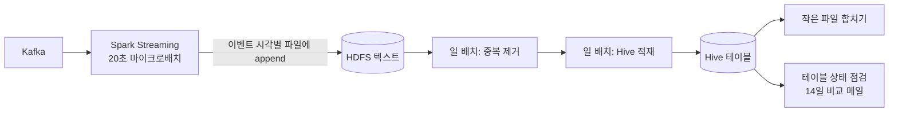

[로그 수집 API](/posts/log-collection-api/)가 Kafka로 보낸 로그는 Spark Streaming 잡이 받아 HDFS에 텍스트 파일로 쌓았다. 그 위에서 매일 도는 배치 몇 개가 중복을 지우고, Hive 테이블에 올리고, 작은 파일을 합치고, 테이블이 정상인지 확인했다. 음악·오디오 서비스에서 맡았던 일이고, 회사 내부 이름과 경로는 뺐다.



## 스트리밍: 이벤트 시각으로 파일을 나눈다

Spark Streaming의 Kafka direct stream으로 토픽을 읽고, 20초마다 마이크로배치를 돌렸다. 배치 안에서 하는 일은 이렇다.

1. 메시지를 JSON으로 파싱해 첫 이벤트의 시각을 꺼낸다.
2. 그 시각을 분 단위 문자열로 바꿔 키로 쓴다.
3. 같은 키의 메시지를 줄바꿈으로 이어 붙인다.
4. 키마다 HDFS의 해당 시각 파일을 찾아, 없으면 만들고 끝에 붙여 쓴다.

파일은 받은 시각 대신 이벤트 시각으로 나눴다. 늦게 도착한 로그도 자기 날짜 폴더에 들어가서, 일 배치는 날짜 폴더 하나만 읽으면 된다. 다만 7일까지 늦게 오는 로그는 일 배치가 돈 뒤에 들어올 수도 있다. [수집 API에서 이벤트 시각을 7일 전부터 1일 뒤 사이로 맞춰 둔 것](/posts/log-collection-api/)도 이 단계에서 엉뚱한 날짜 폴더가 생기지 않게 해 준다. 시각을 파싱하지 못한 메시지는 현재 시각 파일로 보낸다.

다시 처리해야 할 때를 위해 복구 모드 인자를 뒀다. 이 값을 주면 잡 이름과 컨슈머 그룹 이름이 달라져서, 평소 잡과 따로 처음부터 다시 읽을 수 있다.

이 방식에는 한계도 있다. 키별로 합친 결과를 드라이버로 모아(`collect`) 파일에 쓰기 때문에 한 배치의 로그가 많으면 드라이버 메모리가 부담이 된다. HDFS append가 되는 환경이어야 한다. 그리고 20초마다 파일 끝에 조금씩 붙이니 작은 쓰기가 많다. 아래 일 배치들이 이 부분을 정리한다.

## 일 배치: 중복을 지우고 바꿔치기

스트리밍은 오프셋을 컨슈머 자동 커밋에 맡겼다. 그래서 재시작하면 메시지가 겹치거나 빠질 수 있고, 복구 모드로 다시 읽어도 같은 줄이 겹친다. 매일 그날 폴더의 텍스트를 읽어 `dropDuplicates()`로 같은 줄을 지우는 배치가 겹친 쪽을 정리했다. 빠진 메시지는 이 배치로 되살릴 수 없다.

쓸 때는 원래 경로에 바로 덮어쓰지 않는다. `_TMP`가 붙은 경로에 파일 하나로 쓴 뒤, 원래 폴더를 지우고 임시 폴더의 이름을 바꿔 끼운다. 쓰는 도중에 실패해도 원래 데이터는 남아 있다. 대신 읽은 뒤부터 지우기 전까지 스트리밍이 새로 붙인 줄은 지울 때 같이 사라질 수 있다.

```text
1. 날짜 폴더의 텍스트 읽기
2. dropDuplicates()
3. <경로>_TMP에 쓰기 (coalesce(1))
4. 원래 경로 삭제
5. <경로>_TMP → <경로> 이름 변경
```

## Hive 적재와 ORC

중복을 지운 텍스트는 JSON 스키마 파일을 기준으로 읽어 Hive 테이블에 날짜 파티션으로 올렸다. 이 잡도 시작일과 종료일을 받아 하루씩 돌기 때문에 백필에 그대로 쓴다. user agent로 웹·앱 구분, OS, 앱 버전을 컬럼으로 뽑았다.

텍스트 테이블을 ORC로 바꾸는 잡도 따로 있었다. ORC는 컬럼 단위로 저장하고 압축하는 포맷이다.

## 작은 파일 합치기

Hive 테이블도 파티션마다 파일이 많아진다. 파일이 많으면 NameNode 메모리와 쿼리 시작 비용이 늘어난다. 테이블과 파티션을 돌며 파일을 합치는 잡을 따로 뒀다.

| 상황 | 처리 |
|---|---|
| 파티션의 파일이 1개 이하 | 건너뜀 |
| 행 수가 상한을 넘음 | 합치지 않고 실패로 표시 |
| 그 밖 | 합침 |

결과는 테이블, 파티션, 파일 수, 행 수, 상태를 CSV로 만들어 메일로 보냈다. 어떤 파티션이 건너뛰어졌고 어떤 파티션이 실패했는지 한 장으로 볼 수 있다.

## 테이블 상태 점검

로그 테이블이 비거나 갑자기 줄면 뒤쪽 지표가 다 틀린다. 그래서 지난 14일의 행 수를 날짜와 시간별로 세고, 최근 이틀 중 어떤 시간대가 1~2주 전 같은 시간대 평균보다 크게 낮으면 경고로 표시했다. 결과는 메일로 보내고, 경고가 있으면 메일 제목에 표시를 붙이고 메신저로도 알렸다.

## English summary

For music and audio services, a Spark Streaming job read the log topics from Kafka every 20 seconds and appended messages to HDFS text files bucketed by event time, so late logs still landed in the right date folder, with a recovery mode that used a separate consumer group. Daily batches then removed duplicates with `dropDuplicates()` and swapped the result in through a temporary path, loaded the text into date-partitioned Hive tables, converted text tables to ORC, merged small files per partition with a CSV report by mail, and compared hourly row counts over 14 days to flag empty or shrinking tables.
