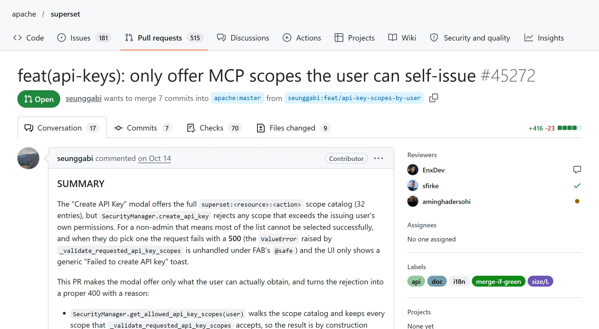

Superset에서 MCP용 API 키를 만드는 창을 열면 `superset:<resource>:<action>` 형태의 권한 범위(scope) 32개가 전부 나온다. 그런데 관리자가 아닌 사용자는 그중 대부분을 고를 수 없다. 서버가 "키에 담을 수 있는 범위는 발급하는 사람이 가진 권한 안쪽까지"라는 규칙으로 막기 때문이다.

문제는 막는 방식이었다. 자기 권한을 넘는 범위를 골라 만들기를 누르면 서버는 `ValueError`를 던지고, 그 예외가 처리되지 않아 HTTP 500이 났다. 화면에는 "Failed to create API key"라는 토스트 한 줄만 떴다. 사용자는 무엇이 잘못됐는지 알 수 없었다.

_[apache/superset#45272](https://github.com/apache/superset/pull/45272)_

## 처음 올린 수정

권한 규칙은 하나도 바꾸지 않았다. 누가 키를 만들 수 있고 키에 어떤 범위를 담을 수 있는지는 그대로다. 대신 화면이 거절될 게 뻔한 선택지를 보여 주지 않게 했다.

| 바꾼 곳 | 내용 |
|---|---|
| `SecurityManager.get_allowed_api_key_scopes(user)` | 범위 목록을 돌며 발급 검증을 통과하는 것만 남긴다. 관리자는 전체, 해당 권한이 없는 사용자는 빈 목록 |
| 새 API `GET /api/v1/me/api_key_scopes/` | 현재 사용자가 발급할 수 있는 범위 목록 |
| `create_api_key` | 범위 초과를 500 대신 400과 이유로 돌려준다 |
| `ApiKeyCreateModal` | 창이 열릴 때 위 목록을 받아 선택지를 거른다. 목록을 못 받으면 예전처럼 전체를 보여 준다. 실패 토스트에 서버가 준 이유를 붙인다 |

허용 목록은 실제 발급 검증 함수를 그대로 돌려서 만들었다. 화면 목록과 실제 발급 범위가 어긋나지 않게 하려는 것이다. 첫 리뷰어도 이 점을 짚었다.

## 리뷰를 기다린 5주

10월 14일에 올렸고 바로 리뷰어 한 명이 지적 두 개를 남겼다. 목록을 불러오는 동안 전체 범위가 잠깐 보인다는 점과, 토스트 문구를 문자열 이어 붙이기 대신 `%s` 번역 문자열로 바꾸라는 내용이었다. 불러오는 중에는 아무것도 보이지 않게 상태를 나눴다. 고쳐서 올렸더니 더 볼 게 없다는 답이 왔다.

그런데 머지하려면 커미터의 승인이 필요했다. API 키와 MCP 범위 코드를 작업했던 커미터들을 지목해 세 번 리뷰를 부탁했고, 중간에 master도 한 번 다시 받았다. 그렇게 한 달이 넘게 지났다.

## 같은 버그를 겪은 사람이 리뷰를 달았다

11월 19일에 다른 기여자가 댓글을 달았다. 관리자가 아닌 사용자에게 MCP 접근을 설정해 주다가 같은 버그를 만났고, 보고하려다 이 PR을 찾았다고 했다. 그 사람은 AI로 리뷰를 작성하고 자기가 확인했다고 밝힌 뒤, 수정 요청 두 개와 선택 사항 하나를 남겼다.

1. 400 응답 메시지에 `400 Bad Request:`가 앞에 붙는다. werkzeug의 `BadRequest`를 `str()`로 바꾸면 상태 줄이 같이 붙기 때문이다. 토스트가 "Failed to create API key: 400 Bad Request: Requested scope ..."로 보였다.
2. 창을 열 때마다 SQL이 90개 안팎으로 나간다. 범위마다 검증 함수를 돌리고, 그 안의 권한 확인이 하나하나 DB 쿼리였다. 리뷰어가 직접 세어 보니 역할 하나에 부여된 권한이 없는 사용자 기준으로 97개였다.
3. 선택 사항으로, 토스트가 `message` 대신 `error`를 읽어야 스키마 검증 실패가 `[object Object]`로 보이지 않는다.

다음 날 세 가지를 모두 반영했다.

- 범위 초과는 `ApiKeyScopeError(BadRequest, ValueError)`라는 예외로 던진다. `__str__`이 이유만 돌려줘서 응답에 상태 줄이 붙지 않는다. `ValueError`이기도 해서 CLI나 Celery처럼 요청 밖에서 부르는 쪽도 그대로 동작한다.
- 허용 목록은 사용자 권한을 `get_user_permissions(user)`로 한 번만 읽어 메모리에서 비교한다. 발급 검증과 목록 계산은 같은 판정 함수(`_user_can_issue_resource_scope`)를 쓴다.
- 토스트는 `error`를 읽는다.

리뷰어가 승인했고, CI가 통과하면 머지하라는 `merge-if-green` 라벨이 붙은 뒤 2026년 11월 21일에 메인테이너가 머지했다.

## English summary

The API key dialog in Apache Superset listed all 32 MCP scopes, but non-admin users could only get a few of them, and choosing a forbidden one returned an HTTP 500 with a generic error. My merged PR made the dialog show only the scopes the user can issue and turned the failure into a 400 with the reason. After waiting about a month for a committer review, another contributor who hit the same bug reviewed it and found that opening the dialog ran about 97 SQL queries. I changed it to load the user's permissions once, removed the status line from the error message.
