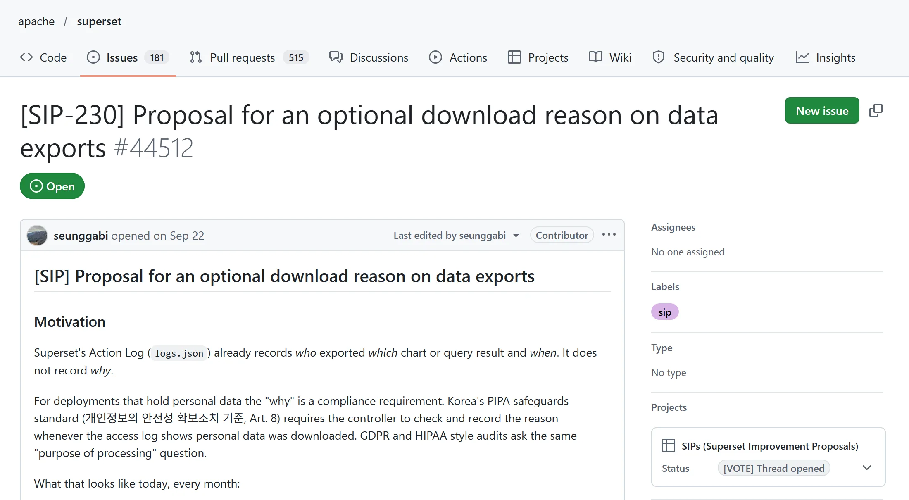

개인정보가 들어 있는 테이블을 Superset으로 보고 있다면 매달 비슷한 일이 생긴다.

1. 분석가가 12일에 고객 세그먼트 차트를 CSV로 내려받는다.
2. 다음 달 1일, 보안 담당자가 Action Log를 점검하다 그 다운로드를 본다. 무엇 때문에 받았는지는 어디에도 없다.
3. 보안 담당자가 분석가에게 묻는다. "12일에 고객 테이블 3만 건 받으셨던데 어디에 쓰셨어요?" 분석가는 티켓을 뒤져서 이틀 뒤에 답한다.
4. 그 답은 로그 옆에 따로 둔 스프레드시트에 붙여 넣는다. 감사 때 보여 줘야 하니까.

개인정보의 안전성 확보조치 기준 제8조(개정안 시행 전 현행 기준)는 접속기록을 점검하다 개인정보 다운로드가 발견되면 그 사유를 확인하라고 한다. Superset의 Action Log에는 누가, 어떤 차트나 쿼리 결과를, 언제 내려받았는지는 남는다. 왜 받았는지만 없다.

그래서 다운로드할 때 사유를 입력하게 하고, 그 사유를 기존 Action Log에 같이 남기는 기능을 만들었다. PR([#44499](https://github.com/apache/superset/pull/44499))은 2026년 9월에 올렸는데, 아직 머지되지 않았다. 지금은 Superset의 기능 제안 절차인 SIP 투표를 기다리고 있다.

_[SIP-230](https://github.com/apache/superset/issues/44512)_

## 기능은 작게, 저장은 있던 곳에

설정 하나(`REQUIRE_DOWNLOAD_REASON`, 기본값 꺼짐)로 켜고 끈다. 켜면 CSV나 XLSX를 받을 때 사유를 묻는 창이 뜬다. 취소하면 다운로드도 안 된다. JSON 내보내기는 묻지 않는다.

새 테이블이나 마이그레이션은 만들지 않았다. Superset의 이벤트 로거는 이미 요청의 쿼리스트링과 폼 값을 `logs.json`에 같이 저장한다. 그래서 다운로드 요청에 `download_reason` 파라미터만 붙이면 사유가 기존 다운로드 기록 옆에 그대로 남는다. 관리자는 Security → Action Log에서 원래 보던 화면 그대로 확인하면 된다.

| 경로 | 처리 |
|---|---|
| 차트 데이터 API (csv, xlsx) | 설정이 켜져 있는데 사유가 없으면 400 |
| SQL Lab CSV, 스트리밍 CSV | 같음 |
| 대시보드 전체 Excel 내보내기 | 같음 |
| 예약 리포트(Alerts & Reports) | 실행기가 `Scheduled report: <이름> (id=<id>)`를 자동으로 붙임 |
| Explore의 화면 기준 CSV | 브라우저에서 바로 만들어 서버를 거치지 않으므로, 프런트엔드 로그 이벤트에 사유를 남김 |

예약 리포트도 같은 내보내기 API를 부른다. 자동 사유가 없으면 설정을 켜는 순간 예약 리포트가 전부 400으로 막히고, 막히지 않더라도 사람이 받은 것과 기계가 받은 것을 구분할 수 없다.

사유는 GET 요청 URL에도 실리기 때문에 255자로 제한했다.

## 리뷰어가 먼저 물은 건 코드가 아니었다

PR을 올린 날 리뷰어 한 명이 SIP를 열어 달라고 했다. 사용 사례를 더 알고 싶고, 왜 설정값이 아니라 새 기능 플래그로 만들었는지도 궁금하다며, PR에 `hold:sip!` 라벨을 붙였다. 처음 버전은 기능 플래그였다.

SIP(Superset Improvement Proposal)는 Superset에 새 기능이나 큰 변경을 넣기 전에 공개적으로 논의하는 문서다. 이슈로 제안서를 올리고, `dev@` 메일링 리스트에서 [DISCUSS] 스레드로 논의한 뒤 [VOTE]로 투표한다.

다음 날 [SIP-230](https://github.com/apache/superset/issues/44512)을 올렸다. 위에 적은 월말 점검 시나리오, 사유가 있으면 점검표가 어떻게 바뀌는지, 점검표가 어떻게 바뀌는지는 표로, 사고가 났을 때 90일치 다운로드 40건을 추려 내는 과정은 예시로 적었다.

메일링 리스트를 구독하고 [DISCUSS] 스레드를 열었다. 가장 큰 쟁점은 기능 플래그냐 설정값이냐였고, 사유를 묻고 확인하는 부분을 한곳에 모아 나중에 다른 기능도 쓸 수 있게 해 달라는 요청도 있었다. 기능 플래그는 점진적으로 켜다가 언젠가 없앨 기능에 쓰는 것이고, 이건 배포 정책이니 설정값이 맞다는 의견이 스레드에서 나왔다. 동의하고 `FEATURE_FLAGS`에서 빼서 일반 설정 키로 옮겼다. 설정을 읽는 곳도 백엔드 함수 하나(`is_download_reason_required()`)로 모았다.

2026년 11월 현재 [VOTE] 스레드가 열려 있다. 마감은 11월 20일로 한 번 연장됐고, binding +1이 하나 있고 반대는 없다.

## 그 사이에 master CI를 고쳤다

PR의 CI가 빨갛게 나왔는데, 원인은 master에 있었다. 그날 새벽 머지된 다른 PR이 `getClientErrorObject`를 쓰면서 import를 빠뜨렸고, 번역 템플릿(`messages.pot`)도 갱신이 안 돼 있었다.

두 개를 고치는 작은 PR([#44513](https://github.com/apache/superset/pull/44513))을 따로 올렸고, 같은 날 머지됐다. 그 뒤 원래 PR 브랜치에 master를 머지해 반영했다.

## English summary

I proposed an optional download reason for CSV and XLSX exports in Apache Superset. When the `REQUIRE_DOWNLOAD_REASON` setting is on, users must give a reason before downloading, and the reason is stored in the existing Action Log with no new table. Scheduled reports send an automatic reason so they keep working. Maintainers asked for a SIP first, so I wrote SIP-230, ran the discussion on the dev@ mailing list, and changed the feature flag to a config setting as agreed. The vote is still open, and while waiting I also fixed a broken master build in a separate PR.
