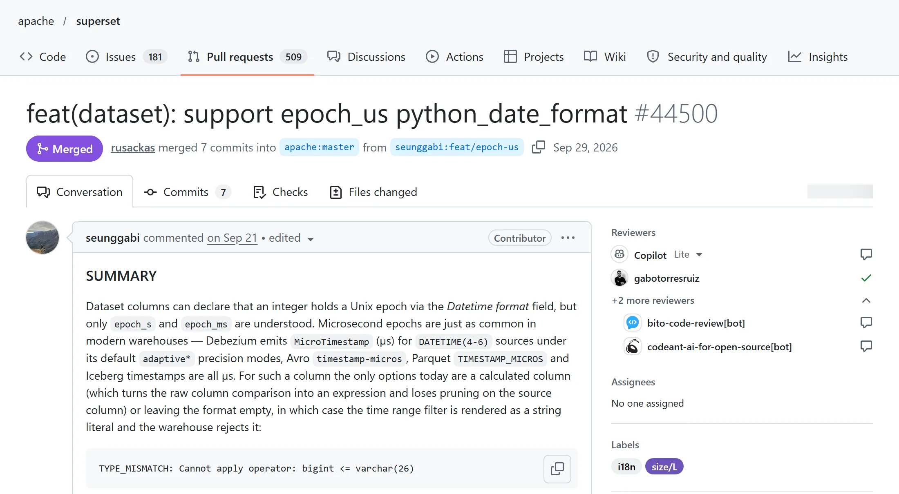

Superset 데이터셋 컬럼 설정에는 Datetime format이라는 칸이 있다. 시간 컬럼을 어떻게 해석할지 정하는 칸인데, 정수 epoch용으로 고를 수 있는 값은 `epoch_s`, `epoch_ms` 두 개뿐이었다.

마이크로초 정수 컬럼으로 시계열 차트를 만들면 시간 필터가 깨졌다. 우회법이 두 개 있긴 했는데, 하나는 쿼리가 실패했고 다른 하나는 스캔량이 늘 수 있었다. 결국 `epoch_us`를 추가하는 PR을 올렸고 9월 29일에 머지됐다.


_[apache/superset#44500](https://github.com/apache/superset/pull/44500)_

## 마이크로초는 생각보다 흔하다

밀리초 epoch는 다들 익숙하다. 마이크로초는 드물 것 같은데, 파이프라인을 따라가 보면 꽤 자주 나온다.

- Debezium은 MySQL `DATETIME(4)`~`DATETIME(6)` 컬럼을 기본 설정(`time.precision.mode=adaptive_time_microseconds`)에서 마이크로초 정수(`MicroTimestamp`)로 내보낸다.
- Avro `timestamp-micros`, Parquet `TIMESTAMP_MICROS`도 마이크로초다.
- Iceberg timestamp 타입도 마이크로초 정밀도라서, 정수로 받은 값과 단위가 그대로 맞는다.

CDC로 받은 값이 BIGINT 그대로 테이블에 쌓이면, Athena나 Trino에서 보는 컬럼은 `1704067200000000` 같은 큰 정수일 뿐이다.


원천 DB와 Debezium까지는 이 값이 마이크로초 시각이라는 걸 안다. 테이블에 BIGINT로 쌓이고 나면 그 정보는 사라진다. Superset에서 다시 알려줘야 하는데, 고를 수 있는 값에 마이크로초가 없었다.

## 우회법 두 개

첫 번째는 Datetime format을 비워 두는 방법이다. 그러면 Superset이 시간 범위 필터를 문자열 리터럴로 만든다. 정수 컬럼을 문자열과 비교하니 쿼리가 바로 실패한다.

```text
TYPE_MISMATCH: Cannot apply operator: bigint <= varchar(26)
```

두 번째는 계산 컬럼이다. `from_unixtime(created_at / 1000000)`으로 timestamp를 만들어 두고 그걸 시간 컬럼으로 쓴다. 차트는 잘 나오지만 WHERE 절이 문제다.

```sql
-- 계산 컬럼을 쓰면 필터가 이렇게 나간다
WHERE from_unixtime(created_at / 1000000) >= TIMESTAMP '2026-09-14 00:00:00'

-- 원하는 건 이쪽이다
WHERE created_at >= 1789344000000000
```

원본 컬럼에 함수가 씌워지면 엔진은 원본 컬럼의 파티션 값이나 파일 통계로 데이터를 건너뛰기 어렵다. 이 컬럼으로 파티셔닝이나 정렬을 해 둔 테이블이라면 읽지 않아도 될 파일까지 읽게 될 수 있다. Athena처럼 스캔량이 곧 비용인 곳에서는 그냥 넘길 문제가 아니었다.

## 고친 방법

`epoch_ms`가 처리되는 곳을 전부 찾아서 `epoch_us`를 같은 방식으로 넣었다. 필터 리터럴, 타임 그레인 표현식, 결과 변환, 입력 검증, 편집 화면 도움말까지 크게 다섯 갈래였다.

코드를 읽다 보니 `("epoch_s", "epoch_ms")` 튜플이 여러 파일에 따로따로 적혀 있는 게 거슬렸다. 여기에 `epoch_us`를 하나씩 끼워 넣으면 언젠가 한 곳은 빠진다. 그래서 상수 하나로 모았다.

```python
EPOCH_FORMATS = {"epoch_s": 1, "epoch_ms": 1_000, "epoch_us": 1_000_000}
```

나머지는 이 상수를 기준으로 맞췄다.

필터 리터럴은 기존 포맷처럼 경계 시각을 UTC 초 단위로 자른 뒤 1,000,000을 곱한다.

타임 그레인 표현식에는 `epoch_us_to_dttm()`을 새로 만들었다. 기본 구현은 엔진의 `epoch_ms_to_dttm()`에 `({col}/1000)`을 넘기는 방식이다. 이렇게 하면 밀리초 템플릿을 따로 정의해 둔 엔진(Druid, Oracle 등)에서도 문법이 맞는 SQL이 나온다. 해상도는 엔진마다 다르다. 밀리초 템플릿이 있는 엔진은 밀리초까지 남는다. 나머지 엔진은 기본 `epoch_ms_to_dttm()`이 다시 1000으로 나눠 초 단위 함수에 넘기기 때문에 초 해상도가 된다. 초보다 굵은 그레인이면 결과는 같다.

마이크로초 변환 함수를 따로 가진 엔진은 그 함수를 쓰게 했다.

| 엔진 | 쓰는 함수 |
|---|---|
| BigQuery | `TIMESTAMP_MICROS` |
| Snowflake | `DATEADD(US, ...)` |
| Kusto | `unixtime_microseconds_todatetime` |
| Pinot | `DATETIMECONVERT(..., '1:MICROSECONDS:EPOCH', ...)` |

쿼리 결과의 시간 컬럼을 pandas datetime으로 바꿀 때는 `unit="us"`가 넘어간다. 입력 검증 두 곳도 새 값을 받게 했다. 화면에서 바뀐 건 Datetime format 도움말 한 문장이다.

Athena/Trino의 BIGINT 마이크로초 컬럼에 일 단위 그레인과 시간 범위를 걸면 이런 SQL이 나온다.

```sql
SELECT date_trunc('day', CAST(from_unixtime(((created_at/1000)/1000)) AS TIMESTAMP)) AS created_at, ...
FROM app_community_receipt
WHERE created_at >= 1789344000000000 AND created_at < 1789948800000000
```

SELECT 쪽에는 함수가 들어가지만 WHERE 절은 원본 컬럼과 정수의 비교다. 처음에 원했던 모양이다.

엔진별 SQL, 필터 리터럴, pandas 변환, 검증기에 각각 테스트를 붙였다. 테스트 파일만 해도 7개다.

## 리뷰

PR을 올리고 9시간쯤 지나서 리뷰어 한 명이 승인했다. 흩어진 튜플을 상수 하나로 모은 부분을 콕 집어서, 포맷 목록이 다시 어긋나지 않게 막아 준다고 적어 줬다.

사소한 지적(nit)이 두 개 있었다.

1. 내가 `epoch_us_to_dttm` docstring에 "결과는 밀리초 해상도"라고 적었는데, 이건 밀리초 템플릿을 따로 정의한 엔진에만 맞는 말이었다. 나머지 엔진은 기본 구현을 타서 초 단위가 된다. 설명을 고쳤다.
2. 테스트에서 엔진 클래스를 `importlib`로 문자열에서 불러오고 있었다. 이러면 클래스 이름이 바뀌어도 테스트 수집 단계에서 안 걸리고 실행 중에 터진다. 직접 import로 바꿨다.

AI 리뷰 봇도 세 개가 붙었다. CodeAnt, Bito, Copilot이다. CodeAnt는 지적마다 "Major"를 달았다. 하나씩 확인해 보니 일부는 이미 처리된 부분이었고, 일부는 기존 포맷과 똑같은 동작이었다.

- BigQuery가 기본 구현을 물려받아 실수 나눗셈이 들어간다는 지적(CodeAnt). BigQuery 엔진은 `TIMESTAMP_MICROS`로 따로 오버라이드하고 있었고, 테스트가 그걸 확인하고 있었다.
- 결과 변환이 마이크로초를 초로 읽는다는 지적(Copilot). 바로 아래 줄에서 포맷 문자열의 `epoch_` 뒤를 잘라 pandas 단위로 쓰고 있어서 `us`가 그대로 들어간다.
- 문자열 컬럼에 `epoch_us`를 지정하면 깨진다는 지적 두 개(CodeAnt). `epoch_s`, `epoch_ms`도 원래 똑같이 동작한다. 기존 규칙상 데이터셋을 잘못 설정한 경우라고 답했고, 문자열 epoch 처리를 바꾸는 건 별도 변경으로 하자고 했다.
- 경계 시각을 초 단위로 자르면 정밀도를 버린다는 지적(Bito). 기존 포맷과 맞추려고 일부러 그렇게 했고, 정수로 계산해야 float 정밀도 손실도 없다고 답했다.

봇 지적은 PR을 올리고 몇 분에서 하루 사이에 달렸다. diff 몇 줄만 보고 판단한 게 많았다. 그냥 resolve 해도 됐지만, 나중에 코드를 보는 사람도 같은 의문을 가질 것 같아서 코드 위치와 테스트 이름을 달아 하나씩 답했다. 이게 생각보다 시간이 많이 들었다.

master를 다시 받는 커밋과 번역 파일 동기화 커밋을 올린 뒤, 9월 29일에 머지됐다. 올린 지 8일 만이었다.

## 돌아보면

같은 컬럼에 밀리초와 마이크로초가 섞여 들어오면 더 곤란하다. 1,000배 차이라서 날짜가 1970년 근처로 가거나 먼 미래로 튄다. CDC 커넥터의 정밀도 모드는 처음부터 고정해 두는 게 낫다.

계산 컬럼을 쓸 거라면 WHERE 절이 실제로 어떻게 나가는지 쿼리 로그로 한 번은 확인하자. 차트가 멀쩡하게 나와도 스캔량은 따로 봐야 안다.

## English summary

Superset only understood epoch seconds and milliseconds for integer time columns. Microsecond epochs are common in data pipelines, for example from Debezium, Avro, Parquet, and Iceberg. Without a microsecond option, the time filter failed, or I had to use a calculated column that could make pruning harder. I added `epoch_us` everywhere epoch formats are handled and put all formats into one constant so they stay in sync. The PR was merged on September 29, 2026.
