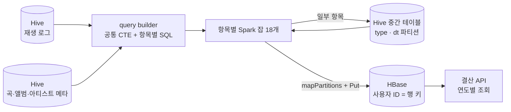

연말 결산 화면은 사용자 한 명에게 "올해 가장 많이 들은 앨범, 계절별로 많이 들은 곡, 가장 많이 들은 날, 장르 비율" 같은 것을 한꺼번에 보여 준다. 화면을 열 때마다 1년 치 재생 로그를 사용자별로 집계하면 응답이 너무 늦다. 이 잡들은 항목을 전부 미리 계산해 HBase에 넣어 두고, API는 사용자 한 명의 결과를 한 번에 읽기만 한다.

이전 회사에서 음악·오디오 서비스의 데이터 쪽을 맡았다. 결산 화면을 채우는 Spark 잡들은 내가 만들었다. 회사 내부 이름과 테이블은 뺐다.



## 항목 하나가 잡 하나

결산 화면의 항목마다 잡 클래스를 하나씩 두었다.

| 잡 | 계산하는 것 |
|---|---|
| 앨범, 아티스트, 장르, 무드 | 사용자별 상위 N개와 재생 수 또는 점수 |
| 계절, 월별 곡, 가장 많이 들은 날 | 기간마다 사용자별 1위 곡이나 상위 곡, 재생 수 1위 날짜 |
| 시간·곡 수, 트렌드 | 총 재생 시간과 곡 수, 나중에 인기 곡이 된 곡을 그 전에 들었는지 |
| 믹스 | 사용자별로 많이 들은 곡, 분위기별 곡, 추천 곡 목록 |
| 기본값, 플레이리스트, 파티 | 사용자와 상관없는 공용 목록 |

흐름은 모두 같다. 대부분 인자로 나라와 연도를 받고, query builder에서 SQL 문자열을 받아 `spark.sql`로 돌린 뒤 결과를 HBase에 쓴다. 월별 잡은 1월부터 12월까지 기간만 바꿔 같은 쿼리를 돌리므로, 1년 로그를 열두 번 읽는다.

## SQL은 CTE 조각을 이어 붙여 만든다

쿼리는 Java static 메서드가 문자열로 만든다. 항목마다 다른 부분은 뒤쪽 순위 계산뿐이고, 앞쪽의 "사용자별로 어떤 곡을 몇 번 들었나"는 공통 CTE 하나를 거의 모든 항목이 같이 쓴다. 이 CTE를 만드는 메서드는 플래그 몇 개로 모양을 바꾼다.

| 플래그 | 바뀌는 것 |
|---|---|
| 연 단위로 묶을지 | 묶지 않으면 날짜 컬럼이 남아, 날짜·기간 항목에서 쓴다 |
| 과거 연도인지 | 연도 조건이 `=` 대신 `<`가 된다. 올해 처음 들은 아티스트를 고를 때 쓴다 |
| 월 | 월 조건이 붙는다 |
| 사용자 목록 포함 | 올해 한 번이라도 들은 사용자 목록 CTE가 앞에 붙는다 |

공통 CTE는 무료 재생을 빼고 유료 재생만 센다. 해외 쪽은 총 재생 시간이 일정 이상인 재생만 남기고, 일부 재생 위치에서 나온 로그는 뺀다.

국내와 해외 서비스는 로그 테이블도, 메타 테이블도, ID 모양도 달랐다. 그래서 메서드 안에서 나라별로 원천을 읽는 CTE를 따로 만들고, 해외 쪽 숫자 ID는 국내와 같은 문자열 ID 모양으로 바꿨다. 컬럼 이름이 같으니 뒤쪽 순위 SQL은 나라와 상관없이 하나다. 연도 같은 값은 문자열로 이어 붙였다. 값이 사용자 입력이 아니라 잡 인자라서 쓸 수 있는 방식이다.

## 사용자별 순위와 목록 한 줄

순위는 대부분 윈도 함수 하나로 끝난다. `RANK() OVER (PARTITION BY user_id ORDER BY cnt DESC, ...)`로 사용자 안에서 순위를 매기고, 바깥에서 상위 N개만 남긴다. 재생 수가 같을 때는 곡이나 앨범의 인기 점수를 두 번째 정렬 기준으로 넣었다.

남긴 행은 사용자당 한 줄로 접는다. `DISTRIBUTE BY user_id SORT BY user_id, rnk`로 같은 사용자를 한 파티션에 모아 순위대로 정렬한 다음, `COLLECT_LIST`를 `CONCAT_WS(',')`로 이어 붙였다. 곡 ID 목록 한 칸, 재생 수 목록 한 칸이 같은 순서로 나온다.

```sql
-- 구조만 보여 주는 스케치
SELECT user_id,
       CONCAT_WS(',', COLLECT_LIST(CAST(album_id AS STRING))) albums,
       CONCAT_WS(',', COLLECT_LIST(CAST(cnt AS STRING)))      cnts
FROM (
  SELECT * FROM ranked WHERE rnk <= :n
  DISTRIBUTE BY user_id SORT BY user_id, rnk
)
GROUP BY user_id;
```

Spark 문서는 `collect_list`가 셔플 뒤 행 순서에 따라 결과가 달라지는 비결정적 함수라고 적으므로, 이 목록 순서는 문서가 보장하는 동작이 아니다.

`RANK`는 동점에 같은 순위를 주므로, `rnk = 1`만 남기는 항목은 동점이면 사용자 한 명에 행이 여러 개 나오고 HBase 같은 칸에는 그중 하나만 남는데, 어느 행이 남을지는 정해져 있지 않다.

## 항목마다 다르게 센 것

| 항목 | 세는 방법 |
|---|---|
| 아티스트 | 곡 하나에 아티스트가 여러 개면 재생 수를 그 개수로 나눠 각각에 더한다 |
| 트렌드 | 연도별 트렌드 곡 테이블과 조인해, 사용자가 처음 들은 날이 그 곡이 트렌드가 된 날보다 이른 곡만 남긴다 |
| 좋아하는 아티스트 | 사용자 안 순위와 함께 `PERCENT_RANK() OVER (PARTITION BY artist_id ...)`로 그 아티스트 청취자 중 위치를 구한다 |

## 규모를 다루는 방식

- 원천 로그를 먼저 `(user_id, track_id, cnt)`로 줄이고 나서 메타 테이블과 조인한다.
- 믹스는 사용자별로 넉넉한 상위 곡을 먼저 자르고 메타 조인 뒤에 한 번 더 자른다. 조인에 들어가는 행이 줄어든다.
- 세션 설정에서 `spark.sql.autoBroadcastJoinThreshold`를 `-1`로 두어 자동 브로드캐스트 조인을 껐고, 브로드캐스트 타임아웃은 길게 잡았다.
- 동적 파티션 덮어쓰기(`partitionOverwriteMode=dynamic`)를 켜서 중간 테이블은 쓰는 파티션만 바뀐다.
- 솔팅이나 skew 조인 힌트 같은 skew 대응 코드는 없다.

## HBase에는 사용자 한 행, 연도는 칸 이름에

좋아하는 아티스트, 믹스, 태그·이미지처럼 단계가 둘인 항목은 첫 단계 결과를 Hive 중간 테이블의 `type`, `dt` 파티션에 `INSERT OVERWRITE`로 덮어쓰고, 다음 단계가 오늘 날짜 파티션을 읽는다. 같은 날 다시 돌려도 행이 겹치지 않는다.

최종 결과는 HBase 사용자 테이블에 쓴다. 행 키는 사용자 ID, 컬럼 패밀리는 결산용 하나, 칸 이름은 `연도_항목_세부` 모양이다. 연도가 칸 이름 앞에 붙어 있어서 올해 결산과 작년 결산이 같은 행에 같이 남는다.

쓰는 쪽은 모든 잡이 같은 패턴이다. `mapPartitions` 안에서 파티션마다 HBase 테이블 핸들을 한 번 얻고, 행마다 칸 몇 개를 담은 `Put`을 하나 보낸다. 마지막에 `count()`를 불러 실제로 실행되게 한다.

```java
// 구조만 보여 주는 스케치
rows.mapPartitions((MapPartitionsFunction<Row, Row>) it -> {
    Table table = hbase(country).getTable("user");
    List<Row> out = new ArrayList<>();
    it.forEachRemaining(r -> { put(table, r.getString(0), "recap", cells(year, r)); out.add(r); });
    table.close();
    return out.iterator();
}, RowEncoder.apply(rows.schema())).count();
```

월별 곡과 계절 항목은 그해 한 번이라도 들은 사용자 목록에 `RIGHT OUTER JOIN`을 하고, 값이 없으면 `NVL`로 빈 문자열을 넣는다. 공용 `put` 함수는 null만 건너뛰고 빈 문자열은 쓴다. 그래서 그 달에 들은 곡이 없는 사용자도 빈 값으로 칸이 덮여, 다시 돌렸을 때 예전 값이 남지 않는다.

사용자와 상관없는 공용 목록은 고정된 기본 행 키 하나에 같은 칸 이름 규칙으로 넣었다. 믹스 곡 목록만은 별도 믹스 테이블에 `사용자_연도_종류` 행 키로 들어간다.

## API는 공용 행과 사용자 행을 읽는다

결산 API는 연도와 사용자 ID를 받는다. 주로 공용 행과 사용자 행을 읽고, 믹스는 별도 조회한다. 공용 행은 연도 접두사를 키로 Spring `@Cacheable`에 캐시해서 사용자마다 다시 읽지 않는다. 구독자이면 사용자 행에서 그해 칸 목록을 지정해 `Get` 한 번으로 읽고, 구독자가 아니면 사용자 행 조회는 건너뛴다.

사용자 결과는 쉼표로 이은 문자열이라서, API가 다시 쪼개 곡·앨범 객체 목록으로 만든다. 집계와 순위는 배치가 끝내 두었으니, API에 남는 일은 행 키로 읽고 문자열을 쪼개는 것뿐이다.

## English summary

At a previous company I built the Spark jobs behind a per-user year-end recap page for music and audio services, about eighteen jobs with one per section. Each job takes a country and a year, gets a SQL string from a query builder that reuses one shared play-count CTE, ranks items per user with `RANK() OVER (PARTITION BY user_id ...)`, and folds the top rows into comma-joined lists. Results go to one HBase row per user with the year in the column name, so several years live in the same row. Because all aggregation happens in batch, the API only reads a cached shared row and the user's row by key and splits the strings.
