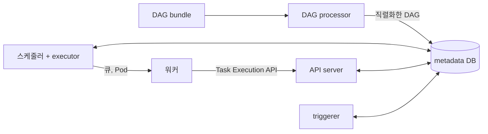

Airflow에서 태스크가 몇 시간째 `scheduled`에 머물러 있다면 원인은 태스크 코드가 아니다. 풀 슬롯이나 동시성 한도가 막고 있거나, 센서가 워커 슬롯을 다 잡고 있을 가능성이 크다. 새 DAG가 UI에 늦게 뜨거나 스케줄러가 느려지는 것도 대개 실행이 아니라 파싱 쪽 문제다. 어느 컴포넌트가 무엇을 맡는지 알면 상태 이름만 보고 원인을 좁힐 수 있다. 날짜, 템플릿, catchup과 백필은 [멱등한 Airflow DAG 글](/posts/airflow-idempotent-dags/)에 정리했다.

버전은 Airflow 3.4.0 기준이다.

## 핵심 키워드

| 키워드 | 한 줄 뜻 |
|---|---|
| 스케줄러 | DAG run을 만들고, 실행할 수 있는 태스크를 골라 executor에 넘긴다 |
| DAG processor | DAG 파일을 파싱해 직렬화한 DAG를 metadata DB에 넣는 별도 프로세스 |
| API server | UI, REST API, 워커용 Task Execution API를 제공한다 |
| Task Execution API | 워커가 상태, 하트비트, XCom을 DB 대신 API server로 주고받는 통로 |
| executor | 태스크를 어디서 돌릴지 정한다. 스케줄러 프로세스 안에서 돈다 |
| triggerer | deferred 태스크의 trigger를 asyncio 루프에서 돌린다 |
| pool | 여러 DAG가 나눠 쓰는 슬롯 묶음. 기본 `default_pool`은 128슬롯 |
| deferrable | 기다리는 동안 태스크를 워커에서 내리고 triggerer에 대기를 맡긴다 |
| XCom | 태스크 사이에 넘기는 작은 값. 기본은 metadata DB에 저장된다 |
| asset | 태스크가 갱신하는 데이터의 이름. Airflow 2의 dataset이 바뀐 이름이다 |

## 컴포넌트가 나뉘고 워커는 DB에서 떨어졌다



Airflow 3에서 반드시 떠야 하는 것은 스케줄러, DAG processor, API server, metadata DB, DAG 파일을 읽어 올 DAG bundle이다. 워커는 LocalExecutor라면 스케줄러 안에 들어가고, triggerer는 deferrable 태스크를 쓸 때만 필요하다. 2.x에서는 스케줄러가 파싱도 했지만 3에서는 로컬 개발 환경이라도 `airflow dag-processor`를 따로 띄운다. 웹서버는 `airflow api-server`로 바뀌었다. 가장 큰 변화는 워커다. 상태 전환, 하트비트, XCom이 Task Execution API를 거쳐 API server로 가고, 태스크 코드를 돌리는 하위 프로세스는 metadata DB에 직접 붙지 않는다. 워커는 짧게 쓰는 자격 증명으로 Execution API에 보고한다. 그래서 태스크 안에서 Airflow DB 세션이나 모델을 import하던 코드는 3에서 깨지고, Task SDK나 Airflow Python Client로 바꿔야 한다. DAG processor와 triggerer는 여전히 DB에 붙은 채 DAG 작성자의 코드를 돌린다.

## DAG 파일은 실행과 상관없이 계속 파싱된다

DAG processor는 `refresh_interval`(기본 300초)마다 bundle의 파일 목록을 새로 읽고, 바뀌지 않은 파일도 `min_file_process_interval`(기본 30초)이 지나면 다시 파싱한다. 새 DAG 파일이 몇 분 늦게 보이는 건 목록 갱신 주기 때문이다. 파싱은 파일을 import하는 일이라, 오퍼레이터 밖 최상위 코드는 태스크가 돌든 말든 매번 실행된다. 최상위에서 `Variable.get()`을 부르면 파싱마다 DB나 secrets 조회가, `requests.get()`을 부르면 네트워크 호출이 일어난다. Variable은 `{{ var.value.threshold }}`처럼 템플릿 필드에 넣으면 실행 직전에만 읽힌다.

파일 하나는 `dag_file_processor_timeout`(기본 50초) 안에, 그중 모듈 import는 `dagbag_import_timeout`(기본 30초) 안에 끝나야 한다. 최상위에서 느린 API를 부르면 그 파일의 DAG 전체가 import 에러가 된다. pandas 같은 무거운 import는 태스크 함수 안으로 옮긴다. `time python dag_file.py`로 재 보면 파싱 비용이 바로 보인다.

## 스케줄러 루프와 태스크 상태

스케줄러는 루프마다 새 DAG run이 필요한 DAG에 run을 만들고, run들을 살펴 실행할 수 있게 된 태스크 인스턴스를 고르고, 풀과 동시성 한도 안에서 executor에 넘긴다. 마지막 단계가 critical section이다. 이때 풀 테이블 행 전체에 쓰기 잠금을 걸어서 스케줄러를 여러 대 띄워도 슬롯이 이중으로 나가지 않는다. 스케줄러끼리는 통신하지 않고 DB 행 잠금으로 맞추며, PostgreSQL 12 이상과 MySQL 8.0 이상에서 여러 대를 지원한다.

| 상태 | 뜻 | 오래 머물면 볼 곳 |
|---|---|---|
| `scheduled` | 의존성이 풀려 실행 대상이 됐다 | 풀 슬롯, `max_active_tasks`, `parallelism` |
| `queued` | executor에 넘어갔고 워커를 기다린다 | 워커 수, Celery 큐, Pod 생성 |
| `running` | 워커에서 도는 중 | 태스크 로그, 하트비트 |
| `up_for_retry` | 실패했고 retry가 남았다 | `retry_delay` |
| `up_for_reschedule` | reschedule 모드 센서가 다음 확인을 기다린다 | `poke_interval` |
| `deferred` | trigger에 넘겨 triggerer가 기다린다 | triggerer 프로세스 |

`running`인데 워커가 OOM으로 죽은 태스크는 하트비트가 끊기는 것으로 잡힌다. 예전에 zombie라고 부르던 경우로, Airflow가 주기적으로 찾아 retry가 남았으면 다시 돌리고 아니면 `failed`로 둔다.

## executor는 섞어 쓸 수 있다

| executor | 태스크가 도는 곳 | 맞는 경우 |
|---|---|---|
| `LocalExecutor` | 스케줄러가 띄운 하위 프로세스 | 기본값. 단일 머신, SQLite 로컬 개발 |
| `CeleryExecutor` | 브로커 큐를 구독하는 상시 워커 | 짧은 태스크가 많고 시작 지연이 싫을 때 |
| `KubernetesExecutor` | 태스크마다 새 Pod | 태스크별 이미지, 자원, 격리가 필요할 때 |

Celery는 워커가 떠 있어 빨리 시작하는 대신 놀 때도 자원을 쓰고, Kubernetes는 Pod를 띄우는 만큼 늦게 시작하는 대신 태스크마다 자원을 따로 잡는다. [Airflow Helm release 이름 글](/posts/airflow-helm-release-name/)에서 뜨지 않은 Redis와 PostgreSQL이 이 구조의 부품이다. 그 글의 커뮤니티 차트(`airflow-helm/charts`)는 기본 executor가 CeleryExecutor라 Celery 브로커인 Redis와 metadata DB인 PostgreSQL을 서브차트로 같이 띄운다.

2.10부터 executor 여러 개를 동시에 설정할 수 있고, 3.0에서 `CeleryKubernetesExecutor`와 `LocalKubernetesExecutor`는 이 방식으로 대체되며 빠졌다. `[core] executor = CeleryExecutor,KubernetesExecutor`처럼 쓰면 첫 번째가 기본값이다. 특정 태스크만 Pod로 보내려면 오퍼레이터에 `executor="KubernetesExecutor"`를, DAG 전체라면 `default_args`에 넣는다. 목록에 없는 executor를 지정한 DAG는 파싱에 실패한다.

## 슬롯은 여러 층에서 막힌다

| 한도 | 범위 | 기본값 |
|---|---|---|
| `[core] parallelism` | 스케줄러 하나가 동시에 돌리는 태스크 인스턴스 | 32 |
| pool 슬롯 | 같은 풀을 쓰는 모든 DAG의 태스크 | `default_pool` 128 |
| DAG `max_active_runs` | 한 DAG에서 동시에 도는 run | 16 |
| DAG `max_active_tasks` | run 하나 안에서 동시에 도는 태스크 (2.x에서는 DAG 전체) | 16 |
| 태스크 `max_active_tis_per_dag` | 같은 태스크의 동시 실행 인스턴스 | 없음 |

풀은 DAG를 가로질러 공유 자원을 지킨다. 같은 DB를 때리는 태스크를 DAG가 달라도 한 풀에 넣으면 그 DB로 가는 동시 쿼리가 풀 크기로 묶인다. 무거운 태스크는 `pool_slots`를 2 이상 주고, 슬롯이 비면 `priority_weight`가 높은 태스크부터 나간다. `parallelism`은 스케줄러당 값이라 스케줄러가 둘이면 전체 상한도 대략 두 배다. 3에서 `max_active_tasks`가 run 단위로 바뀌었으니, 한 DAG 전체의 동시 실행을 묶으려면 `max_active_runs`와 곱해서 봐야 한다.


```python
# Airflow 3.4.0 + apache-airflow-providers-standard
# 먼저 풀을 만든다: airflow pools set warehouse 4 "warehouse queries"
from datetime import datetime
from airflow.providers.standard.sensors.filesystem import FileSensor
from airflow.sdk import DAG, Asset, task

raw_orders = Asset("s3://example-bucket/raw/orders/")

with DAG(dag_id="orders_daily", schedule="0 1 * * *", start_date=datetime(2026, 11, 1),
         max_active_runs=1, max_active_tasks=4):
    wait = FileSensor(task_id="wait_for_export", filepath="/data/export/{{ ds }}/_SUCCESS",
                      poke_interval=60, deferrable=True)

    @task(pool="warehouse", pool_slots=2, outlets=[raw_orders])
    def load():
        print("load orders")

    wait >> load()
```


## 기다리는 태스크는 슬롯을 얼마나 잡나

| 방식 | 기다리는 동안 | 맞는 경우 |
|---|---|---|
| 센서 `poke` (기본) | 워커 슬롯을 계속 잡는다 | 초 단위로 자주 확인할 때 |
| 센서 `reschedule` | 확인할 때만 슬롯을 잡고 `up_for_reschedule`로 쉰다 | 분 단위 이상으로 확인할 때 |
| deferrable | 워커에서 내려가 `deferred`, triggerer가 기다린다 | 오래 기다리거나 외부 이벤트를 기다릴 때 |

센서 기본 `poke_interval`은 60초다. 몇 시간짜리 대기를 poke 센서 여러 개로 걸면 아무 일도 안 하는 센서가 워커 슬롯을 차지하고, 진짜 작업은 `queued`에 쌓인다. deferrable 태스크는 `self.defer(trigger=..., method_name=...)`로 워커를 떠난다. triggerer가 trigger를 asyncio로 돌리다 이벤트가 오면 스케줄러가 태스크를 다시 잡고, 워커에서 `method_name`부터 이어 실행한다. `self`에 넣어 둔 값은 사라지고 `kwargs`로 넘긴 것만 남는다. triggerer 하나는 기본 1000개의 trigger를 맡고, deferred 태스크는 기본 설정에서 풀 슬롯을 차지하지 않는다. trigger의 `run`에서 blocking 호출을 하면 그 triggerer의 이벤트 루프 전체가 멈춘다. `[operators] default_deferrable`을 켜면 지원하는 오퍼레이터와 센서가 모두 deferrable로 돈다.

[TableauOperator 글](/posts/airflow-tableau-template-fields/)의 예시는 `blocking_refresh=True`였다. 이 모드에서 오퍼레이터는 `execute` 안에서 새로고침 작업 상태를 `check_interval`(기본 20초)마다 확인하므로 끝날 때까지 워커 슬롯 하나를 쓴다. 코드가 단순하고 실패가 그 태스크에 바로 드러나는 구성이다. 새로고침이 길고 여러 개가 겹친다면 `blocking_refresh=False`로 job id만 받고, 그 id를 `TableauJobStatusSensor`에 reschedule 모드로 넘겨 실행과 대기를 나눌 수 있다.

## XCom은 작은 값, 에셋은 갱신 신호

XCom은 작은 값을 넘기는 용도다. `@task`의 반환값은 `return_value` 키로 저장되고, 기본 백엔드는 값을 직렬화해 metadata DB의 JSON 컬럼(PostgreSQL은 JSONB)에 넣는다. 그래서 데이터프레임을 그대로 넘기면 DB 행과 API 요청이 함께 커진다. 큰 값은 `apache-airflow-providers-common-io`의 `XComObjectStorageBackend`로 보낸다. `[common.io] xcom_objectstorage_threshold`보다 큰 값은 S3 같은 저장소에 쓰고 DB에는 참조만 남긴다. 3에서는 `xcom_pull()`에 `task_ids`를 안 주면 현재 태스크에서만 찾는다.

에셋은 데이터를 옮기지 않고 갱신 신호만 남긴다. 위 예시의 `load`처럼 `outlets`에 에셋을 둔 태스크가 성공하면 asset event가 생기고, 실패하거나 skip되면 안 생긴다. 소비하는 DAG는 `schedule=[raw_orders]`로 건다. 에셋을 여러 개 주면 지난 run 이후 모두 한 번 이상 갱신돼야 돌고, `&`와 `|`로 조건을 짜거나 `AssetOrTimeSchedule`로 시간 스케줄과 섞는다. Airflow 밖의 시스템이 쓴 데이터는 REST API로 asset event를 보내거나 `AssetWatcher`로 외부 큐를 지켜봐야 반영된다. 2.x의 `airflow.datasets.Dataset`은 `airflow.sdk.Asset`이 됐다.

## 참고 자료

- Airflow 3.4.0 문서: [Architecture Overview](https://airflow.apache.org/docs/apache-airflow/stable/core-concepts/overview.html), [Upgrading to Airflow 3](https://airflow.apache.org/docs/apache-airflow/stable/installation/upgrading_to_airflow3.html), [Dag File Processing](https://airflow.apache.org/docs/apache-airflow/stable/administration-and-deployment/dagfile-processing.html), [Best Practices](https://airflow.apache.org/docs/apache-airflow/stable/best-practices.html)
- [Scheduler](https://airflow.apache.org/docs/apache-airflow/stable/administration-and-deployment/scheduler.html), [Tasks](https://airflow.apache.org/docs/apache-airflow/stable/core-concepts/tasks.html), [Executor](https://airflow.apache.org/docs/apache-airflow/stable/core-concepts/executor/index.html), [Pools](https://airflow.apache.org/docs/apache-airflow/stable/administration-and-deployment/pools.html), [Configuration Reference](https://airflow.apache.org/docs/apache-airflow/stable/configurations-ref.html)
- [Sensors](https://airflow.apache.org/docs/apache-airflow/stable/core-concepts/sensors.html), [Deferrable Operators & Triggers](https://airflow.apache.org/docs/apache-airflow/stable/authoring-and-scheduling/deferring.html)
- [XComs](https://airflow.apache.org/docs/apache-airflow/stable/core-concepts/xcoms.html), [Object Storage XCom Backend](https://airflow.apache.org/docs/apache-airflow-providers-common-io/stable/xcom_backend.html), [Asset-aware scheduling](https://airflow.apache.org/docs/apache-airflow/stable/authoring-and-scheduling/asset-scheduling.html)
- 소스: [dag.py](https://github.com/apache/airflow/blob/3.4.0/task-sdk/src/airflow/sdk/definitions/dag.py), [sensor.py](https://github.com/apache/airflow/blob/3.4.0/task-sdk/src/airflow/sdk/bases/sensor.py), [xcom.py](https://github.com/apache/airflow/blob/3.4.0/airflow-core/src/airflow/models/xcom.py) (3.4.0), [TableauOperator](https://github.com/apache/airflow/blob/main/providers/tableau/src/airflow/providers/tableau/operators/tableau.py)

## English summary

Airflow 3 splits the work into a scheduler, a separate DAG processor, an API server, an optional triggerer, and workers that report through the Task Execution API instead of touching the metadata database. Top-level code in a DAG file runs on every parse, so heavy imports and network calls belong inside tasks or templates. A task must pass several limits before it runs: scheduler parallelism, pool slots, `max_active_runs`, and `max_active_tasks`, which became a per-run limit in Airflow 3. A poke sensor holds a worker slot while it waits, reschedule mode frees it between checks, and a deferrable task hands the wait to the triggerer. In the DAG from my TableauOperator PR post, the operator waits for the refresh itself, which keeps the DAG simple at the cost of one worker slot for the whole refresh.
