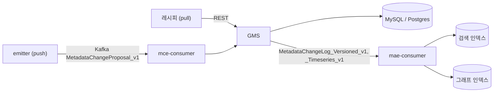

컬럼 타입 하나를 바꾸기 전에 어느 테이블과 대시보드가 그 컬럼을 읽는지, 이 테이블의 주인이 누구인지 물으면 쿼리 엔진은 답하지 못한다. 엔진이 보는 메타스토어에는 위치, 스키마, 파티션만 있다. 누가 쓰는지, 무엇에서 만들어졌는지, 무슨 뜻인지는 다른 곳에 따로 모아야 하고, 그 일을 하는 것이 데이터 카탈로그와 리니지다. 실무에서 DataHub 카탈로그를 도입한 적이 있다. 메타스토어와 파티션이 어긋나는 문제는 [Hive 파티션 글](/posts/hive-partitions-and-metastore/)에, Iceberg 카탈로그의 커밋 경로는 [Iceberg 카탈로그 글](/posts/iceberg-catalogs-and-commits/)에 있다.

버전은 DataHub 1.9.1, OpenLineage 1.55.0(이벤트 스펙 2-0-2), apache-airflow-providers-openlineage 2.21.0 기준이다.

## 핵심 키워드

| 키워드 | 한 줄 뜻 |
|---|---|
| 기술 메타스토어 | 엔진이 쿼리를 계획하려고 읽는 테이블 정의. Hive Metastore, Glue, Iceberg REST 카탈로그 |
| 발견용 카탈로그 | 사람이 데이터를 찾고 이해하려고 보는 메타데이터 저장소. DataHub, OpenMetadata |
| 엔티티와 URN | DataHub 그래프의 노드와 그 식별자. `urn:li:<엔티티>:<키>` 꼴이다 |
| aspect | 엔티티의 속성 묶음. DataHub에서 원자적으로 쓰는 가장 작은 단위 |
| MCP | MetadataChangeProposal. aspect 하나를 바꾸자는 쓰기 요청 |
| MCL | MetadataChangeLog. 저장이 끝난 변경을 알리는 Kafka 이벤트 |
| GMS | DataHub의 메타데이터 서비스. REST, GraphQL API와 저장을 맡는다 |
| 레시피 | source, transformers, sink를 적은 수집 설정 YAML |
| 테이블/컬럼 리니지 | 어느 테이블이, 어느 컬럼이 어디서 왔는지를 잇는 엣지 |
| OpenLineage | 잡 실행마다 run, job, 입출력 dataset을 이벤트로 보내는 표준 |
| 패싯 | OpenLineage 이벤트에 붙이는 확장 메타데이터. 스키마, SQL, 컬럼 리니지 등 |

## 메타스토어는 엔진이, 카탈로그는 사람이 읽는다

| 구분 | 기술 메타스토어 | 발견용 카탈로그 |
|---|---|---|
| 예 | Hive Metastore, AWS Glue Data Catalog, Iceberg REST 카탈로그 | DataHub, OpenMetadata |
| 읽는 쪽 | Spark, Trino, Athena 같은 엔진 | 사람, 검색 UI, 영향 분석 |
| 담는 것 | 위치, 스키마, 파티션, 현재 metadata 포인터 | 설명, 소유자, 용어, 태그, 리니지, 사용량 |
| 어긋나면 | 쿼리 결과가 틀리거나 커밋이 실패한다 | 화면의 정보가 늦거나 빠진다 |

발견용 카탈로그는 메타스토어를 대신하지 않는다. 메타스토어를 수집 대상으로 삼아 복사본을 만들고, 그 위에 사람이 붙이는 정보를 얹는다. 복사본이라 수집 주기만큼 늦을 수 있다. 메타스토어는 커밋 경로에 있어서 늦으면 안 된다. 경계가 흐린 제품도 있다. 오픈소스 Unity Catalog는 Hive Metastore API, Iceberg REST 카탈로그 API와 호환되면서 권한과 거버넌스도 함께 맡는다. OpenMetadata(2.0.9)는 API 서버 하나가 엔티티를 MySQL에 JSON으로 저장하고 Elasticsearch로 색인하는 구조다. DataHub는 아래처럼 Kafka 로그를 중심에 둔다.

## DataHub는 메타데이터를 엔티티와 aspect로 나눈다

엔티티는 타입과 URN을 가진 노드다. 데이터셋 URN은 `urn:li:dataset:(urn:li:dataPlatform:hive,db.orders,PROD)`처럼 플랫폼, 이름, 환경을 묶는다. 이 키 필드들이 key aspect이고, 직렬화하면 URN이 된다. 나머지 속성은 `schemaMetadata`, `ownership`, `glossaryTerms` 같은 aspect로 나뉜다. aspect는 PDL(Pegasus 스키마 언어)로 정의하고, 들어오는 값은 이 스키마로 검증한다. 엔티티 사이의 관계는 aspect 안의 필드에 `@Relationship`을 달아 선언한다. aspect가 쓰기 단위라서 수집기와 사람이 서로를 덮지 않는다. 수집기가 `datasetProperties`를 다시 써도 UI에서 고친 설명은 `editableDatasetProperties`라는 다른 aspect에 있다. aspect는 두 종류다. versioned aspect는 바뀔 때마다 새 버전이 생기고 관계형 DB에 저장된다. 프로파일이나 사용량 같은 timeseries aspect는 관계형 DB에 들어가지 않고 검색 인덱스와 Kafka에만 남는다.

## 쓰기는 MCP로 들어가고 MCL로 퍼진다



MCP는 엔티티 URN, aspect 이름, aspect 값(JSON), `changeType`을 담는다. 지금 쓸 수 있는 `changeType`은 `UPSERT`, `CREATE`, `CREATE_ENTITY`, `DELETE`, `PATCH`다. REST로 GMS에 보내면 성공과 실패를 바로 받는다. Kafka의 `MetadataChangeProposal_v1`로 보내면 비동기로 처리되고, 실패한 제안은 `FailedMetadataChangeProposal_v1`로 간다.

GMS는 DB에 저장한 뒤 MCL을 낸다. MCL에는 이전 aspect 값이 함께 들어 있고, 값이 같은 중복 쓰기는 MCL을 만들지 않는다. mae-consumer가 MCL을 받아 검색 인덱스(Elasticsearch 8.17 이상 또는 OpenSearch 2.x, 3.x)와 그래프 인덱스(기본 Elasticsearch, Neo4j 선택)를 갱신한다. MCL은 URN을 키로 파티셔닝돼서 한 엔티티의 변경은 순서대로 반영된다. 기본 키 조회는 DB로, 검색과 리니지 탐색은 인덱스로 간다. 그래서 저장 직후 상세 화면에는 새 값이 보이는데 검색 결과는 잠깐 옛 값일 수 있다. versioned MCL 토픽의 기본 보존은 7일, timeseries는 90일이다. timeseries는 DB에 원본이 없어서 토픽을 다시 읽어 복구한다.

수집은 pull과 push로 나뉜다. pull은 레시피를 스케줄로 돌려 원천을 긁어 온다. push는 원천 시스템이 일어난 순간 MCP를 보낸다. pull은 원천을 고치지 않아도 되지만 주기만큼 늦고, push는 즉시 반영되지만 원천마다 코드를 넣어야 한다.

```yaml
# DataHub 1.9 레시피(CLI acryl-datahub 1.9.0), 실행: datahub ingest -c hive.dhub.yaml
pipeline_name: hive-warehouse   # stateful ingestion에 필요한 고정 이름
source:
  type: hive
  config:
    host_port: localhost:10000
    database: analytics
transformers:
  - type: simple_add_ownership
    config:
      owner_urns: ["urn:li:corpuser:data-platform"]
sink:
  type: datahub-rest   # 생략해도 datahub-rest가 기본이다
  config:
    server: http://localhost:8080
```

## 리니지는 SQL 파싱과 실행 이벤트 두 길로 모인다

| | SQL 파싱 | 실행 이벤트(OpenLineage) |
|---|---|---|
| 입력 | 쿼리 로그, 뷰 정의, 오퍼레이터의 SQL | 잡이 실제로 읽고 쓴 데이터셋 |
| 장점 | 잡을 고치지 않아도 된다 | SQL이 없는 DataFrame 코드, 실제 경로까지 잡힌다 |
| 놓치는 것 | UDF 내부, 동적 이름, 다중 문장 SQL | 계측하지 않은 잡, 돌지 않은 실행 |

DataHub의 SQL 파서는 sqlglot 위에 만들었다. `SELECT *`는 DataHub에 등록된 스키마로 펼쳐서 컬럼 리니지를 만든다. 등록된 스키마가 낡으면 컬럼 리니지도 틀어진다. 테이블 리니지는 `SELECT`, `CREATE`, `INSERT`, `UPDATE`, `DELETE`, `MERGE`에서 나오고, 컬럼 리니지는 `MERGE`에서는 나오지 않는다. `WHERE`, `JOIN`, `GROUP BY`에만 쓰인 컬럼은 리니지로 치지 않는다. 결과에는 0에서 1 사이의 신뢰도가 붙는다. 테이블 리니지는 "이 테이블을 지우면 무엇이 깨지나"에 답한다. 컬럼 리니지는 "이 컬럼 이름을 바꾸면 어느 대시보드 필드가 깨지나", "개인정보 컬럼이 어디까지 퍼졌나"에 답한다. 컬럼 리니지가 더 쓸모 있지만 파서와 스키마 정확도에 더 기대므로, 영향 분석에서는 둘을 함께 본다.

실행 이벤트 쪽은 OpenLineage가 표준이다. Spark는 `OpenLineageSparkListener`를 리스너로 붙이고, Airflow는 OpenLineage provider를 깐다. Flink는 2.x용 커넥터가 Flink의 네이티브 리니지 인터페이스를 써서 잡 코드를 고치지 않고 Flink SQL까지 잡는다.

```bash
spark-submit --packages io.openlineage:openlineage-spark_2.13:1.55.0 \
  --conf "spark.extraListeners=io.openlineage.spark.agent.OpenLineageSparkListener" \
  --conf "spark.openlineage.transport.type=http" \
  --conf "spark.openlineage.transport.url=http://localhost:5000" \
  job.py
```

Airflow provider는 오퍼레이터마다 리니지를 이 순서로 찾는다. 등록된 custom extractor, 오퍼레이터의 `get_openlineage_facets_on_start/complete/failure` 메서드, 훅 수준 리니지, 마지막으로 `inlets`와 `outlets`다. SQL 오퍼레이터는 쿼리를 파싱해 컬럼 리니지까지 낸다. 태스크의 `outlets`와 에셋 스케줄은 [Airflow 3 글](/posts/airflow-scheduler-and-executors/)에 있다.

## OpenLineage 이벤트는 run, job, dataset에 패싯을 붙인다

```json
{
  "eventType": "COMPLETE",
  "eventTime": "2026-11-21T01:00:00Z",
  "producer": "https://example.com/daily-batch",
  "schemaURL": "https://openlineage.io/spec/2-0-2/OpenLineage.json#/$defs/RunEvent",
  "run": { "runId": "019a8f2e-7c41-7d3a-9b1e-2f6c0d4e5a10" },
  "job": { "namespace": "batch", "name": "daily_metrics" },
  "inputs": [{ "namespace": "s3://example-bucket", "name": "raw/events" }],
  "outputs": [{ "namespace": "s3://example-bucket", "name": "mart/daily_metrics" }]
}
```

job은 namespace와 이름으로 정체성이 정해지고, run은 그 job의 한 번 실행이다. `runId`는 클라이언트가 만드는 UUID로, 한 실행의 모든 이벤트에서 같아야 하며 UUIDv7을 권한다. dataset도 namespace와 이름으로 구분하고, 이름은 물리 위치에서 나온다. `eventType`은 `START`, `RUNNING`, `COMPLETE`, `ABORT`, `FAIL`, `OTHER`다. `COMPLETE`, `ABORT`, `FAIL` 뒤에는 그 run의 이벤트가 더 오지 않는다. 스트리밍 잡은 시작과 종료 이벤트가 드물게만 오므로 여기에 기대면 안 된다. 이벤트는 누적이라 입력 dataset을 `START`에 보내도, `COMPLETE`에 보내도 된다. 실행과 상관없는 정의는 `JobEvent`, `DatasetEvent`로 보낸다.

패싯은 붙는 위치로 의미가 갈린다. run 패싯에는 `nominalTime`, `parent`, `errorMessage`가, job 패싯에는 `sourceCodeLocation`, `sourceCode`, `sql`이 있다. dataset 패싯은 `schema`, `dataSource`처럼 데이터셋 자체를, input 패싯 `dataQualityMetrics`와 output 패싯 `outputStatistics`는 이번 실행에서 읽고 쓴 양을 말한다. 컬럼 리니지는 output dataset의 `columnLineage` 패싯에 들어가고, 변환마다 `DIRECT`(IDENTITY, TRANSFORMATION, AGGREGATION)와 `INDIRECT`(JOIN, FILTER, GROUP_BY 등)를 구분한다. 모든 패싯은 `_producer`와 `_schemaURL`이 필수다.

DataHub는 이 이벤트를 GMS의 `/openapi/openlineage/api/v1/lineage`로 받는다. 위 JSON을 `curl -X POST -H "Content-Type: application/json" -H "Authorization: Bearer $TOKEN" --data @event.json`으로 보내면 된다. Spark와 Airflow에는 DataHub 전용 플러그인을 권하고, Spark 플러그인은 경로 패턴(PathSpec)과 패치 쓰기를 더 지원한다. OpenLineage에는 도메인 패싯이 없어서 도메인은 DataHub 쪽 설정으로 붙인다.

## 소유자, 용어집, 데이터 계약

리니지가 "어디서 왔나"라면 소유자와 용어집은 "누구에게 묻고, 무슨 뜻인가"다. DataHub의 기본 소유 유형은 `TECHNICAL_OWNER`, `BUSINESS_OWNER`, `DATA_STEWARD`, `NONE`이고, 필요하면 소유 유형을 따로 만든다. 용어집은 Term과 폴더 역할의 Term Group으로 이뤄지고, 용어 사이에 `Inherits`(이메일은 PII의 하위)와 `Contains`(주소는 우편번호를 포함) 관계를 둔다. 용어는 데이터셋과 컬럼에 붙인다. 컬럼에 PII 용어를 붙이고 컬럼 리니지를 따라가면 그 값이 흘러간 테이블이 나온다.

DataHub의 데이터 계약은 데이터셋 하나에 거는 assertion 묶음이다. 스키마, 신선도, 품질 검사를 묶고, 그중 하나라도 어기면 계약이 실패 상태가 된다. assertion은 dbt test나 Great Expectations처럼 밖에서 돌리고 결과만 DataHub에 보낼 수 있다. 검사를 어느 단계에 둘지는 [데이터 품질 검사 글](/posts/data-quality-checks/)에 정리했다. DataHub 안에서 assertion을 스케줄로 돌리는 기능은 DataHub Cloud 쪽에 있다.

## 참고 자료

- DataHub: [Metadata Model](https://docs.datahub.com/docs/metadata-modeling/metadata-model), [MCP/MCL](https://docs.datahub.com/docs/advanced/mcp-mcl), [Serving Architecture](https://docs.datahub.com/docs/architecture/metadata-serving), [Ingestion Architecture](https://docs.datahub.com/docs/architecture/metadata-ingestion), [Recipes](https://docs.datahub.com/docs/metadata-ingestion/recipe_overview), [Releases](https://github.com/datahub-project/datahub/releases)
- DataHub 리니지: [SQL Parsing](https://docs.datahub.com/docs/lineage/sql_parsing), [OpenLineage](https://docs.datahub.com/docs/lineage/openlineage), [Graph service](https://docs.datahub.com/docs/how/migrating-graph-service-implementation), [Search client](https://docs.datahub.com/docs/how/elasticsearch-search-client-shim)
- DataHub 거버넌스: [OwnershipType.pdl](https://github.com/datahub-project/datahub/blob/master/metadata-models/src/main/pegasus/com/linkedin/common/OwnershipType.pdl), [Business Glossary](https://docs.datahub.com/docs/glossary/business-glossary), [Data Contracts](https://docs.datahub.com/docs/managed-datahub/observe/data-contract)
- OpenLineage 1.55.0: [Object Model](https://openlineage.io/docs/spec/object-model), [Run Cycle](https://openlineage.io/docs/spec/run-cycle), [Column Lineage Facet](https://openlineage.io/docs/spec/facets/dataset-facets/column_lineage_facet), [Spark 설정](https://openlineage.io/docs/integrations/spark/configuration/usage), [스펙 2-0-2](https://openlineage.io/spec/2-0-2/OpenLineage.json)
- [Airflow OpenLineage provider 2.21.0 Developer Guide](https://airflow.apache.org/docs/apache-airflow-providers-openlineage/stable/guides/developer.html), [Unity Catalog OSS](https://github.com/unitycatalog/unitycatalog), [OpenMetadata High Level Design](https://docs.open-metadata.org/latest/main-concepts/high-level-design)

## English summary

A technical metastore such as Hive Metastore, Glue, or an Iceberg REST catalog sits on the query path, while a discovery catalog such as DataHub copies that metadata and adds owners, terms, and lineage for people. DataHub splits metadata into entities and aspects, accepts writes as MetadataChangeProposals over REST or Kafka, and fans out committed changes as MetadataChangeLogs that update the search and graph indexes. Lineage comes from two places: SQL parsing, which needs no job changes but depends on registered schemas, and runtime OpenLineage events from Spark, Airflow, and Flink, which see real reads and writes but only for instrumented jobs. I introduced DataHub as a catalog at work before. The main design choice is how much to pull on a schedule versus push at the source: pull is cheap to adopt, push is fresh but needs code in every producer.
