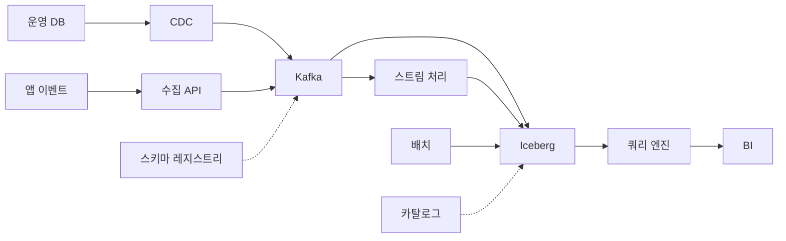

거래를 처리하는 서비스의 운영 DB는 거래를 처리하는 곳이고, 분석 쿼리가 여기에 붙으면 서비스 응답이 같이 느려질 수 있다. 그래서 분석은 운영 DB를 직접 읽지 않고, 변경분과 이벤트를 따로 받아 레이크에 쌓은 뒤 거기서 읽는다. 지금 회사에서 이 플랫폼의 여러 구간을 맡아 왔고, 이 글은 공개된 오픈소스와 AWS 구성 요소 수준에서 전체 모양만 정리한다. 내부 이름과 수치는 넣지 않았다.

## 수집은 두 갈래로 들어온다

운영 MySQL의 변경분은 Debezium이 binlog로 읽어 Kafka로 보낸다. 커넥터는 MSK Connect 위에서 돈다. 이 CDC 파이프라인을 설계하고 운영했다.

CDC를 고른 이유는 일반적인 것이다. 주기적으로 테이블을 다시 읽는 폴링은 하드 삭제와 폴링 사이의 중간 상태를 놓치고, 폴링이 잦을수록 운영 DB에 쿼리 부하가 붙는다. binlog는 DB가 어차피 쓰는 로그라서 원천에 추가 쿼리를 거의 걸지 않는다.

앱 이벤트 로그는 수집 API가 받아 Avro로 바꾼 뒤 Kafka에 넣는다. 스키마는 Schema Registry에 등록된다. 이 이벤트 로그 파이프라인도 맡았다.

## 저장은 S3 Tables 위의 Iceberg 테이블이다

CDC 변경분은 sink 커넥터가 S3 Tables의 Iceberg 테이블에 upsert로 쓴다. 이벤트 로그도 Iceberg를 포함한 레이크 테이블로 들어간다.

Iceberg를 쓰는 이유도 널리 알려진 쪽이다. 파일 목록을 메타데이터로 관리하니 커밋이 원자적이고, 행 단위 삭제와 갱신을 표현할 수 있어 CDC upsert를 받을 수 있다. 스키마와 파티션을 바꿔도 기존 데이터를 다시 쓰지 않아도 된다.

S3 Tables는 compaction과 스냅샷 만료 같은 테이블 정리를 관리형으로 돌려 준다. 스트리밍 쓰기는 작은 파일을 계속 만들기 때문에 이 정리를 직접 운영하는 부담이 줄어든다.

## 처리는 스트림과 배치로 나뉜다

실시간으로 가공해야 하는 흐름은 Kafka를 읽는 Flink 잡이 맡는다. Flink 잡을 만들고 운영한 경험이 있다.

정기 집계와 재처리는 Airflow가 EMR 클러스터를 띄워 Spark 잡을 돌리는 방식이다. 클러스터는 필요할 때 띄우고 끝나면 내린다. Airflow 배치와 EMR 실행 구조를 맡아 운영했다.

## 서빙과 거버넌스

분석 쿼리는 Athena로 레이크 테이블을 읽고, 대시보드는 Superset으로 만든다. 서빙 구간은 운영에 참여했다.

DataHub를 데이터 카탈로그로 들이는 일을 맡았다. 운영 DB, 쿼리 엔진, BI, Airflow의 메타데이터를 한곳에 모아 테이블이 어디서 와서 어디로 가는지 lineage로 볼 수 있게 했다.

## 운영 원칙

배치는 몇 번을 다시 돌려도 같은 결과가 나와야 한다. 날짜 파티션 단위로 덮어쓰게 짜 두면 실패한 날을 다시 돌리는 일이 안전해진다.

이벤트의 모양은 스키마로 약속한다. Schema Registry의 호환성 규칙을 두면 생산자가 스키마를 바꿀 때 소비자를 깨뜨리는 변경이 등록 단계에서 막힌다.

알람은 consumer lag만으로는 모자라다. lag는 소비 쪽이 밀린 것만 보여 주고, 생산 쪽이 멈춰서 새 레코드가 없으면 lag도 오르지 않는다. 그래서 생산 쪽 지표도 함께 보는 편이 안전하다.

테이블 설명과 소유 정보는 카탈로그를 기준으로 삼는다. 사람마다 다른 문서에 적어 두면 어느 쪽이 맞는지 알 수 없게 된다.

## 글로 정리한 개념

- [CDC의 동작 방식](/posts/change-data-capture/)
- [Kafka Connect의 worker와 task](/posts/kafka-connect-workers-tasks/)
- [Kafka 파티션과 consumer lag](/posts/kafka-partitions-and-lag/)
- [Iceberg 테이블 포맷](/posts/iceberg-table-format/)
- [Iceberg의 행 단위 삭제](/posts/iceberg-row-level-deletes/)
- [스키마 진화와 호환성](/posts/schema-evolution/)
- [멱등한 Airflow DAG](/posts/airflow-idempotent-dags/)

이 글은 개인 경험을 일반화해 정리한 것이며, 회사의 공식 입장이나 실제 구성 정보가 아니다.

## English summary

This post is a high-level view of the analytics data platform at a transactional service, kept at the level of public open-source and AWS components. MySQL changes flow through Debezium on MSK Connect into Iceberg tables on S3 Tables, and app events go through an ingestion API as Avro with Schema Registry. Flink handles streaming work, while Airflow runs Spark jobs on short-lived EMR clusters. Athena and Superset serve queries and dashboards, and DataHub acts as the catalog. Internal names, numbers, and incidents are left out on purpose.
