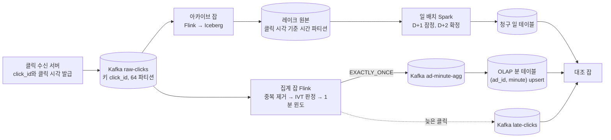

광고 클릭 집계는 숫자가 곧 청구 금액이다. 광고주 리포트는 방금 지난 1분까지 보여 줘야 하고, 청구는 같은 클릭을 두 번 세거나 빠뜨리면 안 된다. 그런데 클릭은 재시도로 중복되고, 늦게 도착하고, 일부 광고에 몰리고, 무효 클릭을 거르는 기준은 나중에 바뀐다.

기준: Kafka 4.4, Flink 2.3, Spark 4.3, Iceberg 1.12 (2026-11). Flink 2.3용 Kafka 커넥터는 아직 없어서, Kafka를 읽고 쓰는 잡은 Flink 2.2와 flink-connector-kafka 5.0.0-2.2로 돌린다고 본다.

## 요구사항과 규모 가정

기능 요구사항은 다섯 가지다. 광고별 분당 유효 클릭과 무효 클릭 수를 만든다. 최근 30일은 분 단위로, 그 이전은 일 단위로 2년까지 조회된다. 무효 트래픽(IVT) 판정은 규칙을 갈아 끼울 수 있는 단계로 둔다. 청구는 광고별 일 합계로 하고, 청구된 클릭마다 원본 레코드와 판정 규칙 버전까지 거슬러 갈 수 있어야 한다. 스트림 숫자와 청구 숫자의 차이는 매일 대조한다. 비기능 요구사항은 이렇다. 분 리포트는 그 분이 끝나고 2분 안에 보인다. 청구 숫자는 같은 입력과 같은 규칙 버전이면 몇 번을 다시 돌려도 같아야 한다. 스트림 일 합계는 청구 숫자와 0.5% 안에서 맞는 것을 목표로 한다. 원본은 분쟁과 감사를 위해 2년, Kafka는 7일 보관한다. 스트림 클러스터는 피크에 맞추고, 무거운 계산은 하루 한 번 배치로 몬다. 아래 숫자는 모두 가정이다.

| 항목 | 가정 | 계산 |
|---|---|---|
| 클릭 수 | 하루 20억 건 | 평균 2e9 / 86,400 ≈ 23,000건/s, 피크는 평균의 3배로 약 70,000건/s |
| 원본 레코드 | 500 B | 하루 2e9 × 500 B = 1 TB, 피크 유입 70,000 × 500 B = 35 MB/s |
| Kafka 디스크 | 압축 4:1, 복제 3, 7일 | 1 TB / 4 × 3 × 7 = 5.25 TB |
| 레이크 원본 | Parquet로 원본의 1/5 | 하루 200 GB, 1년 73 TB, 2년 146 TB |
| 파티션 | 64개 | 피크에 파티션당 약 1,100건/s, 0.55 MB/s. 10배까지 파티션을 늘리지 않고 버틸 여유 |
| 분 테이블 | 분당 클릭이 있는 광고 10만 개, 행 50 B | 하루 10만 × 1,440 = 1.44억 행, 7.2 GB, 30일 216 GB |
| 중복 제거 상태 | TTL 6시간, 키당 64 B | 23,000 × 21,600 ≈ 5억 키, 약 32 GB, 병렬도 64면 태스크당 0.5 GB |
| 핫 광고 | 한 광고가 피크의 5%, 공격 시 단일 광고 50,000건/s | 평소 3,500건/s, 최악은 한 키에 피크의 70% |

## 전체 구조

클릭 수신 서버는 클릭마다 click_id와 클릭 시각을 한 번만 붙인다. 같은 클릭이 재전송돼도 두 값이 같아서, 중복은 같은 이벤트 시각과 같은 날짜 파티션에 떨어진다. 원본 토픽은 아카이브 잡과 집계 잡이 따로 읽는다. 집계 잡에 버그가 있어도 레이크 원본은 영향을 받지 않고, 청구 배치는 그 원본에서 처음부터 다시 계산한다. 최근 분은 OLAP 분 테이블에서, 닫힌 날짜는 청구 일 테이블에서 읽는다.

## 핵심 키워드

| 키워드 | 한 줄 뜻 |
|---|---|
| click_id | 클릭 수신 서버가 클릭마다 한 번 발급하는 ID. 모든 중복 판정의 키 |
| IVT | 봇, 반복 클릭처럼 청구하면 안 되는 무효 트래픽 |
| 규칙 세트 버전 | 판정에 쓴 규칙 코드와 파라미터의 버전. 결과 행마다 남긴다 |
| 워터마크 | "이 시각 이전 클릭은 다 왔다"는 이벤트 시간의 시계 |
| allowed lateness | 윈도가 닫힌 뒤에도 늦은 클릭을 받아 결과를 갱신하는 기간 |
| side output | 허용 기간보다 늦은 클릭을 버리지 않고 빼내는 출력 |
| keyed state TTL | 키별 상태를 정해진 처리 시간 뒤 지우는 설정 |
| 2PC sink | 체크포인트 사이의 출력을 Kafka 트랜잭션으로 묶고 체크포인트 완료 때 커밋 |
| salt 2단계 집계 | 한 키를 여러 하위 키로 나눠 센 뒤 다시 합치는 방식 |
| 대조 | 스트림 합계와 배치 합계의 차이를 원인별로 나눠 확인하는 일 |

## 중복과 무효 클릭은 Flink 상태 안에서 가른다

중복은 클라이언트 재전송, 수신 서버 재시작, 수신 서버의 재시도에서 생긴다. 멱등 프로듀서는 한 프로듀서 세션 안의 재시도만 지운다([Kafka 멱등 프로듀서 글](/posts/kafka-idempotency/)). 나머지는 click_id로 걸러야 한다.

| 선택지 | 장점 | 비용 |
|---|---|---|
| Redis `SET NX EX` | 여러 서비스가 같은 기억을 본다 | 잡 복구 때 되감기지 않아, 다시 읽은 클릭을 중복으로 버려 덜 센다 |
| Flink keyed state + TTL | 오프셋과 같은 체크포인트로 되감긴다 | 상태 크기만큼 체크포인트와 복구가 무거워진다 |
| Bloom filter | 메모리가 작다 | 오탐이 정상 클릭을 버린다. 청구 숫자에는 쓸 수 없다 |

이 설계는 Flink keyed state를 고른다. click_id로 keyBy하고 RocksDB backend에 "본 적 있음"을 TTL 6시간으로 둔다. Redis와 Flink 상태가 복구 때 어떻게 다르게 움직이는지는 [Redis 중복 거르기 글](/posts/redis-dedup-and-windows/)에 있다. TTL은 처리 시간 기준이라 잡이 오래 멈췄다 돌아오면 멈춘 시간도 지난 시간으로 친다. 6시간 넘게 벌어진 중복은 스트림에서 두 번 세지고, 일 배치가 하루 전체를 click_id로 다시 거르면서 바로잡힌다.

IVT 판정은 중복 제거 바로 뒤의 단계다. 규칙은 클릭과 문맥을 받아 (유효 여부, 사유 코드, 규칙 세트 버전)을 돌려주는 공통 인터페이스를 구현한 라이브러리로 잡에 들어가고, 임계값 같은 파라미터는 제어 토픽에서 broadcast state로 받는다. Flink broadcast state는 태스크마다 체크포인트되고, `processBroadcastElement()`의 갱신은 모든 태스크에서 같아야 하므로 broadcast 원소의 도착 순서는 태스크마다 다를 수 있다. 그래서 규칙 갱신은 마지막에 온 값으로 덮지 않고, 규칙 세트 버전이 더 큰 값만 받아들여 순서와 상관없이 같은 상태가 되게 한다.

판정 결과로 클릭을 지우지 않는다. 무효 클릭도 사유 코드별 개수로 남기고, 청구는 유효 클릭만 쓴다. 지우면 규칙이 틀렸을 때 되돌릴 근거가 사라진다. 외부 판정 서비스를 Async I/O로 부르는 방식은 뺐다. 복구 때 진행 중 요청이 다시 나가고 응답이 달라질 수 있어 같은 입력에 같은 결과가 보장되지 않는다(일반적인 추론). 하루 전체를 봐야 하는 무거운 규칙은 일 배치에서 돌린다.

## 핫 광고는 salt로 쪼개 두 단계로 센다

원본 토픽은 ad_id가 아니라 click_id를 키로 쓴다. Kafka는 키를 해시해 파티션을 고르므로 ad_id를 키로 두면 핫 광고가 파티션 하나에 몰린다. 문제는 집계 단계의 keyBy(ad_id)에서 다시 생긴다. 공격으로 한 광고에 초당 5만 건이 몰리면 그 키를 맡은 태스크 하나가 밀리고, 워터마크는 모든 입력의 최소값이라 전체 윈도가 같이 늦어진다.

| 선택지 | 하는 일 | 비용 |
|---|---|---|
| keyBy(ad_id) 한 번 | 가장 단순하다 | 핫 키 하나가 전체 지연이 된다 |
| salt 2단계 (DataStream) | (ad_id, hash(click_id) % 8)로 1분 윈도를 센 뒤 ad_id로 합친다 | 셔플이 한 번 늘고, 2단계에 하위 결과가 최대 8개씩 들어간다 |
| Table API local-global | `table.optimizer.agg-phase-strategy=TWO_PHASE`, mini-batch 필요 | 잡을 Table API로 옮겨야 하고, 이 설계의 DataStream 윈도 설정(allowed lateness, side output)을 그대로 쓸 수 없다 |

이 설계는 모든 키에 salt 8개를 쓰는 2단계를 고른다. 핫 키 목록을 실시간으로 찾는 로직보다 단순하고, 1단계 윈도는 `AggregateFunction`으로 증분 집계해 윈도당 상태가 숫자 몇 개다. 한 광고의 5만 건/s는 8개 태스크로 나뉘어 각각 약 6,250건/s가 된다. 주의할 점은 2단계에서 더하지 않는 것이다. 1단계는 늦은 클릭이 오면 같은 윈도의 갱신된 값을 다시 내보낸다. 2단계는 (ad_id, minute)마다 salt별 최신 값을 MapState에 바꿔 끼우고 그 합을 내보내야 두 번 더해지지 않는다. 첫 합은 윈도 끝 이벤트 시간 타이머에서 한 번 내보낸다. 1단계는 결과를 내보낸 뒤 워터마크를 넘기므로 그때 8개가 다 와 있고, 그 뒤 늦은 갱신만 바로 내보낸다. MapState는 윈도 끝 + 10분 30초 타이머로 지운다.

일 배치의 GROUP BY ad_id는 셔플 전에 태스크마다 부분 집계를 하므로 핫 광고가 큰 셔플 파티션을 만들지 않는다. AQE는 GROUP BY skew를 쪼개 주지 않는다([셔플과 skew 글](/posts/spark-shuffle-and-skew/)). 배치에서 위험한 쪽은 click_id가 비거나 상수로 찍힌 버그다. 같은 키에 수억 행이 몰리므로 click_id가 null이거나 형식이 틀린 행은 중복 제거 전에 격리 테이블로 뺀다.

## 분 결과는 2PC로 내보내고 키로 덮어쓴다

exactly-once는 결과와 읽은 위치를 한 번에 저장할 때만 된다([Kafka 전달 보장 글](/posts/kafka-delivery-guarantees/)). Flink Kafka source는 오프셋을 체크포인트 상태에 두니, 남는 건 출력 쪽이다.

| 선택지 | 복구 뒤 | 비용 |
|---|---|---|
| 카운터 저장소에 `INCRBY` 증분 | 다시 읽은 클릭만큼 두 번 더해진다 | 청구용으로 쓸 수 없다 |
| at-least-once + (ad_id, minute) upsert | 같은 윈도 값을 다시 쓰니 결국 맞다 | 복구 때 옛 값이 다시 나와 최신 값을 잠깐 되돌리고, 토픽을 읽는 다른 컨슈머도 그 되풀이를 받는다 |
| KafkaSink `EXACTLY_ONCE` + upsert | 커밋된 레코드만 보인다 | 체크포인트 간격만큼 지연, 열린 트랜잭션이 컨슈머를 막는다 |

이 설계는 세 번째를 고른다. 분 집계 토픽은 OLAP 말고도 예산 소진 같은 다른 스트림이 읽을 수 있어서, 토픽 자체에 중복이 없어야 한다. 그래도 upsert는 남긴다. 늦은 클릭으로 같은 윈도가 다시 발화하면 같은 키의 새 값이 오고, Flink 문서도 이 출력을 앞선 결과의 갱신으로 다루라고 한다. 출력 행은 (ad_id, minute, valid, invalid_by_reason, rule_set_version)이고 OLAP은 키 기준으로 덮어쓴다. 어떤 엔진이 upsert와 분 단위 조회를 잘하는지는 [실시간 OLAP 엔진 글](/posts/realtime-olap-engines/)에 있다.

비용은 구체적이다. 체크포인트를 30초로 두면 분 결과는 윈도가 닫히고 최대 30초와 체크포인트 소요 시간만큼 더 기다린 뒤 보인다. KafkaSink는 `setTransactionalIdPrefix`가 필수이고 잡마다 달라야 한다. 프로듀서의 `transaction.timeout.ms`는 가장 긴 체크포인트와 가장 긴 재시작을 합친 시간보다 길어야 하며, 브로커 `transaction.max.timeout.ms` 기본값 15분을 넘지 못한다. 커넥터 기본값과 브로커 상한이 어긋나는 문제와 두 단계 커밋의 순서는 [Flink 상태와 체크포인트 글](/posts/flink-state-and-checkpoints/)에 있다. OLAP 적재기는 `isolation.level=read_committed`로 읽어야 한다.

## 늦은 클릭은 10분까지 받고 청구는 일 배치가 정한다

이벤트 시각은 수신 서버가 찍은 클릭 시각이다. 단말 시계보다 흐트러짐이 작아서 `WatermarkStrategy.forBoundedOutOfOrderness`를 30초로 두고, 트래픽이 끊긴 파티션이 워터마크를 붙잡지 않게 `withIdleness`를 1분으로 준다. 워터마크와 윈도의 기본 동작은 [Flink 시간과 윈도 글](/posts/flink-time-and-windows/)에 있다. allowed lateness 기본값은 0이고 이 설계는 10분을 준다. 분 결과는 분이 끝나고 30초 뒤 처음 나가고, 10분 30초까지는 잠정치로 표시한다. 그보다 늦은 클릭은 `sideOutputLateData`로 late-clicks 토픽에 보내 개수만 센다. 수신 서버가 Kafka 장애 동안 쌓았다가 한꺼번에 보낸 클릭이 주로 여기로 간다. 청구는 스트림 결과를 쓰지 않는다. 레이크 원본은 클릭 시각 기준 시간 파티션이라 늦게 온 클릭도 자기 날짜에 들어간다. 일 배치는 D+1 06:00에 잠정치를, D+2 06:00에 확정치를 만든다. 확정 뒤에 도착한 D일 클릭은 청구하지 않고 개수만 남긴다(정책 가정). 그래서 원본 토픽은 브로커가 적재 시각을 찍는 `LogAppendTime`으로 두고, 배치는 적재 시각이 D+2 06:00 이전인 행만 읽는다. 나중에 다시 돌려도 입력이 같다.

배치 순서는 다음과 같다. click_id별로 `row_number()`를 수신 시각, 원본 파티션, 오프셋 순서로 매겨 첫 행만 남긴다. `dropDuplicates`는 어느 행을 남길지 지정할 수 없어 다시 돌릴 때 같은 결과를 보장하지 못한다. 그 위에 스트림과 같은 규칙 라이브러리와 하루 전체를 봐야 하는 규칙을 돌리고, 광고 차원 테이블의 그날 스냅숏과 브로드캐스트 조인한 뒤 광고별로 센다. 결과는 Iceberg `overwritePartitions()`로 그 날짜만 바꾼다. 이미 있는 행을 건너뛰는 Writer는 다시 돌려도 겹쳐 쌓이지 않지만 바뀐 값은 반영하지 않는다([광고 리포트 배치 글](/posts/ad-report-batch/)). 청구 테이블은 파티션을 통째로 바꿔야 규칙 수정이 숫자에 반영된다.

대조 잡은 확정치가 나오면 (ad_id, day)마다 스트림 합계와 배치 합계를 비교하고, 차이를 아는 원인으로 나눈다. late-clicks 개수, 배치에서만 무효가 된 클릭 수, TTL 밖 중복 수다. 원인으로 설명되지 않는 차이가 전체 0.5% 또는 한 광고주에서 정한 건수를 넘으면 알린다. 어느 쪽이 정답인지는 이미 정해 뒀다. 닫힌 날짜는 배치가 이기고, 리포트도 닫힌 날짜는 청구 테이블을 읽는다([실시간 테이블과 일별 테이블 글](/posts/batch-and-stream-layers/)).

## 선택지 비교

| | 이 설계 (Flink 분 집계 + Spark 일 청구) | 스트림만 (Kappa) | 원본을 OLAP에 넣고 조회 때 집계 |
|---|---|---|---|
| 청구 정답 | 레이크 원본에서 다시 계산한 배치 | 스트림 결과 그대로 | 조회 결과 |
| 분 리포트 지연 | 윈도 종료 후 약 1분 | 같다 | 적재 지연만큼, 가장 짧다 |
| 규칙이 바뀌면 | 2년 원본에서 다시 계산 | Kafka 보관 7일 안만 재처리 | 원본이 OLAP에 있는 기간만 |
| 중복 제거 | 스트림 6시간 + 배치 하루 전체 | 상태 TTL 안에서만 | 조회마다 click_id로 걸러야 해 비싸다 |
| 비용 | 로직을 스트림과 배치에 두 벌 | 긴 토픽 보관, 재처리 중 출력 두 벌 | 하루 1 TB를 조회 엔진에 저장 |

## 장애와 재처리

Flink 잡이 죽으면 마지막 체크포인트에서 상태와 오프셋이 같이 되감기고, 열려 있던 트랜잭션은 커밋되지 않아 read_committed 컨슈머는 그 레코드를 보지 못한다. 연산자마다 uid를 고정해 두면 코드를 고친 뒤에도 세이브포인트에서 상태를 이어받는다. 파싱이 안 되거나 click_id가 없는 레코드는 예외를 던지지 않고 DLQ 토픽으로 보낸다. 재시작 루프에 빠지는 대신 개수가 지표로 남는다. 스트림 로직에 버그가 있었다면 고친 잡을 새 출력 토픽으로 띄워 Kafka 7일 안을 다시 읽고, 따라잡으면 OLAP이 새 토픽을 읽게 바꾼다. 7일보다 오래된 분 데이터는 다시 만들지 않는다. 그 날짜들은 이미 배치 청구 테이블이 정답이다. 배치는 날짜 파티션 덮어쓰기라 같은 날짜를 몇 번 다시 돌려도 한 벌만 남는다. 청구서가 이미 나간 날짜는 덮어쓴 차이를 조정 행으로 따로 남긴다(정책 가정).

지켜볼 지표는 여섯 개다.

| 지표 | 알림 조건 예 |
|---|---|
| 소스 지연 (컨슈머 lag을 시간으로) | 2분 초과 |
| 워터마크와 현재 시각 차이 | 2분 초과, 핫 키나 멈춘 파티션 신호 |
| 체크포인트 소요 시간과 실패 수 | 트랜잭션 timeout의 절반 초과, 연속 실패 |
| late-clicks, DLQ 비율 | 평소 대비 급증 |
| 중복 비율, 사유별 무효 비율 | 평소 대비 급변, 규칙 배포 직후 특히 |
| 대조 잡의 설명 안 되는 차이 | 0.5% 초과 |

## 규모가 10배가 되면

하루 200억 건, 피크 70만 건/s, 유입 350 MB/s가 된다. 가장 먼저 무거워지는 건 중복 제거 상태다. 32 GB가 320 GB가 되면 체크포인트와 복구가 길어지고, 그 시간이 트랜잭션 timeout 15분 안에 들어와야 한다. RocksDB 증분 체크포인트로 바뀐 부분만 올리고 병렬도를 늘린다. 그런데 Flink의 최대 병렬도는 따로 정하지 않으면 병렬도 64면 128이 되고, 잡이 시작된 뒤에는 상태를 버리지 않고 바꿀 수 없다. 병렬도 64로 시작하면 2배까지만 늘릴 수 있으니, 처음 띄울 때 `setMaxParallelism`을 1024처럼 넉넉히 준다. 다음은 파티션이다. 64개면 파티션당 피크 약 11,000건/s, 5.5 MB/s로 가정한 여유 안이지만, 소스 병렬도가 64에 묶인다. 그 위로 늘릴 때 click_id 키라서 키 배치가 바뀌어도 순서 문제는 없지만, 늘리기 전에 들어온 클릭과 그 뒤의 재전송이 다른 파티션으로 갈 수 있다. 중복 제거가 Flink keyBy에서 다시 모으므로 결과는 같다. salt 개수는 상태 키의 일부라 바꾸려면 세이브포인트를 거쳐야 한다. 배치는 200억 행을 click_id로 셔플하고 레이크 원본이 2년에 1.46 PB가 되므로, 오래된 원본은 더 싼 저장 등급으로 옮긴다. OLAP 분 테이블은 클릭 수가 아니라 분당 클릭이 있는 광고 수를 따라 늘어서 10배보다 덜 커진다.

## 참고 자료

- [Apache Flink 2.3 Windows (allowed lateness, side output)](https://nightlies.apache.org/flink/flink-docs-stable/docs/dev/datastream/operators/windows/)
- [Apache Flink 2.3 Generating Watermarks](https://nightlies.apache.org/flink/flink-docs-stable/docs/dev/datastream/event-time/generating_watermarks/)
- [Apache Flink 2.3 Kafka Connector](https://nightlies.apache.org/flink/flink-docs-stable/docs/connectors/datastream/kafka/)
- [Apache Flink 2.3 Broadcast State Pattern](https://nightlies.apache.org/flink/flink-docs-stable/docs/dev/datastream/fault-tolerance/broadcast_state/)
- [Apache Flink 2.3 Performance Tuning (local-global aggregation)](https://nightlies.apache.org/flink/flink-docs-stable/docs/dev/table/tuning/)
- [Apache Flink 2.3 Production Readiness Checklist (max parallelism)](https://nightlies.apache.org/flink/flink-docs-stable/docs/ops/production_ready/)
- [flink-connector-kafka 버전 목록 (Maven Central)](https://repo1.maven.org/maven2/org/apache/flink/flink-connector-kafka/)
- [Apache Kafka 4.4 Broker Configs (transaction.max.timeout.ms)](https://kafka.apache.org/44/configuration/broker-configs/)
- [Apache Iceberg 1.12 Spark Writes (overwritePartitions)](https://iceberg.apache.org/docs/latest/spark-writes/)

## English summary

This design counts ad clicks per ad per minute with Flink and leaves billing to a daily Spark job that recomputes from raw logs in the lake. Flink removes duplicate click_ids in keyed state that rewinds with the Kafka offsets, tags invalid clicks through a pluggable rule stage instead of dropping them, and splits hot ads into eight salted sub-keys before summing the latest partial per salt. Minute results go out through the exactly-once Kafka sink and are upserted by ad and minute, so late firings replace earlier values. Clicks later than ten minutes go to a side output, the batch produces a final daily number on D+2, and a reconciliation job explains the gap between the two. At ten times the load, deduplication state and the fixed maximum parallelism break first.
