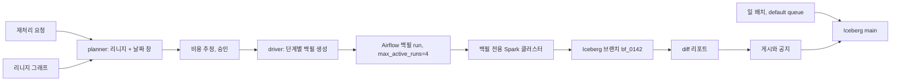

일 배치 하나의 버그를 고치면 그 테이블 180일치와, 그 테이블을 읽는 하류 테이블 전부를 다시 계산해야 한다. 그 사이에도 매일 도는 배치는 제시간에 끝나야 하고, 분석가는 절반만 새 숫자로 바뀐 테이블을 보면 안 된다. 다시 돌릴 범위를 정하고, 자원을 나누고, 결과를 검증한 뒤 한 번에 바꾸는 일까지를 플랫폼이 맡는 설계다.

기준: Airflow 3.4.0, Iceberg 1.12.0과 Spark 4.1 모듈(2026-11).

## 요구사항과 규모 가정

기능 요구사항은 다섯 가지다. 테이블, 기간, 사유로 재처리를 요청하면 다시 돌릴 하류 테이블과 날짜를 계산하고, 비용을 추정해 승인을 받고, 위상 순서로 실행하고, 기존 값과 비교한 리포트를 만든 뒤 승인된 결과를 게시하고 공지한다. 중간에 멈춰도 끝난 날짜를 다시 돌리지 않고 이어서 돌 수 있어야 한다.

비기능 요구사항은 이렇다. 일 배치의 완료 시각(매일 06:00)은 백필 중에도 지킨다. 분석가가 읽는 `main`은 게시 전까지 옛 값, 게시 뒤에는 새 값만 보여야 하고 테이블 하나 안에서 날짜가 섞이면 안 된다. 게시 뒤 30일 동안은 옛 값으로 되돌리거나 비교할 수 있어야 한다. 180일 재처리는 일주일 안에 끝나고, 비용은 미리 알 수 있어야 한다. 아래 숫자는 가정이다.

```text
고친 테이블 1개(하루 30GB), 리니지상 하류 40개(5단계, 가장 넓은 단계 16개, 하루 평균 5GB)
하루치 출력 30 + 40 × 5 = 230GB → 180일 41.4TB를 브랜치에 새로 쓴다
작업 수 41 테이블 × 180일 = 7,380개 테이블-날짜 run
일 배치 체인 계산량 하루 400 vCPU·h(원천 80 + 하류 320) → 180일 72,000 vCPU·h
백필 전용 800 vCPU: 72,000 / 800 = 90시간, 단계 사이 대기로 이용률 75%면 120시간 = 5일
비용(단가 가정): spot vCPU·h 0.05달러 × 72,000 = 3,600달러
저장: 새 파일 41.4TB + 옛 파일 41.4TB를 30일 보관, GB-월 0.023달러면 각 약 950달러
```

새 파일과 옛 파일이 30일 동안 같이 남는다는 것이 저장 비용을 두 배로 만든다. 계산 비용은 일 배치 180일치와 같고, 줄일 여지는 날짜 범위와 하류 목록을 좁히는 데 있다.

## 전체 구조



요청이 오면 planner가 리니지에서 하류 테이블을 찾고, 테이블마다 다시 돌릴 날짜 범위를 계산해 실행 계획을 만든다. 승인이 나면 driver가 영향받는 테이블마다 Iceberg 브랜치 `bf_0142`를 만들고, 위상 정렬한 단계 순서대로 DAG마다 Airflow 백필을 만든다. 백필 run은 동시 run 수를 묶은 채 별도 Spark 클러스터에서 돌고 결과를 브랜치에만 쓴다. 일 배치는 같은 시간에 `main`에 계속 쓴다. 모든 단계가 끝나면 브랜치와 `main`을 비교한 리포트를 만들고, 승인되면 테이블마다 `main`을 바꾸고 공지한다.

## 핵심 키워드

| 키워드 | 한 줄 뜻 |
|---|---|
| 파티션 덮어쓰기 | 같은 날짜를 몇 번 돌려도 그 파티션 한 벌만 남게 쓰는 방식 |
| 영향 집합 | 고친 테이블에서 리니지를 따라 닿는 모든 하류 테이블 |
| 날짜 창 | 하류가 상류의 며칠치를 읽는지. 7일 롤링이면 영향 날짜가 6일 늘어난다 |
| 위상 단계 | 상류가 모두 끝나야 시작하는 테이블 묶음 |
| 백필 run | Airflow 3에서 run_type이 `backfill`인 DAG run |
| reprocess behavior | 이미 run이 있는 날짜를 다시 만들지 정하는 백필 옵션 |
| WAP 브랜치 | 쓰기를 브랜치로 보내 `main` 독자에게 안 보이게 하는 Iceberg 방식 |
| diff 리포트 | 날짜별로 추가, 삭제, 변경된 행과 지표 합계 차이를 모은 표 |
| 진행표 | 백필 요청, 단계, DAG별 백필 ID와 상태를 적은 테이블 |

## 다시 돌릴 범위는 리니지와 날짜 창으로 정한다

전제가 하나 있다. 모든 일 배치가 run에서 받은 날짜의 파티션만 덮어써야 한다. append로 쓰는 잡이 하나라도 있으면 백필이 중복을 만든다. 날짜를 DAG run에서 받아 그 파티션만 덮어쓰는 방법은 [멱등한 Airflow DAG 글](/posts/airflow-idempotent-dags/)에 있다. 플랫폼은 이 조건을 확인하지 못하는 테이블을 영향 집합에서 빼지 않고, 계획 단계에서 막고 소유자에게 돌려보낸다.

하류 목록은 사람이 적지 않고 리니지에서 계산한다. 리니지가 SQL 파싱과 OpenLineage 실행 이벤트 두 길로 모이는 방식은 [카탈로그와 리니지 글](/posts/data-catalog-and-lineage/)에 있다. 실행 이벤트는 실제로 돈 잡만 잡고 SQL 파싱은 UDF 안을 놓치니 둘의 합집합을 쓴다. 리니지가 레이크 밖으로 나가는 곳(외부 export, 리버스 ETL, 피처 저장소)은 다시 계산하지 않고 소유자 확인 목록으로 따로 낸다.

테이블 목록만으로는 날짜가 정해지지 않는다. 하류가 상류의 7일 롤링 합계를 쓰면 상류 마지막 날을 바꿨을 때 하류는 그 뒤 6일까지 바뀐다. 그래서 간선마다 날짜 창을 DAG 메타데이터에 선언하게 하고, planner는 위상 순서로 범위를 넓힌다. 하류의 시작일은 상류와 같고 끝일은 창 길이만큼 늘어나며, 오늘을 넘는 날짜는 일 배치가 맡는다. 창을 선언하지 않은 간선은 하류를 전체 재계산 대상으로 본다(보수적인 기본값이다). 실행 순서는 테이블 위상 순서가 먼저고 날짜는 그 안에서 정한다. 이 설계는 단계 하나의 180일이 모두 끝나야 다음 단계를 시작한다. 날짜별로 상류가 끝나는 대로 하류를 돌리면 더 빠르지만, 날짜 창이 있는 간선마다 "상류의 d-6부터 d까지 끝났나"를 따져야 해서 driver가 복잡해진다. 이용률을 75%로 잡은 것이 이 선택의 비용이다. 전날 출력을 읽는 누적 테이블은 상류 첫날 뒤의 날짜가 모두 바뀌니 범위가 오늘까지 늘어나고, 날짜 순서대로 하나씩 돌아야 한다. 이런 DAG에 `depends_on_past`를 걸어 두면 Airflow는 거꾸로 도는 백필과 `reprocess_behavior`가 `none`인 백필을 거부한다.

## 실행은 Airflow 백필에 맡기고 순서만 얇은 driver가 쥔다

Airflow 3의 백필은 CLI(`airflow backfill create`), REST API(`POST /api/v2/backfills`), UI(Trigger 메뉴의 Backfill)로 만든다. 만들면 범위 안 날짜마다 DAG run이 DB에 생기고 스케줄러가 돌린다. 이미 run이 있는 날짜는 `reprocess_behavior`가 정한다. `none`(기본값)은 없는 날짜만, `failed`는 실패한 날짜도, `completed`는 성공한 날짜까지 다시 만든다. `completed`로 고르면 기존 run을 clear해 같은 run을 QUEUED로 되돌리며, run_type이 `backfill`로 바뀌고 넘긴 conf로 덮인다. API의 `max_active_runs` 기본값은 10이고 DAG의 `max_active_runs`와 따로 적용된다. 빠진 것도 분명하다. 백필은 DAG 하나 단위라 DAG 사이의 순서를 모르고, DAG 하나에 돌고 있는 백필은 하나만 허용된다. 문서는 스케줄러가 백필 태스크의 우선순위를 따로 낮추지 않는다고 적고, 백필이 쓰는 용량은 `max_active_runs`로 조절하라고 한다.

처음부터 전용 재처리 서비스를 만들면 순서와 자원은 마음대로 정하지만, run 상태, 재시도, 로그, UI를 다시 만들어야 한다. 이 설계는 둘을 나눈다. driver는 단계 순서와 진행표만 들고, 각 DAG의 날짜 실행은 Airflow 백필에 맡긴다. 백필 run은 DAG 파라미터나 `[core] rerun_with_latest_version`으로 바꾸지 않았다면 최신 번들 버전, 곧 고친 코드로 돈다(`run_on_latest_version`, CLI 도움말은 실험적 기능으로 적는다). DAG의 태스크는 conf의 `wap_branch`를 Spark 세션의 `spark.wap.branch`로 넘긴다.

```python
# 구조만 보여 주는 스케치. driver가 단계마다 DAG별 백필을 만든다
for level in plan.levels:                      # 위상 단계, 상류부터
    for dag in level:
        bf = post("/api/v2/backfills", {"dag_id": dag.id, "from_date": dag.start, "to_date": dag.end,
            "reprocess_behavior": "completed", "max_active_runs": 4, "dag_run_conf": {"wap_branch": "bf_0142"}})
        progress.save(request_id, level.no, dag.id, bf["id"])
    wait_until_done(level)                     # GET /api/v2/backfills/{id}/dag_runs
```

자원은 Airflow 슬롯과 Spark 클러스터 두 층에서 나눈다. cluster policy의 `task_instance_mutation_hook`은 스케줄러가 태스크 인스턴스를 만들거나 맞출 때 불리니 백필 run의 태스크를 `backfill` 큐로 보낼 수 있다. 그런데 3.4.0 `models/backfill.py`는 `completed`로 다시 만드는 날짜에서 기존 run을 clear한 다음에 run_type을 `backfill`로 바꾼다. clear 중에 불린 훅은 옛 run_type을 보니, 이미 run이 있던 날짜의 첫 시도는 원래 큐로 가고 재시도와 새로 생긴 run만 훅이 옮긴다. 그래서 일 배치 보호는 큐보다 백필 `max_active_runs`에 기댄다. `[core] parallelism`(스케줄러 하나의 상한)과 기본 큐 워커 수는 백필 단계의 동시 run(가장 넓은 단계 16 DAG × 4 = 64)이 돌리는 태스크와 일 배치 최대 동시 태스크의 합보다 크게 잡는다. 슬롯이 막히는 층은 [Airflow 3 스케줄러 글](/posts/airflow-scheduler-and-executors/)에 있다. Spark 쪽은 태스크가 실행 시점에 conf를 읽어 백필 전용 클러스터에 제출하고, 일 배치 클러스터와 노드를 나누지 않는다.

```python
# airflow_local_settings.py, 구조만 보여 주는 스케치. 재시도와 새 run에만 먹힌다
def task_instance_mutation_hook(task_instance, dag_run=None):
    if dag_run is not None and dag_run.run_type == "backfill":
        task_instance.queue = "backfill"
```

비용은 실행 전에 계산한다. planner는 영향 집합의 테이블마다 최근 30회 일 run의 vCPU·h와 출력 크기 중앙값에 날짜 수를 곱해 계산 비용과 저장 비용을 낸다. 추정이 정해 둔 금액(예: 1,000달러)을 넘거나 외부 소비자가 있는 테이블이 들어 있으면 플랫폼 담당과 해당 소유자의 승인이 있어야 driver가 시작한다. 클러스터를 일이 끝난 뒤에도 켜 두는 비용과 spot을 둘 노드는 [AWS 데이터 플랫폼 비용 글](/posts/data-platform-cost-levers/)에 적었다.

## 결과는 브랜치에 쓰고, 비교한 뒤 한 번에 바꾼다

선택지는 셋이다. `main`에 바로 덮어쓰면 백필이 도는 5일 동안 분석가가 날짜마다 다른 버전을 본다. 별도 스테이징 테이블에 쓰면 `main`은 안전하지만 하류 잡이 상류 스테이징을 읽도록 SQL을 바꿔야 한다. 이 설계는 Iceberg 브랜치에 쓰고, driver가 브랜치를 만들 때 `write.wap.enabled`(기본 false)도 켠다. 이 속성을 켠 테이블에서 세션에 `spark.wap.branch`를 주면 쓰기가 그 브랜치로 가고, 브랜치를 지정하지 않은 읽기도 그 테이블에 브랜치가 있으면 브랜치를 읽는다. 그래서 하류 잡은 SQL을 고치지 않고 상류의 새 값을 읽으며, 영향 집합 밖의 테이블은 브랜치가 없으니 `main`을 읽는다. 브랜치와 WAP의 동작은 [스냅샷과 브랜치 글](/posts/iceberg-snapshots-and-branches/)에 있다. 비교는 `spark.wap.branch`를 주지 않은 세션에서 돈다. 그 설정이 있으면 옛 값 쪽 읽기도 브랜치로 가기 때문이다.

```sql
-- 구조만 보여 주는 스케치. 날짜별 추가, 삭제, 변경 행과 합계 차이
SELECT coalesce(o.dt, n.dt) AS dt,
  count_if(o.order_id IS NULL) AS added, count_if(n.order_id IS NULL) AS removed,
  count_if(o.amount <> n.amount) AS changed, sum(n.amount) - sum(o.amount) AS amount_delta
FROM (SELECT * FROM lake.mart.orders_daily WHERE dt BETWEEN '2026-05-25' AND '2026-11-20') o
FULL OUTER JOIN (SELECT * FROM lake.mart.orders_daily VERSION AS OF 'bf_0142'
                 WHERE dt BETWEEN '2026-05-25' AND '2026-11-20') n
  ON o.dt = n.dt AND o.order_id = n.order_id
GROUP BY 1;
```

리포트는 `ops.backfill_diff`에 테이블, 날짜, 컬럼별로 쌓인다. 요청자는 바뀔 것으로 예상하는 테이블과 컬럼을 요청에 적고, 예상 밖 테이블에서 차이가 나오거나 행 수가 정해 둔 비율 넘게 바뀌면 게시가 막힌다. 키가 없는 집계 테이블은 차원별 합계만 비교한다.

게시가 가장 까다롭다. `fast_forward`는 `main`의 현재 스냅샷이 브랜치 머리의 조상일 때만 되는데, 백필이 도는 동안 일 배치가 `main`에 새 날짜를 썼으니 실패한다. 그래서 게시 창에 영향 집합의 DAG들을 일시 정지하고, 백필 시작 뒤 `main`에 들어온 날짜를 `drain_dag`를 켠 짧은 백필로 브랜치에 한 번 더 쓴다. drain은 끝나지 않은 run만 돌리고 예약 run은 만들지 않으며, 다 끝나면 DAG를 다시 정지한다. 그다음 길이 둘이다. 이 백필 DAG 말고 쓰는 쪽이 없는 테이블은 `set_current_snapshot(table => ..., ref => 'bf_0142')`로 `main`을 브랜치 머리로 옮긴다. 이 프로시저는 조상 관계를 요구하지 않고 메타데이터만 바꾸니 테이블당 몇 초다. 다른 writer(스트리밍 적재, 삭제 잡)가 있는 테이블은 이 방식이 그 커밋을 버리므로, 브랜치에서 다시 계산한 날짜 범위를 읽어 `writeTo(...).overwrite(dt 범위 조건)` 한 번으로 `main`에 쓴다. dynamic `INSERT OVERWRITE`(`partitionOverwriteMode=dynamic`)는 새 결과에 행이 있는 파티션만 바꿔서, 새 값에서 비어 버린 파티션에는 옛 행이 남는다. 테이블 안에서는 커밋 하나라 날짜가 섞이지 않지만 데이터를 한 번 더 쓴다.

Iceberg 커밋은 테이블마다 따로 일어나서 41개 테이블을 한 커밋으로 바꿀 수는 없다. 메타데이터 게시는 몇 분 안에 끝나니 공지한 게시 창에 몰아서 하고, 그 사이 상류와 하류가 다른 버전일 수 있다는 점은 공지에 적는다. 게시 직전 `main`에는 `ALTER TABLE ... CREATE TAG pre_bf_0142 RETAIN 30 DAYS`로 태그를 단다. 태그와 브랜치 보존 기본값은 영구라서 `RETAIN`을 빼면 옛 파일이 계속 남는다. 공지는 카탈로그의 테이블 변경 기록, 분석 채널 메시지, diff 리포트 링크로 나가고, 대시보드에는 게시 시각 주석을 단다. 숫자가 왜 바뀌었는지 묻는 사람은 태그로 옛 값을 직접 읽을 수 있다.

## 스트림이 같이 쓰는 테이블은 닫힌 날짜만 바꾼다

영향 집합에 스트림이 낀 테이블은 세 종류다. 스트림이 오늘 파티션을 쓰고 일 배치가 지난 날짜를 덮어쓰는 테이블은 늦은 데이터 허용 기간이 지난 닫힌 날짜만 백필 범위에 넣는다. 열린 날짜는 스트림과 다음 일 배치가 맡는다. 고친 테이블을 조인 차원으로 읽는 스트리밍 잡은 과거 출력을 다시 만들지 않으니, 그 결과 테이블은 배치 재계산 대상인지 소유자가 정하게 목록에만 올린다. Kafka에서 바로 만든 테이블은 이 버그의 하류가 아니고, 다시 만든다면 Kafka를 다시 읽을지 레이크에서 계산할지의 문제가 된다. 두 경로의 비용과 어느 쪽 값을 믿을지는 [배치와 스트림 레이어 글](/posts/batch-and-stream-layers/)에 있다. 스트림 writer가 있는 테이블은 앞에서 말한 대로 `set_current_snapshot`을 쓰지 못하고 복사 게시로 간다. 그 커밋이 스트리밍 커밋과 같은 테이블 메타데이터를 두고 경쟁하면 Iceberg는 낙관적 동시성으로 다시 시도하고, `commit.retry.num-retries` 기본값은 4다. 180일 파티션을 다시 쓰는 커밋은 크니, 스트리밍 커밋 간격이 짧은 테이블은 게시 창 동안 그 잡의 체크포인트 간격을 늘린다(일반적인 추론이다).

## 선택지 비교

| | Airflow 백필만 | 얇은 driver + Airflow 백필(이 설계) | 전용 재처리 서비스 |
|---|---|---|---|
| DAG 사이 순서 | 사람이 DAG마다 만든다 | 리니지 위상 단계로 자동 | 자동 |
| 재시도, 로그, UI | Airflow 것 | Airflow 것 | 새로 만든다 |
| 자원 분리 | `max_active_runs`뿐 | 동시 run 상한, 별도 클러스터 | 마음대로 |
| `main` 보호 | DAG 코드에 달림 | 브랜치와 게시 단계 | 브랜치와 게시 단계 |
| 만드는 비용 | 없음 | driver와 planner | Spark 제출기와 상태 저장소 전부 |

## 장애와 재처리

진행표는 요청, 단계, DAG, 백필 ID를 들고, 날짜별 상태는 Airflow의 백필 run이 들고 있다. driver가 죽으면 진행표를 읽어 끝나지 않은 단계의 백필 상태를 API로 다시 읽고 이어 간다. 날짜 몇 개가 재시도 끝에 실패하면 같은 범위로 `reprocess_behavior`를 `failed`로 둔 백필을 다시 만든다. 성공한 날짜는 건너뛰고 없거나 실패한 날짜만 생긴다. 일 배치 완료가 늦어지면 백필 API의 pause로 그 단계를 멈추고 unpause로 잇는다. 쓰기가 파티션 덮어쓰기라서 어느 날짜를 두 번 돌려도 브랜치에는 한 벌만 남는다. 다시 돌려도 안 되는 실패도 있다. 고친 코드에 새 버그가 있으면 diff 리포트에서 막히고, 브랜치를 지운 뒤 코드를 고쳐 처음부터 다시 돈다. 게시 뒤에 문제가 보이면 30일 안에는 `pre_bf_0142` 태그로 `main`을 되돌릴 수 있지만, 그 사이 일 배치가 쓴 날짜는 다시 돌려야 한다. 리니지가 놓친 하류는 게시 뒤 옛 값과 새 값을 섞어 계산하니, 게시 다음 날 영향 집합 밖에서 게시된 테이블을 읽은 잡을 실행 이벤트로 찾아 경고한다.

| 지표 | 경고 조건 |
|---|---|
| 일 배치 체인 완료 시각 | 06:00 초과 |
| 백필 진행률 대비 경과 시간 | 계획보다 20% 이상 늦음 |
| 실패한 백필 run 수 | 단계마다 1 이상 |
| diff에서 예상 밖 테이블의 변경 행 | 1 이상 |
| 백필 클러스터 비용 누적 | 승인액의 80% 초과 |
| 게시 뒤 영향 집합 밖에서 게시 테이블을 읽은 잡 | 1 이상 |

## 규모가 10배가 되면

테이블 수와 하루 데이터가 모두 10배면 계산량은 720,000 vCPU·h이고, 전용 800 vCPU에 이용률 75%로는 50일이라 일주일 요구를 못 맞춘다. 먼저 깨지는 것은 단계 대기다. 단계가 깊어질수록 앞 단계의 가장 느린 DAG가 전체를 붙잡으니, 날짜 창을 따지는 날짜 단위 파이프라이닝으로 바꾼다. 다음은 Airflow 쪽이다. 410개 테이블 × 180일 = 73,800개 백필 run이 DB에 생기고 스케줄러가 일 배치와 같은 루프에서 돌리니, 백필 전용 Airflow 배포를 둔다. 비용은 영향 집합을 좁히는 쪽이 가장 크게 준다. 컬럼 리니지로 고친 컬럼을 실제로 읽는 하류만 남기고, diff가 0인 테이블은 그 하류를 계획에서 잘라낸다. 옛 파일 보관도 약 414TB가 되니 태그 보존을 7일로 줄이고 그 뒤에는 diff 리포트만 남긴다.

## 참고 자료

- [Airflow 3.4.0 Backfill](https://airflow.apache.org/docs/apache-airflow/stable/core-concepts/backfill.html), [CLI reference](https://airflow.apache.org/docs/apache-airflow/stable/cli-and-env-variables-ref.html), [Cluster Policies](https://airflow.apache.org/docs/apache-airflow/stable/administration-and-deployment/cluster-policies.html), [REST API 스펙](https://github.com/apache/airflow/blob/3.4.0/airflow-core/src/airflow/api_fastapi/core_api/openapi/v2-rest-api-generated.yaml), [models/backfill.py](https://github.com/apache/airflow/blob/3.4.0/airflow-core/src/airflow/models/backfill.py)
- [Iceberg Spark Procedures](https://iceberg.apache.org/docs/latest/spark-procedures/), [Spark Writes](https://iceberg.apache.org/docs/latest/spark-writes/), [Spark DDL](https://iceberg.apache.org/docs/latest/spark-ddl/), [Spark Queries](https://iceberg.apache.org/docs/latest/spark-queries/), [Configuration](https://iceberg.apache.org/docs/latest/configuration/)
- [Iceberg 1.12.0 SparkTableUtil (Spark 4.1)](https://github.com/apache/iceberg/blob/apache-iceberg-1.12.0/spark/v4.1/spark/src/main/java/org/apache/iceberg/spark/SparkTableUtil.java)

## English summary

Fixing a bug in one daily job means recomputing 180 days of that table and of every table downstream of it, while daily runs keep their deadline. A planner builds the affected set from lineage, widens date ranges by each edge's window, and a thin driver creates one Airflow 3 backfill per DAG in topological order, with capped concurrency and a separate Spark cluster. Every backfill writes to an Iceberg WAP branch, so downstream jobs read the new upstream values without SQL changes while analysts still read main. After a diff report is approved, main moves to the branch head with set_current_snapshot, or with one filtered overwrite for tables that also have a streaming writer. Commits are per table, so publishing 41 tables is short but not atomic across tables, and a 30-day tag keeps the old numbers readable.
