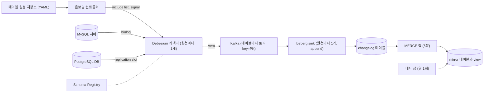

여러 팀의 운영 MySQL과 PostgreSQL에 있는 테이블 수백 개를 몇 분 지연으로 Iceberg 레이크하우스에 복제하고, 테이블 추가는 각 팀이 설정 파일 하나로 하게 만들어야 한다. 어려운 점은 복제 자체보다 테이블마다 따로 일어나는 일이다. 한 팀의 DDL, 한 테이블의 재스냅샷, 한 커넥터의 장애가 다른 수백 개 테이블을 멈추거나 원천 DB의 디스크를 채우면 안 된다.

기준: Debezium 3.7, Kafka 4.4, Confluent Schema Registry 8.4, Iceberg 1.12 (Spark 4.1 모듈), MySQL 8.4, PostgreSQL 19 (2026-11).

## 요구사항과 규모 가정

기능 요구사항은 네 가지다. 설정 PR로 테이블을 추가하면 초기 적재와 이후 변경 반영이 자동으로 시작된다. 레이크에는 원천의 현재 상태를 담은 mirror 테이블과 모든 변경을 담은 changelog 테이블이 함께 있다. 삭제와 스키마 변경도 반영된다. 테이블 하나를 다른 테이블을 멈추지 않고 다시 받을 수 있다. 비기능 요구사항은 mirror 신선도 p99 15분, 하루 한 번 대사에서 허용 오차를 넘는 행 수 차이 0, 원천에 테이블 잠금 없음, 커넥터 다운 2일까지는 재스냅샷 없이 복구, changelog 90일 보관이다. 신선도 예산은 Debezium에서 Kafka까지 수 초, Iceberg sink 커밋 주기 2분, MERGE 주기 5분, MERGE 실행 3분으로 최악 약 10분이다. 아래 숫자는 모두 가정이다.

| 항목 | 전제 | 계산 |
|---|---|---|
| 원천 | MySQL 서버 30대, PostgreSQL DB 10개, 테이블 600개 | 커넥터 40개 |
| 변경 | 평균 6,000건/s, 피크 24,000건/s, Avro 이벤트 1 KB (before, after 포함) | 하루 6,000 × 86,400 = 5억 1,840만 건, 518 GB |
| Kafka 보관 | 7일, 복제 3 | 518.4 GB × 7 × 3 = 10.9 TB |
| changelog | Parquet 압축 1/5 | 하루 103.7 GB, 1년이면 37.8 TB, 90일 보관이면 9.3 TB |
| 파티션 | 상위 20개 테이블은 피크 600건/s씩, 나머지 580개는 피크 합 12,000건/s(테이블당 약 21건/s), 파티션당 250건/s 목표 | 20 × ⌈600/250⌉ + 580 × 1 = 60 + 580 = 640개, 복제 3이면 1,920 레플리카 |
| MERGE 입력 | 5분 주기, 피크 기준 | 24,000 × 300 = 720만 행/회 (전체 테이블 합) |
| PostgreSQL WAL | 가장 바쁜 DB가 하루 80 GB 생성, 다운 허용 2일 | slot이 최대 160 GB를 붙잡는다. 상한을 200 GB로 두면 2.5일 |

## 전체 구조



Debezium 커넥터는 MySQL은 서버마다, PostgreSQL은 데이터베이스마다 하나다. binlog는 서버 단위 로그이고 logical slot은 데이터베이스 하나에 묶이므로, 테이블마다 커넥터를 두면 같은 로그를 여러 번 읽고 PostgreSQL에서는 slot이 그 수만큼 WAL을 붙잡는다. 커넥터는 테이블마다 토픽 하나에 PK를 키로 쓰므로 같은 행의 변경은 한 파티션에 커밋 순서로 쌓인다. 이 순서와 tombstone, 스냅샷 이벤트(`op=r`)의 의미는 [CDC 글](/posts/change-data-capture/)에 있다. Iceberg Kafka Connect sink는 원천마다 하나씩 두고 changelog 테이블에 append만 하며, MERGE 잡이 changelog를 읽어 mirror에 반영한다. 사용자는 mirror 위의 view를 읽는다. 같은 CDC 토픽을 캐시 무효화 같은 다른 소비자가 함께 읽을 수 있다는 점이 Kafka를 가운데 두는 이유다([Kafka 캐시 갱신 설계 글](/posts/design-kafka-cache-update/)).

## 핵심 키워드

| 키워드 | 한 줄 뜻 |
|---|---|
| incremental snapshot | 스트리밍을 멈추지 않고 PK 순서의 청크(기본 1024행)로 테이블을 읽는 Debezium 스냅샷 |
| signal | 커넥터에 스냅샷 시작, 중지 같은 명령을 넣는 메시지. source 테이블이나 Kafka 토픽으로 보낸다 |
| mirror 테이블 | 원천의 현재 상태. 키마다 행 하나 |
| changelog 테이블 | 모든 변경 이벤트를 append한 테이블. Kafka 파티션과 오프셋을 컬럼으로 갖는다 |
| 세대(generation) | 깨지는 변경이나 전체 재구축 때 토픽, subject, Iceberg 테이블을 새로 만드는 단위 |
| `max_slot_wal_keep_size` | slot이 붙잡을 수 있는 WAL 상한. 기본 -1은 무제한 |
| 고아 행 | 원천에서 사라졌는데 삭제 이벤트를 받지 못해 mirror에 남은 행 |
| 대사 | 원천과 mirror의 행 수를 PK 범위별로 맞춰 보는 검사 |

## 테이블 추가는 설정 PR과 incremental snapshot signal로 한다

테이블 설정은 저장소의 YAML 한 장이다. 원천, 테이블, 키 컬럼, 모드(mirror 또는 append만), 신선도 목표, 소유 팀, 마스킹할 컬럼을 적는다. CI는 원천에 붙어 PK나 유니크 키가 있는지, MySQL `binlog_row_image=FULL`인지, PostgreSQL이면 `REPLICA IDENTITY`가 무엇인지, binlog 보존이 3일 이상인지 검사한다. 병합되면 컨트롤러가 토픽과 Iceberg 테이블을 만들고, `PUT /connectors/<이름>/config`로 커넥터의 include list에 테이블을 더한 뒤 snapshot signal을 보낸다.

초기 적재 방식은 셋이다. `snapshot.mode=initial`은 커넥터가 처음 뜰 때만 돌고, 이미 도는 커넥터에 테이블을 더할 때는 쓸 수 없다. `blocking` 타입 signal은 스냅샷 동안 스트리밍을 멈춰 같은 원천의 다른 테이블이 함께 늦어진다. 이 설계는 `incremental` 타입을 쓴다. 스트리밍과 번갈아 청크를 읽고 잠금을 걸지 않으며, `additional-conditions`로 범위를 줄 수 있다. 다만 Debezium은 incremental snapshot에 source signal 채널을 요구하므로, 원천마다 signal 테이블과 그 테이블에 쓸 권한이 필요하다. GTID를 켠 MySQL은 `read.only=true`로 signal 테이블에 쓰지 않는 방식을 쓸 수 있다. 컨트롤러는 Kafka signal 채널(`signal.kafka.topic`)로 명령을 보내고, 메시지 키는 커넥터의 `topic.prefix`와 같아야 한다.

```json
{"type": "execute-snapshot", "data": {"type": "incremental", "data-collections": ["shop.orders"], "additional-conditions": [{"data-collection": "shop.orders", "filter": "id >= 1000000 AND id < 2000000"}]}}
```

Flink CDC처럼 여러 reader가 청크를 병렬로 읽고, 스냅샷이 끝날 때까지 binlog가 원천에 남아 있어야 하는 방식은 [Flink CDC 글](/posts/flink-cdc-incremental-snapshot/)에 있다. Debezium 방식은 커넥터 태스크 하나가 청크를 순서대로 읽어 느리지만, 스냅샷이 길어져도 스트리밍 위치는 계속 앞으로 간다.

PK 없는 테이블은 온보딩에서 가장 많이 막힌다. 유니크 키가 있으면 Debezium이 그 키를 이벤트 키로 쓰고, 없으면 `message.key.columns`로 실제로 유니크한 컬럼을 지정한다. 그것도 없으면 키가 null이라 행 단위 순서와 upsert가 성립하지 않으니 append만 모드로 받는다. 로그성 테이블이면 이것으로 충분하다. incremental snapshot은 signal의 `surrogate-key`로 청크를 자를 컬럼을 준다. PostgreSQL은 더 위험하다. `REPLICA IDENTITY DEFAULT`인데 PK가 없는 테이블이 UPDATE, DELETE를 내보내는 publication에 들어가면 원천에서 그 테이블의 UPDATE와 DELETE가 에러로 실패한다. Debezium의 `publication.autocreate.mode` 기본값 `all_tables`는 모든 테이블을 publication에 넣으므로, 이 설계는 `filtered`로 include list의 테이블만 넣고, PK 없는 테이블은 `REPLICA IDENTITY FULL`을 먼저 걸게 한다.

## upsert는 append 로그 뒤의 주기적 MERGE로 한다

선택지는 셋이다. 첫째는 Flink Iceberg sink의 upsert로, 키마다 equality delete를 쓰고 체크포인트마다 커밋한다. 신선도는 가장 좋지만 커밋마다 equality delete가 쌓여 읽기가 느려지고, 도착한 순서대로 덮어쓰므로 재생 중에는 옛 값이 잠시 이긴다(동작에서 나온 추론이다). 둘째는 Spark `MERGE INTO`를 merge-on-read로 돌리는 방식이다. 지울 행을 먼저 찾으니 position delete나 v3 deletion vector를 쓰고, 버전 비교 조건을 MERGE 안에 넣을 수 있다. 셋째는 append 로그만 두고 읽을 때 키마다 최신을 고르는 view인데, 모든 조회가 전체 로그를 정렬한다. delete 파일 종류와 읽기 비용은 [Iceberg 행 단위 변경 글](/posts/iceberg-row-level-deletes/)에 있다.

이 설계는 둘째를 고른다. Iceberg 1.12 문서의 Kafka Connect sink는 upsert 설정을 설명하지 않으므로, sink에는 append만 맡긴다. `DebeziumTransform`이 `_cdc.op`, `_cdc.ts`, `_cdc.target`을 붙이고 `KafkaMetadataTransform`이 파티션과 오프셋을 붙인다. sink 하나가 원천의 토픽 수백 개를 받으므로 `iceberg.tables.dynamic-enabled=true`, `iceberg.tables.route-field=_cdc.target`으로 테이블을 고르고, changelog 이름은 `cdc.target.pattern`으로 정한다. 삭제는 `op=d` 이벤트로 충분하고 토픽이 compact가 아니니 Debezium `tombstones.on.delete=false`로 값이 null인 tombstone은 내지 않는다. sink 커밋 주기 `iceberg.control.commit.interval-ms`는 기본 5분을 2분으로 줄인다. MERGE 잡은 테이블마다 처리한 파티션별 오프셋(`_kafka_metadata_offset`, 스케치에서는 `_offset`)을 상태 테이블에 두고, 그보다 큰 changelog 행만 읽는다. 키가 PK이고 파티션 수가 그대로면 오프셋이 곧 그 키의 변경 순서라서 비교 기준은 `(세대, 오프셋)`이다.

```sql
-- 구조만 보여 주는 스케치
MERGE INTO lake.shop.orders_m t
USING (SELECT * FROM (SELECT c.*, row_number() OVER (PARTITION BY id ORDER BY _offset DESC) rn
                      FROM new_changes c) WHERE rn = 1) s
ON t.id = s.id
WHEN MATCHED AND s._offset > t._offset THEN UPDATE SET *   -- op=d도 _deleted=true인 행으로 덮는다
WHEN NOT MATCHED THEN INSERT *                             -- 처음 보는 키의 op=d도 _deleted=true로 남긴다
```

삭제는 행을 지우지 않고 `_deleted=true`와 오프셋을 남긴다. 행을 바로 지우면 그 키의 마지막 오프셋이 사라져, 재생으로 다시 온 옛 insert가 `NOT MATCHED`로 되살아난다. mirror에 없던 키의 마지막 이벤트가 삭제일 때도 같은 이유로 `_deleted=true` 행을 넣는다. 사용자 view는 `_deleted`를 걸러 내고, 7일(Kafka 보관 기간)이 지난 삭제 행은 하루 한 번 실제로 지운다. 대가는 세 가지다. 신선도가 MERGE 주기에 묶이고, 5분마다 테이블 수만큼 Spark 작업이 돌며, mirror를 v3로 만들면 읽는 엔진도 v3를 지원해야 한다. merge-on-read MERGE는 그사이 compaction이 대상 파일을 바꿔 쓰면 커밋에 실패하므로, mirror의 compaction은 같은 잡이 MERGE 다음 차례에 돌린다. 신선도 1~2분이 꼭 필요한 테이블 몇 개는 같은 토픽에서 Flink upsert로 별도 mirror를 만든다. 토픽이 가운데 있으니 이 선택은 테이블 단위로 바꿀 수 있다.

## 스키마 변경은 넓히는 쪽만 자동으로 받는다

MySQL의 DDL은 Debezium이 스키마 이력으로 따라가고, 그 뒤 이벤트는 새 Connect 스키마를 달고 나온다. AvroConverter는 이를 `<토픽>-value` subject의 새 버전으로 등록하고, 레지스트리는 subject의 호환성 모드로 검사한다. 이 설계는 기본값 `BACKWARD`를 둔다. 모드마다 무엇이 통과하는지는 [Avro 스키마 진화 글](/posts/schema-evolution/)에 있다. PostgreSQL logical decoding은 DDL을 내보내지 않으니, 스키마 변경은 그 테이블의 다음 행 이벤트에서야 드러난다(동작에서 나온 추론이다).

| 원천 변경 | 레지스트리 | Iceberg | 이 설계의 처리 |
|---|---|---|---|
| null 허용 컬럼 추가 | 통과 | 컬럼 추가 | sink `iceberg.tables.evolve-schema-enabled=true`가 changelog에, MERGE 잡이 mirror에 추가 |
| 컬럼 삭제 | 통과 | 옛 컬럼 유지 | 이후 행은 null. 소유 팀에 알림 |
| 이름 변경 | 삭제 + 추가로 보인다 | 새 컬럼 | 설정 PR에 적으면 Iceberg 쪽 이름만 바꾸고 그 테이블을 재스냅샷 |
| `INT`에서 `BIGINT` | 통과 (`int`에서 `long` 승격) | 허용 | sink 문서의 자동 진화는 필드 추가뿐이라, 컨트롤러가 `ALTER COLUMN ... TYPE`을 먼저 건다 |
| `INT`에서 `VARCHAR` | 거절 | 불가 | 새 세대 |

Iceberg가 허용하는 타입 변경이 넓히는 방향뿐이라는 점은 [Iceberg 스키마 진화 글](/posts/iceberg-schema-and-partition-evolution/)에 있다. 문제는 거절되는 경우다. 레지스트리가 등록을 거절하면 source 태스크가 죽고, Debezium MySQL과 PostgreSQL 커넥터는 태스크 하나로 돌기 때문에 그 원천의 모든 테이블이 함께 멈춘다. 그 사이 binlog 보존 시계도 간다.

그래서 깨지는 변경은 세대를 올려 처리한다. 설정 PR에서 `generation: 2`로 바꾸면 컨트롤러가 그 테이블을 include list에서 빼 커넥터를 먼저 살린다. 이어 Debezium `ToLogicalTopicRouter` SMT로 그 테이블만 `shop.orders.g2` 토픽으로 보내고(`key.enforce.uniqueness=false`로 키를 PK 그대로 둔다), 새 subject와 `orders_m__g2` 테이블을 만든 뒤 테이블을 다시 넣고 incremental snapshot을 건다. 스냅샷이 끝나면 view가 새 세대를 가리키고, 옛 세대는 소비자가 옮긴 뒤 지운다. 새 토픽은 오프셋이 0부터라서 세대가 비교 기준의 앞자리에 온다.

## 로그 보존 기간이 커넥터 다운타임의 예산이다

MySQL과 PostgreSQL은 커넥터가 멈췄을 때 반대로 망가진다. MySQL은 `binlog_expire_logs_seconds`가 지나면 binlog를 지우고, 커넥터는 다시 붙을 때 읽던 위치를 못 찾는다. PostgreSQL은 slot이 WAL을 붙잡아 원천 디스크가 찬다. 변경이 드문 데이터베이스에서 slot이 앞으로 가지 않는 문제는 Debezium `heartbeat.action.query`로 heartbeat 테이블을 주기적으로 갱신해 푼다.

| | MySQL binlog | PostgreSQL slot |
|---|---|---|
| 예산 | 보존 기간 (온보딩 조건 3일 이상) | `max_slot_wal_keep_size` (이 설계는 200 GB) |
| 예산을 넘으면 | 읽던 binlog 파일이 없다 | slot의 `wal_status`가 `unreserved`를 거쳐 `lost`, `invalidation_reason=wal_removed` |
| 경고 | 커넥터가 읽은 마지막 이벤트 시각이 보존 기간의 50%를 넘을 때 | `pg_replication_slots.safe_wal_size`가 상한의 50% 아래일 때 |

상한을 거는 쪽을 고른다. 무제한이면 CDC는 끊기지 않지만 원천 DB가 디스크를 채워 서비스가 멈출 수 있다. 상한을 걸면 2.5일 넘게 멈춘 커넥터는 slot을 잃고 테이블을 다시 받아야 한다. 원천 서비스가 레이크보다 중요하다는 판단이다. `idle_replication_slot_timeout`(기본 0, 꺼짐)은 지운 커넥터가 남긴 slot을 정리하는 데 쓸 수 있다. 원천 장애 조치 뒤에도 slot을 이어 쓰려면 Debezium `slot.failover=true`로 failover slot을 만들고, primary의 `synchronized_standby_slots`에 standby의 physical slot을 넣고, standby에 `sync_replication_slots`를 켜야 한다.

위치를 잃었을 때 `snapshot.mode=when_needed`는 그 원천의 모든 테이블을 처음부터 다시 받는다. 이 설계는 `initial`로 두어 커넥터가 에러로 멈추게 한 뒤, 컨트롤러가 `PUT /connectors/<이름>/stop`, `DELETE /connectors/<이름>/offsets`로 위치를 지운다. MySQL은 Debezium 문서의 절차대로 스키마 이력 토픽도 비우고, PostgreSQL은 `lost`가 된 slot을 `pg_drop_replication_slot`으로 지운다. 그 뒤 `no_data`로 현재 위치부터 스트리밍을 다시 시작한다. 그리고 테이블마다 incremental snapshot을 순서대로 건다. 스트리밍이 먼저 살아나니 새 변경은 바로 들어오고, 위치를 잃은 사이의 변경은 스냅샷이 채운다. 그 사이 원천에서 지워진 행은 스냅샷이 알려 주지 않으므로 다음 절의 고아 행 정리가 필요하다.

## 선택지 비교

| | Debezium + Connect append + Spark MERGE (이 설계) | Debezium + Kafka + Flink upsert sink | Flink CDC 파이프라인 직행 |
|---|---|---|---|
| 신선도 | 5~10분 | 체크포인트 주기 (1~2분) | 체크포인트 주기 |
| 재생 때 옛 값 | 오프셋 비교로 거절 | 도착 순서대로 덮어쓴다 | 같음 |
| 읽기 비용 | position delete, DV | 커밋마다 equality delete, compaction 필수 | 같음 |
| 테이블 하나 다시 받기 | signal 하나, 다른 테이블은 계속 | signal 하나 | 세이브포인트로 잡을 멈췄다가 다시 띄워야 새 테이블 스캔 |
| 운영할 것 | Connect 클러스터, 레지스트리, Spark 스케줄 | Connect, 레지스트리, Flink 잡 | Flink 클러스터와 체크포인트 저장소 |
| 다른 소비자 | 토픽을 함께 읽는다 | 같음 | 없음 |

## 장애와 재처리

| 장애 | 복구 |
|---|---|
| 테이블 하나가 틀어짐 | 컨트롤러가 그 테이블의 파티션마다 끝 오프셋을 기록하고 incremental snapshot을 건다. Debezium 알림(`notification.enabled.channels`)의 `COMPLETED`를 받고 MERGE가 그 뒤까지 반영하면, `_offset`이 자기 파티션의 기록값보다 작은 mirror 행은 스냅샷에도 이후 변경에도 나오지 않은 고아 행이라 지운다(알고리즘에서 나온 추론이다) |
| 일부 범위만 틀어짐 | 같은 절차를 `additional-conditions`의 PK 범위로 좁히고, 고아 행 정리도 그 범위 안에서만 한다 |
| sink 태스크 실패 | Connect는 죽은 태스크를 다시 띄우지 않는다([Kafka Connect 글](/posts/kafka-connect-workers-tasks/)). 컨트롤러가 실패한 태스크만 재시작하고, 같은 레코드에서 반복되면 DLQ와 그 원천만의 경고로 넘긴다. sink가 원천마다 따로라서 다른 원천은 계속 돈다 |
| 해석할 수 없는 값 | sink의 DLQ는 컨버터와 SMT 실패만 받는다. MERGE에서 형 변환에 실패한 행은 격리 테이블로 보내고 오프셋은 넘긴다. source 쪽은 건너뛰지 않는다. 건너뛰면 원천 변경이 사라진다 |
| 다른 팀의 폭주 | 대량 UPDATE 한 번이 Kafka와 MERGE를 채운다. Connect 클러스터를 중요도별로 나누고, 커넥터마다 Kafka produce 쿼터를 걸고, MERGE 잡은 원천마다 따로 돌린다 |

대사는 하루 한 번 원천의 읽기 replica에서 PK 범위별 `COUNT(*)`를 세고 mirror의 같은 범위와 비교한다. 둘을 같은 순간에 셀 수 없으니, 그 범위의 최근 15분 changelog insert, delete 수만큼을 허용 오차로 둔다. 두 번 연속 넘는 범위만 그 범위의 재스냅샷으로 넘긴다. 볼 지표는 여섯 개다. 커넥터별 `MilliSecondsBehindSource`, 테이블별 신선도(지금에서 마지막으로 반영한 이벤트의 `_cdc.ts`를 뺀 값, 변경이 없는 테이블은 끝 오프셋까지 따라잡은 마지막 MERGE의 시작 시각 기준), 테이블별 Kafka lag와 MERGE 미처리 오프셋, binlog 보존 대비 커넥터 정지 시간과 slot `safe_wal_size`, 대사 불일치 범위 수, DLQ와 격리 테이블 유입 수다. 커넥터 RUNNING 상태는 태스크 실패를 가리므로 지표에 넣지 않는다.

## 규모가 10배가 되면

변경 평균 60,000건/s, 테이블 6,000개를 가정한다. 먼저 깨지는 곳은 원천 하나의 커넥터다. Debezium MySQL과 PostgreSQL 커넥터는 태스크 하나라서 가장 바쁜 서버의 변경을 한 스레드가 다 지나야 한다. 테이블을 나눠 커넥터를 둘로 쪼개면 binlog를 두 번 읽고 `database.server.id`도 따로 줘야 하며, PostgreSQL은 slot이 둘이 되어 WAL 상한도 둘로 나눠야 한다. 다음은 MERGE다. 5분마다 6,000개 테이블에 Spark 작업을 띄우면 스케줄링 비용이 데이터 처리보다 커지므로, 변경이 없는 테이블은 건너뛰고 작은 테이블은 한 작업에 묶고, 변경이 큰 테이블은 Flink upsert로 옮긴다. Iceberg 쪽은 2분 커밋 × 테이블 6,000개면 하루 432만 커밋이라 카탈로그 부하와 스냅샷 만료가 일이 된다. 커밋 주기를 테이블 중요도에 따라 늘린다. 저장은 changelog가 연 378 TB가 되어 보관을 30일로 줄이고 오래된 이력은 mirror의 스냅샷 보관으로 대신한다. 토픽 파티션은 6,400개 수준이라 브로커보다 레지스트리 subject 1만 2,000개와 Connect 설정 관리가 먼저 무거워진다.

## 참고 자료

- Debezium 3.7: [MySQL connector](https://debezium.io/documentation/reference/stable/connectors/mysql.html), [PostgreSQL connector](https://debezium.io/documentation/reference/stable/connectors/postgresql.html), [Signaling](https://debezium.io/documentation/reference/stable/configuration/signalling.html), [Notifications](https://debezium.io/documentation/reference/stable/configuration/notification.html), [Topic routing](https://debezium.io/documentation/reference/stable/transformations/topic-routing.html)
- Apache Kafka 4.4: [Kafka Connect User Guide (REST API, offsets)](https://kafka.apache.org/44/kafka-connect/user-guide/)
- Apache Iceberg 1.12: [Kafka Connect](https://iceberg.apache.org/docs/latest/kafka-connect/), [Spark Writes](https://iceberg.apache.org/docs/latest/spark-writes/), [Evolution](https://iceberg.apache.org/docs/latest/evolution/)
- PostgreSQL 19: [Replication settings](https://www.postgresql.org/docs/current/runtime-config-replication.html), [pg_replication_slots](https://www.postgresql.org/docs/current/view-pg-replication-slots.html), [Publication](https://www.postgresql.org/docs/current/logical-replication-publication.html)
- [Confluent Schema Evolution and Compatibility](https://docs.confluent.io/platform/current/schema-registry/fundamentals/schema-evolution.html)

## English summary

The platform replicates hundreds of MySQL and PostgreSQL tables into Iceberg with one Debezium connector per source, one topic per table, and the primary key as the message key. Teams add a table with a config pull request, and a controller extends the connector's include list and sends an incremental snapshot signal, so no table is locked and other tables keep streaming. The Iceberg sink only appends to a changelog table, and a Spark job merges it into a mirror table every five minutes, comparing Kafka offsets so replays cannot bring back old rows and keeping deletes as flagged rows. Breaking schema changes get a new generation of topic, subject and tables, and lost log positions are recovered by streaming from the current position and re-snapshotting table by table. The hard limits are the single task per Debezium connector and the WAL cap on PostgreSQL, which trades CDC continuity for the safety of the source database.
