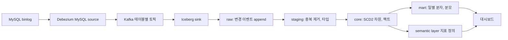

마켓플레이스 운영 DB의 주문, 결제, 환불, 상품, 판매자 테이블로 매일 아침 GMV, 순매출, 환불률, 판매자 순위, 고객 코호트를 내야 한다. 어려운 점은 운영 DB가 행을 계속 고친다는 것이다. 주문 상태는 바뀌고, 부분 취소는 수량을 줄이고, 판매자 등급과 상품 카테고리도 바뀌는데, 분석가는 지난달 숫자가 오늘 다시 열어 봐도 같기를 원한다.

기준: Debezium 3.7, MySQL 8.4, Kafka 4.4, Iceberg 1.12, Spark 4.3, dbt Core 1.12 (2026-11).

## 요구사항과 규모 가정

기능 요구사항은 다섯 가지 지표를 매일 06:00(KST)까지 전날 기준으로 내는 것이다. 지표 정의는 한 곳에만 두고 대시보드와 마트가 같은 정의를 쓴다. 판매자 순위는 그때 등급으로도, 지금 등급으로도 묶을 수 있어야 한다. 비기능 요구사항은 raw 신선도 15분 안, 닫힌 날짜의 숫자 불변, 닫힌 날짜의 주문 건수와 금액이 운영 DB와 차이 0, raw 5년 보관, 매일 빌드는 최근 며칠만 다시 읽는 비용이다. 아래 숫자는 가정이다.

| 항목 | 값 | 계산 |
|---|---|---|
| 주문, 주문 항목 | 200만 건/일, 500만 행/일 | 주문당 항목 2.5개 |
| 변경 이벤트 | 약 3,000만/일 | 주문 200만×5회 + 항목 500만×2회 + 결제 240만(주문당 1.2건)×3회 + 환불·취소 20만(항목의 4%)×2회 + 상품·판매자·고객·쿠폰 200만 = 2,960만 |
| 평균, 피크 | 347/s, 약 3,500/s | 3,000만 ÷ 86,400 = 347, 세일 때 10배 |
| Kafka 유입, 보관 | 60 GB/일, 피크 7 MB/s, 보관 약 1.3 TB | 이벤트당 2 KB(before, after 포함 JSON), 60 GB × 7일 × 복제 3 = 1,260 GB |
| raw Iceberg | 12 GB/일, 연 4.4 TB | Parquet 압축 1/5, 12 × 365 = 4,380 GB |
| 항목 팩트 | 연 18억 행, 일 파티션 500 MB | 500만 × 365 = 18.25억, 행당 100 B |

일 파티션 하나가 500 MB라서 날짜 단위가 맞는 크기다. 시간 단위로 나누면 파티션이 약 21 MB로 작아진다. 피크 7 MB/s는 Kafka 파티션 몇 개로 충분하니 파티션 수는 sink 병렬도로 정하고, 주문과 주문 항목 토픽은 12개씩 둔다.

## 전체 구조



Debezium이 binlog를 읽어 테이블마다 토픽으로 보내고, 레코드 키는 원천 기본 키다. Iceberg sink는 변경 이벤트를 고치지 않고 raw 테이블에 쌓는다. Iceberg가 주는 DebeziumTransform은 걸지 않는다. 이 SMT는 `before`나 `after`를 위로 올리면서 `op`를 삽입, 수정, 삭제 셋으로 줄이고 `source` 블록 대신 `db.table` 문자열만 남겨, `r`과 `source.ts_ms`, binlog 위치가 사라진다. 그래서 raw에는 봉투의 `op`, `ts_ms`, `before`, `after`, `source`를 그대로 둔다. sink는 `iceberg.control.commit.interval-ms` 기본값인 5분마다 커밋하니 raw 신선도는 5분 남짓이다. staging, core, mart는 Spark에서 도는 dbt 모델이고 매일 새벽 한 번 빌드한다.

## 핵심 키워드

| 키워드 | 한 줄 뜻 |
|---|---|
| `op` | Debezium 이벤트 종류. `c` 생성, `u` 수정, `d` 삭제, `r` 스냅샷 읽기, `t` truncate(기본 `skipped.operations=t`라 건너뜀) |
| `source.ts_ms` | 원천 DB에서 변경이 일어난 시각. 봉투의 `ts_ms`는 커넥터가 처리한 시각 |
| raw, staging, core, mart | 원본 이벤트, 정리된 행, 차원과 팩트, 지표용 집계 |
| SCD2, 대리 키 | 속성이 바뀔 때마다 차원 행을 하나 더 넣는 방식과, 그 버전 하나를 가리키는 키 |
| inferred member | 차원보다 팩트가 먼저 왔을 때 넣는 자리표시 차원 행 |
| 조정 팩트 | 환불, 취소, 정정을 원래 행을 고치지 않고 음수 금액으로 쌓는 팩트 |
| microbatch `lookback` | 마지막 북마크 앞의 배치 몇 개를 다시 처리할지 |
| 마감일 | 정기 빌드가 더는 다시 쓰지 않는 날짜 |
| 대사(reconciliation) | 웨어하우스 합계를 운영 DB 합계와 맞춰 보는 검사 |

## 팩트의 한 행은 주문 항목으로 정한다

후보는 주문, 주문 항목, 결제 세 가지다. 한 주문에 여러 판매자의 상품이 섞이므로 주문 grain으로는 판매자 순위를 낼 수 없다. 결제는 카드와 포인트로 나뉘어 한 주문에 여러 건이 될 수 있고, 어느 결제가 어느 항목을 샀는지 정해져 있지 않다. 그래서 주문 항목을 기본 grain으로 두고 결제는 따로 팩트를 둔다. 한 행의 뜻과 다시 돌려도 한 벌만 남는 키를 먼저 정하는 이유는 [지표 테이블 grain 글](/posts/metric-table-grain/)에 적었다.

| 팩트 | 한 행 | 키 | 파티션 |
|---|---|---|---|
| `fct_order_items` | 주문 시점의 주문 항목 하나 | `order_item_id` | 주문일(KST) |
| `fct_item_adjustments` | 항목 하나에 대한 환불, 취소, 정정 한 건 | `adjustment_id` | 조정일(KST) |
| `fct_payments` | 결제 승인, 매입, 환불 거래 하나 | `payment_txn_id` | 거래일(KST) |

단가와 수량은 상품 차원에서 끌어오지 않고 주문 시점 값을 팩트에 둔다. 상품 가격이 나중에 바뀌어도 팩트 금액은 그대로다. 주문 전체에 붙은 쿠폰은 항목 금액 비율로 나눠 `coupon_amount`에 넣고, 나누고 남은 원 단위 끝수는 금액이 가장 큰 항목에 몰아 주문 합계가 운영 DB와 맞게 한다. 주문 단위 지표는 항목 팩트를 묶은 마트로 만든다. 비용은 결제와 항목이 주문 단위에서만 이어진다는 점이고, "카드로 산 상품" 같은 질문에는 답하지 않는다.

## 환불과 부분 취소는 행을 고치지 않고 조정 팩트로 쌓는다

운영 DB에서 세 개 산 항목 중 하나를 취소하면 수량이 3에서 2로 바뀌거나 환불 테이블에 행이 생긴다. 팩트를 그대로 따라 고치면 구현은 쉽지만, 지난달 GMV가 이번 달 취소 때문에 줄어든다. 이 설계는 `fct_order_items`를 주문 시점 값으로 고정하고, 수량 감소와 환불 행을 staging에서 조정 이벤트로 바꿔 `fct_item_adjustments`에 쌓는다. 한 취소가 수량 감소와 환불 행을 둘 다 남기는 원천이면 환불 행만 조정의 원천으로 삼아 두 번 빼지 않는다. 가격 정정도 같은 길로 들어온다. 조정 행은 원래 항목의 주문일과 차원 키를 물려받고, 금액은 쿠폰 몫을 뺀 순금액의 음수다. GMV는 D에 주문된 항목의 `gross_amount` 합이라 조정으로 줄지 않고, 날짜 D의 순매출은 D에 주문된 항목의 `gross_amount - coupon_amount` 합에 D에 일어난 조정 금액(음수)을 더한 값이다.

발생일 기준 순매출은 조정이 일어난 날에 빠지므로 닫힌 날짜가 바뀌지 않는다. 주문일 기준 "30일 안 환불률"은 사정이 다르다. 주문 뒤 30일 동안 분자가 계속 자란다. 그래서 이 마트는 분자와 분모를 따로 두고 최근 33일 주문일을 매일 다시 만들며, 30일 창과 늦은 이벤트를 받는 사흘이 모두 지난 행에만 `is_final = true`를 붙여 대시보드는 그 행만 확정 숫자로 보여 준다.

지표 정의는 dbt semantic layer(MetricFlow)에 한 번만 적는다. ratio metric은 분자와 분모 metric 이름을 받는다. 대시보드가 metric을 바로 쿼리하는 Semantic Layer API는 dbt 플랫폼 Starter 이상 플랜 기능이라, 이 경로는 그 플랜을 전제로 한다. 마트 SQL이 같은 나눗셈을 다시 쓰면 정의가 두 벌이 되니, 마트에는 분자와 분모 컬럼만 두고 나눗셈은 metric에서만 한다. 비용은 조정 팩트를 빼먹은 쿼리가 GMV를 순매출로 착각할 수 있다는 점이고, 순매출은 metric으로만 노출해서 막는다.

```yaml
# 구조만 보여 주는 스케치
metrics:
  - name: refund_rate_30d
    type: ratio
    numerator: refunded_amount_30d
    denominator: ordered_net_amount  # 분자와 같은 쿠폰 뺀 금액 기준
```

## 상품과 판매자 차원은 CDC 로그로 SCD2를 만든다

판매자 등급과 상품 카테고리는 바뀌고, 지난 순위는 그때 값으로 묶여야 한다. SCD2의 대리 키와 반열린 유효 기간은 [SCD 차원 모델링 글](/posts/dimensional-modeling-scd/)에 있다. dbt snapshot은 실행할 때의 원천 상태를 비교해서, 두 실행 사이에 여러 번 바뀐 값은 마지막 값만 남긴다. raw에는 모든 `u` 이벤트가 있으니 이 설계는 로그에서 버전을 만든다. 대신 raw를 지우지 못하고, 같은 키의 순서를 직접 정해야 한다.

```sql
-- 구조만 보여 주는 스케치. 같은 키의 순서는 변경 시각, 같으면 binlog 위치(source.file, source.pos)로 정한다
SELECT seller_id, grade, changed_at AS valid_from,
       COALESCE(next_at, TIMESTAMP '9999-12-31 00:00:00') AS valid_to
FROM (SELECT seller_id, grade, op, changed_at,
             LEAD(changed_at) OVER (PARTITION BY seller_id ORDER BY changed_at, bin_file, bin_pos) AS next_at
      FROM stg_seller_changes) v
WHERE op <> 'd';
```

`changed_at`은 `source.ts_ms`에서 온다. 처음 스냅샷으로 들어온 `r` 행의 시각은 스냅샷을 뜬 때라서 CDC를 켜기 전의 이력은 없고, 첫 버전의 `valid_from`은 아주 이른 날짜로 당겨 그 전 주문도 키를 받게 한다. 팩트는 `valid_from <= order_ts < valid_to`인 버전의 대리 키를 받는다. 판매자 ID도 팩트에 따로 남겨, 지금 등급으로 묶을 때는 현재 행에 ID로 붙인다. 늦게 오는 차원도 있다. 상품 DB와 주문 DB가 다르면 커넥터도 다르고, 상품 등록 직후 들어온 주문이 상품 행보다 먼저 raw에 도착할 수 있다. 팩트를 버리거나 미루는 대신 차원에 `is_inferred = true`인 자리표시 행을 넣고 그 대리 키를 준다. 대리 키는 원천 ID와 `valid_from`의 해시이고 첫 버전의 `valid_from`이 고정된 이른 날짜라서, 진짜 행이 오면 같은 키로 자리표시 행의 속성만 덮어쓰고 팩트는 다시 쓰지 않는다. 비용은 자리표시 행만 Type 1처럼 고쳐진다는 점이고, 마감일까지 풀리지 않은 자리표시 행 수를 경고로 본다.

## 증분 빌드는 날짜 파티션을 다시 쓰고 사흘 뒤에 닫는다

매일 전체를 다시 만들면 연 18억 행을 매일 읽는다. 키로 MERGE하면 읽는 양은 줄지만 다시 계산한 결과에 없는 옛 키가 남는다. 이 설계는 날짜 파티션을 통째로 바꾸는 쪽을 고르고, 팩트를 dbt microbatch로 날짜마다 배치 하나씩 만든다. dbt-spark에서 microbatch는 `insert_overwrite`로 그 배치의 파티션을 바꾸고 `partition_by`가 필요하다. `lookback` 기본값은 1인데, 2로 두면 매일 빌드가 마지막 북마크 배치와 그 앞 두 배치를 다시 만든다. 이 사흘이 늦은 CDC 이벤트와 늦은 차원을 받아 주는 기간이고, 그 뒤가 마감일이다. 비용은 매일 사흘치를 다시 쓰는 것과, 사흘보다 늦게 온 이벤트는 백필 전까지 반영되지 않는다는 점이다. 겹쳐 읽는 범위와 어댑터별 합치는 방법은 [dbt 증분 모델 글](/posts/dbt-incremental-models/)에 있다.


```sql
-- 구조만 보여 주는 스케치
{{ config(materialized='incremental', incremental_strategy='microbatch',
          event_time='order_local_ts', begin='2024-01-01', batch_size='day',
          lookback=2, partition_by=['order_date']) }}
```


함정은 시간대다. dbt는 `event_time`, `begin`, `--event-time-start`, `--event-time-end`를 모두 UTC로 보고, 배치를 시작 이상 끝 미만으로 자른다. UTC 하루 배치로 KST 날짜 파티션을 덮어쓰면 한 파티션에 9시간이 빈다. 그래서 staging에서 주문 시각에 9시간을 더한 벽시계 컬럼 `order_local_ts`를 만들고, staging과 팩트가 둘 다 이 컬럼을 `event_time`으로 쓴다. 실제 순간을 뜻하지 않는 컬럼이니 이 용도에만 쓴다. 상위 모델이 UTC 시각을 `event_time`으로 두면 입력이 UTC 하루로 걸러져 같은 9시간이 빈다. `event_time`이 없는 차원은 배치마다 통째로 읽히지만 작으니 받아들인다. 마감 전에는 검사를 건다. 수집, 적재, 적재 후로 나누는 틀은 [데이터 품질 검사 글](/posts/data-quality-checks/)에 있다. 적재 단계에서는 dbt 기본 data test인 `unique`, `not_null`, `relationships`(팩트의 대리 키가 차원에 있는지), `accepted_values`(조정 종류)를 돌린다. 대사 쿼리는 닫히는 날짜의 주문 건수와 금액 합을 운영 DB 읽기 복제본에서 센 값과 비교한다. 운영 DB는 부분 취소가 반영된 지금 상태이니 웨어하우스 쪽 금액은 항목 팩트에 지금까지의 조정을 더한 합으로 잡고, 주문마다 항목 순금액 합과 매입된 결제 합도 맞춰 본다. 적재 후에는 `dbt source freshness`로 raw 적재 시각을 보고, 일별 GMV가 전주 같은 요일보다 크게 흔들리면 경고만 낸다. 테스트가 실패하면 그날 마트는 발행하지 않고 전날 숫자를 둔다.

## 선택지 비교

| | CDC 이벤트 로그 + 계층 모델(이 설계) | CDC upsert 복제본 + 매일 스냅샷 | 매일 전체 덤프 |
|---|---|---|---|
| 원천 이력 | 모든 변경 | 하루 한 번의 상태 | 하루 한 번의 상태 |
| 하드 삭제 | `d` 이벤트로 보인다 | 스냅샷 차이로만 안다 | 다음 덤프에서 빠진 것으로만 안다 |
| 하루 안 여러 번 바뀐 차원 | 버전마다 행 | 마지막 값만 | 마지막 값만 |
| 운영 DB 부하 | binlog 읽기 | binlog 읽기 | 매일 전체 스캔 |
| 비용 | raw 저장, 중복 제거와 SCD2 빌드 | 스냅샷 저장, 정합 검사 | 덤프 저장, 긴 배치 |

upsert 복제본은 원천을 따라가는 사본으로는 맞지만 키마다 현재 상태만 남는다. 로그 기반 CDC가 하드 삭제와 폴링 사이의 변경까지 받는 이유는 [CDC 개념 글](/posts/change-data-capture/)에 적었다.

## 장애와 재처리

커넥터가 오래 멈추면 binlog가 먼저 지워질 수 있다. MySQL 8.4의 `binlog_expire_logs_seconds` 기본값은 2,592,000초(30일)이고, 커넥터가 이미 지워진 위치에서 다시 시작하면 실패하며 새 스냅샷이 필요하다는 에러를 낸다. 이때는 그 테이블을 다시 스냅샷하고, `r` 행은 staging에서 키마다 최신 행과 합치고, 스냅샷에 없는 키는 멈춘 사이 지워진 것으로 보고 닫는다. 소스가 재시작 뒤 같은 이벤트를 다시 보내는 경우도 있으니 raw는 중복을 전제로 두고, staging에서 원천 기본 키와 binlog 위치가 같은 행을 하나로 줄인다. Iceberg sink가 exactly-once를 내세워도 Kafka에 이미 두 번 들어간 이벤트까지 지우지는 않는다. 변환에 실패하는 레코드는 sink 커넥터에 `errors.tolerance=all`과 `errors.deadletterqueue.topic.name`을 주어 DLQ 토픽으로 보낸다. 기본값 `none`이면 첫 에러에서 커넥터 task가 실패한다. DLQ 건수가 0이 아니면 그 테이블의 마감을 미룬다. 닫힌 날짜를 다시 쓰는 경우는 로직 버그뿐이다. `dbt run --event-time-start ... --event-time-end ...`로 그 범위만 다시 만들고, 실패한 배치는 `dbt retry`로 그 배치만 다시 돈다. 고친 날짜와 이유는 정정 로그 테이블에 남겨 대시보드에서 보이게 한다.

| 볼 지표 | 경고 기준 예 |
|---|---|
| Debezium `MilliSecondsBehindSource` | 10분 이상 |
| sink 컨슈머 lag | 피크가 지나도 계속 늘어남 |
| raw 신선도(최신 봉투 `ts_ms`) | 15분 이상 |
| data test 실패, 대사 차이 | 1건 이상, 0이 아님 |
| 풀리지 않은 inferred member | 마감일 행에 1건 이상 |
| DLQ 건수 | 1건 이상 |

## 규모가 10배가 되면

변경 이벤트가 하루 3억, 피크 35,000/s, 70 MB/s가 된다. 먼저 막히는 곳은 소스다. MySQL 커넥터는 늘 task 하나로 돌아서 `tasks.max`를 올려도 소용이 없다. 운영 DB를 샤드로 나누고 샤드마다 커넥터를 두면, 자연 키에 샤드 ID를 붙여야 키가 겹치지 않는다. 다음은 SCD2 빌드다. 전체 로그에 `LEAD`를 다시 거는 방식은 이력이 쌓일수록 느려지니, 그날 바뀐 키만 골라 현재 행을 닫고 새 행을 넣는 증분 MERGE로 바꾼다. 항목 팩트의 일 파티션은 5 GB가 되고 매일 사흘치 15 GB를 다시 쓴다. 판매자 순위와 코호트 마트는 사용자와 판매자 단위 상태를 쌓아 두는 쪽으로 바꿔야 매일 전체 이력을 읽지 않는다. 코호트 표의 grain과 대각선을 하루씩 채우는 방식은 [코호트 리텐션 글](/posts/cohort-retention/)에 있다. Kafka 보관은 7일 기준 12.6 TB가 되니, 재처리 원천은 raw로 두고 토픽 보관은 줄인다. 넓은 마트는 그대로 둘 수 있다. 이벤트 시점 값을 차원 키와 함께 복사해 두면 그때 기준과 지금 기준 그룹을 둘 다 답할 수 있다는 내용은 [정규화와 비정규화 글](/posts/normalization-vs-denormalization/)에 있다.

## 참고 자료

- [Debezium 3.7 MySQL connector (op, source.ts_ms, snapshot, tasks.max, MilliSecondsBehindSource)](https://debezium.io/documentation/reference/stable/connectors/mysql.html)
- [Apache Iceberg 1.12 Kafka Connect (DebeziumTransform, commit interval)](https://iceberg.apache.org/docs/latest/kafka-connect/)
- [Apache Kafka 4.4 Connect user guide (errors.tolerance, dead letter queue)](https://kafka.apache.org/44/kafka-connect/user-guide/), [MySQL 8.4 binary log options (binlog_expire_logs_seconds)](https://dev.mysql.com/doc/refman/8.4/en/replication-options-binary-log.html)
- [dbt: Microbatch incremental models (lookback, UTC, adapter mechanisms)](https://docs.getdbt.com/docs/build/incremental-microbatch)
- [dbt: Ratio metrics](https://docs.getdbt.com/docs/build/ratio), [Data tests](https://docs.getdbt.com/docs/build/data-tests), [Snapshots](https://docs.getdbt.com/docs/build/snapshots)
- Ralph Kimball, Margy Ross, The Data Warehouse Toolkit, 3rd ed. (Wiley, 2013)

## English summary

This design lands every Debezium change event from the marketplace database in an append-only raw Iceberg table, then builds staging, core, and mart layers with dbt on Spark. The main fact has one row per order item at order time, while refunds, partial cancellations, and price fixes go to a separate adjustment fact on their own date, so a closed day's GMV and net revenue never change. Product and seller dimensions are SCD2 tables built from the change log, with placeholder rows when a fact arrives before its dimension. Daily microbatches rewrite only the last three days, and dbt treats event_time as UTC, so a shifted local timestamp keeps each batch aligned with one KST date partition.
