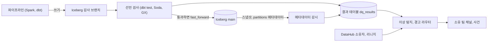

레이크하우스에 테이블이 5,000개 있고, 그중 1,000개를 매일 아침 대시보드와 정산이 읽는다. 검사 몇 개를 다는 일은 쉽다. 어려운 건 검사를 쓰지 않은 테이블까지 덮는 일, 나쁜 데이터를 독자가 보기 전에 막는 일, 그리고 하루 수백 건의 경고가 아무도 읽지 않는 소음이 되지 않게 하는 일이다.

기준: Iceberg 1.12, dbt Core 1.12, GX Core 1.25, Soda Core 4.31, Trino 484, DataHub 1.9 (2026-11).

## 요구사항과 규모 가정

기능 요구사항은 다섯 가지다. 모든 테이블에 신선도, 양, 스키마 감시를 설정 없이 건다. 핵심 테이블에는 null, 유일성, 참조 무결성, 분포 검사를 파이프라인 코드 옆에 선언한다. 검사마다 막는 검사인지 알리는 검사인지 정한다. 경고는 카탈로그의 소유자에게 가고, 리니지로 영향받는 하위 자산을 같이 보여 준다. 모든 결과는 테이블로 남아 SLA 보고에 쓴다. 비기능 요구사항은 핵심 테이블 06시 발행, 검사가 발행을 늦추는 시간 15분 이하, 결과 13개월 보관(작년 같은 달과 비교), 검사 연산이 파이프라인 연산의 5% 이하다. 아래 숫자는 모두 가정이다.

| 항목 | 전제 | 계산 |
|---|---|---|
| 커밋 | 테이블 5,000개, 하루 평균 2회, 70%가 01~05시 | 하루 10,000 커밋, 피크 7,000 / 14,400 s ≈ 0.49 커밋/s |
| 메타데이터 감시 | 커밋마다 신선도, 양, 스키마 | 30,000 지표 행/일, 데이터 스캔 0 바이트 |
| 선언 검사 | 핵심 1,000개 × 10개, 하루 1회, 실행당 엔진 30초 | 10,000 실행 × 30 s = 300,000 s, 4시간 창이면 300,000 / 14,400 ≈ 21개 동시 실행 |
| 분포 프로파일 | 핵심 1,000개 × 컬럼 50개 × 지표 5개 | 250,000 지표 행/일 |
| 결과 테이블 | 행당 300 B | 290,000 × 300 B = 87 MB/일, 1년 약 31.8 GB |
| 검사 스캔량 | 레이크 2 PB, 하루 새 파티션 20 TB, 검사는 50개 중 5개 컬럼만 읽는다 | 전체 스캔 2 PB/일, 새 파티션만 20 TB/일, 필요한 컬럼만 약 2 TB/일(컬럼 크기가 고르다는 가정) |
| 오탐 | 프로파일 지표마다 ±3σ 경고, 정규분포 가정 | 250,000 × 0.0027 ≈ 675건/일 |

마지막 줄이 이 설계의 방향을 정한다. 지표 하나가 경고 하나가 되면 정상인 날에도 하루 675건이 울린다.

## 전체 구조



핵심 테이블의 파이프라인은 main이 아니라 감사 브랜치에 쓴다. 선언 검사가 그 브랜치를 읽고, 막는 검사가 모두 통과하면 main을 브랜치 머리로 옮긴다. 모든 테이블은 커밋 뒤 메타데이터 감시가 스냅샷 요약과 `partitions` 메타데이터 테이블을 읽어 신선도, 양, 스키마 지표를 남긴다. 신선도는 감사 브랜치가 아니라 main이 바뀐 시각으로 잰다. 두 경로의 결과가 한 결과 테이블에 모이고, 이상 탐지는 이 테이블의 이력으로 기준선을 만든다. 라우터는 실패를 테이블 단위 사건으로 묶고 카탈로그에서 소유자와 하위 자산을 찾아 보낸다.

## 핵심 키워드

| 키워드 | 한 줄 뜻 |
|---|---|
| 선언 검사 | 파이프라인 코드 옆 YAML이나 SQL로 적은 규칙. 사람이 의미를 안다 |
| 자동 감시 | 설정 없이 메타데이터에서 뽑은 지표에 거는 감시. 모든 테이블을 덮는다 |
| write-audit-publish (WAP) | 쓰기를 독자에게 보이지 않는 곳에 두고, 검사 뒤 원자적으로 공개하는 방식 |
| 막는 검사, 알리는 검사 | 실패하면 발행을 멈추는 검사와, 발행은 하고 사람에게 알리는 검사 |
| 사건(incident) | 같은 원인으로 묶인 실패들. 사람에게 가는 단위 |
| 영향 분석 | 리니지를 따라 실패한 테이블의 하위 테이블과 대시보드를 찾는 일 |
| 결과 테이블 | 검사 실행 하나가 한 행인 이력 테이블. 기준선과 SLA 보고의 원천 |
| 컬럼 메트릭 | Iceberg가 데이터 파일마다 기록하는 행 수, null 수, 최솟값, 최댓값 |

## 검사는 코드로 선언하고, 나머지는 메타데이터가 지킨다

선언 검사는 의미를 안다. "주문 ID는 유일하다", "고객 ID는 고객 테이블에 있다"는 사람이 써야 한다. 대신 5,000개 테이블에 다 쓰게 할 수는 없고, 안 쓴 테이블은 아무 보호가 없다. 자동 감시는 반대다. 모든 테이블을 덮지만 무엇이 맞는 값인지 모르고 과거와 다른지만 안다. 이 설계는 둘을 겹친다. 모든 테이블에 자동 감시를 걸고, 핵심 1,000개에는 소유 팀이 선언 검사를 단다. 선언 도구는 파이프라인 종류를 따른다. dbt 모델은 data test를 쓴다. `relationships` 같은 내장 test와 `severity`, `store_failures`는 [데이터 품질 검사 글](/posts/data-quality-checks/)에 정리돼 있다. 아래처럼 실패 건수로 경계를 나누면 100건까지는 경고, 그 위는 실패가 된다.

```yaml
# 구조만 보여 주는 스케치 (dbt Core 1.12). 모델 이름은 예시다
models:
  - name: orders
    columns:
      - name: order_id
        data_tests: [unique, not_null]
      - name: customer_id
        data_tests:
          - relationships:
              arguments: {to: ref('customers'), field: customer_id}
              config: {warn_if: ">0", error_if: ">100"}
```

dbt 밖의 Spark 잡은 Soda 계약이나 GX로 적는다. Soda Core 4에서는 `schema`, `row_count`, `freshness`, `missing`, `duplicate`, `invalid`, `aggregate`, `metric`, `failed_rows` 검사를 계약 YAML에 두고 `soda contract verify`로 돌린다. 기준값을 넘으면 기본은 실패이고 `level: warn`을 주면 경고가 된다. GX Core는 expectation마다 critical, warning, info 심각도를 두고, Checkpoint의 `SlackNotificationAction`이 `notify_on`으로 어느 수준에서 울릴지 정한다. 세 도구의 결과는 모양이 다르니, 각 실행 뒤 같은 모양의 행으로 바꿔 결과 테이블에 넣는다. dbt는 `run_results.json`의 결과마다 `unique_id`, `status`, `failures`, `execution_time`을 남긴다. `store_failures`로 남는 실패 행 테이블은 실행마다 덮어써져 이력이 되지 않는다. 대가는 두 가지다. 핵심 테이블 기준을 정하고 소유 팀이 검사를 유지하게 하는 운영 비용이 있고, 도구 셋의 결과를 맞추는 변환 코드가 생긴다.

## 핵심 테이블은 감사 브랜치에서 검사하고 발행한다

| 검사 위치 | 독자가 나쁜 데이터를 보나 | 대가 |
|---|---|---|
| 발행 뒤(after the fact) | 본다. 경고까지의 시간만큼 | 파이프라인은 그대로 |
| 파이프라인 안, 쓰기 뒤 (`dbt build`) | 그 테이블은 본다. 막히는 건 하위 모델이다 | 실패한 test의 하위 노드가 SKIP된다 |
| 감사 브랜치 뒤 발행 (WAP) | 보지 않는다 | 스냅샷과 브랜치 관리, 발행 지연 |

`dbt build`에서 data test가 모델을 만든 뒤에 돈다는 점은 [dbt 증분 모델 글](/posts/dbt-incremental-models/)에 있다. `unique` test가 실패하면 하위 모델은 SKIP되지만, 그 모델 테이블은 이미 바뀌어 있다. 06시에 대시보드가 읽는 테이블이라면 막은 게 아니다. 그래서 핵심 테이블의 마지막 쓰기는 Iceberg 브랜치로 보낸다. `write.wap.enabled=true`와 `spark.wap.branch`로 쓰기를 브랜치에 두고 `fast_forward`로 main을 옮기는 방법, `main`이 그사이 움직였으면 `fast_forward`가 실패한다는 점은 [Iceberg 스냅샷과 브랜치 글](/posts/iceberg-snapshots-and-branches/)에 있다. 실패해도 독자에게 새 데이터가 보이지는 않으니, 새 main에서 브랜치를 다시 만들어 쓰고 검사한다. 핵심 테이블의 압축은 발행 뒤로 미룬다(일반적인 설계 추론이다).

```sql
-- 구조만 보여 주는 스케치 (Spark SQL, Iceberg 1.12). 이름은 예시다
ALTER TABLE lake.sales.orders CREATE BRANCH `audit_20261121` RETAIN 3 DAYS;
SET spark.wap.branch = audit_20261121;
INSERT INTO lake.sales.orders SELECT * FROM staged_orders;
RESET spark.wap.branch;  -- 검사는 브랜치를 읽는다. Trino는 FOR VERSION AS OF
SELECT order_id FROM lake.sales.orders VERSION AS OF 'audit_20261121'
WHERE dt = '2026-11-20' GROUP BY order_id HAVING count(*) > 1;
CALL lake.system.fast_forward('sales.orders', 'main', 'audit_20261121');
```

심각도는 실패의 확실성으로 나눈다. 스키마 깨짐, 키 중복, 키의 null, 0건 적재는 틀린 게 확실하니 발행을 막는다. 양의 이상, null 비율 변화, 분포 변화는 연휴나 캠페인으로도 생기니 발행하고 알린다. 프로파일 지표는 저장만 하고 울리지 않는다. 막는 검사가 실패하면 독자는 어제 데이터를 계속 본다. 신선도 SLA를 어기는 대신 틀린 숫자를 보이지 않는 선택이고, 소유자가 원인을 확인한 뒤 수동으로 발행할 수 있게 하되 누가 왜 넘겼는지를 결과 테이블에 남긴다. WAP를 모든 테이블에 쓰지는 않는다. 체크포인트마다 커밋하는 스트리밍 테이블은 커밋마다 검사하고 발행할 수 없어 발행 뒤 감시만 둔다. dbt로 만드는 핵심 모델은 결과를 스테이징 테이블에 만든 뒤 브랜치 쓰기, 검사, 발행을 하는 Spark 단계를 하나 덧붙인다(일반적인 설계 추론이다). 대가는 테이블마다 브랜치 스냅샷 만료를 챙기는 일과, 검사 시간만큼 늦어지는 발행이다.

## 기준선은 같은 요일 같은 시간으로, 경고는 사건 단위로

결과 테이블의 한 행은 검사 실행 하나다. 키는 `(check_id, table_urn, partition, run_id)`이고 값, 기준, 상태, 심각도, 스캔 바이트를 담는다. 한 행이 무엇인지 먼저 정하고 다시 돌려도 한 벌만 남는 키를 두는 원칙은 [지표 테이블 grain 글](/posts/metric-table-grain/)과 같다. 같은 파티션을 다시 검사하면 행이 늘고, SLA 보고는 파티션마다 마지막 실행만 읽는다. 신선도 SLA 달성률은 "핵심 테이블별로 main 발행 시각이 06시 이전인 날의 비율"이 되고, 발행 시각은 `history` 메타데이터 테이블의 `made_current_at`에서 온다. `fast_forward`는 새 스냅샷을 만들지 않고 브랜치에 이미 있는 스냅샷을 main으로 가리키므로, 스냅샷 커밋 시각은 검사 전 쓰기 시각이다. 이상 탐지는 이 이력 위에서 돈다. 로그 양은 요일과 시간대를 타니 전날과 비교하면 월요일 아침마다 울린다. 기준선은 최근 8주의 같은 요일, 같은 시간대 값 8개로 만들고, 평균과 표준편차 대신 중앙값과 MAD를 쓴다. robust z = (x - 중앙값) / (1.4826 × MAD)이고, 지난주 장애로 0이 된 한 점이 기준선을 끌어내리지 못한다(일반적인 통계 기법이다). 값이 늘 같아 MAD가 0이면 중앙값의 일정 비율을 최소 폭으로 둔다. 사건으로 판정된 점은 기준선에서 뺀다. 이력이 4주보다 짧은 새 테이블은 고정 기준만 쓴다. Soda Cloud의 metric monitoring처럼 전체 스캔 없이 행 수, 스키마 변화, 삽입 활동으로 지표를 모으고 1년 전까지의 과거 메타데이터로 기준선을 채운 뒤 민감도와 피드백으로 조정하는 상용 기능도 있지만, 계절성을 어떤 방식으로 모델링하는지는 문서에서 확인하지 못했다.

경고 피로는 판정보다 묶는 쪽에서 줄인다(일반적인 운영 추론이다). 프로파일 지표는 혼자 울리지 않고, 같은 테이블에서 둘 이상이 벗어나거나 양 검사와 같이 벗어날 때만 사건이 된다. 같은 테이블, 같은 실행의 실패는 사건 하나로 묶는다. 상위 테이블에 열린 사건이 있으면 리니지상 하위 테이블의 실패는 새 사건이 아니라 그 사건의 증상으로 붙는다. 소유자가 "정상"으로 닫은 경고는 그 날짜를 기준선 예외로 표시한다.

라우터는 사건의 `table_urn`으로 DataHub에서 `TECHNICAL_OWNER`를 찾고, 없으면 파이프라인 소유자에게 보낸다. 하위 테이블과 대시보드는 리니지에서 찾는다. 테이블 리니지와 컬럼 리니지가 각각 무엇에 답하는지, 외부 검사 결과를 DataHub assertion으로 보낼 수 있다는 점은 [데이터 카탈로그와 리니지 글](/posts/data-catalog-and-lineage/)에 있다. 하위에 핵심 대시보드가 있는 사건만 호출하고, 나머지는 팀 채널로 보낸다. 대가는 소유자 정보의 품질이다. 소유자가 비어 있거나 떠난 사람이면 경고는 갈 곳이 없으니, 소유자 공백 비율도 지표로 본다.

## 큰 테이블은 새 파티션과 메타데이터로 잰다

검사 비용의 대부분은 읽는 바이트다. 이 설계는 싼 순서로 쓴다.

| 방법 | 읽는 것 | 잡지 못하는 것 |
|---|---|---|
| 스냅샷 요약 | 커밋마다 `added-records`, `deleted-records`, `total-records`, `changed-partition-count` | 행 안의 값 |
| `partitions`, `files` 메타데이터 테이블 | 파티션별 `record_count`, `last_updated_at`, 파일별 `null_value_counts`, 최솟값, 최댓값 | 유일성, 분포 |
| 파티션 범위 검사 | 이번에 쓴 파티션의 필요한 컬럼만 | 과거 파티션과 겹치는 키 |
| 표본 검사 | Trino `TABLESAMPLE SYSTEM`은 세그먼트 단위로 건너뛴다 | 드문 위반 |

Spark에서는 `lake.sales.orders.partitions`처럼 테이블 이름 뒤에 붙여 읽고, 데이터 파일은 열지 않는다. 메타데이터에도 빈틈이 있다. Iceberg는 기본으로 컬럼 100개까지만 메트릭을 모으고(`write.metadata.metrics.max-inferred-column-defaults`), 기본 모드 `truncate(16)`은 문자열 경계를 16자로 자른다. `record_count`는 삭제 파일을 빼지 않은 값이라, merge-on-read 삭제가 많은 테이블의 양 지표는 삭제 건수를 같이 봐야 한다. Trino의 `BERNOULLI` 표본은 모든 블록을 읽고 행만 버리니 읽기 비용을 줄이지 않는다. 표본은 분포 검사에만 쓰고, 키 검사에는 쓰지 않는다. 유일성은 근사로 대신할 수 없다. HyperLogLog 같은 스케치는 오차가 1~2%라는 점이 [근사 집계 글](/posts/approximate-aggregation/)에 있다. 1억 행 중 중복 1,000건은 0.001%라 오차 안에 묻힌다. 그래서 키 검사는 새 파티션의 키만 정확히 세고, 과거 파티션과의 충돌은 새 키를 과거 키 컬럼에만 조인해 확인한다. 참조 무결성도 새 파티션의 외래 키를 차원 키와 anti join 한다. 차원이 작으면 브로드캐스트로 끝난다. 대가는 검사가 "이번에 쓴 범위"만 본다는 점이다. 과거 파티션을 고친 백필은 백필 범위를 검사 범위로 넘겨야 한다.

## 선택지 비교

| | 파이프라인 안 검사만 (dbt test) | 자체 플랫폼 (WAP + 메타데이터 감시) | 상용 관측 서비스 |
|---|---|---|---|
| 덮는 범위 | dbt 모델만 | 모든 Iceberg 테이블 | 연결한 웨어하우스 전체 |
| 독자 보호 | 하위 모델만 막는다 | 핵심 테이블은 발행 전에 막는다 | 메타데이터 감시라 발행 뒤에 감지 |
| 이상 탐지 | 직접 쓴 singular test | 직접 만든 요일·시간 기준선 | 내장, 민감도 조정 |
| 비용 | 낮다 | 만들고 운영할 사람 | 구독료, 메타데이터 접근 권한 |

이 설계는 가운데를 고른다. Iceberg 브랜치로 막는 것은 테이블 포맷 기능이라 외부 서비스가 대신해 줄 수 없다. 상용 서비스의 이상 탐지가 충분하면 감시 쪽만 바꿔 끼울 수 있게 결과 테이블의 모양을 도구와 떼어 둔다.

## 장애와 재처리

| 장애 | 복구 |
|---|---|
| 검사 실행기가 멈춤 | 결과가 없는 것 자체를 신선도 실패로 본다. 핵심 테이블에 그날 검사 결과가 발행 마감 전까지 없으면 사건이 된다. 하루 한 번 도는 검사라 "24시간 결과 없음"은 늦게 울린다 |
| 막는 검사의 오탐으로 발행 보류 | 소유자가 확인 뒤 수동 `fast_forward`, 넘긴 이유를 결과 테이블에 남기고 그 검사의 기준을 고친다 |
| 나쁜 데이터가 이미 main에 | `rollback_to_snapshot`으로 이전 스냅샷으로 되돌리고, 하위 테이블은 리니지 순서대로 다시 만든다 |
| 큰 테이블 검사가 시간 초과 | 검사마다 시간과 스캔 바이트 상한을 두고, 넘으면 파티션 범위나 표본으로 낮춘 뒤 알린다 |
| 백필 | 백필 범위의 파티션을 다시 검사한다. 결과 행은 늘고, 보고는 파티션마다 마지막 실행을 읽는다 |

볼 지표는 여섯 개다. 핵심 테이블 중 지난 24시간 결과가 있는 비율(검사 커버리지), 06시 발행 SLA 달성률, 발행 보류 건수와 보류 시간, 소유자별 주간 사건 수와 "정상"으로 닫힌 비율(오탐률), 소유자가 비어 있는 핵심 테이블 수, 검사가 하루에 읽은 바이트다.

## 규모가 10배가 되면

테이블 50,000개, 커밋 100,000/일이 되면 먼저 커밋마다 메타데이터를 읽는 감시가 무거워진다. 주기적으로 모든 테이블을 훑는 대신 파이프라인이 끝날 때 보내는 실행 이벤트를 받아 바뀐 테이블만 읽는다. 선언 검사는 동시 실행이 약 210개가 필요해, 팀별 연산 할당량과 검사 큐를 둔다. 프로파일 지표는 2,500,000행/일, 결과 테이블은 연 약 318 GB로 저장은 버티지만, 기준선을 매길 시계열이 250만 개가 된다. 프로파일은 핵심 테이블의 핵심 컬럼으로 줄이고 나머지는 저장만 한다. 소유자 공백도 테이블 수에 비례해 늘어, 소유자가 없는 테이블은 핵심 테이블로 올릴 수 없게 막는다.

## 참고 자료

- dbt Core 1.12: [build](https://docs.getdbt.com/reference/commands/build), [severity, error_if, warn_if](https://docs.getdbt.com/reference/resource-configs/severity), [store_failures](https://docs.getdbt.com/reference/resource-configs/store_failures), [run_results.json](https://docs.getdbt.com/reference/artifacts/run-results-json), [PyPI dbt-core](https://pypi.org/project/dbt-core/)
- Soda Core 4: [Contract language reference](https://docs.soda.io/reference/contract-language-reference), [Data observability](https://docs.soda.io/data-observability), [PyPI soda-core](https://pypi.org/project/soda-core/)
- GX Core 1.25: [Create a Checkpoint with Actions](https://docs.greatexpectations.io/docs/core/trigger_actions_based_on_results/create_a_checkpoint_with_actions), [PyPI great-expectations](https://pypi.org/project/great-expectations/)
- Apache Iceberg 1.12: [Configuration](https://iceberg.apache.org/docs/latest/configuration/), [Spark Queries (branches, metadata tables)](https://iceberg.apache.org/docs/latest/spark-queries/), [Spark Procedures](https://iceberg.apache.org/docs/latest/spark-procedures/), [SnapshotSummary.java](https://github.com/apache/iceberg/blob/apache-iceberg-1.12.0/core/src/main/java/org/apache/iceberg/SnapshotSummary.java)
- Trino 484: [SELECT (TABLESAMPLE)](https://trino.io/docs/current/sql/select.html), [Iceberg connector (time travel to branches)](https://trino.io/docs/current/connector/iceberg.html)

## English summary

A data quality platform for thousands of lakehouse tables puts automatic freshness, volume and schema monitors on every table from Iceberg metadata, and asks owning teams to declare rule checks in dbt, Soda or GX only for the critical ones. Critical tables are written to an Iceberg audit branch, checked there, and published with `fast_forward`, because `dbt build` tests a model only after it has already replaced the table. Every check run lands as a row in one results table, which feeds same-weekday, same-hour baselines with median and MAD and the 06:00 publish SLA report. Alerts are grouped into one incident per table, downstream failures attach to the upstream incident through lineage, and owners come from the catalog. Large tables are checked from snapshot summaries, partition metadata and new partitions only, while key uniqueness stays exact because sketch error would hide a small number of duplicates.
