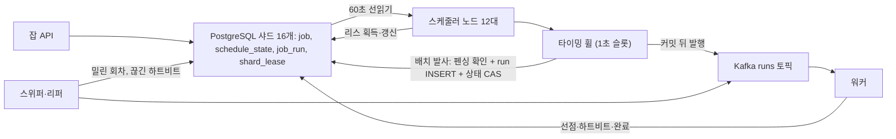

cron 표현식과 "30분 뒤 한 번" 같은 지연 작업 2,000만 개를 정한 시각에 워커로 넘기는 스케줄러를 만든다. 어려운 곳은 세 군데다. 매시 정각에 수십만 건이 같은 초로 몰리고, GC로 멈췄다 깨어난 노드가 이미 넘겨준 샤드의 작업을 또 쏠 수 있으며, 노드가 내려가 있던 동안 놓친 회차와 DST로 사라지거나 두 번 오는 시각을 어떻게 셀지 정해야 한다.

기준: PostgreSQL 19, Kafka 4.4, Kubernetes 1.37, Airflow 3.4, Quartz 2.5.2, Temporal Server 1.32 (2026-11).

## 요구사항과 규모 가정

기능은 잡 등록·수정·일시 정지, cron(시간대 포함)과 1회성 지연 실행, 회차별 재시도와 타임아웃, 실행 이력 조회다. 사용자가 보는 보장은 "회차 하나에 실행 기록 하나, 성공 실행 하나"다. 잡 코드가 넘겨받은 `run_id`로 멱등하게 쓰면 외부 부수 효과도 한 번이 된다. 아래 숫자는 모두 가정이다.

| 항목 | 목표 |
|---|---|
| 예정 지연 | 워커가 시작한 시각 − 예정 시각, 평소 p99 1초, 정각 몰림 p99 10초 |
| 정확성 | (job_id, 예정 시각)마다 run 행 하나. 중복 발사 0 |
| 보관 | run 이력 DB에 14일, 레이크에 1년 |
| 비용 | 정각 피크 기준으로 잡고 평소에는 노드를 줄이지 않는다 |

```text
활성 잡        cron 1,500만 + 대기 중인 1회성 500만 = 2,000만
일 실행        cron 1,500만 × 하루 20회 = 3억 + 1회성 1억 = 4억 회/일, 평균 4억 / 86,400초 ≈ 4,630회/초
정각 몰림      매시 0초에 120만 회가 몰리고 10초 안에 끝낸다 → 피크 12만 회/초
잡 정의        2,000만 × 1 KB = 20 GB, 발사 상태만 따로 둔 좁은 표 2,000만 × 100 B = 2 GB
run 이력       4억 × 400 B = 160 GB/일, 14일 = 2.24 TB, 레이크 Parquet 1/5 → 32 GB × 365 ≈ 11.7 TB
DB 샤드        논리 샤드 1,024개 = hash(job_id) mod 1,024, PostgreSQL 클러스터 16개에 64개씩
DB당 피크      12만 / 16 = 7,500회/초 × (run INSERT + 상태 UPDATE) = 1.5만 행/초, 500건 배치면 15 tx/초, 이력 2.24 TB / 16 = 140 GB
스케줄러 노드  노드당 2만 회/초 가정 → 6대, 두 배 여유로 12대, 노드당 논리 샤드 약 85개
선읽기 메모리  60초 구간 28만(평균) + 120만(정각) = 148만 / 12대 ≈ 12.3만 × 200 B ≈ 25 MB
Kafka          12만 × 500 B = 60 MB/s, 파티션당 5 MB/s면 12개, 워커 병렬성을 보고 256개
```

## 전체 구조



잡 API는 정의를 쓰면서 다음 발사 시각 `next_fire_at`(UTC)을 계산해 좁은 `schedule_state` 표에 넣는다. 스케줄러 노드는 자기가 리스를 잡은 논리 샤드에서 앞으로 60초 안에 발사할 잡을 읽어 메모리의 타이밍 휠에 올린다. 슬롯 시각이 되면 DB 샤드별로 수백 건을 한 트랜잭션에 묶어 run 행을 만들고 `next_fire_at`을 다음 회차로 옮긴다. 커밋이 끝난 회차만 Kafka에 발행하고, 워커는 메시지를 받으면 run 행을 조건부 UPDATE로 선점한 뒤 실행한다. Kafka는 초인종이고 상태의 원본은 언제나 run 행이다.

## 핵심 키워드

| 키워드 | 한 줄 뜻 |
|---|---|
| `next_fire_at` | 잡의 다음 예정 시각. UTC 시점으로 저장하고 (shard, next_fire_at) 인덱스를 둔다 |
| 타이밍 휠 | 시간을 슬롯으로 나눈 원형 배열. 넣기와 꺼내기가 O(1) |
| 논리 샤드 | job_id 해시로 고정한 1,024개 조각. 노드와 DB에는 조각 단위로 배정한다 |
| 리스 | 만료 시각이 있는 소유권. 갱신하지 못하면 남이 가져간다 |
| 펜싱 토큰 | 리스를 새로 잡을 때마다 오르는 번호. 쓰는 쪽 저장소가 낡은 번호를 거절한다 |
| run 행 | 회차 하나의 기록. (job_id, scheduled_at)이 유일 키 |
| 선점 | `state = 'QUEUED'`일 때만 성공하는 UPDATE로 run을 가져가는 일 |
| catch-up | 내려가 있던 동안 놓친 회차를 나중에 얼마나 돌릴지 |
| 겹침 정책 | 앞 회차가 아직 돌고 있을 때 새 회차를 어떻게 할지 |

## 다음 시각은 DB 인덱스에, 60초 앞만 메모리에

후보는 셋이다. 첫째는 DB 인덱스 폴링이다. `next_fire_at <= now()` 인 행을 `FOR UPDATE SKIP LOCKED`로 집어 가는 방식으로, PostgreSQL 문서도 `SKIP LOCKED`를 여러 소비자가 큐 같은 표를 읽을 때 잠금 경합을 피하는 용도로 든다. 단순하지만 정밀도가 폴링 간격에 묶이고, 1초 간격이면 노드마다 초당 질의가 샤드 수만큼 나간다. 둘째는 분 단위 버킷이다. (분, 샤드)를 키로 잡 ID 목록을 두면 범위 인덱스가 없는 KV 저장소에서도 한 키만 읽으면 된다. 대신 회차마다 잡을 다음 버킷으로 옮기는 삭제와 삽입이 생기고, 잡 수정이 버킷 이동과 경쟁한다. 셋째는 메모리 타이밍 휠이다. 넣고 꺼내는 비용이 일정하지만 메모리에만 있으니 재시작이나 샤드 이동 때 다시 만들어야 한다.

이 설계는 첫째를 원본으로, 셋째를 앞단으로 쓴다. 노드는 5초마다 자기 샤드에서 `next_fire_at < now() + 60초`인 잡을 읽어 1초 슬롯 60개짜리 휠에 넣는다. 12.3만 개면 힙으로도 충분하지만, 휠은 같은 초에 떨어지는 잡을 슬롯 하나로 모아 주니 정각 몰림을 DB 샤드별 배치로 바로 나눌 수 있다. 이미 읽은 60초 안으로 들어오는 새 잡은 API가 주인 노드에 바로 알리고, 알림이 유실돼도 스위퍼가 2초마다 `next_fire_at < now() − 2초`인 잡을 찾아 늦게라도 쏜다. 같은 인덱스 하나가 선읽기와 밀린 회차 찾기를 같이 맡는다. 비용은 인덱스 쓰기다. PostgreSQL은 인덱스가 걸린 컬럼을 바꾸지 않을 때만 HOT 업데이트를 하므로, 하루 4억 번 바뀌는 `next_fire_at`은 매번 새 인덱스 항목을 만든다. 그래서 1 KB짜리 잡 정의와 100 B짜리 `schedule_state`를 나눠 넓은 행이 회차마다 복사되지 않게 하고, `job_run`은 날짜별 파티션으로 만들어 14일 지난 파티션을 통째로 떼어 낸다. 행 버전이 쌓이고 정리되는 방식은 [격리 수준과 MVCC 글](/posts/isolation-levels-and-mvcc/)에 있다.

## 샤드 리스와 펜싱 토큰으로 멈췄던 노드를 막는다

샤드를 노드에 나누는 방법은 해시 링, 중앙 배정기, 리스 경쟁이 있다. 논리 샤드 수를 1,024로 고정하고 주인만 바꾸면 노드가 늘어도 잡이 다른 샤드로 옮겨 가지 않는다. 파티션 수를 넉넉히 고정하고 통째로 넘기는 방식은 [파티셔닝과 샤딩 글](/posts/partitioning-and-sharding/)에 있다. 이 설계는 배정기 없이 리스 경쟁을 쓴다. 각 DB 샤드에 자기 논리 샤드 64개의 `shard_lease` 행을 두고, 노드는 만료된 행을 가져가며 목표 개수(1,024 / 노드 수)를 넘으면 남는 샤드를 놓는다. 리스만으로는 부족하다. 노드가 30초 GC 정지 뒤 깨어나면 자기 리스가 살아 있다고 믿고 휠에 든 잡을 쏜다. 그래서 리스를 가져갈 때마다 `epoch`를 올리고, 발사 트랜잭션이 같은 DB 안에서 그 번호를 확인한다. 쓰기를 받는 저장소가 번호를 검사해야 한다는 점이 핵심이다. 리스 만료는 DB의 `now()` 하나로 판정하니 노드 시계가 틀려도 소유권이 갈리지 않는다.

```sql
-- 구조만 보여 주는 스케치 (PostgreSQL 19). 이름은 예로 지었다
UPDATE shard_lease SET owner = $me, epoch = epoch + 1, expires_at = now() + interval '15 seconds'
WHERE shard = $s AND expires_at < now() RETURNING epoch;

-- 발사 배치: 실제로는 같은 샤드의 수백 회차를 한 트랜잭션에 넣는다
BEGIN;
SELECT 1 FROM shard_lease WHERE shard = $s AND epoch = $my_epoch FOR SHARE;  -- 0행이면 ROLLBACK
WITH s AS (UPDATE schedule_state SET next_fire_at = $next
  WHERE job_id = $job AND next_fire_at = $at AND version = $ver RETURNING job_id)
INSERT INTO job_run (run_id, job_id, scheduled_at, dispatch_after, state)
SELECT $run_id, job_id, $at, $at, 'QUEUED' FROM s ON CONFLICT (job_id, scheduled_at) DO NOTHING;
COMMIT;
```

`FOR SHARE`로 잡은 리스 행은 가져가는 쪽 UPDATE와 충돌하므로, 넘겨받기는 진행 중인 옛 배치가 끝난 뒤에 일어나고 그 뒤 옛 번호의 배치는 0행을 보고 되돌린다. 옛 노드는 갱신에 10초 넘게 실패하면 만료 전에 스스로 발사를 멈춘다. 최종 방어선은 유일 키와 `next_fire_at` CAS다. 두 노드가 같은 회차를 쏴도 run 행은 하나만 생기고, 일시 정지나 수정으로 `version`이 바뀐 잡은 CAS가 0행이라 run 행도 생기지 않는다. 판정을 잠금과 조건부 UPDATE가 하니 기본 READ COMMITTED로 충분하다. 낡은 리더를 임기 번호로 거르는 일반 원리는 [CAP과 합의 글](/posts/cap-consistency-and-consensus/)에, Kafka 프로듀서가 epoch로 옛 인스턴스를 막는 같은 장치는 [Kafka 멱등 프로듀서 글](/posts/kafka-idempotency/)에 있다. 대가는 DB 샤드 하나가 죽으면 그 64개 샤드의 발사가 페일오버 동안 멈춘다는 점이다.

## 전달은 최소 한 번, 실행은 run 행 선점으로 한 번

Kafka 발행은 커밋 뒤에 하므로 그 사이에 노드가 죽으면 메시지가 빠진다. 스위퍼가 `dispatch_after`를 30초 넘게 지나도 `QUEUED`인 run을 다시 발행하고, 워커 재시작이나 리밸런스로 같은 메시지가 두 번 올 수도 있다. 그래서 전달은 최소 한 번으로 두고, 워커가 실행 전에 run 행을 선점한다. 아웃박스 표를 두는 방법도 있지만 run 행 자체가 이미 발행 대기 목록이다.

```sql
-- 구조만 보여 주는 스케치
UPDATE job_run SET state = 'RUNNING', attempt = attempt + 1, worker = $w,
       started_at = now(), lease_until = now() + interval '30 seconds'
WHERE run_id = $r AND state = 'QUEUED' AND dispatch_after <= now() RETURNING attempt;
```

0행이면 중복 메시지라 오프셋만 커밋하고 버린다. 워커는 10초마다 `WHERE run_id = $r AND attempt = $a AND state = 'RUNNING'` 조건으로 `lease_until`을 늘리고, 완료도 같은 조건으로 쓴다. `attempt`가 워커 쪽 펜싱 토큰이라, 하트비트가 끊겨 재시도로 넘어간 뒤에 살아난 옛 워커의 완료 보고는 0행이 된다. 리퍼는 `lease_until`이 지났거나 잡별 실행 타임아웃을 넘긴 run을 실패로 바꾸고, 시도가 남았으면 `dispatch_after = now() + 지수 백오프 + 지터`로 다시 `QUEUED`에 둔다. 남은 구멍은 하나다. 외부에 쓰고 완료를 기록하기 전에 워커가 죽으면 재시도가 같은 쓰기를 다시 한다. 이 구간은 스케줄러가 막을 수 없어서 잡에 `run_id`를 멱등 키로 넘긴다. 쿠버네티스도 Job이 두 번 시작될 수 있어 Job을 멱등하게 만들라고 한다는 점은 [쿠버네티스 워크로드 글](/posts/kubernetes-workloads-for-data/)에 있다.

테넌트별 속도 제한은 발행 앞에서 건다. 잡이 job_id 해시로 노드에 고르게 흩어지므로 노드마다 테넌트 한도의 1/12짜리 토큰 버킷을 두고, 넘친 회차는 run 행만 만들고 `dispatch_after`를 미룬다. 회차 기록은 제시간에 남고 실행만 늦어지므로, 이 지연은 예정 지연 지표에서 `throttled` 라벨로 따로 센다. 잡 몇 개뿐인 작은 테넌트는 노드별 1/12 몫이 실제 사용과 어긋나는데, 이 규모에서는 그 오차를 받아들인다.

## 놓친 회차와 DST는 잡마다 정책으로 정한다

1시간 장애면 그동안 밀린 회차가 평균 4,630 × 3,600 ≈ 1,670만 개다. 다른 시스템의 기본값부터 다르다. Airflow 3.4는 `catchup_by_default`가 `False`라 놓친 구간이 많아도 가장 최근 회차 하나만 만든다. 쿠버네티스 CronJob은 놓친 회차가 100개를 넘으면 `TooManyMissedTimes` 이벤트를 남기고 가장 최근 회차만 시작하며, `startingDeadlineSeconds`를 두면 그 시간보다 늦은 회차를 건너뛴다. Temporal Schedule은 catchup window 기본값이 1년이다. 이 설계의 잡은 세 값을 가진다. `catchup`은 `latest`(기본, 가장 최근 회차 하나), `all`(최대 50회, 순서대로), `none`이다. `starting_deadline`보다 늦은 회차는 `MISSED`로 기록만 하고, 건너뛴 회차 수는 run 행의 `skipped_ticks`에 적어 행이 1,670만 개 생기지 않게 한다. `overlap`은 `skip`(기본, 앞 회차가 `RUNNING`이면 `SKIPPED` 행만 남긴다)과 `allow`다. 같은 잡의 run은 같은 샤드에 있어 이 확인은 같은 트랜잭션 안에서 끝난다. 복구 때 스위퍼는 초당 5만 회로 제한해서 제시간 회차를 먼저 쏘고 남는 여력으로 밀린 회차를 돈다. 1,670만 개가 모두 남아도 약 5.6분이다. catchup, 백필, retry가 결국 같은 태스크를 다시 부른다는 점은 [멱등한 Airflow DAG 글](/posts/airflow-idempotent-dags/)에 있다.

시간대는 IANA 이름으로 저장하고(기본 UTC), 다음 시각은 현재 시각이 아니라 직전 예정 시각에서 계산해 밀림을 막는다. `Asia/Seoul`은 DST가 없지만 `America/Los_Angeles`는 2026-03-08이 23시간, 2026-11-01이 25시간이고 그날 01:30이 −07:00과 −08:00으로 두 번 온다는 점은 [타임스탬프와 시간대 글](/posts/timestamps-and-time-zones/)에 있다. 규칙은 Vixie cron을 따른다. 분과 시가 고정된 잡은 사라진 시각이면 바뀐 직후에 한 번 돌고, 반복된 시각이면 첫 번째에만 돈다. 분이나 시에 `*`가 있는 잡은 바뀐 시계를 그대로 따라 반복된 한 시간에도 다시 돈다. `scheduled_at`은 UTC 시점이라 01:30(−07:00)과 01:30(−08:00)은 서로 다른 유일 키다. tzdata가 갱신되면 해당 시간대 잡의 `next_fire_at`을 다시 계산한다.

## 선택지 비교

| | 이 설계 | DB 행 잠금 스케줄러 (Quartz JDBC JobStore, Airflow HA) | Temporal Schedules | 쿠버네티스 CronJob |
|---|---|---|---|---|
| 노드 조정 | 샤드 리스 + epoch 펜싱 | 공유 DB의 `SELECT ... FOR UPDATE` 행 잠금 | 서버가 일정을 관리 | kube-controller-manager의 컨트롤러 |
| 중복 방지 | (job_id, scheduled_at) 유일 키, run 선점 | Quartz는 발사마다 한 노드만 쏜다. 노드 시계를 1초 안으로 맞춰야 한다 | 워크플로 ID에 예정 시각을 붙인다 | 회차마다 Job이 둘 생기거나 안 생길 수 있다 |
| 놓친 회차 | 잡별 latest/all/none + deadline | Quartz `misfireThreshold` 기본 60초, Airflow catchup 기본 꺼짐 | catchup window 기본 1년 | 100개 초과면 최근 하나, `startingDeadlineSeconds` |
| 겹침 | skip/allow | 잡이나 DAG 쪽 설정으로 정한다 | 기본 `Skip`, BufferOne·BufferAll·CancelOther·TerminateOther·AllowAll | 기본 `Allow`, `Forbid`, `Replace` |
| 수백만 잡에서 먼저 막히는 곳 | 정각 몰림의 DB 쓰기 | 잠금 행 하나와 공유 DB | 서버 클러스터 용량 | 회차마다 Job과 Pod 객체 생성 |

Airflow는 스케줄러 여러 대가 합의 알고리즘 없이 메타데이터 DB의 행 잠금으로만 조정한다. 스케줄러 루프와 태스크 상태 전이는 [Airflow 스케줄러 글](/posts/airflow-scheduler-and-executors/)에 있다. Temporal은 시각 해석을 UTC로 하길 권하고, 액션은 보통 예정 시각 1초 안에 시작한다고 적는다.

## 장애와 재처리

스케줄러 노드가 죽으면 리스가 15초 뒤 만료되고 다른 노드가 epoch를 올려 가져간 뒤 그 샤드를 선읽기한다. 만료까지의 회차는 스위퍼 경로로 늦게 나가고, 이 15초 남짓이 노드 장애 때 예정 지연의 상한이 된다. DB 샤드 페일오버 중에는 그 샤드의 발사와 선점이 같이 멈추고, 복구 뒤 밀린 회차는 catch-up 정책을 따른다. 커밋 뒤 발행 전에 죽은 회차는 스위퍼가, 하트비트가 끊긴 실행은 리퍼가 되살린다. cron 표현식이 잘못됐거나 다음 시각 계산이 예외를 내는 잡은 `next_fire_at`을 비우고 `BROKEN`으로 표시해 휠과 스위퍼가 같은 잡에서 계속 실패하지 않게 한다. 매번 실패하는 잡은 최대 시도 뒤 `FAILED`로 끝나고 다음 회차는 정상 일정대로 온다. 이력 레이크는 매일 닫힌 파티션을 내보내므로 DB 파티션을 떼기 전에 행 수를 대조한다.

| 지표 | 경고 기준 |
|---|---|
| 예정 지연 p99 (발사, 시작 각각, throttled 제외) | 발사 2초, 시작 5초를 5분 넘게 초과 |
| 밀린 잡 수, `next_fire_at < now() − 5초` | 샤드별 1분 넘게 0 초과 |
| 리스 이동 횟수 | 분당 10회 초과 |
| 펜싱으로 되돌린 배치 수 | 0 초과가 계속되면 노드 정지나 리스 갱신 지연 |
| `QUEUED` 체류 시간 p99, 스위퍼 재발행 수 | 30초 초과 |
| 리퍼가 회수한 실행 비율 | 1% 초과 |

## 규모가 10배가 되면

정각 몰림이 1,200만 회가 되면 10초 안에 끝내려면 초당 120만 회를 써야 하고, 먼저 막히는 곳은 DB 쓰기다. DB 16개면 샤드당 7.5만 회/초, 15만 행/초라 한계를 넘는다. 논리 샤드가 1,024개로 고정돼 있으니 DB를 64개로 늘려 DB당 논리 샤드를 16개로 줄이면 1.9만 회/초로 내려온다. 이력은 1.6 TB/일, 14일 22.4 TB라 DB당 350 GB다. 몰림 자체를 줄이는 쪽도 연다. Temporal의 jitter는 액션마다 무작위 오프셋을 더한다. 여기서는 정확한 초가 필요 없는 잡에 잡 ID 해시로 고정한 0~60초 오프셋을 주는 옵션을 두면 1,200만 회가 60초에 퍼져 초당 20만 회가 된다. Kafka는 600 MB/s로 최소 120개가 필요하니 256개로 버틴다. 노드별 1/N 토큰 버킷은 노드가 120대가 되면 작은 테넌트에서 오차가 커져서, 큰 테넌트만 중앙 카운터로 옮긴다. 선읽기 메모리는 노드당 25 MB 수준 그대로다.

## 참고 자료

- [PostgreSQL 19 SELECT, Locking Clause (SKIP LOCKED)](https://www.postgresql.org/docs/19/sql-select.html)
- [PostgreSQL 19 Heap-Only Tuples (HOT)](https://www.postgresql.org/docs/19/storage-hot.html)
- [Kubernetes CronJob](https://kubernetes.io/docs/concepts/workloads/controllers/cron-jobs/)
- [Airflow 3.4.0 Dag Runs (catchup)](https://airflow.apache.org/docs/apache-airflow/3.4.0/core-concepts/dag-run.html)
- [Airflow 3.4.0 Scheduler (running more than one scheduler)](https://airflow.apache.org/docs/apache-airflow/3.4.0/administration-and-deployment/scheduler.html)
- [Quartz JDBC JobStore Clustering (2.3.0 문서)](https://www.quartz-scheduler.org/documentation/quartz-2.3.0/configuration/ConfigJDBCJobStoreClustering.html)
- [Quartz JobStoreTX Configuration (2.3.0 문서)](https://www.quartz-scheduler.org/documentation/quartz-2.3.0/configuration/ConfigJobStoreTX.html)
- [Temporal Schedule](https://docs.temporal.io/schedule)
- [cron(8), Debian trixie (DST 처리)](https://manpages.debian.org/trixie/cron/cron.8.en.html)
- [Martin Kleppmann, How to do distributed locking (2016)](https://martin.kleppmann.com/2016/02/08/how-to-do-distributed-locking.html)
- [Varghese, Lauck, Hashed and Hierarchical Timing Wheels (SOSP 1987)](https://doi.org/10.1145/41457.37504)

## English summary

This design fires 20 million cron and delayed jobs on time and hands each run to a worker once. Next fire times live in a PostgreSQL index split into 1,024 fixed logical shards, and each scheduler node loads only the next 60 seconds into an in-memory timing wheel. Nodes own shards through leases, and every fire batch checks the lease epoch inside the same database transaction, so a node that wakes up from a long pause cannot fire again. Delivery through Kafka is at least once, and workers claim the run row with a conditional update and keep it alive with heartbeats. A unique key on job and scheduled time is the last guard, because it is the one check every path must pass through.
