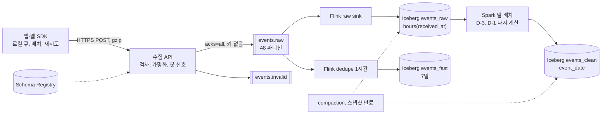

수천만 대의 기기가 화면 조회와 클릭 이벤트를 보내고, 분석가는 다음 날 아침 이벤트 하나가 한 행인 테이블을 받아야 한다. 어려운 건 양보다 출처다. 기기 시계는 틀리고, 오프라인에서 쌓인 이벤트는 며칠 늦게 오고, 재시도는 같은 이벤트를 두 번 보내고, 봇과 개인정보가 섞여 들어온다.

기준: Kafka 4.4, Confluent Platform 8.4 Schema Registry, Flink 2.3, Iceberg 1.12, Spark 4.3 (2026-11).

## 요구사항과 규모 가정

기능 요구사항은 다섯 가지다. iOS, Android, 웹에서 이벤트를 받는다. 기기에서 Kafka까지는 at-least-once로 보낸다. 대시보드용 실시간 테이블은 5분 안에 보인다. 분석용 clean 테이블은 `event_id`마다 한 행이고, 매일 06:00 KST까지 전날이 채워진다. 늦게 온 이벤트는 3일까지 반영하고 그 뒤 날짜는 닫는다. 비기능 요구사항은 수집 API p99 200ms 이하, 기기 큐에서 버려진 이벤트 0.1% 이하(SDK가 센 값으로 잰다), raw 90일과 clean 2년 보관이다. 아래 숫자는 모두 가정이다.

| 항목 | 계산 | 값 |
|---|---|---|
| 하루 이벤트 | DAU 2,000만 × 150개 | 30억 |
| 평균 초당 | 30억 / 86,400 | 약 34,700/s |
| 피크 초당 | 평균 × 3 | 약 104,000/s |
| 수집 요청 | 피크 104,000 / 요청당 20개 | 약 5,200 req/s |
| 원본 JSON | 30억 × 1KB | 3TB/일 |
| Kafka 디스크 | 3TB × 1/4(압축) × 복제 3 × 보관 7일 | 약 15.8TB |
| 레이크 Parquet | 3TB × 1/8 | 375GB/일, 약 137TB/년 |
| 보관 총량 | raw 375GB × 90일 + clean 137TB × 2년 | 약 34TB + 274TB |
| 파티션 수 | 피크 104,000 / 서브태스크당 4,000 | 26개 남짓 필요, 48개로 잡는다 |
| 수집 서버 | 5,200 / 대당 1,000 req/s | 6대, 존 하나가 빠져도 버티게 12대 |

## 전체 구조



SDK는 이벤트가 생길 때 `event_id`와 기기 시각을 붙여 로컬 큐에 넣고, 묶어서 보낸다. 수집 API는 봉투 스키마와 이벤트 계약을 검사하고, IP와 사용자 ID를 처리한 뒤 이벤트 하나를 Kafka 레코드 하나로 쓴다. 통과하지 못한 이벤트는 버리지 않고 이유를 붙여 `events.invalid`로 보낸다. raw 테이블은 받은 그대로 쌓는 재처리 원천이고, 분석가는 매일 raw에서 다시 만든 clean 테이블만 읽는다. 실시간 테이블은 1시간 안의 중복만 거른 근사치라 7일만 둔다.

## 핵심 키워드

| 키워드 | 한 줄 뜻 |
|---|---|
| `event_id` | SDK가 이벤트를 만들 때 붙이는 UUIDv7. 재시도와 앱 재시작을 지나도 같다 |
| `client_ts` | 이벤트가 생긴 순간의 기기 시각 |
| `sent_at` | 기기가 요청을 보낸 순간의 기기 시각. 요청마다 하나 |
| `received_at` | 수집 API가 요청을 받은 서버 시각 |
| `event_time` | `client_ts + (received_at - sent_at)`로 보정한 시각 |
| `event_date` | `event_time`의 KST 날짜. clean 테이블 파티션 |
| 봉투 스키마 | 모든 이벤트에 공통인 필드. 레지스트리에 Avro로 등록한다 |
| 이벤트 계약 | 이벤트 이름과 버전별 `properties` JSON Schema 목록 |
| 늦게 받는 기간 | clean이 다시 계산하는 날짜 범위. 이 설계는 3일 |
| 가명 토큰 | 데이터 밖의 키로 만든 사용자 ID의 HMAC |

## event_id는 기기에서 만들고 중복은 배치에서 지운다

중복은 네 경로로 생긴다. 응답이 늦어 SDK가 같은 배치를 다시 보내는 경우, 보낸 직후 앱이 죽어 다음 실행에서 큐를 다시 보내는 경우, 수집 API가 Kafka 응답을 기다리다 재시작한 경우, 프로듀서가 배치를 재시도하는 경우다. [Kafka 멱등 프로듀서 글](/posts/kafka-idempotency/)대로 멱등 프로듀서는 마지막 경로만 지우고, 앱이 다시 보낸 요청은 새 레코드가 된다. 그래서 키는 이벤트가 처음 생긴 기기에서 붙인다. UUIDv7은 앞 48비트가 Unix 밀리초라 생성 순서대로 정렬된다(RFC 9562).

SDK는 이벤트를 디스크 큐에 먼저 쓰고, 50개가 모이거나 15초가 지나면 보낸다. 웹은 `visibilitychange`에서 남은 큐를 보낸다. 수집 API가 Kafka의 `acks=all` 응답을 받은 뒤에만 202를 돌려주고, SDK는 그때 큐에서 지운다. 413은 배치를 반으로 나눠 다시 보내고, 429와 503은 `Retry-After`를 따르거나 지수 백오프에 지터를 섞는다. 계약 위반 이벤트가 섞여도 202를 준다. 다시 보내도 결과가 같기 때문이다. 큐가 1,000개나 7일을 넘으면 오래된 것부터 버리고, 버린 개수를 다음 요청 헤더에 실어 손실을 잴 수 있게 한다. 수집 API 프로듀서는 `compression.type`(기본 `none`)을 `zstd`로, `batch.size`(기본 16384바이트)를 256KB로, `linger.ms`(기본 5)를 20으로 올려 배치를 키운다. 피크에 서버 한 대가 초당 약 9MB를 쓰니 `batch.size`만 두면 16KB 배치가 linger보다 먼저 찬다. 중복을 지우는 자리는 셋을 놓고 골랐다.

| 방법 | 범위 | 비용 |
|---|---|---|
| 수집 API에서 Redis `SET NX` | TTL 안 | 요청마다 Redis 왕복, Redis 장애가 수집 장애가 된다 |
| Flink keyed state + TTL | TTL 안 | 피크 1시간이면 3억 7,500만 키, 키당 60바이트로 잡으면 약 22.5GB |
| clean 배치의 `ROW_NUMBER` | 늦게 받는 기간 3일 전체 | 매일 raw 3일치를 다시 읽는다 |

이 설계는 정답을 배치에 두고, 실시간 테이블만 Flink SQL 중복 제거로 1시간 안의 중복을 지운다. Flink의 중복 제거 쿼리는 `ROW_NUMBER() OVER (PARTITION BY event_id ORDER BY proctime ASC) = 1` 모양이어야 하고, ASC는 첫 행을 남긴다. `table.exec.state.ttl` 기본값은 0이라 상태를 지우지 않으니 1시간으로 준다. 이 값은 갱신되지 않은 상태를 최소 얼마나 둘지라서, 1시간 넘게 늦은 재전송은 실시간 테이블에 두 번 들어간다.

clean 배치는 날짜가 아니라 3일 범위 전체에서 `event_id`로 묶는다. 같은 이벤트라도 두 번 보낸 요청은 `sent_at`과 `received_at`이 달라 보정 시각이 몇 초 어긋나고, 자정 근처면 `event_date`가 갈린다.

```python
# 구조만 보여 주는 스케치, Spark 4.3 PySpark + Iceberg 1.12. 테이블과 컬럼 이름은 예시다
from pyspark.sql import Window, functions as F

w = Window.partitionBy("event_id").orderBy("received_at")
(spark.table("lake.events_raw")
    .where(F.col("received_at") >= F.lit("2026-11-17T23:00:00+09:00").cast("timestamp"))
    .withColumn("rn", F.row_number().over(w)).where("rn = 1").drop("rn")
    .where(F.col("event_date").between("2026-11-18", "2026-11-20"))
    .writeTo("lake.events_clean").overwritePartitions())
```

첫 수신본을 남긴 뒤에 날짜로 거르므로 두 사본이 다른 날짜로 갈리지 않는다. 읽기를 한 시간 앞당긴 건 닫힌 D-4 날짜로 먼저 들어간 사본이 이겨 걸러지게 하려는 것이다. [배치와 스트림 계층 글](/posts/batch-and-stream-layers/)대로 dynamic 덮어쓰기는 결과에 행이 있는 날짜만 바꾼다.

## 기기 시각은 받은 시각으로 보정하고 늦게 받는 기간을 닫는다

기기 시계는 사용자가 바꿀 수 있고 몇 시간씩 틀린 기기도 있다. 서버 시각만 쓰면 오프라인에서 어제 쌓인 이벤트가 오늘 날짜로 간다. 기기 시각만 쓰면 미래 날짜 파티션이 생긴다. 이 설계는 세 시각을 다 받는다. 요청 안의 이벤트는 같은 시계로 찍혔으니 `received_at - sent_at`가 그 기기의 시계 오차에 네트워크 지연을 더한 값이고, 이를 `client_ts`에 더하면 서버 시계 기준 시각이 된다. 이벤트가 생긴 뒤 보내기 전에 사용자가 시계를 바꾸면 이 보정도 틀린다(일반적인 추론이다). 보정 뒤에도 남는 값은 규칙으로 자른다. `event_time`이 `received_at`보다 뒤면 `received_at`으로 바꾸고 `time_fixed` 플래그를 단다. 원래 `client_ts`는 컬럼으로 남긴다. [로그 수집 API 글](/posts/log-collection-api/)의 API는 7일 전부터 1일 뒤 범위를 벗어난 이벤트 시각을 서버 시각으로 바꾸고 원래 값을 에러 로그에 남겼다.

늦은 이벤트를 받아 주는 기간은 3일이다. D일 배치는 `event_date`가 D-3부터 D-1인 파티션을 다시 만들고, 그보다 오래된 날짜는 바꾸지 않는다. 기간 밖으로 늦은 이벤트는 raw에만 남고 날짜별 개수로 센다. 3일은 가정이고, 실제 값은 `received_at - event_time` 분포의 꼬리를 보고 정한다. 세션 테이블은 여기에 하루를 더 읽는다. [세션 나누기 글](/posts/sessionization/)대로 자정을 넘는 세션은 전날을 함께 읽어야 하고, 늦은 이벤트는 두 세션을 하나로 합칠 수 있다.

## Kafka는 키 없이, raw는 받은 시각, clean은 일어난 날짜로 나눈다

Kafka 레코드 키로 `device_id`를 쓰면 기기별 순서가 남는다. 하지만 그 순서는 믿을 수 없다. 오프라인 큐를 재시도한 배치가 새 배치보다 늦게 도착하기 때문이다. 대신 이벤트를 하루 수십만 개 보내는 봇 기기 하나가 파티션 하나를 밀리게 한다. 그래서 키를 비운다. [파티션과 lag 글](/posts/kafka-partitions-and-lag/)대로 키 없는 레코드는 sticky 파티셔너가 `batch.size`만큼 채우고 다음 파티션으로 넘어가고, 파티션 수는 늘릴 수만 있다. 키가 없으니 파티션을 늘려도 키와 파티션의 대응이 깨질 일이 없다. 기기별로 묶어야 하는 소비자는 자기 쪽에서 `keyBy`하고 이벤트 시각으로 정렬한다. 레이크는 두 테이블을 다른 시계로 나눈다.

| 테이블 | 파티션 | 이유 | 대가 |
|---|---|---|---|
| `events_raw` | `hours(received_at)` | 닫힌 시간은 다시 바뀌지 않는다. 보존 삭제와 "몇 시부터 다시" 재처리가 파티션과 맞는다 | 날짜로 찾는 쿼리는 수신 범위를 넓게 읽는다 |
| `events_clean` | `event_date` (identity) | 분석가가 묻는 날짜가 사건이 일어난 날이다 | 지난 3일 파티션을 매일 다시 쓴다 |

`event_date`는 `day(event_time)`이 아니라 따로 계산한 KST 날짜 컬럼이다. [타임스탬프와 시간대 글](/posts/timestamps-and-time-zones/)대로 Iceberg `day(ts)`는 `timestamptz` 컬럼을 UTC 날짜로 자른다. 시간 단위 `hours`는 UTC여도 KST와 정확히 9시간 차이라 경계가 같다.

작은 파일은 raw에서 생긴다. writer 48개가 1분 체크포인트마다 파일을 닫으면 하루 48 × 1,440 = 69,120개, 평균 약 5.4MB다. 512MB로 합치면 375GB / 512MB = 약 733개다. [Flink Iceberg sink 글](/posts/flink-iceberg-sink/)대로 파일은 체크포인트가 끝나야 커밋되고, 재시작 뒤에는 스냅샷 요약의 체크포인트 ID로 같은 파일을 두 번 커밋하지 않는다. [작은 파일 글](/posts/small-files-and-compaction/)대로 스트리밍은 커밋 하나의 파일을 파티션 수 근처로 묶는 데서 멈추고 나머지는 compaction 몫이다. 그래서 한 시간이 닫히면 그 시간 파티션만 `rewrite_data_files`로 합친다. clean은 배치가 날짜마다 한 번에 쓰니 따로 합칠 일이 거의 없다.

## 계약 검사와 가명화는 수집 API에서, 봇은 표시만 한다

이벤트 스키마를 둘로 나눈다. 봉투(`event_id`, `event_name`, `event_version`, 세 시각, `device_id`, 사용자 토큰, 앱 버전, 플랫폼)는 Avro로 레지스트리에 등록하고, 기본 이름 전략인 `TopicNameStrategy`에 따라 `events.raw-value` subject 하나에 둔다. [스키마 진화 글](/posts/schema-evolution/)대로 기본 호환성 모드 `BACKWARD`는 컨슈머를 먼저 배포하는 모드다. 이벤트마다 다른 `properties`는 이벤트 계약 저장소의 JSON Schema로 검사한다. 앱의 옛 버전은 몇 달씩 남으니 계약은 이벤트별 버전을 지우지 않고 쌓는다. SDK의 이벤트 함수를 계약에서 생성하면 선언하지 않은 이벤트는 앱 빌드에서 막힌다.

개인정보는 수집 API를 나가기 전에 바꾼다. IP는 국가와 지역 코드, 봇 신호를 뽑은 뒤 지운다. 로그인 사용자 ID는 HMAC 토큰으로 바꾼다. [접근 제어와 개인정보 글](/posts/data-access-control-and-pii/)대로 sha256만 쓴 전화번호는 전수 대입으로 복원되니 데이터 밖에 둔 키로 HMAC을 써야 하고, Iceberg에서 지운 행은 이전 스냅샷이 만료돼야 사라진다. 삭제 요청은 같은 키로 토큰을 만들어 raw와 clean에서 지우고, 그 행이 빠진 데이터 파일로 다시 쓴 뒤 스냅샷을 만료시킨다. Kafka에는 토큰만 실려 보존 7일이 지난 세그먼트가 지워질 때 사라진다.

봇은 지우지 않고 `bot_reason`을 단다. IP 대역 신호는 IP를 지우기 전인 수집 API에서만 볼 수 있고, 기기별 분당 이벤트 수와 알려진 봇 User-Agent는 clean 배치에서 본다. 규칙 버전을 컬럼에 남기면 규칙을 바꾼 뒤 3일 범위 밖의 날짜도 재계산할 수 있다. 분석가는 `bot_reason IS NULL`을 건 뷰를 기본으로 읽는다.

## 선택지 비교

| | 이 설계: Kafka + raw + 일 배치 clean | Flink가 `event_id`로 Iceberg upsert | 수집 API가 오브젝트 스토리지에 파일로 직접 |
|---|---|---|---|
| clean 지연 | 다음 날 06:00, 3일 동안 수정 | 체크포인트 주기 | 파일 묶는 주기 + 배치 |
| 중복 범위 | 3일 전체 | 테이블 전체(키가 살아 있는 동안) | 배치가 읽는 범위 |
| 읽기 비용 | 배치 한 번 쓴 큰 파일 | 커밋마다 equality delete가 붙어 읽기가 느려진다 | 배치 뒤에는 같다 |
| 재처리 | raw 90일에서 다시 계산 | Kafka 7일 안에서 다시 읽기 | 파일 보관 기간 |
| 실시간 소비자 | Kafka에서 바로 붙는다 | 같다 | 없다 |
| 운영 부담 | Kafka, Flink, 배치 | Kafka, Flink, 상태와 delete 파일 정리 | 가장 적다 |

upsert 쪽은 파티션 원천 컬럼이 키에 들어가야 해서 `event_date`가 갈린 두 사본을 같은 키로 보지 못한다. 실시간 소비자가 없다면 세 번째도 충분하다.

## 장애와 재처리

| 장애 | 복구 |
|---|---|
| 수집 API가 Kafka에 쓰지 못함 | 503을 돌려주고 SDK 큐가 버퍼가 된다. 수집 서버에는 디스크 버퍼를 두지 않는다 |
| Flink raw sink 중단 | 체크포인트에서 다시 시작한다. Kafka 보관 7일이 복구 한도다 |
| 역직렬화나 변환 실패 레코드 | side output으로 DLQ 테이블에 넣고 잡은 계속 돈다 |
| clean 로직 버그 | raw 90일 안의 날짜를 같은 배치로 다시 만든다. 90일보다 오래된 날짜는 raw가 없어 다시 만들 수 없다 |
| 앱 버전 하나의 시계나 ID 버그 | 앱 버전으로 범위를 찾고, 규칙 버전을 올려 해당 날짜를 다시 만든다 |

지켜볼 지표는 여섯 개다. 수집 API의 5xx·429 비율과 p99 지연, SDK가 보고한 버린 이벤트 수, raw sink 컨슈머 lag(시간 단위)와 `elapsedSecondsSinceLastSuccessfulCommit`, 앱 버전별 `events.invalid` 비율, clean 배치의 중복률과 기간 밖 늦은 이벤트 비율, raw 시간 파티션의 파일 수와 평균 크기다.

## 규모가 10배가 되면

피크는 약 104만/s, Kafka 디스크는 약 158TB가 된다. 먼저 모자라는 건 파티션이다. 서브태스크당 4,000/s면 약 260개가 필요하다. 키가 없으니 늘리는 일 자체는 쉽고, Flink 병렬도를 같이 올린다. 실시간 중복 제거 상태는 약 225GB가 되어 TTL을 줄이거나 실시간 테이블에서 중복을 허용해야 한다. raw는 writer 480개가 하루 69만 개 파일을 만드니 체크포인트를 늘리거나 writer 수를 줄인다. 매일 raw 3일치를 다시 읽는 양도 약 1.1TB에서 11TB로 는다. raw의 새 행은 Flink의 append 커밋으로만 들어오니 Iceberg 증분 읽기(`start-snapshot-id`는 제외 기준이고, append 스냅샷만 읽어 compaction과 삭제 스냅샷은 건너뛴다)로 어제 배치 뒤 들어온 행만 읽어, 늦은 이벤트가 닿은 날짜만 다시 만들도록 바꾼다. 수집 API는 상태가 없어 대수만 늘린다.

## 참고 자료

- [Apache Kafka 4.4 Producer Configs](https://kafka.apache.org/44/configuration/producer-configs/)
- [Confluent Platform 8.4 Schema Registry Formats, Serializers, and Deserializers](https://docs.confluent.io/platform/current/schema-registry/fundamentals/serdes-develop/index.html)
- [Apache Flink 2.3 Deduplication](https://nightlies.apache.org/flink/flink-docs-stable/docs/sql/reference/queries/deduplication/)
- [Apache Flink 2.3 Table Configuration (table.exec.state.ttl)](https://nightlies.apache.org/flink/flink-docs-stable/docs/dev/table/config/)
- [Apache Iceberg 1.12 Spark Queries (Incremental read)](https://iceberg.apache.org/docs/latest/spark-queries/)
- [RFC 9562: Universally Unique IDentifiers (UUIDv7)](https://www.rfc-editor.org/rfc/rfc9562)
- [RFC 6585: Additional HTTP Status Codes (429)](https://www.rfc-editor.org/rfc/rfc6585)

## English summary

This design collects app and web events through an SDK that stamps each event with a UUIDv7 `event_id` and the device time, queues it on disk, and deletes it only after the collector gets `acks=all` from Kafka. The collector checks an Avro envelope and per-event contracts, turns IPs into region codes and user IDs into HMAC tokens, and writes unkeyed records so a bot device cannot overload one partition. A raw Iceberg table is partitioned by receive hour, and a daily Spark job rebuilds the last three event dates of the clean table, removing duplicates by `event_id` across the whole window. Event time is the device time corrected by the gap between the send time and the receive time, and events later than three days stay only in raw. I put the exact dedupe in the batch because a streaming state that covers three days would hold billions of keys.
