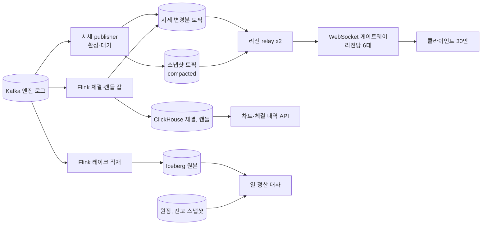

매칭 엔진이 순서를 정한 이벤트 로그를 내면, 그 뒤에는 성격이 반대인 두 소비자가 붙는다. 30만 개 WebSocket 연결에 호가와 체결을 0.2초 안에 뿌리는 시세 경로는 느린 클라이언트 하나 때문에 멈추면 안 되고, 캔들과 체결 내역, 일 정산 보고서를 만드는 데이터 경로는 이벤트 하나도 빠지거나 두 번 들어가면 안 된다. 엔진과 이벤트 로그는 [매칭 엔진 설계 글](/posts/design-exchange-matching-engine/)에서 다뤘고, 이 글은 브리지가 Kafka로 옮긴 그 로그에서 출발한다.

기준: Kafka 4.4, Flink 2.3, Iceberg 1.12, ClickHouse 26.10, WebSocket RFC 6455, RFC 7692 (2026-11). Flink 2.3용 Kafka 커넥터는 아직 없어서(5.0.0이 Flink 2.1, 2.2용) Kafka를 읽는 Flink 잡은 Flink 2.2로 돌린다고 본다.

## 요구사항과 규모 가정

기능 요구사항은 다섯 가지다. 종목별 호가(상위 20단계), 체결, 티커를 WebSocket으로 보낸다. 클라이언트는 메시지 유실을 스스로 알아채고 다시 맞출 수 있어야 한다. 1분봉부터 일봉까지 캔들과 체결 내역을 API로 조회한다. 취소된 체결은 지난 캔들에도 반영한다. 매일 원장, 체결, 잔고를 맞춘 정산 보고서를 낸다. 비기능 요구사항은 엔진 시각부터 같은 리전 클라이언트 송신까지 p99 200ms, 1분봉은 분이 끝나고 2초 안에, 정산 보고서는 D+1 02:00 KST까지다. 레이크 적재는 중복도 유실도 0건이고, 대사 허용 오차는 자산 최소 단위 0이다. 보관은 Kafka 7일, ClickHouse 체결 90일, 레이크 원본 5년이다. 엔진 쪽 숫자는 매칭 엔진 글의 가정(종목 300개, 피크 명령 50,000/s, 체결 15,000/s, 하루 로그 약 138GB)을 받고, 하류는 체결 30,000/s까지 견디게 두 배 여유를 둔다. 나머지는 이 글의 가정이다. 브리지는 샤드마다 1씩 늘어나는 이벤트 번호 `event_no`를 레코드에 함께 싣는다고 본다. 브리지가 재시작하면 같은 레코드를 다시 쓸 수 있으므로, 엔진 로그를 읽는 잡은 모두 샤드별로 이미 본 `event_no` 이하를 버린다.

| 항목 | 가정 | 계산 |
|---|---|---|
| 하루 체결 | 명령 4억 3,200만 × 0.3 | 1억 2,960만 건 |
| 시세 변경분 토픽 | 명령당 호가 변경 1건 60B, 체결 80B | 50,000 × 60B + 15,000 × 80B = 4.2MB/s |
| Kafka 엔진 로그 | 7일, 복제 3 | 138GB × 7 × 3 ≈ 2.9TB |
| 레이크 Parquet | 압축 뒤 원본의 1/5 | 27.6GB/일, 1년 약 10.1TB, 5년 약 50.5TB |
| ClickHouse 체결 | 90일, 압축 뒤 행당 15B | 1.296억 × 90 × 15B ≈ 175GB |
| 1분봉 | 종목 × 1,440분 | 300 × 1,440 = 432,000행/일 |
| WebSocket 연결 | 동시 30만, 연결당 호가 2, 체결 2, 티커 1 구독 | 리전 3곳에 10만씩 |
| 송신 메시지 상한 | 호가와 체결은 100ms 묶음(초당 10건), 티커는 초당 1건 | 300,000 × 4 × 10 + 300,000 = 1,230만 건/s |
| 송신 대역 | 메시지 평균 200B | 1,230만 × 200B = 2.46GB/s ≈ 19.7Gbps |
| 게이트웨이 | 대당 2만 연결 | 최소 15대, 리전마다 6대씩 18대. 한 대가 빠져도 5대 × 2만 = 10만 |
| 정산 대사 입력 | 체결당 원장 기록 6건, 계정 1,000만 × 자산 4 | 원장 7억 7,760만 행, 잔고 4,000만 행 |

들어오는 시세는 4.2MB/s인데 나가는 쪽은 2.46GB/s로 약 590배다. 이 설계의 무게는 거의 다 팬아웃에 있다.

## 전체 구조



publisher는 엔진 로그만 읽어 종목별 호가를 들고, 바뀐 가격 단계를 순번과 함께 시세 토픽에 쓰고 스냅샷을 주기적으로 남긴다. 리전마다 relay 두 대가 중앙 Kafka를 읽어 리전 안 게이트웨이에 TCP로 넘기므로, 리전 사이를 건너는 스트림은 리전당 두 개뿐이다. 게이트웨이는 자기 클라이언트가 구독한 종목의 호가를 직접 들고, 100ms마다 종목과 채널별로 메시지 하나를 만들어 구독자 모두에게 같은 바이트를 쓴다. 데이터 경로는 시세 경로와 독립이다. 캔들 잡과 레이크 잡은 엔진 로그를 각자 읽으므로 게이트웨이가 밀려도 영향이 없다.

## 핵심 키워드

| 키워드 | 한 줄 뜻 |
|---|---|
| 호가 순번 `seq` | 종목마다 호가를 바꾼 이벤트에 1씩 붙는 번호. 빈 번호가 곧 유실이다 |
| 변경분 | 바뀐 가격 단계와 그 단계의 새 수량만 담은 메시지. 증감이 아니라 결과값을 싣는다 |
| 스냅샷 | 특정 `seq` 시점의 상위 20단계 전체. 새 구독과 재동기화의 출발점 |
| 재동기화 | 빈 번호를 본 클라이언트가 변경분을 쌓아 두며 스냅샷을 받고 이어 붙이는 절차 |
| conflation | 아직 못 보낸 여러 변경을 최신 상태 하나로 합치는 일 |
| 체결 시각 | 엔진이 로그와 함께 찍은 시각. 캔들과 정산 날짜를 자르는 유일한 시계 |
| 체결 취소 | 이미 낸 체결을 무효로 하는 엔진 이벤트. 닫힌 캔들을 다시 계산하게 만든다 |
| ReplacingMergeTree | 같은 정렬 키의 행을 병합 때 버전이 가장 큰 하나만 남기는 ClickHouse 엔진 |
| 순번 컷 | 날짜 경계를 벽시계가 아니라 샤드별 `event_no`로 정한 지점 |

## 호가는 순번 붙은 변경분과 주기적 스냅샷으로 보낸다

선택지는 셋이다. 바뀔 때마다 상위 20단계 전체를 보내거나, 변경분만 보내거나, 순번 붙은 변경분에 주기적 스냅샷을 더한다. 전체를 매번 보내면 클라이언트 구현은 쉽지만 한 단계만 바뀌어도 약 40배 바이트를 쓴다. 순번 없는 변경분은 메시지 하나가 빠지면 클라이언트 호가가 조용히 틀린다. 이 설계는 세 번째를 고른다.

publisher는 결정적이다. `seq`는 엔진 로그에서만 계산하므로 같은 로그를 읽는 활성, 대기 publisher가 같은 번호를 낸다. 활성이 죽어도 대기가 같은 번호로 이어 가니 클라이언트가 재동기화할 이유가 없다. publisher는 종목마다 1초 또는 변경 1,000건마다 `(호가, seq, 엔진 로그 오프셋)`을 종목 키로 스냅샷 토픽에 쓴다. 이 토픽은 `cleanup.policy=compact`라서 키마다 최신 값이 남고, 압축되지 않은 활성 세그먼트의 옛 값은 읽는 쪽이 마지막 것만 쓰면 된다. compaction이 키마다 마지막 값을 남기는 방식은 [로그 보존과 compaction 글](/posts/kafka-log-retention-and-compaction/)에 있다.

시세 토픽에는 트랜잭션을 쓰지 않는다. publisher가 재시작하면 마지막 스냅샷의 오프셋부터 다시 읽어 이미 보낸 변경분을 또 쓰지만, 같은 `seq`라서 받는 쪽이 버린다. 처리한 뒤 커밋하면 재시작 때 같은 메시지를 다시 받는다는 점은 [Kafka 전달 보장 글](/posts/kafka-delivery-guarantees/)에 있고, 여기서는 그 중복을 순번으로 지운다. 트랜잭션을 쓰면 커밋 주기만큼 지연이 붙고 읽는 쪽이 `read_committed`여야 한다. 클라이언트는 종목마다 이 규칙을 지킨다.

```text
# 구조만 보여 주는 스케치. 메시지는 (first_seq, last_seq)를 싣는다
on diff(first, last):
  if last <= local_seq: 버림                     # 재연결이나 재시작으로 겹친 메시지
  elif first <= local_seq + 1: 적용, local_seq = last   # 겹친 앞부분은 결과값이라 다시 적용해도 같다
  else: 빈 번호. 변경분을 버퍼에 쌓으며 스냅샷 요청
on snapshot(seq):
  호가 = 스냅샷, local_seq = seq
  버퍼에서 last <= seq 는 버리고 first <= seq + 1 <= last 인 것부터 적용
```

변경분이 증감이 아니라 그 단계의 결과 수량이라서, 스냅샷과 겹치는 변경분을 다시 적용해도 값이 같다. 새 게이트웨이는 스냅샷 토픽을 끝까지 읽은 뒤, 시세 토픽을 `offsetsForTimes`로 가장 오래된 스냅샷 시각보다 몇 초 앞에서부터 읽고 스냅샷 `seq` 이하를 버린다. 클라이언트의 스냅샷 요청은 게이트웨이가 들고 있는 호가로 답하므로 publisher까지 가지 않는다. 대가는 클라이언트마다 이 규칙을 구현해야 한다는 점과, 규칙을 틀리게 짠 클라이언트를 서버가 알아챌 방법이 없다는 점이다.

## 느린 클라이언트는 묶어 보내고, 그래도 밀리면 끊는다

선택지는 셋이다. 느린 연결이 위를 기다리게 하거나, 연결마다 끝없는 큐를 두거나, 크기가 정해진 버퍼에 conflation과 강제 종료를 더한다. Flink 안에서는 [런타임과 백프레셔 글](/posts/flink-runtime-and-backpressure/)대로 credit이 없으면 위 연산자가 멈추고, 그게 맞는 동작이다. 시세에서는 연결 하나가 publisher를 멈추면 30만 명이 같이 멈춘다. 끝없는 큐는 느린 연결 몇 개가 게이트웨이 메모리를 채운다. 이 설계는 세 번째를 고르고, 위쪽은 아래를 절대 기다리지 않는다.

게이트웨이는 100ms마다 종목과 채널별로 메시지를 한 번만 직렬화한다. 종목이 300개라 틱마다 많아야 600개, 초당 6,000번 인코딩하고 그 바이트를 구독자에게 나눠 쓴다. 게이트웨이 18대면 대당 초당 약 68만 건, 137MB/s를 쓴다. permessage-deflate(RFC 7692)에서 서버가 앞 메시지의 압축 문맥을 이어 쓰면 같은 메시지도 연결마다 다른 바이트가 된다. 그래서 압축은 서버 응답에 `server_no_context_takeover`를 넣을 때만 켠다. RFC 7692는 클라이언트가 제안하지 않았어도 서버가 이 값을 응답에 넣을 수 있게 하고, 그러면 서버는 메시지마다 빈 LZ77 창에서 압축을 시작한다. 압축 설정이 같으면 한 번 압축한 프레임을 모든 연결에 그대로 쓸 수 있고, 서버가 보내는 프레임은 마스킹하지 않으니 헤더까지 같은 바이트다. 메시지당 압축본과 원본 두 벌만 만들면 된다. 대가는 메시지 사이의 중복을 못 쓰는 만큼 압축률이 떨어진다는 점이고, 위 대역 계산은 압축 없는 200B로 잡았다.

연결마다 송신 버퍼 상한을 512KB로 둔다. 2만 연결이 모두 꽉 차도 약 10GB다. 채널마다 밀렸을 때의 처리가 다르다. 호가는 쌓인 변경분을 버리고 그 종목에 표시만 해 두었다가, 버퍼가 비면 그 시점의 상위 20단계 스냅샷을 보낸다. 스냅샷이 약 1KB로 작아서 conflation이 곧 스냅샷 교체가 된다. 티커는 최신 값 하나만 남긴다. 체결은 각각이 사실이라 합치지 않는다. 체결이 버퍼 상한을 넘기면 연결을 끊고, 클라이언트는 다시 붙은 뒤 마지막 체결 ID 이후를 REST로 채운다. 죽은 연결은 RFC 6455의 ping, pong 제어 프레임으로 찾는다. relay와 게이트웨이 사이도 같은 규칙이다. relay보다 정해진 양 이상 뒤처진 게이트웨이는 끊기고 스냅샷부터 다시 시작한다. 대가는 느린 클라이언트가 중간 호가를 못 본다는 점이고, 모든 변경이 필요한 클라이언트는 이 경로가 아니라 별도 묶음 없는 피드로 보내야 한다.

## 캔들은 체결 시각으로 자르고 취소된 체결은 다시 계산한다

선택지는 셋이다. Flink 이벤트 시간 텀블링 윈도, 종목 키로 묶은 `KeyedProcessFunction`의 직접 집계, ClickHouse materialized view다. 이벤트 시간 윈도는 워터마크가 분 끝을 지나야 발화하고, 늦은 데이터는 allowed lateness와 side output으로 다룬다. 그 동작은 [Flink 시간과 윈도 글](/posts/flink-time-and-windows/)에 있다. 거래가 뜸한 파티션은 워터마크를 붙잡으므로 `withIdleness`도 필요하다. 이 설계는 `KeyedProcessFunction`을 고른다. 엔진 로그는 종목 단위로 순서가 정해져 있고 체결 시각은 엔진이 찍으니, 한 종목 안에서는 순서가 뒤바뀐 체결이 없다. 워터마크로 막을 늦음이 없는 셈이다. 차트는 진행 중인 분봉도 체결마다 갱신해야 하는데, 윈도는 기본적으로 발화할 때 한 번만 낸다. 상태는 종목마다 현재 분봉(시가, 고가, 저가, 종가, 거래량, 마지막 `event_no`)과 그 분의 체결 목록이다. 가장 붐비는 종목도 체결 4,500/s × 60초 × 24B ≈ 6.5MB다. 다음 분의 체결이 오면 닫힌 분봉을 내고, 체결이 없는 종목은 분 끝 + 2초의 처리 시간 타이머로 닫는다. 타이머는 분봉을 닫힌 것으로 내보내기만 하고 상태는 다음 분의 체결이 올 때까지 남기므로, 잡이 밀려 타이머가 먼저 울려도 같은 분의 뒤늦은 체결은 그 분봉을 고쳐 다시 낸다. 체결이 없는 분에는 행을 만들지 않는다. 5분봉부터 일봉은 Flink 상태가 아니라 1분봉 표에서 합치므로 보정된 1분봉이 그대로 반영된다. 일봉 경계는 정산과 같은 KST 자정으로 두며, 날짜 경계가 시간대 때문에 9시간 밀리는 경우는 [타임스탬프와 시간대 글](/posts/timestamps-and-time-zones/)에 있다. 대가는 윈도가 해 주던 상태 정리와 타이머를 직접 짜고 시험해야 한다는 점이다.

체결 취소가 어려운 부분이다. 거래량은 빼면 되지만, 고가와 저가는 빼는 연산이 없다. 취소된 체결이 아직 상태에 남은 분이면 Flink가 목록에서 빼고 다시 계산한다. 이미 넘어간 분이면 보정 작업이 ClickHouse 체결 표에 취소 행이 보일 때까지 기다린 뒤 그 분을 다시 집계한다.

```sql
-- 구조만 보여 주는 스케치. 표와 컬럼 이름은 예시다
SELECT argMin(price, event_no) AS open, max(price) AS high, min(price) AS low,
       argMax(price, event_no) AS close, sum(qty) AS volume
FROM trades FINAL
WHERE instrument = 'AAA-KRW' AND status != 'busted'
  AND ts >= '2026-11-20 05:03:00' AND ts < '2026-11-20 05:04:00'
```

`event_no`는 체결마다 다르고 한 종목은 한 샤드에 있어 순서를 그대로 따르므로 `argMin`, `argMax`의 결과가 정해진다. 체결 표와 캔들 표는 모두 `ReplacingMergeTree(version)`이다. 체결 표의 정렬 키는 `(instrument, ts, trade_id)`이고, 취소는 같은 키에 더 큰 버전의 행을 넣는다. 캔들 표의 키는 `(instrument, interval, open_time)`, 버전은 반영한 마지막 `event_no`다. ClickHouse에서 다시 계산한 1분봉은 취소 이벤트의 `event_no`를 버전으로 넣는다. 그 분이 상태에서 빠진 건 다음 분의 체결이 온 뒤이므로, 취소 이벤트의 번호는 그 분봉에 반영된 어느 번호보다 크다. 그 뒤 그 분을 품은 5분봉부터 일봉까지 다시 쓴다. 클라이언트에는 같은 `open_time`의 보정 메시지를 보낸다. ReplacingMergeTree는 백그라운드 병합 때만 중복을 지우므로 조회는 `FINAL`을 붙인다. 같은 키로 접히니 Flink가 재시작하며 다시 쓴 행도 조회 결과를 바꾸지 않는다. 엔진이 적재 때 정렬과 병합에 기대는 방식은 [실시간 OLAP 엔진 글](/posts/realtime-olap-engines/)에 있다. ClickHouse 문서는 대부분 월보다 잘게 파티션을 나눌 필요가 없고 고객 ID 같은 값으로 나누지 말라고 하므로, 파티션은 월이고 종목은 정렬 키 맨 앞에 둔다.

## 레이크에는 한 번만 쓰고, 정산은 같은 순번에서 자른다

레이크 적재 잡은 엔진 로그 전체를 Iceberg의 명령, 이벤트, 체결 표로 쓴다. 파티션은 `day(ts)`와 `bucket(16, instrument)`, 파일 안 정렬은 `(instrument, event_no)`다. 종목을 identity로 나누면 날마다 파티션 300개가 생기고, 한산한 종목은 체크포인트마다 작은 파일을 만든다. bucket 16개면 파일 수가 종목 수와 상관없이 묶인다. 컬럼 포맷이 필요한 컬럼만 읽게 해 주는 이유는 [파일 포맷 비교 글](/posts/file-formats-compared/)에 있다. 중복 커밋은 Iceberg sink가 막는다. [Flink Iceberg sink 글](/posts/flink-iceberg-sink/)대로 committer가 스냅샷 요약에 마지막으로 커밋한 체크포인트 ID를 남기고, 재시작하면 그보다 큰 것만 커밋한다. 엔진 로그를 트랜잭션으로 쓴다면 소스를 `read_committed`로 바꿔야 한다. Kafka 컨슈머 기본값은 `read_uncommitted`다. sink를 믿는 것과 별개로 결과를 센다. 매일 샤드마다 세 표를 합쳐 `count(*) = max(event_no) - min(event_no) + 1`이고 `count(DISTINCT event_no) = count(*)`이며, 그날 최솟값이 전날 최댓값 + 1인지 확인한다. 앞이 틀리면 유실, 뒤가 틀리면 중복이다.

정산 대사는 세 원천을 맞춘다. 체결(Iceberg), 리스크 샤드가 체결마다 쓴 복식 원장 기록, 리스크 샤드 잔고의 일말 스냅샷이다. 날짜 경계는 벽시계로 자르지 않는다. KST 자정 이후 엔진 시각을 가진 샤드별 첫 `event_no`를 순번 컷으로 정하고, 원장 기록은 원인이 된 `(샤드, event_no)`를 싣는다. 매수자와 매도자가 다른 리스크 샤드에 있으면 같은 체결이 두 샤드에서 따로 적용되므로, 잔고 스냅샷은 리스크 샤드가 모든 샤드의 컷을 넘겨 적용한 뒤 찍고, 원인이 컷 뒤인 원장 기록을 빼서 컷 시점 값으로 되돌린다. 세 원천이 같은 논리 시점에서 잘리므로 자정 근처 체결이 한쪽에만 들어가는 일이 없다. 검사는 셋이다. 체결마다 원장 기록 6건이 있고 금액이 가격 × 수량과 수수료로 맞는지 양방향으로 맞춘다. 자산마다 당일 체결 원장의 합이 수수료 계정을 포함해 0인지 본다. 계정과 자산마다 전일 잔고 + 당일 원장 = 당일 잔고인지 본다. 금액은 자산 최소 단위의 정수로 두고 반올림 규칙은 원장과 대사가 같은 코드를 쓴다. 차이가 하나라도 있으면 보고서를 내지 않고 차이 목록을 넘긴다. 두 경로의 같은 숫자를 키별로 비교하는 대사는 [실시간 지표 대시보드 설계 글](/posts/design-realtime-metrics-dashboard/)에도 있다. 대사에 쓴 입력 표의 스냅샷에는 날짜 이름의 태그를 단다. [Iceberg 스냅샷과 브랜치 글](/posts/iceberg-snapshots-and-branches/)대로 태그는 스냅샷 하나에 고정되고, 태그의 `max-ref-age-ms` 기본값은 영원이다. 대가는 원장 기록과 잔고 스냅샷이 원인의 `(샤드, event_no)`를 들고 다녀야 한다는 점이다.

## 선택지 비교

| | publisher, Kafka, 리전 relay, 게이트웨이 (선택) | 게이트웨이가 시세 토픽을 직접 구독 | 게이트웨이가 엔진 로그로 호가를 직접 만듦 |
|---|---|---|---|
| 리전 사이 대역 | relay 2대 × 4.2MB/s = 8.4MB/s | 6대 × 4.2MB/s = 25.2MB/s | 6대 × 엔진 로그 피크 16MB/s = 96MB/s |
| 순번 | publisher가 정함 | publisher가 정함 | 게이트웨이마다 계산. 같은 코드 버전이어야 같은 번호 |
| 새 게이트웨이 시작 | relay가 스냅샷과 변경분을 줌 | 스냅샷 토픽과 `offsetsForTimes` | 엔진 로그를 스냅샷부터 다시 읽음 |
| 지연 | 홉 하나 더 | Kafka fetch 한 번 | 가장 짧음 |
| 운영 부담 | relay라는 구성 요소 | 리전 밖 Kafka 컨슈머 18개 | 호가 로직이 게이트웨이 18대에 복제 |

## 장애와 재처리

활성 publisher가 죽으면 대기 publisher가 같은 로그 위치에서 같은 순번으로 잇고, 겹친 변경분은 순번으로 버려진다. 게이트웨이 한 대가 죽으면 2만 클라이언트가 다시 붙는다. 재연결 지연을 0초에서 10초 사이에서 무작위로 고르게 하면 남은 게이트웨이에 초당 2,000 연결이 오고, 스냅샷은 각 게이트웨이가 들고 있는 호가에서 나간다. relay가 죽으면 게이트웨이는 같은 리전의 다른 relay로 옮기고 순번 규칙대로 이어 붙인다. 캔들 잡은 체크포인트에서 돌아오고, 다시 쓴 행은 ReplacingMergeTree가 같은 키로 접는다. 해석할 수 없는 이벤트는 경로마다 다르게 다룬다. publisher는 모르는 이벤트 유형을 건너뛰면 호가가 틀리므로 그 종목의 송출을 멈추고 클라이언트에 중단 상태를 보낸다. 레이크 잡은 그 레코드를 격리 표에 쓰고 계속 가며, 순번 연속성 검사가 그 날짜를 미완료로 잡는다. 캔들 로직이 바뀌면 Iceberg 체결 표로 기간을 다시 집계해 더 큰 버전으로 넣는다. 감사용 재현은 레이크에서 한다. 스냅샷 토픽을 시간마다 레이크에 함께 내려 두고, 묻는 시점 직전 스냅샷에 그 뒤 이벤트를 같은 버전의 publisher 코드로 적용하면 그 `event_no` 시점의 호가가 나온다. 레이크 보관 5년이 이 재현의 상한이다. 지켜볼 지표는 여섯 개다.

| 지표 | 경고 기준 예 |
|---|---|
| 엔진 시각 대비 게이트웨이 송신 지연 p99 | 200ms 초과 |
| publisher, relay, 레이크 잡의 lag | 1초, 1초, 2분 초과 |
| 클라이언트 재동기화 수, 강제 종료 수 | 분당 기준선의 3배 |
| 게이트웨이 연결 수, 송신 버퍼 합 | 대당 2만 근접, 5GB 초과 |
| 레이크 순번 연속성 | 빈 번호나 중복 1건 이상 |
| 정산 대사 차이 | 최소 단위 1 이상 |

## 규모가 10배가 되면

연결이 300만, 명령이 500,000/s가 되면 먼저 송신이 깨진다. 송신 상한이 약 197Gbps, 게이트웨이가 150대 이상이 된다. 종목 수가 같으면 틱당 인코딩 수는 그대로이고 늘어나는 건 연결마다 쓰는 일이라 게이트웨이는 수평으로 늘릴 수 있지만, 비용과 리전 안 대역이 먼저 한계에 닿는다. 기본 묶음 주기를 100ms에서 250ms로 늘리면 호가와 체결 메시지가 2.5배 줄고, 묶음 없는 피드는 필요한 클라이언트에게만 준다. relay와 게이트웨이 사이에 가용 영역마다 한 층을 더 둔다. 정산은 원장 기록이 하루 77억 행을 넘어 하루 한 번의 조인이 보고서 마감을 위협하므로, 순번 컷을 매시 정각에도 두고 시간 단위로 대사해 일 보고서는 24개 결과의 합으로 만든다. 레이크는 하루 276GB, 1년 약 101TB가 되어 bucket 수를 64로 늘린다. 시세 변경분 토픽은 42MB/s로 아직 작아서 그대로 둔다.

## 참고 자료

- [RFC 6455 The WebSocket Protocol](https://www.rfc-editor.org/rfc/rfc6455), [RFC 7692 Compression Extensions for WebSocket](https://www.rfc-editor.org/rfc/rfc7692)
- Apache Kafka 4.4: [Consumer Configs (isolation.level)](https://kafka.apache.org/44/configuration/consumer-configs/), [KafkaConsumer (offsetsForTimes)](https://kafka.apache.org/44/javadoc/org/apache/kafka/clients/consumer/KafkaConsumer.html)
- Apache Flink 2.3: [Generating Watermarks (withIdleness)](https://nightlies.apache.org/flink/flink-docs-stable/docs/dev/datastream/event-time/generating_watermarks/), [Process Function](https://nightlies.apache.org/flink/flink-docs-stable/docs/dev/datastream/operators/process_function/), [Downloads (Kafka connector 호환 버전)](https://flink.apache.org/downloads/)
- ClickHouse: [ReplacingMergeTree](https://clickhouse.com/docs/engines/table-engines/mergetree-family/replacingmergetree), [Custom partitioning key](https://clickhouse.com/docs/engines/table-engines/mergetree-family/custom-partitioning-key), [argMin](https://clickhouse.com/docs/sql-reference/aggregate-functions/reference/argmin)
- [Apache Iceberg Table Spec (partition transforms)](https://iceberg.apache.org/spec/)

## English summary

This design sits downstream of a matching engine and reads its sequenced event log from Kafka. A deterministic publisher sends order book changes with per-instrument sequence numbers and writes periodic snapshots to a compacted topic, so clients detect gaps and resync from a snapshot. Gateways serialize each message once per 100ms and never let a slow client block upstream: book updates collapse into a fresh snapshot, and a connection that falls behind on trades is closed. Candles are built per instrument from engine trade time, and a busted trade triggers a recompute of that minute in ClickHouse. The lake load is checked by counting event numbers per shard, and the daily settlement cuts trades, ledger entries and balances at the same event number.
