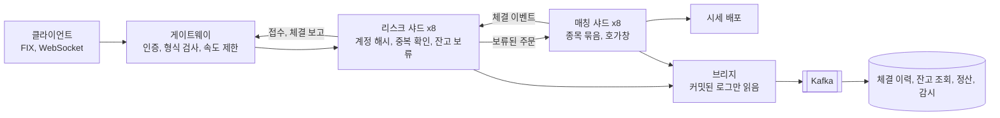

거래소 코어는 주문을 받아 잔고를 확인하고, 호가창에서 상대 주문과 맞춰 체결하고, 그 결과를 잔고에 옮긴다. 어려운 건 이 단계들이 모두 같은 순서를 봐야 한다는 점이다. 같은 주문이 두 번 체결되거나 잔고가 음수가 되면 안 되고, 서버 한 대가 죽어도 커밋된 체결은 남아야 하며, 이걸 마이크로초 단위로 해야 한다.

기준: Aeron 1.54.2 (Aeron Cluster), LMAX Disruptor 4.0.0, FIX 5.0 SP2 데이터 사전, Kafka 4.4 (2026-11).

## 요구사항과 규모 가정

기능 요구사항은 다섯 가지다. 지정가, 시장가, IOC, FOK, post-only 주문과 취소를 받는다. 가격이 좋은 주문이 먼저, 같은 가격이면 먼저 온 주문이 먼저 체결된다. 주문을 받는 순간 필요한 자산을 잡아 두어 어떤 계정의 잔고도 음수가 되지 않는다. 같은 ClOrdID로 다시 온 주문은 한 번만 처리한다. 체결과 잔고 변화는 모두 복식부기 원장에 남는다. 비기능 요구사항은 데이터센터 안에서 게이트웨이 수신부터 접수 응답까지 p99 500µs 이하, 노드 한 대가 죽어도 커밋된 체결 유실 0건, 노드 복구 1분 이내, 이벤트 로그는 노드에 7일 두고 그 뒤는 오브젝트 스토리지에 장기 보관이다. 종목은 300개, 24시간 거래하는 시장으로 잡는다. 아래 숫자는 모두 가정이다.

| 항목 | 계산 | 값 |
|---|---|---|
| 피크 명령 | 신규, 취소, 정정 합 | 50,000/s |
| 하루 명령 | 평균 5,000/s × 86,400 | 4억 3,200만 |
| 가장 붐비는 종목 | 피크 × 30% | 15,000/s, 명령당 66.7µs |
| 피크 체결 | 50,000 × 명령당 0.3건 | 15,000/s |
| 로그 레코드 | 명령 128B + 결과 이벤트 2개 × 96B, 피크 50,000 × 320B | 명령당 320B, 피크 16MB/s |
| 하루, 1년 로그 | 4억 3,200만 × 320B, × 365 | 약 138GB(복제 3이면 약 415GB), 복제 전 연 약 50.5TB |
| 대기 주문 | 500만 × 128B | 640MB |
| 잔고 | 계정 1,000만 × 자산 4 × 64B | 2.56GB |
| ClOrdID 중복 표 | 신규 주문(명령의 절반) 2억 1,600만 × 32B | 약 6.9GB |
| 샤드 | 매칭 8개(최상위 종목은 단독) + 리스크 8개, 샤드당 3노드 | 48노드 |

상태가 모두 메모리에 들어간다. 리스크 샤드 하나는 잔고 320MB와 중복 표 864MB를, 매칭 샤드 하나는 평균 80MB의 호가창을 든다. 최상위 종목도 명령 사이 간격이 66.7µs라 매칭에 10µs를 쓰면 스레드는 15%만 바쁘다.

## 전체 구조



게이트웨이는 연결과 인증, 메시지 형식, 속도 제한만 보고 상태를 들지 않는다. 주문은 계정 해시로 정한 리스크 샤드로 간다. 리스크 샤드는 ClOrdID 중복을 확인하고 잔고를 보류한 뒤 종목이 속한 매칭 샤드로 넘긴다. 매칭 샤드의 체결 이벤트는 매수자와 매도자의 리스크 샤드로 돌아가 원장에 적힌다. 샤드마다 Aeron Cluster 3노드가 명령을 하나의 로그로 순서 짓고 복제하며, 세 노드가 같은 로그를 같은 순서로 적용한다. 체결 이력과 정산 같은 하류는 브리지가 커밋된 로그를 Kafka로 옮긴 뒤에 붙으니, 하류가 느려져도 주문 경로는 기다리지 않는다.

## 핵심 키워드

| 키워드 | 한 줄 뜻 |
|---|---|
| 가격-시간 우선 | 좋은 가격이 먼저, 같은 가격이면 먼저 들어온 주문이 먼저 체결된다 |
| 가격 레벨 | 한 가격에 쌓인 주문의 FIFO 큐와 잔량 합 |
| 주문 ID 색인 | 주문 ID에서 큐 안의 노드로 바로 가는 해시 맵. 취소가 O(1)이 된다(레벨이 비면 맵에서 지우는 O(log L)이 붙는다) |
| 시퀀서 | 들어온 명령에 전체 순서를 매기는 한 지점. 여기서는 Raft 리더 |
| 이벤트 소싱 | 상태 대신 상태를 만든 명령 로그를 원본으로 두는 방식 |
| 결정적 상태 기계 | 같은 로그를 같은 순서로 넣으면 어느 노드에서나 같은 상태와 출력이 나온다 |
| 보류(hold) | 주문에 필요한 자산을 가용 잔고에서 떼어 둔 양 |
| 복식부기 | 모든 이동을 같은 자산의 차변과 대변으로 적어 합이 0이 되게 하는 방식 |
| ClOrdID | FIX tag 11. 클라이언트가 붙이는 주문 ID로, 한 거래일 안에서 유일해야 한다 |
| IOC, FOK | TimeInForce 3과 4. 바로 체결된 만큼만 남기고 취소, 전량 체결이 아니면 전부 취소 |
| post-only | 대기 주문으로만 들어가는 주문. FIX로는 ExecInst 6(Participate don't initiate) |
| 스냅샷 | 로그 위치 하나에서 찍은 상태. 복구는 스냅샷을 읽고 그 뒤 로그만 다시 돌린다 |

## 호가창은 정렬된 가격 레벨과 주문 ID 색인으로 만든다

호가창은 매수와 매도 두 쪽이고, 연산은 최우선 가격 찾기, 주문 넣기, 주문 취소 셋이다. 가격 레벨을 담는 방법은 둘이다. 정렬 맵(Java `TreeMap`은 red-black tree)은 새 레벨 삽입이 O(log L)이고 최우선 가격은 첫 항목이다. 틱 단위 배열은 레벨 접근이 O(1)이지만 가격 범위가 정해져 있어야 하고, 최우선 레벨이 비면 다음 레벨을 훑어야 한다. 이 설계는 정렬 맵을 쓴다. 체결 한 번에 레벨 탐색은 몇 번뿐이고 가격 범위가 열린 종목에도 그대로 맞는다. 대가는 포인터를 따라가는 캐시 미스와 객체 할당이라 주문과 레벨 객체를 풀에서 재사용한다.

```java
// 구조만 보여 주는 스케치
final class Order { long id, accountId, price, qty; Order prev, next; Level level; }
final class Level { long price, totalQty; Order head, tail; }      // 같은 가격 안은 FIFO
final class BookSide {
  final TreeMap<Long, Level> levels;   // 매수는 내림차순, 매도는 오름차순 비교자
  Level best() { var e = levels.firstEntry(); return e == null ? null : e.getValue(); }
}
final HashMap<Long, Order> byId = new HashMap<>();  // 취소는 찾아서 prev, next 링크만 끊는다
```

지정가 매수가 P에 오면 최우선 매도가가 P 이하인 동안 그 레벨의 head부터 체결하고, 체결가는 대기 주문의 가격이다. 남은 수량은 지정가면 호가창에 붙고, IOC와 시장가면 취소한다. FOK는 아무것도 건드리기 전에 P 이하 레벨의 잔량 합을 먼저 세어 모자라면 거절한다. post-only는 들어오자마자 체결될 가격이면 거절한다. 시장가 매수는 쓸 금액 상한을 함께 받아야 보류할 양을 정할 수 있다. 주문 ID 색인은 찾기에만 쓰고 순회하지 않는다. Aeron Cluster 튜토리얼은 결정성을 깨는 예로 타임스탬프, 난수, 설정 파일 읽기와 함께 HashMap 순회를 든다.

## 종목마다 스레드 하나, 순서는 복제된 로그가 정한다

한 호가창을 여러 스레드가 잠금으로 나눠 고치면 체결 순서가 스레드 스케줄에 따라 달라지고, 복제본이 같은 결과를 재현할 수 없다. 그래서 호가창마다 쓰는 스레드를 하나로 둔다. LMAX Disruptor 논문도 데이터마다 쓰기 스레드를 하나로 두어 쓰기 경합을 없애는 것을 설계 목표로 든다. 링 버퍼의 메모리를 시작할 때 모두 할당해 재사용하고, 생산자가 하나면 잠금도 CAS도 필요 없다. LMAX는 이 패턴으로 주문 매칭 엔진과 실시간 리스크 관리를 만들었다. 이 설계도 노드 안에서 수신, 엔진, 송신 스레드 사이를 이런 링 버퍼로 잇고 엔진 스레드만 상태를 쓴다.

노드 사이의 순서는 Aeron Cluster가 정한다. Raft 기반이고, 리더가 클라이언트 입력을 하나의 로그로 순서 지어 팔로워에 복제하며, Aeron Archive가 로그를 디스크에 기록한다. 서비스는 과반이 로그를 기록한 뒤에야 그 항목을 처리한다. 팔로워도 같은 서비스를 돌리므로 같은 상태를 든 핫 스탠바이가 된다. 그러려면 서비스가 결정적이어야 한다. 시각은 클러스터가 로그와 함께 넘기는 타임스탬프만 쓰고, 설정 변경도 메시지로 넣는다. [CAP과 합의 글](/posts/cap-consistency-and-consensus/)대로 과반 투표를 쓰면 분할 때 소수 쪽은 요청을 거절하고, 복제본의 확인을 기다리는 비용은 장애가 없어도 요청마다 낸다. 클러스터는 3대나 5대가 권장값이고 여기서는 3대다.

| 구간 | p99 예산 |
|---|---|
| 게이트웨이 파싱, 인증, 속도 제한 | 30µs |
| 로그 복제 두 번(리스크, 매칭 샤드 과반 기록) | 200µs |
| 중복 확인, 잔고 보류 | 10µs |
| 매칭 | 10µs |
| 접수 보고 송신 | 50µs |
| 큐 대기, GC 여유 | 200µs |

복제 두 번이 예산의 40%다. 인터넷 너머 클라이언트와의 왕복은 이 표 밖이고, 대개 이 예산 전체보다 크다. 대가는 둘이다. 한 종목은 코어 하나를 넘어 쓸 수 없고, 버스트 때 명령은 링 버퍼에서 줄을 선다. [파티셔닝 글](/posts/partitioning-and-sharding/)대로 핫 키는 어떤 해시로도 흩어지지 않으니, 최상위 종목은 매칭 샤드 하나를 혼자 쓴다.

## 잔고는 접수 때 보류하고 체결로 옮긴다

리스크 샤드는 계정과 자산마다 `total`과 `held`를 들고, 가용 잔고는 `total - held`다. 지정가 매수는 가격 × 수량에 최대 수수료를 더한 금액을, 매도는 수량을 보류한다. 가용 잔고가 모자라면 매칭 샤드로 보내지 않고 거절한다. 체결은 보류분에서만 빼고, 더 좋은 가격에 체결되면 차액을 풀어 준다. 취소와 IOC의 남은 수량도 보류를 푼다. 빼는 돈은 언제나 보류분이고 보류는 `total`을 넘지 않으니 잔고는 음수가 될 수 없다. 금액은 자산마다 최소 단위의 정수로 든다. 0.5 BTC를 BTC당 30,000 USDT에 사고팔고 수수료가 양쪽 0.1%면 원장은 이렇게 적힌다.

| 계정 | USDT | BTC |
|---|---|---|
| 매수자 | -15,015 (보류에서) | +0.5 |
| 매도자 | +14,985 | -0.5 (보류에서) |
| 수수료 계정 | +30 | 0 |
| 합 | 0 | 0 |

매수자와 매도자가 다른 리스크 샤드에 있으면 같은 체결 이벤트를 두 샤드가 각자 반쪽씩 적용한다. 그래서 자산별 합은 두 반쪽이 모두 적용된 매칭 로그 위치에서 0이 되고, 대사 작업은 그 위치를 기준으로 비교한다. 잔고를 DB 행으로 두면 [격리 수준 글](/posts/isolation-levels-and-mvcc/)의 lost update를 막으려고 `SELECT ... FOR UPDATE`나 한 문장 안의 계산이 필요하다. 샤드 안에서는 쓰는 스레드가 하나라 동시 쓰기 자체가 없다. 대가는 사용자의 자금이 미체결 주문에 묶이는 것과, 체결이 잔고에 닿기까지 샤드를 한 번 더 건너는 지연이다. 출금도 같은 보류 절차를 거친다.

## 같은 주문은 ClOrdID로 한 번만 받는다

Aeron Cluster 튜토리얼은 리더가 죽을 때 클러스터로 보낸 메시지 일부가 사라질 수 있으니, 클라이언트가 자기 메시지의 응답을 추적하고 타임아웃을 두라고 한다. 그러면 클라이언트는 응답을 못 받은 주문을 다시 보낸다. 이미 커밋된 주문이었다면 그대로 받을 때 주문이 두 개가 된다. 그래서 리스크 샤드가 `(account, ClOrdID)`에서 원래 주문 ID로 가는 표를 상태에 들고, 다시 온 주문에는 원래 주문의 현재 상태를 돌려준다. 이 표도 로그로 만들어지니 복제되고 스냅샷에 들어간다. FIX는 ClOrdID를 한 거래일 안에서 유일하게 하라고 하므로 24시간 시장에서는 창을 24시간으로 둔다. [Kafka 멱등 프로듀서 글](/posts/kafka-idempotency/)대로 전송 계층의 재시도 제거는 한 세션 안에서만 통하고, 애플리케이션이 다시 보낸 요청을 거르려면 요청이 생긴 곳에서 붙인 키가 필요하다. FIX의 PossDupFlag(43)는 재전송일 수 있다는 표시일 뿐이라 판단은 ClOrdID로 한다.

장애 조치에서 두 번 체결되지 않는 이유는 엔진이 로그를 다시 실행하지 않기 때문이다. 새 리더는 로그가 가장 최신인 노드 중에서 뽑히고, 커밋된 명령은 과반의 로그에 있으니 새 리더의 로그에도 있다. 새 리더는 아직 적용하지 않은 커밋 항목을 같은 결과로 적용하고 그다음 위치부터 이어 갈 뿐이다. 커밋되지 않은 명령은 사라지고 클라이언트가 같은 ClOrdID로 다시 보낸다. 샤드 사이 메시지에는 `(출발 샤드, 출발 로그 위치)`를 붙이고, 받는 샤드는 출발지별 최대 위치를 상태에 두어 그 이하를 버린다. 출발 샤드는 받는 쪽이 확인한 위치 뒤의 메시지를 상태에 두고, 새 리더가 그 위치부터 다시 보낸다. 그래서 전송 중 사라진 메시지는 다시 가고, 두 번 간 메시지는 한 번만 적용된다. 클라이언트로 가는 체결 보고에도 로그 위치를 실어 게이트웨이와 클라이언트가 중복을 거른다. 대가는 리스크 샤드마다 864MB인 중복 표와, 24시간이 지난 ClOrdID 재사용은 막지 못한다는 점이다.

## 선택지 비교

| | 이 설계: 계정 샤드 리스크 + 종목 샤드 매칭 | 단일 엔진: 리스크와 전 종목 매칭을 한 상태 기계에 | DB 트랜잭션: 잔고 행 잠금 + 주문 테이블 |
|---|---|---|---|
| 잔고 확인 | 샤드 한 번 건넘, 체결은 이벤트로 돌아옴 | 같은 스레드에서 바로 | 행 잠금 트랜잭션 |
| 처리 한도 | 샤드 수만큼, 종목 하나는 코어 하나 | 스레드 하나 | 인기 계정과 종목의 잠금 경합 |
| 지연 | 로그 복제 두 번 | 한 번 | 커밋과 잠금 대기 |
| 장애 범위 | 샤드 하나 | 전체 | DB 하나 |
| 어려운 부분 | 샤드 간 중복 제거와 반쪽 체결 대사 | 거의 없다 | 체결 순서를 재현할 로그가 따로 없다 |

지금 규모라면 단일 엔진도 스레드 하나에 들어갈 수 있다. 이 설계가 샤드를 나눈 건 엔진 버그 하나가 전 종목을 멈추지 않게 하고, 10배 규모에서 다시 짜지 않으려는 것이다.

## 장애와 재처리

| 장애 | 복구 |
|---|---|
| 샤드 리더 장애 | 과반이 남은 쪽에서 새 리더를 뽑는다. 커밋 안 된 명령은 클라이언트가 같은 ClOrdID로 다시 보낸다 |
| 노드 재시작 | 최근 스냅샷을 읽고 그 뒤 로그를 재생한다. 스냅샷은 10분마다 찍는다 |
| 엔진이 예외를 던지는 명령 | 세 복제본이 같은 명령에서 똑같이 죽는다. 명령 단위로 예외를 잡아 거절 이벤트를 내고, 형식 검사는 게이트웨이에서 먼저 한다 |
| 복제본 상태 분기 | 스냅샷마다 상태 해시를 로그 위치와 함께 남겨 노드끼리 비교하고, 다른 노드는 빼서 스냅샷에서 다시 만든다 |
| 하류 Kafka 장애 | 브리지가 멈추고 마지막으로 보낸 로그 위치를 기억한다. 로그가 노드에 남은 7일 안이면 이어서 보낸다 |
| 대사 불일치 | 자산별 합이 0이 아니면 출금을 멈추고 로그 위치로 차이 난 체결을 찾는다 |

최상위 종목 샤드는 10분에 15,000 × 600 = 900만 명령이 쌓이고, 재생은 보고를 보내지 않으니 초당 100만 건(명령당 평균 1µs, 10µs는 p99 예산)으로 잡으면 9초다. 리스크 샤드 스냅샷은 약 1.18GB다. 둘 다 복구 1분 안에 든다. 브리지의 Kafka 레코드에는 `(샤드, 로그 위치)`를 헤더로 실어 소비자가 중복을 거른다. 계정별 최신 잔고 토픽은 `cleanup.policy=compact`로 두면 [로그 보존과 compaction 글](/posts/kafka-log-retention-and-compaction/)대로 키마다 최신 값 하나가 남아 조회용 뷰를 처음부터 다시 채울 수 있다. 쓰기가 대부분인 체결 이력 저장소에는 [LSM 글](/posts/lsm-tree-vs-btree/)대로 쓰기를 memtable에 모아 정렬된 파일로 한 번에 내리는 LSM 계열이 맞는다.

지켜볼 지표는 여섯 개다. 샤드별 접수 지연 p99와 p99.9, 리더와 팔로워의 로그 위치 차이, 최상위 종목 엔진 스레드의 사용률, 자산별 원장 합(0이 아니면 경보), ClOrdID 중복 비율, 브리지의 로그 위치 지연이다.

## 규모가 10배가 되면

피크 500,000/s에서 최상위 종목은 150,000/s, 명령 간격 6.7µs로 매칭 예산 10µs보다 짧아진다. 먼저 한계에 닿는 건 그 종목의 엔진 스레드이고, 호가창은 나눌 수 없다. 시세 인코딩과 보고 직렬화를 엔진 스레드 밖의 링 버퍼 소비자로 옮기고, 그 샤드에 장비 한 벌을 따로 준다. 하루 로그는 약 1.38TB, 1년 복제 전 약 505TB가 되어 노드 보관을 7일보다 줄이고 오브젝트 스토리지로 일찍 넘긴다. 10분 스냅샷이면 최상위 종목 재생이 9,000만 명령, 90초라 복구 1분을 넘으니 스냅샷을 5분 이하로 당긴다. 중복 표는 약 69GB가 되어 리스크 샤드를 늘려야 하고, 계정을 옮길 때는 로그 위치 하나에서 찍은 스냅샷으로 넘기는 동안 그 계정 묶음의 주문을 잠시 멈춘다.

## 참고 자료

- [LMAX Disruptor technical paper](https://lmax-exchange.github.io/disruptor/disruptor.html), [4.0.0 release](https://github.com/LMAX-Exchange/disruptor/releases/tag/4.0.0)
- [Aeron Cluster README (1.54.2)](https://github.com/aeron-io/aeron/blob/1.54.2/aeron-cluster/README.md)
- [Aeron Cluster Tutorial](https://github.com/aeron-io/aeron/wiki/Cluster-Tutorial)
- [In Search of an Understandable Consensus Algorithm (Raft)](https://raft.github.io/raft.pdf)
- [Apache Kafka 4.4 Topic Configs (cleanup.policy)](https://kafka.apache.org/44/configuration/topic-configs/)
- [FIX Trading Community Standards](https://fixtrading.org/standards/), FIX 5.0 SP2 [ClOrdID (11)](https://www.onixs.biz/fix-dictionary/5.0.sp2/tagnum_11.html), [TimeInForce (59)](https://www.onixs.biz/fix-dictionary/5.0.sp2/tagnum_59.html), [ExecInst (18)](https://www.onixs.biz/fix-dictionary/5.0.sp2/tagnum_18.html), [PossDupFlag (43)](https://www.onixs.biz/fix-dictionary/5.0.sp2/tagnum_43.html)

## English summary

This design splits an exchange core into risk shards keyed by account and matching shards keyed by instrument, and each shard is a three-node Aeron Cluster that orders commands into one Raft log. Each order book has one writer thread with price levels in a sorted map, a FIFO queue per level, and an order ID index for constant-time cancels, so every replica that applies the same log reaches the same state. Risk shards hold funds when an order is accepted, move them on each fill with double-entry entries that sum to zero, and release them on cancel, so balances cannot go negative. Resent orders are caught by the client order ID, and cross-shard messages carry their source log position. I split the shards because one engine bug should stop one shard, not every instrument.
