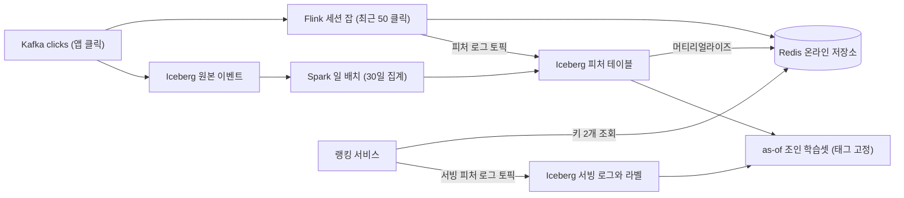

추천 모델 하나가 사용자 30일 집계와 이번 세션의 최근 클릭을 같이 쓴다. 학습은 지난 몇 달의 노출 로그에 그때의 피처 값을 붙여야 하고, 서빙은 요청마다 같은 피처를 10ms 안에 꺼내야 한다. 어려운 건 저장소 두 개를 두는 일이 아니라, 학습이 본 값과 서빙이 본 값을 같은 시각 기준으로 맞추는 일이다.

기준: Kafka 4.4, Flink 2.3, Spark 4.3, Iceberg 1.12, Redis 8, Cassandra 5.0, Feast 0.68 (2026-11).

## 요구사항과 규모 가정

기능 요구사항은 네 가지다. 일 배치로 사용자 30일 집계(클릭 수, 카테고리별 CTR 등 30개)를 만들고, 스트림으로 세션의 최근 클릭 50개를 유지한다. 학습용으로 라벨 시각 기준의 피처를 붙인 데이터셋을 만들고, 서빙용으로 사용자 하나의 피처를 키로 조회한다. 비기능 요구사항은 온라인 조회 p99 10ms 이하, 학습과 서빙의 값 일치, 오프라인 피처 이력 1년 보관, 온라인은 최신 값만 메모리에 두는 비용 한도다. 후보 아이템 피처(아이템 100만 개 × 200 B = 200 MB)는 랭킹 서비스 프로세스 메모리에 두어, 온라인 저장소는 요청당 사용자 키만 읽는다. 아래 숫자는 모두 가정이다.

| 항목 | 전제 | 계산 |
|---|---|---|
| 클릭 이벤트 | DAU 2,000만, 1인 50회/일, 200 B | 하루 10억 건, 평균 10억 / 86,400 ≈ 11,600건/s, 피크 3배 ≈ 35,000건/s |
| 원본 이벤트 용량 | 압축 전 | 10억 × 200 B = 200 GB/일, 1년 73 TB, Parquet 1/5 압축이면 약 15 TB |
| 배치 피처 스냅샷 | MAU 5,000만, 사용자당 1 KB | 50 GB/일, 압축 후 10 GB/일, 1년 3.65 TB |
| 온라인 저장소 | 배치 50 GB + 세션(동시 200만 × 클릭 50개 × 16 B = 1.6 GB) ≈ 52 GB | 샤드당 16 GB를 넘기지 않으면 52 / 16 = 3.25, 프라이머리 4개, 레플리카 포함 8노드 |
| 서빙 조회 | 피크 20,000 req/s, 요청당 키 2개 | 40,000 키 조회/s, 샤드당 약 10,000 |
| Kafka 파티션 | 파티션당 1,000건/s를 목표로 | 35,000 / 1,000 = 35, 여유를 두고 48개, 피크 대역폭 35,000 × 200 B = 7 MB/s |

## 전체 구조



클릭은 Kafka에 한 번 들어가고 두 갈래로 나간다. Flink 잡은 사용자별 최근 클릭을 keyed state로 들고 Redis와 피처 로그 토픽에 같은 레코드를 쓰고, 그 토픽은 Iceberg로 들어간다. 원본 이벤트도 Iceberg에 쌓이고, Spark 일 배치가 30일 집계를 Iceberg 피처 테이블에 쓴 뒤 그 테이블에서 Redis로 옮긴다. 랭킹 서비스는 조회한 피처 벡터를 요청 ID와 함께 로그로 남기고, 학습셋은 이 로그의 라벨에 피처 테이블을 as-of 조인해 만든다.

## 핵심 키워드

| 키워드 | 한 줄 뜻 |
|---|---|
| 피처 뷰 | 같은 엔티티 키(여기서는 `user_id`)와 같은 갱신 주기를 갖는 피처 묶음. 버전 단위가 된다 |
| 오프라인, 온라인 저장소 | 피처의 전체 이력(학습셋과 백필의 원천)과, 엔티티마다 서빙이 키로 읽는 최신 값 한 벌 |
| 머티리얼라이즈 | 오프라인 피처 테이블의 최신 값을 온라인 저장소로 옮기는 작업 |
| as-of 조인 | 라벨 시각 이전의 가장 최근 피처 값을 붙이는 조인. point-in-time 조인이라고도 한다 |
| 라벨 누수 | 라벨 시각 뒤에 생긴 정보가 학습 피처에 들어가는 것 |
| training-serving skew | 같은 요청에 대해 학습 피처와 서빙 피처의 값이 다른 것 |
| `available_at` | 그 피처 값이 온라인에서 처음 읽힐 수 있게 된 시각 |
| `max_age` | 피처 뷰마다 정한 허용 나이. 넘으면 기본값을 쓴다 |

## 학습 조인은 서빙에서 보였던 시각으로 붙인다

라벨은 노출 뒤 30분 안의 클릭 여부다. 여기에 사용자 30일 집계를 붙이는 방법은 여럿이고, 대부분 어딘가로 미래가 샌다.

| 조인 기준 | 새는 것 |
|---|---|
| 최신 스냅샷 | 학습 기간 전체에 오늘 값이 붙는다 |
| 라벨 날짜 = 피처 날짜 | 그날 집계에 라벨이 된 클릭 자체가 들어간다 |
| 집계 구간 끝(`feature_ts`) ≤ 요청 시각 | 0시에 끝난 집계는 배치와 적재가 끝난 03시부터 온라인에 보인다. 00시~03시 요청은 서빙에서 전날 값을, 학습에서 오늘 값을 본다 |
| `available_at` ≤ 요청 시각 | 서빙이 그 시각에 볼 수 있던 값만 붙는다 |

이 설계는 마지막 줄을 고른다. 피처 테이블의 각 행에 머티리얼라이즈가 끝난 시각을 `available_at`으로 남기고, 조인은 그 시각으로 한다. 구간을 시작 포함, 끝 제외로 잡아 경계의 사건이 두 행에 붙지 않게 하는 방식은 [SCD 차원 모델링 글](/posts/dimensional-modeling-scd/)의 유효 기간 조인과 같다.

```sql
-- 구조만 보여 주는 스케치 (Spark SQL). 테이블 이름은 예시다
SELECT * FROM (
  SELECT l.request_id, l.label, f.clicks_30d, f.ctr_30d,
         ROW_NUMBER() OVER (PARTITION BY l.request_id ORDER BY f.available_at DESC) AS rn
  FROM lake.serving_labels l
  LEFT JOIN lake.feat_user_30d_v3 f
    ON f.user_id = l.user_id
   AND f.available_at <= l.request_ts
   AND f.feature_ts   >  l.request_ts - INTERVAL 2 DAYS  -- 서빙이 나이를 재는 _ts, max_age와 같은 기준
) WHERE rn = 1;
```

보이는 시각은 `available_at`으로, 나이는 서빙과 같은 `feature_ts`와 `max_age`로 잰다. 서빙에서 이틀 넘은 값은 기본값으로 바뀌니, 학습에서도 이틀 넘은 값은 NULL이 되어 같은 기본값으로 채워져야 한다. Feast도 같은 모양이다. `get_historical_features`는 엔티티 행의 `event_timestamp`와 같거나 이전인 가장 최근 값을 붙이고, 피처 뷰의 `ttl`은 과거로 얼마나 거슬러 볼지를 제한한다. 이 설계를 Feast로 옮긴다면 피처 뷰의 타임스탬프 컬럼에 `available_at`을 넣는 셈인데, 그러면 `ttl`도 그 컬럼에서 재므로 나이 기준이 적재 지연만큼 어긋난다(동작에서 나온 추론이다). 대가는 저장과 조인 비용이다. 날짜별 스냅샷을 다 남겨야 해서 1년에 3.65 TB가 쌓이고, 조인은 `user_id`로 셔플한 뒤 범위 조건을 거는 무거운 작업이 된다.

## 피처 정의는 한 벌로, 온라인 값은 오프라인에도 남긴다

skew는 대개 같은 피처를 두 번 짜는 데서 나온다. 배치는 SQL로, 서빙은 서비스 코드로 30일 CTR을 계산하면 0으로 나누기, 시간대, NULL 처리 중 하나는 결국 달라진다.

| 방식 | skew | 대가 |
|---|---|---|
| 배치 코드와 서빙 코드를 따로 | 상시 생긴다 | 두 코드를 계속 맞춰야 한다 |
| 서빙 피처 로그만으로 학습 | 없다 | 새 피처는 로그가 쌓일 때까지 학습할 수 없다 |
| 한 정의로 계산하고, 온라인 값을 오프라인에도 쓴다 | 시각 차이만 남는다 | 스트림 피처 백필에 재생 경로가 필요하다 |

이 설계는 세 번째를 고르고, 서빙 피처 로그는 검증용으로 둔다. 배치 피처는 계산을 Spark 한 곳에서만 한다. 온라인 값은 Iceberg 피처 테이블 행의 복사본이라 값 자체는 다를 수 없고, 남는 차이는 앞 절의 `available_at`으로 맞춘다. 다만 적재가 도는 약 한 시간 동안은 키마다 새 값이 보이는 시각이 달라, 이 구간의 차이는 서빙 피처 로그로 잰다. 스트림 피처는 Flink 잡이 Redis와 피처 로그 토픽에 같은 레코드를 쓰니, 학습은 서빙이 읽은 것과 같은 레코드를 읽는다. Feast에서는 stream feature view가 스트림 소스와 배치 소스를 함께 갖고, push source는 `PushMode.ONLINE_AND_OFFLINE`으로 같은 값을 두 저장소에 넣을 수 있다.

세션 상태는 Flink keyed state에 state TTL 30분으로 둔다. [Flink 상태와 체크포인트 글](/posts/flink-state-and-checkpoints/)에 적은 대로 state TTL은 처리 시간만 지원해서, 오래 멈췄던 잡을 복구하면 멈춘 시간도 지난 시간으로 계산된다. 장애 뒤에는 세션이 비어 있는 상태로 시작한다고 보고 서빙 기본값과 맞춘다. 새 스트림 피처를 과거로 채우려면 같은 Flink 잡에 원본 이벤트를 다시 흘려야 한다. Kafka의 기본 보관 기간은 7일이라 그보다 긴 재처리는 레이크에서 다시 계산해야 한다는 점은 [실시간 테이블과 일별 테이블 글](/posts/batch-and-stream-layers/)에 있다.

## 신선도는 저장소 TTL이 아니라 읽을 때 나이로 판정한다

| 저장소 | TTL 단위 | 만료된 값 |
|---|---|---|
| Redis | 키(`EXPIRE`), 7.4부터 해시 필드(`HEXPIRE`) | 접근할 때와 주기적 샘플링으로 지우고, 읽기에는 보이지 않는다 |
| DynamoDB | 항목의 숫자 속성(Unix 초) | 보통 만료 후 며칠 안에 지운다. 그 전에는 읽히므로 필터가 필요하다 |
| Cassandra | 셀 | 툼스톤이 되고, `gc_grace_seconds`(기본 864000초, 10일)가 지나야 compaction으로 사라진다 |
| HBase | 컬럼 패밀리(초), 셀 단위(`Mutation#setTTL`, 밀리초)도 있다 | 패밀리 TTL은 현재 값을 포함한 모든 버전에 적용된다 |

만료가 읽기에 반영되는 시점이 저장소마다 다르니 신선도 판정을 저장소에 맡기지 않는다. Redis 키는 `fv:user_30d:v3:{user_id}` 해시이고, 피처 필드와 함께 `_ts`(피처 테이블의 `feature_ts`와 같은 값)를 넣는다. 서빙은 `now - _ts`가 피처 뷰의 `max_age`를 넘으면 그 뷰 전체를 기본값으로 바꾼다. 배치 뷰는 48시간이라 하루치 배치가 실패해도 그날 안에 재실행하면 기본값으로 떨어지지 않고, 세션 뷰는 30분이다. 저장소 TTL은 `max_age`보다 길게 걸어 메모리 회수에만 쓴다. 해시 태그 `{user_id}`로 두 뷰의 키를 한 슬롯에 두면 파이프라인 한 번에 같은 노드에서 둘 다 읽는다. Redis는 메모리를 넘기면 `maxmemory-policy`에 따라 TTL이 남은 키도 지울 수 있다는 점이 [Redis 중복 거르기 글](/posts/redis-dedup-and-windows/)에 있다. 피처가 축출되면 조회는 miss가 되고 기본값으로 떨어지므로, 온라인 저장소는 캐시와 인스턴스를 나누고 miss 비율을 지표로 본다. 대가는 읽을 때마다 나이를 계산하는 코드와, 기본값을 학습과 서빙에서 같은 상수로 관리하는 일이다.

## 정의를 바꾸는 백필은 새 버전 키로 쓰고 바꿔 끼운다

일상 머티리얼라이즈는 증분이다. 전날 이후 새로 쓴 날짜 파티션만 옮기고, 적재가 끝나면 그 행들의 `available_at`을 채운다. Feast의 `feast materialize-incremental`도 각 피처 뷰의 마지막 머티리얼라이즈 종료 시각부터 온라인 저장소로 적재한다. 5,000만 행을 초당 14,000건으로 쓴다고 하면 50,000,000 / 14,000 ≈ 3,600초, 약 한 시간이다. 정의가 바뀌면 같은 뷰를 덮어쓰지 않고 버전을 올린다. 덮어쓰면 아직 v3로 학습한 모델이 서빙 중에 v4 값을 받는다.

1. Spark로 과거 1년을 v4 정의로 다시 계산해 `feat_user_30d_v4`에 쓴다.
2. 학습에 쓴 스냅샷에 태그를 붙인다. 태그로 읽으면 그 스냅샷의 스키마로 읽힌다는 점은 [Iceberg 스냅샷과 브랜치 글](/posts/iceberg-snapshots-and-branches/)에 있다.
3. 온라인에 `fv:user_30d:v4:` 키를 v3 옆에 대량 적재한다. 그동안 이 뷰의 메모리는 50 GB에서 100 GB로 두 배가 되고, 전체 102 GB는 샤드당 16 GB 기준 프라이머리 7개(102 / 16 ≈ 6.4)라 적재 전에 샤드를 늘려 둔다. 모델 아티팩트에 쓰는 뷰와 버전을 기록하고, v4 모델이 배포되면 그 모델만 v4 키를 읽는다. v3를 읽는 모델이 없어지면 v3 키를 지운다.

랭킹 서비스가 메모리에 든 아이템 피처도 같은 문제를 겪는다. 배치가 원천을 통째로 바꾸는 순간 캐시를 언제 버릴지는 따로 설계해야 한다는 점은 [배치가 채우는 읽기 API 캐시 글](/posts/read-api-caching/)에 있다. 여기서는 캐시 키에 버전을 넣어 새 버전이 적재되면 새 키로 읽게 한다.

## 선택지 비교

| | Redis Cluster | DynamoDB | HBase, Cassandra |
|---|---|---|---|
| 52 GB, 40,000 조회/s | 8노드 | 1 KB 항목의 최종 일관성 읽기는 0.5 읽기 단위, 약 20,000 단위/s | 클러스터 운영 필요 |
| 묶어 읽기 | 파이프라인 | `BatchGetItem` 최대 100개, 16 MB, 기본 최종 일관성 | Get 묶음, 파티션 키 쿼리 |
| TTL 반영 | 읽기에 바로 | 며칠 늦을 수 있음 | 툼스톤, compaction 의존 |
| 커지면 | 메모리 비용이 선형으로 는다 | 파티션당 초당 3,000 읽기, 1,000 쓰기 단위 한도 | 행 키와 compaction 설계가 지연을 정한다 |

이 규모에서는 Redis를 고른다. 52 GB는 메모리에 두기에 부담이 없고, 만료가 읽기에 바로 반영된다. DynamoDB는 운영이 없는 대신 TTL 지연을 읽기 쪽에서 걸러야 한다. 미리 계산한 결과를 키 하나로 꺼내는 저장소에서는 행 키를 어떻게 만들고 읽느냐가 속도를 정한다는 점이 [HBase 행 키 글](/posts/hbase-serving-row-keys/)에 있다. Feast 0.68의 온라인 저장소 목록에는 넷이 다 있다.

## 장애와 재처리

| 장애 | 복구 |
|---|---|
| Flink 잡 중단 | 마지막 체크포인트의 상태와 Kafka 오프셋에서 다시 읽는다. 그사이 세션 피처는 `max_age` 30분을 넘으면 기본값이 된다 |
| 일 배치 지연, 실패 | Redis에는 전날 값이 남고, 48시간 안이면 그대로 서빙한다. 재실행은 날짜 파티션 덮어쓰기라 몇 번 돌려도 한 벌이다 |
| 잘못된 집계가 적재됨 | 머티리얼라이즈 전에 행 수, NULL 비율, 분포 검사를 통과해야 옮긴다. 이미 옮겼다면 Iceberg 이전 스냅샷에서 다시 적재한다 |
| Redis 샤드 유실 | 배치 피처는 Iceberg 최신 스냅샷에서 다시 적재하고, 세션 피처는 30분 안에 새 클릭으로 다시 찬다 |
| 파싱할 수 없는 이벤트 | Flink에서 dead letter 토픽으로 빼고 잡은 계속 돈다 |

볼 지표는 여섯 개다. 피처 뷰별 나이 p99(`now - _ts`), 기본값으로 떨어진 조회 비율, 마지막 머티리얼라이즈 성공 시각, 온라인 조회 지연 p99, 서빙 피처 로그와 오프라인 as-of 재계산 값이 다른 비율(skew), 학습 기준 분포 대비 피처별 PSI(population stability index, drift)다. skew 비율이 0이 아니면 정의나 시각 처리 중 하나가 갈라진 것이고, drift는 사용자 행동이 바뀐 것이라 대응이 다르다.

## 규모가 10배가 되면

피크 200,000 req/s면 키 조회가 400,000/s, 세션 쓰기가 350,000/s가 된다. 먼저 깨지는 곳은 Redis CPU와 메모리다. MAU도 10배면 배치 피처가 500 GB가 되어 메모리 비용이 커지니, 배치 피처를 디스크 기반 저장소로 내리고 세션 피처만 Redis에 남기는 분리가 맞다. DynamoDB라면 1 KB 항목 400,000 조회/s는 200,000 읽기 단위로, 테이블 기본 한도 40,000을 넘으니 한도 상향이 필요하다. 사용자 한 명에게 요청이 몰리는 경우도 생긴다. 해시는 같은 키를 흩지 못하고, 읽기가 몰리면 복제본이나 캐시로 받는다는 점은 [파티셔닝과 샤딩 글](/posts/partitioning-and-sharding/)에 있다. 비정상 트래픽은 피처 저장소 앞에서 요청 수를 제한한다.

오프라인에서는 as-of 조인이 먼저 무거워진다. 라벨과 피처 테이블을 같은 `user_id` 버킷으로 나눠 두고 날짜 범위별로 나눠 돌려 셔플 크기를 줄인다(일반적인 추론이다). 피처 스냅샷은 1년에 36.5 TB가 되니, 날마다 전체를 남기는 대신 값이 바뀐 사용자만 유효 기간 행으로 남기는 쪽으로 바꿀 수 있다.

## 참고 자료

- Feast 0.68: [Feature retrieval](https://docs.feast.dev/getting-started/concepts/feature-retrieval), [Feature view](https://docs.feast.dev/getting-started/concepts/feature-view), [CLI reference](https://docs.feast.dev/reference/feast-cli-commands), [Push source](https://docs.feast.dev/reference/data-sources/push), [Online stores](https://docs.feast.dev/reference/online-stores), [Releases](https://github.com/feast-dev/feast/releases)
- Redis: [EXPIRE](https://redis.io/docs/latest/commands/expire/), [HEXPIRE](https://redis.io/docs/latest/commands/hexpire/)
- Amazon DynamoDB: [Time to Live](https://docs.aws.amazon.com/amazondynamodb/latest/developerguide/TTL.html), [BatchGetItem](https://docs.aws.amazon.com/amazondynamodb/latest/APIReference/API_BatchGetItem.html), [Partition key design](https://docs.aws.amazon.com/amazondynamodb/latest/developerguide/bp-partition-key-design.html), [Service quotas](https://docs.aws.amazon.com/amazondynamodb/latest/developerguide/ServiceQuotas.html)
- [Apache Cassandra 5.0 Tombstones](https://cassandra.apache.org/doc/latest/cassandra/managing/operating/compaction/tombstones.html)
- [Apache HBase Reference Guide (Time To Live)](https://hbase.apache.org/book.html#ttl)

## English summary

A feature store keeps two copies of each feature: the full history in Iceberg for training, and only the latest value in Redis for serving. Training joins each label to the latest feature row whose `available_at`, the time the value became readable online, is at or before the request time, with the same two-day lookback as the online freshness limit. Batch features are computed once in Spark and copied to Redis, and the Flink job writes each session feature to Redis and to a log topic, so training reads the same values serving read. Freshness is checked at read time from a stored timestamp, because store TTLs expire data at different times. A changed definition gets a new version key instead of an in-place overwrite, so a model trained on the old version never reads the new one.
