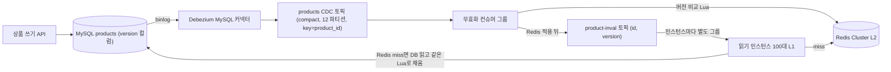

상품 가격과 재고를 초당 수만 번 읽는 API가 있고, 읽기 인스턴스 100대가 Redis와 각자의 메모리에 상품을 캐시한다. 가격이 바뀌면 이 캐시가 몇 초 안에 새 값을 보여야 한다. 어려운 건 변경을 전달하는 일이 아니라, 이벤트가 빠지거나 늦거나 순서가 바뀌어도 옛 값이 새 값을 덮지 않게 하는 일이다.

기준: Kafka 4.4, Debezium 3.7, Redis 8.10 (2026-11).

## 요구사항과 규모 가정

기능 요구사항은 세 가지다. 상품 ID로 가격, 재고, 이름을 읽고, 원천 MySQL의 변경이 Redis 캐시(L2)와 인스턴스 메모리 캐시(L1)에 반영되며, 삭제된 상품은 캐시에서도 사라진다. 비기능 요구사항은 캐시 읽기 p99 5ms, 커밋에서 캐시 반영까지 p99 2초, 이벤트를 잃어도 옛 값이 남는 시간은 TTL(10분) 이하, Redis 메모리 비용 한도다. 주문과 결제는 캐시가 아니라 DB를 읽는다. 지연 예산 2초는 binlog에서 Kafka까지 1초, 무효화 컨슈머 0.5초, L1 전파 0.5초로 나눈다. 파티션당 유입은 2,000 / 12 ≈ 167건/s라서, 무효화 컨슈머의 lag 경고선은 파티션당 약 83건(0.5초)이다. 아래 숫자는 모두 가정이다.

| 항목 | 전제 | 계산 |
|---|---|---|
| 읽기 | 피크 50,000 QPS, L1 적중 60%, Redis 적중 99% | Redis 50,000 × 0.4 = 20,000 ops/s, DB 200 QPS |
| 쓰기 | 피크 2,000 행 변경/s, 평균 500/s, CDC 이벤트 1 KB | 피크 2 MB/s, 하루 500 × 86,400 = 4,320만 건, 43.2 GB |
| CDC 토픽 | 상품 1,000만 개 × 1 KB, compact | 정리 뒤 10 GB, dirty 비율 0.5까지 쌓이면 약 20 GB, 복제 3이면 60 GB |
| 파티션 | 이벤트 하나에 Redis 왕복 1ms면 파티션당 순차 상한 1,000건/s, 사용률 20% 목표 | 2,000 / 200 = 10, 여유를 두고 12개 |
| Redis 메모리 | 1,000만 키 × 600 B (값 500 B + 키와 오버헤드 100 B) | 6 GB, 프라이머리 3개면 샤드당 2 GB |
| 무효화 표시 | 2,000/s × TTL 60초 × 100 B | 12만 개, 12 MB |
| L1 | 인스턴스 100대, 인기 상품 10만 개 × 600 B | 인스턴스당 60 MB |
| 브로드캐스트 | 2,000건/s를 100대가 모두 읽는다 | 브로커 송신 20만 건/s, 100 B 메시지면 20 MB/s, 1 KB CDC 이벤트를 직접 읽으면 200 MB/s |

## 전체 구조



쓰기 API는 DB에만 쓰고 이벤트를 보내지 않는다. Debezium이 binlog에서 행 변경을 읽어 상품 ID를 키로 CDC 토픽에 쓰고, 무효화 컨슈머가 Redis의 키를 버전과 함께 무효화한다. Redis 적용이 끝난 뒤에 작은 무효화 메시지를 `product-inval` 토픽에 다시 내고, 읽기 인스턴스는 각자 이 토픽을 끝까지 읽어 L1에서 키를 지운다. 읽기는 L1, Redis, DB 순으로 내려가고, DB에서 읽은 값은 행의 `version`과 함께 Redis에 채운다.

## 핵심 키워드

| 키워드 | 한 줄 뜻 |
|---|---|
| 이중 쓰기 | 앱이 DB 커밋과 Kafka 전송을 따로 하는 방식. 둘 중 하나만 성공할 수 있다 |
| transactional outbox | 변경과 이벤트 행을 같은 DB 트랜잭션에 쓰고, 그 행을 CDC로 발행하는 패턴 |
| 로그 기반 CDC | DB의 복제 로그(MySQL binlog)를 읽어 커밋된 행 변경을 이벤트로 내는 방식 |
| 무효화 표시 | 키를 지우는 대신 남기는 "버전 N부터 무효" 기록. 늦게 온 옛 값 채우기를 막는다 |
| 행 버전 | UPDATE마다 1씩 올리는 `version` 컬럼. 캐시 쓰기의 비교 기준이 된다 |
| 브로드캐스트 구독 | 모든 인스턴스가 같은 이벤트를 다 받도록 인스턴스마다 컨슈머 그룹을 따로 두는 것 |
| tombstone | 값이 `null`인 레코드. compacted 토픽에서 그 키의 삭제 표시다 |
| 신선도 | 원천 커밋 시각과 캐시 반영 시각의 차이. lag를 시간으로 잰 값이다 |

## 변경 이벤트는 애플리케이션이 아니라 binlog에서 받는다

| 방식 | 이벤트가 빠지는 경우 | 같은 키의 순서 | 대가 |
|---|---|---|---|
| 이중 쓰기 | 커밋 뒤 전송 전에 죽으면 이벤트가 없다. 먼저 보내고 커밋이 실패하면 없는 변경을 알린다 | 여러 인스턴스가 같은 상품을 쓰면 커밋 순서와 전송 순서가 다를 수 있다 | 가장 단순하다 |
| outbox | 같은 트랜잭션이라 빠지지 않는다 | Outbox Event Router가 `aggregateid`를 메시지 키로 쓴다 | 모든 쓰기 경로가 outbox 행을 써야 하고, 행을 지우는 작업이 필요하다 |
| 로그 기반 CDC | 커밋된 변경은 관리자 SQL, 배치 UPDATE까지 다 나온다 | 키가 PK라서 같은 행의 변경은 한 파티션에 커밋 순서로 쌓인다 | 이벤트 모양이 테이블 스키마에 묶이고, 커넥터를 운영해야 한다 |

이 설계는 상품 테이블을 직접 CDC로 읽는다. 캐시 값이 상품 행 하나의 투영이라 스키마에 묶이는 비용이 작고, 앱을 거치지 않은 수정도 캐시에 반영된다. 캐시 값이 여러 테이블을 합친 도메인 객체라면 outbox가 맞다. 그때는 앱이 "무엇이 바뀌었는지"를 이벤트로 정해 준다. binlog를 읽는 원천 설정과, 커넥터가 멈춘 사이 binlog가 지워지면 스냅샷부터 다시 받는 경로는 [CDC 글](/posts/change-data-capture/)에 있다. Debezium은 장애 복구 때 일부 변경 이벤트를 다시 보낼 수 있다. 받는 쪽은 같은 이벤트를 두 번 적용해도 결과가 같아야 한다.

## 값을 쓰지 않고 지우되, 버전을 남긴다

갱신 방식은 컨슈머가 캐시 값을 직접 만든다. 값이 여러 필드를 가공한 결과라면 읽기 경로와 같은 로직을 컨슈머에 한 벌 더 둬야 하고, 아무도 읽지 않는 상품까지 메모리에 쓴다. 순서가 바뀐 이벤트가 오면 옛 값이 새 값을 덮는다. 무효화 방식은 지우기만 하므로 같은 이벤트가 두 번 와도 결과가 같고, 최악이 miss 한 번이다. 그래서 무효화를 고른다. 다만 단순 `DEL`에는 채우기와 겹치는 틈이 있다.

```text
t1 읽기 A: Redis miss, DB에서 version 5 읽음 (응답이 느리다)
t2 쓰기:   DB에 version 6 커밋
t3 무효화: DEL p:{42}      # 아직 키가 없어 아무 일도 없다
t4 읽기 A: SET p:{42} <v5> # 옛 값이 TTL까지 남는다
```

그래서 무효화는 키를 지우지 않고 `{v: 6, d: ""}` 표시를 60초 TTL로 남긴다. 채우기와 무효화가 같은 스크립트를 거치고, 스크립트는 저장된 버전보다 낮은 쓰기를 거절한다. t4의 version 5 채우기는 여기서 막힌다. 읽는 쪽은 `d`가 비어 있으면 miss로 보고 DB를 읽어 version 6으로 다시 채운다.

```lua
-- 구조만 보여 주는 스케치. KEYS[1]=p:{42}, ARGV[1]=version, ARGV[2]=값(""이면 무효화 표시), ARGV[3]=TTL 초
local cur = tonumber(redis.call('HGET', KEYS[1], 'v') or '-1')
if cur > tonumber(ARGV[1]) then return 0 end
redis.call('HSET', KEYS[1], 'v', ARGV[1], 'd', ARGV[2])
redis.call('EXPIRE', KEYS[1], ARGV[3])
return 1
```

Redis는 스크립트를 원자적으로 실행하고, 스크립트가 쓰는 키는 모두 `KEYS`로 넘겨야 클러스터에서도 맞게 동작한다. 같은 버전은 받아 준다. 무효화 표시 v6을 v6 데이터로 바꾸는 게 정상 경로이기 때문이다. `WATCH`/`MULTI`로도 같은 비교를 할 수 있지만, 감시한 키가 바뀌면 `EXEC`가 실패해 재시도 왕복이 생긴다. Redis 8.4에 들어온 `SET ... IFEQ`는 현재 값이 주어진 값과 같을 때만 쓰는 비교라서 "더 큰 버전만"이라는 조건은 표현하지 못한다. 비교 기준이 될 버전 후보는 셋이다.

| 후보 | 장점 | 문제 |
|---|---|---|
| `version` 컬럼 (UPDATE마다 +1) | 같은 행에서 단조 증가하고, 읽기 경로의 SELECT로도 얻는다 | 모든 쓰기 경로가 올려야 한다. 수동 SQL도 예외가 없다 |
| binlog 위치 (Debezium `source.file`, `source.pos`) | 쓰기 경로를 고칠 필요가 없다 | DB를 읽는 채우기 경로는 이 값을 모른다. 파일이 바뀌면 `pos`가 다시 작아지므로 (파일 번호, `pos`) 쌍으로 비교해야 하고, 장애 조치로 서버가 바뀌면 파일 이름도 GTID의 서버 UUID도 이어지지 않는다(구조에서 나온 추론) |
| `updated_at` | 대부분 테이블에 이미 있다 | 같은 밀리초의 두 갱신은 같은 값이고, 앱 서버 시계를 쓰면 역전된다 |

채우기와 무효화가 같은 기준을 써야 하므로 `version` 컬럼을 고른다. 이 설계의 마지막 안전망은 TTL이다. 데이터 키는 10분에 ±10% 지터를 준다. 무효화 표시의 60초는 요청 타임아웃보다 길어야 한다. t1에서 t4까지가 60초를 넘으면 표시가 먼저 사라지기 때문이다. 무효화가 인기 상품을 치면 miss가 한꺼번에 몰린다. 상품 하나에 5,000 QPS가 오는데 키가 무효화되면 인스턴스 100대가 동시에 DB로 간다. 인스턴스 안에서는 single-flight(같은 키의 동시 miss를 조회 한 번으로 합치기)로 키마다 DB 조회를 하나로 합쳐 최대 100건으로 줄이고, 인스턴스 사이에서는 `SET lock:p:{42} <token> NX PX 200`을 얻은 하나만 DB를 읽게 한다. 나머지는 50ms 기다렸다 Redis를 다시 읽는다. TTL 지터는 웜업처럼 한 번에 채운 키들이 같은 순간 만료되는 일을 막는다.

## 순서는 파티션 키로 얻고, 맞고 틀림은 버전이 가린다

Debezium 이벤트의 키가 상품 PK라서 같은 상품의 변경은 한 파티션에 커밋 순서로 쌓인다. 이 순서가 깨지는 경로는 생각보다 많다.

| 원인 | 깨지는 모양 |
|---|---|
| 멱등을 끈 프로듀서의 재시도 | in-flight 요청이 여럿이면 실패한 배치가 뒤 배치보다 늦게 써질 수 있다 |
| 같은 키를 여러 프로듀서가 보냄 | 이중 쓰기와 CDC를 섞거나 커넥터를 두 개 띄우면 프로듀서 사이에는 순서가 없다 |
| 파티션 증설 | 같은 키의 새 이벤트가 다른 파티션으로 가고, 옛 파티션에 밀린 이벤트가 나중에 처리될 수 있다 |
| 재시도 토픽, DLQ 재투입 | 실패한 이벤트를 따로 돌리는 사이 뒤 이벤트가 먼저 적용된다 |
| 파티션 안 병렬 처리 | 한 파티션을 스레드 여러 개로 나누면 키 순서가 스레드 순서가 된다 |

재시도와 in-flight 요청의 관계는 [Kafka 멱등 프로듀서 글](/posts/kafka-idempotency/)에, 파티션 수를 늘리면 해시 나머지가 바뀌어 키가 옮겨 가는 이유는 [Kafka 파티션 글](/posts/kafka-partitions-and-lag/)에 있다. 이 설계에서 파티션 순서는 성능을 위한 것이다. 버전 비교가 있으니 순서가 바뀌어도 낮은 버전은 거절되고, 남는 손해는 쓸데없는 miss다. 무효화 컨슈머는 Redis 적용과 `product-inval` 전송이 끝난 뒤 오프셋을 커밋한다. 처리 뒤 커밋은 at-least-once라서 죽으면 같은 이벤트를 다시 받는다는 점은 [Kafka 전달 보장 글](/posts/kafka-delivery-guarantees/)에 있고, 다시 받은 이벤트는 스크립트가 같은 결과로 만든다.

## 로컬 캐시는 인스턴스마다 따로 구독한다

컨슈머 그룹은 파티션을 멤버에게 나눠 주므로, 100대가 한 그룹이면 각자 일부 상품의 무효화만 받는다. L1은 모든 인스턴스가 모든 무효화를 받아야 한다. pub-sub처럼 모든 레코드를 받으려면 프로세스마다 자기 그룹을 둔다. 로컬 캐시 provider에서 `@CacheEvict`는 그 호출을 받은 노드만 비운다는 점은 [읽기 API 캐시 글](/posts/read-api-caching/)에 있다. 여기서는 그 전파를 Kafka가 맡는다.

읽기 인스턴스는 `group.id`에 호스트 이름을 붙이고, `enable.auto.commit=false`, `auto.offset.reset=latest`로 둔다. L1은 시작할 때 비어 있으니 과거 무효화를 다시 읽을 필요가 없고, 커밋하지 않으니 재시작하면 언제나 끝에서 시작한다. 파티션을 배정받고 끝 위치를 잡은 뒤에 트래픽을 받는다. 그 전에 Redis에서 채운 값은 사이의 무효화를 놓칠 수 있다. L1이 CDC 토픽을 직접 읽지 않는 이유는 두 가지다. 첫째는 크기다. 1 KB 이벤트를 100대가 읽으면 200 MB/s, 키와 버전만 담은 100 B 메시지면 20 MB/s다. 둘째는 순서다. L1이 Redis보다 먼저 무효화되면 바로 다음 miss가 아직 옛 값인 Redis에서 다시 채운다. 그래서 무효화 컨슈머가 Redis에 적용한 뒤에 `product-inval`을 낸다. L1 채우기가 Redis 응답을 기다리는 사이 무효화가 먼저 도착하면 옛 응답이 L1에 들어갈 수 있다. 그래서 채우기를 시작할 때 L1에 "채우는 중" 자리를 먼저 넣고, 무효화가 그 자리를 지웠으면 도착한 응답을 버린다. Redis client-side caching 문서가 두 연결 경합에 권하는 방식과 같다. L1 TTL 30초는 그래도 남는 오류의 상한이다.

L1이 표 전체를 들어야 하는 경우도 있다. 카테고리나 환율처럼 10만 행 이하의 작은 표라면, 시작할 때 compacted 토픽을 처음부터 읽어 전체를 만들고, 시작 시점의 끝 오프셋까지 따라잡은 뒤 준비 완료를 알린다. compaction은 active segment를 정리하지 않으므로 재생에는 같은 키의 옛 버전이 섞여 오고, 버전 비교가 이를 걸러낸다. tombstone이 `delete.retention.ms` 뒤에 사라지는 순서는 [Kafka compaction 글](/posts/kafka-log-retention-and-compaction/)에 있다. 빈 L1을 채우는 재생이라면 tombstone까지 사라진 키는 처음부터 없는 키라서 문제가 없다.

## 선택지 비교

| L1 무효화 통로 | Kafka 인스턴스별 그룹 | Redis Pub/Sub | Redis client-side caching (`CLIENT TRACKING`) |
|---|---|---|---|
| 놓친 메시지 | 보관 기간 안에서 다시 읽을 수 있다 | at-most-once. 끊긴 동안의 메시지는 사라진다 | 연결이 끊기면 로컬 캐시를 비워야 한다 |
| 무엇이 무효화를 일으키나 | 무효화 컨슈머가 명시적으로 보낸다 | 앱이 보낸 `PUBLISH` | Redis 키가 바뀌거나 만료, 축출될 때 서버가 보낸다 |
| 서버 비용 | 브로커 송신이 쓰기 × 인스턴스 수 | Redis가 메시지마다 모든 구독자에게 보낸다 | 기본 모드는 키별 추적 메모리, `BCAST`는 메모리 없이 접두사 단위로 보낸다 |
| 버전 | 메시지에 실을 수 있다 | 실을 수 있다 | 키 이름만 온다 |

이 설계는 Kafka를 고른다. 무효화가 버전을 싣고 지연을 lag로 잴 수 있으며, Redis 연결 상태와 L1의 정확성이 묶이지 않는다. `CLIENT TRACKING`은 L1이 Redis 키를 그대로 캐시할 때 가장 적은 코드로 같은 일을 한다. Redis 쓰기가 곧 무효화라서 적용 순서 문제도 없다. 대신 클라이언트 라이브러리 지원이 필요하고, 데이터 연결과 무효화 연결이 따로면 응답보다 무효화가 먼저 오는 경합을 클라이언트가 처리해야 한다.

## 장애와 재처리

| 장애 | 복구 |
|---|---|
| Debezium 재시작으로 이벤트 반복 | 같은 버전이라 스크립트 결과가 같다 |
| binlog가 지워져 스냅샷 재수행 | 스냅샷 이벤트(`op=r`)도 같은 무효화 경로를 탄다. 그동안은 TTL 10분이 상한이다 |
| 삭제 | `op=d` 이벤트와 tombstone 모두 최대 버전의 무효화 표시를 쓴다. 재생 때는 compaction으로 `op=d`가 사라지고 tombstone만 남을 수 있어서다. 상품 ID를 재사용하지 않는다는 가정이 필요하다 |
| 해석할 수 없는 이벤트 | 키를 읽을 수 있으면 그 키를 지우고 DLQ로 보낸다. 키도 못 읽으면 DLQ와 경고만 남기고, 파티션은 멈추지 않는다. 그 상품은 TTL이 상한이다 |
| 무효화 컨슈머 중단 | lag가 곧 신선도다. 복구하면 커밋된 오프셋부터 다시 적용한다 |
| Redis 장애 조치 | 비동기 복제라 마스터가 OK를 준 쓰기도 잃을 수 있다는 점은 [Redis 중복 거르기 글](/posts/redis-dedup-and-windows/)에 있다. 잃은 무효화 표시 때문에 옛 값이 되살아날 수 있으니, 장애 조치 뒤 무효화 컨슈머를 멈추고 `kafka-consumer-groups.sh --group <무효화 그룹> --topic <CDC 토픽> --reset-offsets --by-duration PT5M --execute`로 그룹을 5분 전 위치로 되감아 다시 적용한다. 그룹에 멤버가 남아 있으면 이 명령은 거절된다 |
| Redis 전체 유실 | L1을 지난 20,000 QPS가 바로 DB로 간다. compacted CDC 토픽 10~20 GB를 50 MB/s로 재생하면 약 200~400초다. 이때만 값을 직접 쓰는 갱신 방식을 쓰고, 같은 스크립트로 버전을 비교한다. 다 채운 뒤에 트래픽을 돌린다 |

볼 지표는 여섯 개다. Redis 적용 시각에서 Debezium `source.ts_ms`(DB에서 변경이 일어난 시각)를 뺀 신선도 p99, 무효화 그룹의 파티션별 lag를 유입률로 나눈 시간 lag, 스크립트가 낮은 버전이라 거절한 비율(급증하면 순서 역전이나 재생), DLQ 유입 수, Redis 적중률과 DB QPS(몰림 감지), 인스턴스별 `product-inval` lag다.

## 규모가 10배가 되면

읽기 500,000 QPS, 쓰기 20,000건/s를 가정한다. 먼저 깨지는 곳은 L1 브로드캐스트다. 읽기 인스턴스도 1,000대가 되면 20,000 × 1,000 = 2,000만 건/s를 브로커가 내보내야 한다. 무효화 컨슈머가 파티션마다 100ms 동안 모은 키를 메시지 하나로 묶으면 파티션 수 × 10건/s로 줄어든다. 아래에서 정하는 128개 파티션이면 1,280건/s, 1,000대가 읽어도 128만 건/s다(일반적인 추론이다). 줄어드는 건 건수이고 바이트는 남는다. 키와 버전이 16 B씩이면 20,000 × 16 B × 1,000 = 320 MB/s다. 인스턴스별 그룹도 1,000개가 되어 coordinator가 그만큼의 그룹을 관리한다. L1 구독은 오프셋을 커밋하지 않으니 그룹 관리를 쓰지 않는 `assign()`으로 모든 파티션을 받고 끝으로 이동해도 된다. 쓰기의 대부분이 재고 차감이라면 재고를 상품 캐시 값에서 빼고, 자주 바뀌지 않는 "품절 여부"만 캐시해 무효화 자체를 줄인다. Debezium MySQL 커넥터는 태스크 하나로만 돈다. 원천 DB 하나의 변경 20,000건/s가 한 태스크를 지나므로, 따라가지 못하면 테이블별로 커넥터를 나누거나 DB 샤드마다 커넥터를 둔다. 무효화 컨슈머는 20,000 / 200 = 100개 파티션이 필요하다. 기존 토픽의 파티션을 늘리면 키가 옮겨 가므로 128개짜리 새 토픽을 만들고 옮긴다. 옮기는 동안 두 토픽의 이벤트가 섞여도 버전 비교가 낮은 쪽을 거절한다. Redis는 L1 적중이 그대로라면 200,000 ops/s라서 샤드를 늘리고, 한 상품에 몰리는 읽기는 L1과 single-flight가 받는다.

## 참고 자료

- Apache Kafka 4.4: [Consumer Configs](https://kafka.apache.org/44/configuration/consumer-configs/), [Topic Configs](https://kafka.apache.org/44/configuration/topic-configs/), [KafkaConsumer Javadoc](https://kafka.apache.org/44/javadoc/org/apache/kafka/clients/consumer/KafkaConsumer.html)
- Debezium 3.7: [MySQL connector](https://debezium.io/documentation/reference/stable/connectors/mysql.html), [Outbox Event Router](https://debezium.io/documentation/reference/stable/transformations/outbox-event-router.html)
- Redis: [Scripting with Lua](https://redis.io/docs/latest/develop/programmability/eval-intro/), [Transactions](https://redis.io/docs/latest/develop/using-commands/transactions/), [SET](https://redis.io/docs/latest/commands/set/), [Pub/Sub](https://redis.io/docs/latest/develop/pubsub/), [Client-side caching reference](https://redis.io/docs/latest/develop/reference/client-side-caching/), [Redis Open Source 8.10 release notes](https://redis.io/docs/latest/operate/oss_and_stack/stack-with-enterprise/release-notes/redisce/redisos-8.10-release-notes/)

## English summary

Many service instances cache product rows in Redis and in local memory, and the design keeps them in line with MySQL by reading the binlog with Debezium instead of having the app publish events. The consumer does not write new values; it leaves a versioned invalidation mark, and a Lua script rejects any cache write with a lower row version, so a slow read-through fill or an out-of-order event cannot bring back an old price. Partitioning by product ID keeps per-key order, but the version check is what makes retries, replays and DLQ re-injection safe. Each instance reads a small invalidation topic with its own consumer group, and that topic is written only after Redis is updated, so a local miss never refills from a stale Redis key.
