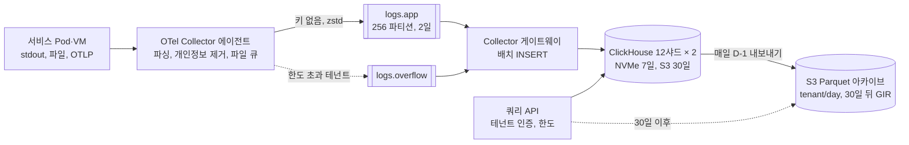

서비스 3,000개가 하루 30TB의 애플리케이션 로그를 남기고, 장애가 나면 개발자는 지난 7일에서 trace ID 하나나 에러 문자열 하나를 몇 초 안에 찾아야 한다. 같은 데이터를 최근 7일은 빠르게 찾고 90일에서 1년치는 거의 읽지 않으면서 싸게 남겨야 해서, 무엇을 미리 색인하느냐가 검색 속도와 저장 비용을 함께 정한다.

기준: OpenTelemetry Collector 0.165, Fluent Bit 5.2, Vector 0.62, Kafka 4.4, ClickHouse 26.10, OpenSearch 3.10, Elasticsearch 9.5, Loki 3.7 (2026-11).

## 요구사항과 규모 가정

기능 요구사항은 다섯 가지다. 쿠버네티스 Pod와 VM의 stdout, 파일, OTLP 로그를 모은다. 서비스, 시간 범위, 심각도, 본문 단어로 찾는다. trace ID 하나로 여러 서비스의 로그를 모은다. 서비스별 분당 에러 수 같은 집계를 낸다. 테넌트(서비스를 가진 팀)마다 보존 기간을 7일, 30일, 90일, 1년 중에서 고른다. 비기능 요구사항은 로그가 생긴 뒤 30초 안에 검색되고, 7일 안에서 서비스 하나와 1시간 범위를 거는 쿼리가 p95 3초 안에 끝나고, 30일 이후는 분 단위 응답을 허용하는 것이다. 전달은 at-least-once이고 중복 몇 줄은 허용한다. 개인정보는 저장 전에 지운다. 앱·웹 이벤트를 레이크로 모으는 일은 [이벤트 로그 파이프라인 글](/posts/design-event-log-pipeline/)의 몫이고, 여기서는 운영 로그만 다룬다. 아래 숫자는 모두 가정이다.

| 항목 | 계산 | 값 |
|---|---|---|
| 하루 원본 | 서비스 3,000개 × 평균 10GB | 30TB |
| 하루 줄 수 | 30TB / 줄당 500B | 600억 줄 |
| 평균 초당 | 600억 / 86,400 | 약 69만 줄/s, 약 347MB/s |
| 피크 초당 | 평균 × 3 | 약 208만 줄/s, 약 1.04GB/s |
| Kafka 디스크 | 30TB × 1/5(zstd) × 복제 3 × 보관 2일 | 36TB |
| Kafka 파티션 | 피크 208만 / 파티션당 소비 1만 줄/s | 208개 필요, 256개로 잡는다 |
| ClickHouse 하루 | 30TB × 1/10(압축) × 1.3(인덱스) | 약 4TB |
| 로컬 디스크 7일 | 4TB × 7일 × 레플리카 2 | 56TB |
| ClickHouse의 S3 구간 8~30일 | 4TB × 23일 × 레플리카 2 | 184TB, 월 약 $4,000 |
| 아카이브 1년 | 30TB × 1/10(Parquet zstd) × 365일 | 1,095TB, 월 약 $6,000 |
| 샤드 수 | 피크 1.04GB/s / 샤드당 100MB/s | 10.4개 분량, 12샤드 × 2 = 24대 |

S3 단가는 us-east-1 공개 가격표 기준으로 Standard가 GB-월 $0.021~0.023, Glacier Instant Retrieval(GIR)이 $0.004다. 아카이브는 첫 30일 90TB를 Standard에, 나머지 1,005TB를 GIR에 둔 값이고, 모든 테넌트가 1년을 고른 최악이다.

## 전체 구조



노드마다 뜬 에이전트가 파일을 tail하고, OTLP 로그 모델의 필드(시각, 심각도, trace ID, span ID, 리소스 속성)로 바꾼 뒤 Kafka에 쓴다. Kafka는 ClickHouse가 느려지거나 멈춰도 2일치를 받아 두는 완충이다. [Kafka 보존 글](/posts/kafka-log-retention-and-compaction/)대로 Kafka는 닫힌 세그먼트를 통째로 지우므로 2일은 최소 보관 기간이다. 게이트웨이는 Kafka에서 읽어 큰 배치로 ClickHouse에 넣는다. ClickHouse는 7일까지 로컬 NVMe에, 30일까지 S3 디스크에 part를 두고 그 뒤 지운다. 매일 전날 데이터를 테넌트와 날짜 경로의 Parquet으로 한 번 내보내고, 30일이 지난 조회는 쿼리 API가 이 파일을 직접 읽는다.

## 핵심 키워드

| 키워드 | 한 줄 뜻 |
|---|---|
| 역색인 | 단어마다 그 단어가 든 문서 목록을 미리 만들어 두는 색인 |
| 스트림 | Loki에서 레이블 조합 하나. 색인은 레이블만 갖고 본문은 압축 chunk에 있다 |
| 스킵 인덱스 | ClickHouse가 granule 묶음마다 요약을 남겨 읽지 않을 범위를 고르는 보조 색인 |
| granule | ClickHouse 정렬 키 색인의 단위. 기본 8,192행 |
| text 인덱스 | ClickHouse의 토큰 단위 역색인. 26.2부터 GA |
| 고카디널리티 필드 | trace ID, 사용자 ID처럼 고유값이 거의 줄마다 다른 필드 |
| 테넌트 | 보존 기간과 한도를 따로 갖는 단위. 이 설계는 서비스를 가진 팀 |
| 파싱 시점 | 필드를 적재할 때 뽑느냐 쿼리할 때 뽑느냐 |

## 본문 전체 역색인 대신 컬럼 저장과 스킵 인덱스를 고른다

로그를 찾게 하는 방법은 무엇을 미리 색인하느냐로 세 갈래다. OpenSearch와 Elasticsearch는 본문 단어까지 역색인한다. 단어 검색이 가장 빠른 대신 색인과 원본을 레플리카만큼 로컬 디스크에 둔다. 색인 크기를 원본의 0.5배로만 잡아도 7일 hot에 레플리카 포함 210TB가 들고, Elasticsearch가 권하는 샤드 크기 10~50GB의 위쪽으로 잡아도 하루 주 샤드 300개, 7일이면 레플리카 포함 4,200개다. Elasticsearch 기본 `logs` ILM 정책은 주 샤드가 50GB이거나 30일이 되면 rollover하고, logsdb 인덱스 모드는 9.0부터 새 `logs-*-*` 데이터 스트림에 기본으로 켜지며 벤치마크에서 저장량을 최대 60% 줄였다(색인 성능 10~20% 손해). 이 절감의 바탕인 synthetic `_source`는 유료 구독 기능이다. 오래된 인덱스는 searchable snapshot으로 S3에 두고 읽을 때 캐시한다. Elasticsearch는 이 기능에 Enterprise 라이선스가 필요하고 frozen 단계는 최근 검색한 부분만 로컬에 캐시한다. OpenSearch는 ISM의 `snapshot`과 `convert_index_to_remote` 동작으로 같은 일을 하고, 그 인덱스는 `warm` 역할 노드가 읽는다.

Loki는 레이블만 색인하고 본문은 gzip(기본 `chunk_encoding`) chunk로 오브젝트 스토리지에 둔다. 저장은 가장 싸다. 대신 레이블로 고른 스트림의 chunk를 시간 범위만큼 풀어 읽어야 해서, 전 서비스 1시간 에러 grep은 원본 약 1.25TB를 훑는다. 레이블은 시리즈당 기본 15개까지이고, 사용자 ID처럼 값이 끝없는 필드를 레이블로 두면 색인이 커지고 작은 chunk가 쏟아진다.

ClickHouse는 행을 정렬 키 순서로 컬럼마다 압축해 두고, 정렬 키 색인과 스킵 인덱스로 읽을 granule을 줄인다. 이 설계는 ClickHouse를 고른다. 세 가지 질의(trace ID 조회, 에러 grep, 집계) 중 집계가 컬럼 저장에서 가장 싸고, 26.2부터 text 인덱스가 GA가 되어 본문 단어 검색도 역색인으로 할 수 있게 됐다. 엔진별로 적재할 때 무엇을 미리 하는지는 [실시간 OLAP 엔진 글](/posts/realtime-olap-engines/)에 있고, 작은 INSERT가 part를 쌓아 "too many parts"를 내는 문제도 거기 적었다. 그래서 게이트웨이는 파티션마다 수만 행 단위로 묶어 넣는다.

```sql
-- 구조만 보여 주는 스케치, ClickHouse 26.10. 이름은 예시다
CREATE TABLE logs ON CLUSTER logs (
  ts        DateTime64(9) CODEC(Delta(8), ZSTD(3)),
  tenant    LowCardinality(String),
  service   LowCardinality(String),
  severity  LowCardinality(String),
  trace_id  String CODEC(ZSTD(3)),
  body      String CODEC(ZSTD(3)),
  attrs     Map(LowCardinality(String), String) CODEC(ZSTD(3)),
  INDEX idx_trace trace_id TYPE text(tokenizer = 'array'),
  INDEX idx_body lower(body) TYPE text(tokenizer = 'splitByNonAlpha'),
  INDEX idx_attr_val mapValues(attrs) TYPE bloom_filter(0.01) GRANULARITY 1
) ENGINE = ReplicatedMergeTree
PARTITION BY toDate(ts)
ORDER BY (tenant, service, ts)
TTL toDateTime(ts) + INTERVAL 7 DAY TO VOLUME 's3',
    toDateTime(ts) + INTERVAL 30 DAY DELETE
SETTINGS storage_policy = 'nvme_then_s3', ttl_only_drop_parts = 1;

SELECT ts, body FROM logs WHERE tenant = 'payments' AND service = 'checkout'
  AND ts >= now() - INTERVAL 1 HOUR AND hasAllTokens(lower(body), ['connection', 'timeout']);
```

정렬 키를 `(tenant, service, ts)`로 둔 건 대부분의 쿼리가 서비스 하나와 시간 범위를 걸기 때문이다. OTel Collector의 ClickHouse exporter 기본 테이블은 `(toStartOfFiveMinutes(Timestamp), ServiceName, Timestamp)`로 시간 버킷을 앞에 두는데, 이쪽은 전 서비스의 최근 몇 분을 읽는 쿼리에 유리하다. 대가는 본문 검색 비용이다. text 인덱스는 bloom filter와 달리 거짓 양성이 없지만 part마다 수십에서 수백 MB로 크고, 토큰이 수십억 개인 part를 병합할 때 메모리를 많이 쓴다.

## trace ID와 속성은 파싱하되 레이블이나 정렬 키에 두지 않는다

구조화 로그는 에이전트가 JSON을 풀어 승격 필드 몇 개만 컬럼으로 뽑고 나머지는 `attrs` 맵에 넣는다. 승격 필드는 tenant, service, severity, trace_id, span_id, host다. 형식을 모르는 평문 줄은 시각과 심각도만 정규식으로 뽑고 본문은 그대로 둔다. 필드를 적재할 때 다 뽑으면 쿼리는 빠르지만 서비스가 형식을 바꿀 때마다 파서가 깨지고, 쿼리할 때 뽑으면 파서가 안 깨지는 대신 매번 본문을 다시 읽는다. 그래서 거의 모든 쿼리에 걸리는 필드만 적재 때 뽑고, 나머지는 `extract`나 `JSONExtractString`으로 쿼리 때 뽑는다. 파싱에 실패한 줄도 버리지 않고 `parse_error` 속성을 달아 넣는다.

에이전트 후보 셋은 모두 파일을 읽어 Kafka에 쓰고 디스크에 버퍼를 둔다. OTel Collector는 filelog receiver, transform processor(OTTL), kafka exporter가 logs beta이고 `file_storage` 확장으로 영속 큐를 둔다. Fluent Bit은 tail 입력, kafka 출력, mmap 기반 파일시스템 버퍼를, Vector는 file 소스, kafka 싱크, VRL `remap`과 `redact` 함수, disk 버퍼를 쓴다. 이 설계는 OTel Collector를 고른다. trace ID와 span ID가 OTLP 로그 모델의 정식 필드라 트레이싱과 이름이 맞고, 게이트웨이도 같은 Collector의 kafka receiver와 ClickHouse exporter(logs beta)로 짤 수 있다. Kafka 레코드에는 키를 두지 않는다. 로그를 루프로 찍는 서비스 하나가 파티션 하나를 밀리게 하지 않으려는 것이다.

trace ID는 거의 줄마다 값이 달라 Loki라면 레이블이 아니라 structured metadata에 두고 `{service="checkout"} | trace_id="..."`처럼 거른다. 실험 기능인 bloom 가속을 켜지 않으면 고른 스트림의 chunk는 다 읽는다. ClickHouse에서는 정렬 키에 넣지 않고 text 인덱스로 찾는다. trace ID는 정렬 키에 없으니 7일 조회가 모든 part의 인덱스를 열지만, 값과 정확히 맞는 행만 읽는다. Parquet 아카이브의 trace ID 컬럼에는 bloom filter를 켠다. [파일 포맷 비교 글](/posts/file-formats-compared/)대로 Parquet bloom filter는 `=`와 `IN`에만 쓰이고, 고유값이 많아 min/max가 쓸모없는 컬럼을 위한 것이다.

## 로컬 7일, S3 30일, 그 뒤는 Parquet 한 벌로 남긴다

ClickHouse는 TTL로 part를 NVMe 볼륨에서 S3 디스크 볼륨으로 옮긴다. 문제는 레플리카다. S3 디스크에서도 ReplicatedMergeTree의 레플리카는 각자 자기 사본을 쓰고, 메타데이터만 복제하는 zero-copy replication은 22.8부터 기본으로 꺼져 있으며 운영에 권하지 않는다. 그래서 S3 구간의 데이터도 두 벌이다. 1년을 이 방식으로 두면 4TB × 358일 × 2 = 2,864TB, Standard 단가로 월 약 $60,000이 든다.

그래서 ClickHouse는 30일까지만 들고, 아카이브는 한 벌로 만든다. 매일 D-1을 `INSERT INTO FUNCTION s3(..., 'Parquet') PARTITION BY tenant`로 `tenant=<t>/day=<d>/` 경로에 쓰고, S3 lifecycle 규칙이 테넌트 prefix마다 보존 기간이 지나면 지운다(규칙은 버킷당 1,000개까지라 테넌트가 더 많으면 보존 기간을 경로 앞에 둔다). 1년 테넌트는 30일 뒤 GIR로 옮기고, 원본 GB-월당 비용은 0.1GB × $0.004 = $0.0004다. GIR은 최소 보관이 90일이라 90일 테넌트는 GIR에 60일만 있어도 90일치가 청구되지만, GB당 $0.004 × 3개월 = $0.012로 Standard-IA 60일($0.0125 × 2 = $0.025)보다 싸서 같은 규칙을 쓴다. GIR은 읽을 때 GB당 $0.03이 붙어 하루치 3TB를 다 훑으면 $90이다. 그래서 쿼리 API는 30일 이후 조회에 테넌트와 날짜를 필수로 받는다. 날짜 경로마다 파일이 크게 나오니 [오브젝트 스토리지 글](/posts/object-storage-semantics/)의 prefix당 초당 PUT 3,500건 한도에는 닿지 않는다.

## 테넌트 한도는 적재와 쿼리 양쪽에 건다

에이전트는 DaemonSet이라 한 노드의 Collector가 여러 테넌트의 로그를 함께 보낸다. Kafka quota(`producer_byte_rate`)는 사용자나 client-id 단위라 한 Collector 안의 테넌트를 나누지 못한다. 그래서 에이전트가 테넌트마다 분당 바이트를 세고, 하루 예산을 넘긴 테넌트의 DEBUG 줄은 버리고 나머지는 `logs.overflow`로 보낸다. overflow를 읽는 게이트웨이는 수를 적게 둬서, 한 팀의 폭주가 다른 팀의 30초 신선도를 밀지 않는다. 버린 줄 수는 테넌트별 지표로 남긴다.

쿼리 쪽은 쿼리 API가 테넌트 조건과 시간 범위를 강제로 붙이고, ClickHouse row policy로 다른 테넌트의 행을 막는다. 역할별 settings profile에 `max_execution_time`, `max_memory_usage`, `max_bytes_to_read`를 건다. ClickHouse workload scheduling은 기본으로 꺼져 있고, `CREATE RESOURCE`와 `CREATE WORKLOAD`로 CPU, 메모리, 디스크 IO를 대화형 조회와 아카이브 내보내기 사이에 비율로 나눈다. Loki는 이 부분이 기본 내장이다. `X-Scope-OrgID` 헤더로 테넌트를 나누고 `ingestion_rate_mb`(기본 4), `max_global_streams_per_user`(기본 5,000), `split_queries_by_interval`(기본 1h) 같은 한도를 테넌트마다 덮어쓴다.

개인정보는 Kafka에 닿기 전에 지운다. Collector의 transform processor가 OTTL `replace_pattern`으로 이메일과 전화번호 패턴을 가리고, 요청 헤더의 토큰과 쿠키 속성은 지운다. redaction processor는 logs가 alpha라 쓰지 않는다. 사용자 ID는 조인에 필요하면 HMAC 토큰으로 바꾼다. [접근 제어와 개인정보 글](/posts/data-access-control-and-pii/)대로 그냥 해시하거나 모든 행에 같은 salt를 섞은 값은 전수 대입으로 되돌릴 수 있어, 데이터 밖에 둔 키로 HMAC을 만든다.

## 선택지 비교

| | 이 설계: ClickHouse + Parquet 아카이브 | OpenSearch·Elasticsearch | Loki |
|---|---|---|---|
| 색인 | 정렬 키, text 인덱스, bloom filter | 모든 단어의 역색인 | 레이블만 |
| 에러 grep 1시간 | text 인덱스로 granule을 고른다 | 가장 빠르다 | 고른 스트림의 chunk를 다 푼다 |
| 집계 | 컬럼 스캔, 가장 싸다 | doc values 집계 | 메트릭 쿼리로 chunk를 읽는다 |
| 7일 저장 | 56TB | 210TB | 가장 작다 |
| 콜드 구간 | Parquet 한 벌, GIR | searchable snapshot, Elasticsearch는 Enterprise | 같은 chunk를 보존 기간만큼 |
| 멀티테넌시 | row policy, profile, workload를 직접 짠다 | 인덱스나 별칭으로 나눈다 | 헤더와 테넌트별 한도가 내장 |
| 운영 부담 | 병합과 part 수 관리 | 샤드 수와 힙 관리 | 레이블 설계 관리 |

본문 검색이 대부분이고 집계가 드물면 OpenSearch 쪽이 맞고, 쿼리가 거의 서비스와 시간으로만 좁혀지면 Loki가 가장 싸다.

## 장애와 재처리

| 장애 | 복구 |
|---|---|
| Kafka에 쓰지 못함 | 에이전트 영속 큐가 노드 디스크에 쌓는다. 큐가 차면 새로 들어오는 로그가 버려지므로 그 수를 센다 |
| ClickHouse가 느리거나 멈춤 | Kafka 2일이 완충이다. 게이트웨이는 커밋된 오프셋부터 다시 넣는다 |
| 재시도로 같은 배치가 다시 들어감 | Replicated 테이블은 최근 블록 10,000개와 1시간(`replicated_deduplication_window`, `replicated_deduplication_window_seconds` 기본) 안의 해시로 블록 전체가 같은 재시도만 건너뛴다. 6시간 멈춘 뒤의 재시도는 걸러지지 않는다. 배치 경계가 바뀐 중복은 남기고 허용한다 |
| 파싱 불가 줄 | 버리지 않고 본문 그대로 `parse_error`를 달아 넣는다 |
| 아카이브 내보내기 실패 | 그 날짜 경로를 지우고 같은 쿼리로 다시 쓴다. ClickHouse에 30일이 있어 그 안에서만 다시 만들 수 있다 |
| ClickHouse 데이터 손실 | 아카이브 Parquet을 `s3()` 테이블 함수로 읽어 다시 넣는다. 아직 내보내지 않은 날짜는 Kafka 2일에서 다시 읽는다 |

지켜볼 지표는 여섯 개다. 에이전트 영속 큐 크기와 버린 줄 수, 게이트웨이 컨슈머 lag(시간 단위), ClickHouse 파티션당 활성 part 수와 INSERT 지연, 테넌트별 적재 바이트와 overflow 비율, 쿼리 p95와 한도로 거절된 쿼리 수, 아카이브 내보내기의 완료 시각과 날짜별 행 수 대조다.

## 규모가 10배가 되면

하루 300TB, 피크 약 10.4GB/s다. 샤드를 120개, 노드를 240대로 늘리면 샤드당 하루 50억 줄은 지금과 같다. 그만큼 늘리기 전에 먼저 닿는 곳은 ClickHouse 병합이다. text 인덱스는 병합 때 다시 만들어지며 토큰이 많을수록 메모리를 많이 쓴다. 본문 text 인덱스는 INFO 이상 테이블에만 두고 DEBUG는 인덱스 없는 별도 테이블로 나눈다. text 인덱스는 2^32(약 42억) 행이 넘는 part에는 만들어지지 않지만, 줄당 압축 크기가 약 67B라 기본 병합 상한 150GiB(`max_bytes_to_merge_at_max_space_in_pool`) part도 약 24억 행이어서 아직 닿지 않는다. Kafka는 파티션 2,080개 남짓이 필요해 클러스터를 지역이나 테넌트 묶음으로 나눈다. 아카이브는 월 약 $60,000이 되어, 보존 1년은 기본값이 아니라 예산을 가진 테넌트만 고르게 하고 DEBUG는 샘플링한다. 서비스별 분당 에러 수 같은 고정 집계는 materialized view로 미리 만들어 원본 스캔에서 뺀다.

## 참고 자료

- [Elasticsearch: Size your shards](https://www.elastic.co/docs/deploy-manage/production-guidance/optimize-performance/size-shards), [Logs data streams (logsdb)](https://www.elastic.co/docs/manage-data/data-store/data-streams/logs-data-stream), [Searchable snapshots](https://www.elastic.co/docs/deploy-manage/tools/snapshot-and-restore/searchable-snapshots), [`logs@lifecycle.json` (v9.5.6)](https://github.com/elastic/elasticsearch/blob/v9.5.6/x-pack/plugin/core/template-resources/src/main/resources/logs@lifecycle.json)
- [OpenSearch 3.10: ISM supported operations](https://docs.opensearch.org/latest/im-plugin/ism/policies-operations/), [Searchable snapshots](https://docs.opensearch.org/latest/tuning-your-cluster/availability-and-recovery/snapshots/searchable_snapshot/); [Grafana Loki 3.7: Labels](https://grafana.com/docs/loki/latest/get-started/labels/), [Structured metadata](https://grafana.com/docs/loki/latest/get-started/labels/structured-metadata/), [Configuration](https://grafana.com/docs/loki/latest/configure/)
- [ClickHouse: Full-text search with text indexes](https://clickhouse.com/docs/engines/table-engines/mergetree-family/textindexes), [MergeTree (skip indexes, TTL, storage policies)](https://clickhouse.com/docs/engines/table-engines/mergetree-family/mergetree), [Workload scheduling](https://clickhouse.com/docs/operations/workload-scheduling), [replicated_deduplication_window](https://clickhouse.com/docs/operations/settings/merge-tree-settings)
- [OpenTelemetry Collector Contrib v0.165.0 (filelog, transform, kafka, clickhouse exporter)](https://github.com/open-telemetry/opentelemetry-collector-contrib/tree/v0.165.0), [Fluent Bit: Buffering](https://docs.fluentbit.io/manual/pipeline/buffering), [Vector: Kafka sink](https://vector.dev/docs/reference/configuration/sinks/kafka/)
- [Amazon S3 storage classes](https://docs.aws.amazon.com/AmazonS3/latest/userguide/storage-class-intro.html), [Amazon S3 pricing](https://aws.amazon.com/s3/pricing/)

## English summary

This design stores application logs in ClickHouse for 30 days, seven on local NVMe and the rest on an S3 disk, and keeps one Parquet copy per tenant and day in S3 for up to a year. Agents built on the OpenTelemetry Collector parse a few promoted fields, remove personal data, and write unkeyed records to Kafka, which buffers two days if ClickHouse slows down. Trace IDs and body words are found through ClickHouse text indexes instead of the sort key, which stays tenant, service, and time. I keep the archive outside ClickHouse because each replica on an S3 disk writes its own copy in S3 Standard, while the archive is one copy that moves to Glacier Instant Retrieval after 30 days, so a year inside the cluster would cost about ten times as much.
