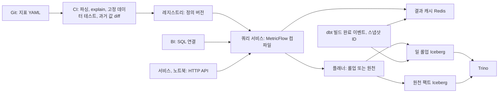

재무 대시보드의 지난달 매출과 노트북에서 다시 뽑은 매출, 주문 API가 내는 매출이 서로 다르다. 셋 다 SQL은 맞게 돌았고, 누구는 환불을 뺐고 누구는 주문 항목에 주문을 조인하다 배송비를 여러 번 더했다. 지표 계층은 "매출", "활성 사용자", "전환율"의 정의를 한 곳에 코드로 두고 모든 소비자가 그 정의에서 SQL을 받게 하는 구조인데, 어려운 곳은 정의를 모으는 일보다 조인 경로, 더할 수 없는 지표, 캐시 무효화, 권한, 정의가 바뀔 때의 과거 숫자다.

기준: MetricFlow 0.214(dbt Core 1.12), Cube Core 1.8, Trino 484, Superset 6.1과 7.0 RC (2026-11).

## 요구사항과 규모 가정

기능 요구사항은 다섯 가지다. 지표를 measure, dimension, entity와 조인 키, 시간 grain, 기본 필터로 정의하고 Git 리뷰를 거쳐 버전으로 배포한다. 지표 이름, 묶을 차원, grain, 필터를 받으면 엔진용 SQL을 만든다. BI 도구는 SQL로, 서비스와 노트북은 HTTP API로 같은 정의를 쓴다. 사용자마다 볼 수 있는 행을 정의에 상관없이 제한한다. 정의를 바꾸면 영향받는 대시보드와 과거 값 차이를 알린다. 비기능 요구사항은 대시보드 쿼리 p95 2초 안, 같은 입력 데이터와 같은 정의 버전이면 어느 경로로 물어도 같은 숫자, 원천 갱신 뒤 15분 안에 캐시 반영, 원천 팩트 3년 보관, 엔진 스캔량을 원천 전체 스캔보다 몇 자릿수 줄이는 비용이다. 아래 숫자는 가정이다.

| 항목 | 값 | 계산 |
|---|---|---|
| 정의 | 지표 300개, semantic model 40개, 변경 PR 주 20건 | |
| 대시보드 쿼리 | 24만/일, 피크 13.3/s | 조회 3만 × 차트 8개, 09시 한 시간에 20%: 48,000 ÷ 3,600 |
| API, 노트북 쿼리 | 50만/일, 평균 5.8/s, 피크 17.4/s | 500,000 ÷ 86,400 = 5.79, 피크 3배 |
| 합계 피크, 엔진 도달 | 약 31/s, 3.1/s | 13.3 + 17.4 = 30.7, 결과 캐시 적중 90% |
| 원천 이벤트 팩트 | 1억 행/일, 8 GB/일, 연 2.9 TB | 행당 80 B(Parquet), 8 × 365 = 2,920 GB |
| 30일 쿼리를 원천에서 | 쿼리당 240 GB, 하루 17.8 PB | 8 GB × 30일, 전체 74만 × 미적중 10% = 7.4만 × 240 GB |
| 일 롤업 | 3만 행/일, 최대 69 MB/일, 연 최대 25 GB | 국가 20 × 플랫폼 3 × 채널 10 × 카테고리 50, measure 30개 × 8 B = 7.2 MB, HLL 스케치 행당 최대 2 KB(4,096 버킷 × 4비트) = 61 MB |
| 결과 캐시 | 약 400 MB | 하루 고유 쿼리 2만 × 결과 20 KB |

원천만으로는 하루 17.8 PB를 읽어야 하니 대시보드 경로는 롤업이 받아야 한다. 롤업은 하루 3만 행이라 날짜 파티션 하나로 충분하고, 결과 캐시는 Redis 한 대에 들어간다. 롤업에 없는 차원이나 정확한 고유 수는 원천으로 가고, 이 경로만 엔진 동시성을 쓴다.

## 전체 구조



정의는 Git의 YAML이고, CI를 통과한 커밋이 레지스트리에 새 버전으로 올라간다. 쿼리 서비스는 요청을 받아 오픈소스 MetricFlow로 SQL을 만들고, 정책 술어를 넣은 뒤 롤업으로 답할 수 있는지 플래너가 고른다. 결과는 정의 버전, 데이터 스냅샷, 정책을 키에 넣어 Redis에 둔다. dbt가 팩트와 롤업을 다시 쓰면 완료 이벤트가 새 스냅샷 ID를 알리고, 그 테이블을 읽는 캐시 키는 더 이상 맞지 않게 된다.

## 핵심 키워드

| 키워드 | 한 줄 뜻 |
|---|---|
| semantic model | 테이블 하나에 붙인 entity, dimension, measure 정의 |
| entity | 조인 키. primary, unique, foreign, natural로 나뉜다 |
| measure, metric | 컬럼을 집계하는 식과, 그것을 이름 붙여 내보내는 지표 |
| `metric_time`, grain | 지표의 기준 시각과 묶는 단위(일, 주, 월) |
| fan-out | 1:N 조인으로 1쪽 행이 복제돼 합계가 커지는 현상 |
| chasm trap | 공통 차원 하나에 팩트 둘을 붙여 서로를 곱하는 조인 |
| ratio metric | 분자와 분모를 각각 집계한 뒤 나누는 지표 |
| non-additive | 고유 수, 비율, 백분위처럼 부분 합을 더해 전체를 만들 수 없는 값 |
| HLL 스케치 | 합칠 수 있는 근사 고유 수 상태. Trino `approx_set`, `merge`, `cardinality` |
| 롤업 | 자주 묻는 차원 조합으로 additive measure를 미리 더해 둔 테이블 |
| 스냅샷 ID | Iceberg 테이블 커밋마다 생기는 버전. 캐시와 롤업의 데이터 버전 |

## 조인 경로는 집계한 뒤에 붙이고 1:N 방향은 막는다

주문 테이블의 배송비를 주문 항목과 조인한 뒤 `SUM`하면 항목 수만큼 배송비가 더해진다. 막는 방법은 셋이다. Looker의 symmetric aggregates는 1:N 조인을 허용하고, 기본 키를 해시해 `SUM DISTINCT`로 1쪽 값을 한 번만 더한다. 모델에 고유 기본 키와 맞는 relationship을 적어야 하고, 틀리면 조용히 틀린다. 두 번째는 조인을 N:1 방향만 허용하고, 각 measure를 자기 테이블의 grain에서 먼저 집계한 뒤 요청한 차원으로 붙이는 방식이다. MetricFlow가 이쪽이다. 붙이려는 쪽 entity가 primary나 unique일 때만 left join하고, foreign entity 쪽으로 붙는 조인은 fan-out으로 보고 거절하며, 여러 팩트의 measure는 각자 집계한 결과를 full outer join한다. 다중 홉은 두 홉까지다. 세 번째는 넓은 테이블 하나에 미리 조인해 두는 방식이다. 이 설계는 두 번째를 고른다. 금지된 조인은 컴파일 에러로 드러나니 틀린 숫자가 대시보드까지 가지 않는다. 비용은 표현할 수 없는 질문이 생긴다는 점이다. "주문 항목 카테고리별 배송비"는 배송비를 항목에 어떻게 나눌지 정한 브리지 모델을 따로 만들어야 답이 나온다.

```sql
-- 구조만 보여 주는 스케치: measure마다 자기 grain에서 집계한 뒤 차원으로 붙인다
WITH rev AS (SELECT order_date, SUM(net_amount) AS revenue FROM fct_order_items GROUP BY 1),
     ship AS (SELECT order_date, SUM(shipping_fee) AS shipping FROM fct_orders GROUP BY 1)
SELECT COALESCE(r.order_date, s.order_date) AS order_date, r.revenue, s.shipping
FROM rev r FULL OUTER JOIN ship s ON r.order_date = s.order_date;
```

비율도 같은 원칙이다. 전환율은 분자 metric과 분모 metric을 요청 grain까지 각각 집계한 뒤 나누고, MetricFlow ratio metric도 분자와 분모가 서로 다른 semantic model이면 서브쿼리에서 따로 계산해 공통 차원으로 조인한 뒤 나눈다. 일별 전환율을 평균 내는 정의는 리뷰에서 막는다. 평균은 날마다 다른 방문자 수의 가중치를 지운다. 고유 사용자 수는 합이 아니라 합집합이라, 일 롤업의 값을 더해 주간 값을 만들 수 없다. 분자와 분모를 넣고 고유 수는 원천에서 세는 이유는 [지표 테이블 grain 글](/posts/metric-table-grain/)에 적었다. 이 설계는 `active_users`를 두 벌로 둔다. 정확한 값은 원천에서 `COUNT(DISTINCT)`로 세고, `active_users_approx`는 롤업에 HLL 스케치 컬럼을 넣어 `merge` 뒤 `cardinality`로 낸다. Trino 484의 `approx_set`은 버킷 4,096개 HLL(소스 기준)이라 표준 오차가 약 1.6%(1.04/√4096)로, `approx_distinct` 기본값 2.3%보다 작다. 근사 지표는 이름과 설명에 근사임을 적는다.

## 정의는 Git에 두고 바뀌면 버전과 과거 diff를 같이 낸다

정의는 저장소의 YAML 파일이다. 지표마다 소유 팀, 설명, 기본 필터, 근사 여부, 상태(`active`, `deprecated`)를 둔다. MetricFlow 지표 타입은 simple, ratio, cumulative, derived, conversion 다섯 가지이고, simple metric의 `agg`는 `sum`, `count_distinct`, `average`, `percentile` 같은 값을 받는다. 아래 스케치의 필드 이름은 이 설계에서 정한 것이다.

```yaml
# 구조만 보여 주는 스케치
metrics:
  - name: net_revenue
    version: 3
    owner: finance-data
    type: simple
    agg: sum
    expr: gross_amount - coupon_amount + adjustment_amount
    filter: is_test_order = false
    status: active
    changed: "v3: 테스트 주문 제외 (2026-11-01부터 과거 전체 재계산)"
```

정의를 고친 PR이 올라오면 CI는 네 단계를 돈다. 파싱과 조인 경로 검증, MetricFlow가 엔진에 보내는 explain으로 컬럼과 함수가 실제로 있는지 확인, 고정 입력 데이터에 대한 기대값 테스트, 운영 데이터로 옛 버전과 새 버전의 최근 13개월 값을 나란히 뽑은 diff다. 고정 데이터 테스트는 fan-out이 생기는 주문 하나, 환불 하나, 테스트 주문 하나를 넣고 손으로 계산한 값과 비교한다. 모델 SQL 로직을 고정 입력으로 보는 unit test와 만들어진 데이터를 보는 data test의 차이는 [dbt 증분 모델 글](/posts/dbt-incremental-models/)에 있다. diff는 PR 댓글로 붙어 리뷰어가 과거 숫자가 얼마나 움직이는지 보고 승인한다.

의미가 바뀌는 변경은 버전을 올린다. 쿼리는 버전을 생략하면 최신 `active` 버전을 받고, 대시보드는 저장할 때 버전을 고정한다. 새 버전이 나오면 옛 버전은 4주 동안 `deprecated`로 같이 계산되고, API 응답 헤더와 BI 차트 설명에 경고를 붙이고, 사용량이 0이 되거나 기한이 지나면 내린다. 과거 값이 바뀌는 변경은 변경 로그 테이블에 버전, 적용일, diff 요약을 남기고, 대시보드는 차트에 그 날짜를 주석으로 그린다. 비용은 같은 지표가 몇 주 동안 두 벌 계산된다는 점이다. 원천 마트에는 분자와 분모 컬럼만 두고 나눗셈은 metric에서만 하는 구성은 [커머스 웨어하우스 설계 글](/posts/design-commerce-warehouse/)과 같다.

## 롤업은 더할 수 있는 measure만 받고 스냅샷 ID로 무효화한다

사전 집계는 두 층이다. 일 롤업은 자주 묻는 차원 조합으로 additive measure와 HLL 스케치를 더해 둔 Iceberg 테이블이고, 결과 캐시는 컴파일된 쿼리의 결과다. 플래너는 쿼리의 모든 measure가 additive이고, 요청한 차원과 필터 차원이 모두 롤업에 있고, grain이 일 이상이고, 롤업이 요청과 같은 정의 버전으로 만들어졌을 때만 롤업으로 보낸다. Cube의 pre-aggregation 매칭 규칙도 같은 모양이다. 쿼리의 leaf measure가 모두 additive여야 하고, 차원, 필터 차원, measure가 pre-aggregation에 모두 있어야 하며, `one_to_many` 관계로 measure가 곱해지면 쓰지 않는다. Cube 문서가 `count_distinct_approx`를 `count_distinct`와 달리 additive라 rollup pre-aggregation에 쓸 수 있다고 구분하는 것도 위의 정확, 근사 두 벌과 같다.

무효화 방법은 셋이다. TTL만 두면 구현은 쉽지만 원천이 바뀐 뒤 TTL 동안 옛 값을 낸다. 둘째는 원천에 변경 검사 쿼리를 주기적으로 던지는 방식이다. Cube pre-aggregation의 `refresh_key`는 기본이 `every: 1 hour`이고, `sql`에 `MAX(updated_at)` 같은 쿼리를 주면 그 쿼리를 기본 10초마다 돌려 결과가 바뀔 때만 다시 만든다. 셋째는 데이터 버전을 키에 넣는 방식이다. 이 설계는 셋째를 고른다. dbt 빌드가 끝나면 쓴 테이블과 새 Iceberg 스냅샷 ID를 이벤트로 내고, 롤업 빌더는 바뀐 날짜 파티션만 다시 만들고, 쿼리 서비스는 읽는 테이블들의 현재 스냅샷 ID를 캐시 키에 넣는다. 옛 키는 아무도 읽지 않다가 TTL로 사라진다. 배치 버전을 캐시 키에 넣는 방식과 그 비용은 [읽기 API 캐시 글](/posts/read-api-caching/)에 적었다. 비용은 큰 백필 뒤에 그 테이블의 캐시가 한꺼번에 비어 엔진으로 몰린다는 점이고, 대시보드 상위 쿼리 목록을 빌드 이벤트 직후 미리 데워 줄인다.

dbt 플랫폼에서는 같은 일을 하는 기능이 있다. Semantic Layer와 그 GraphQL, JDBC(Arrow Flight SQL), Python SDK API는 Starter 이상 플랜이고, saved query의 export로 결과를 `dbt_sl_cache` 스키마에 미리 만드는 declarative caching은 Enterprise 이상이다. 이 캐시는 상위 모델이 캐시보다 새 데이터를 가지면 무효화되지만, 캐시에서 답할 때는 보안 컨텍스트가 쿼리 시점에 적용되지 않는다. 이 설계가 오픈소스 MetricFlow를 컴파일러로만 쓰고 서빙과 캐시를 직접 두는 이유가 이 두 가지다. MetricFlow는 0.209.0부터 Apache 2.0이고, Trino와 Athena SQL 렌더러를 갖고 있다.

## 행 권한은 컴파일 단계에서 넣고 엔진 권한을 바닥으로 둔다

권한을 집행할 수 있는 자리는 BI 도구, 지표 계층, 엔진 셋이다. BI 도구에만 두면 API와 노트북이 비켜 간다. Superset RLS는 Regular 필터(지정한 역할에만 WHERE 절 적용)와 Base 필터(지정한 역할 외 모두에 적용)를 데이터셋에 걸지만 Superset을 거치는 쿼리에만 걸린다. 엔진에만 두면 지표 계층의 서비스 계정 하나로 모든 쿼리가 나가 사용자 구분이 사라진다. 이 설계는 두 층을 쓴다. 쿼리 서비스는 요청자의 토큰에서 그룹과 속성(예: 담당 국가)을 읽어 정책 술어를 만들고, 집계 전에 각 measure 서브쿼리의 WHERE에 넣는다. 집계 뒤에 거르면 다른 국가 행이 이미 합계에 들어가 있다. 엔진에는 요청자 신원을 넘겨 Trino 접근 규칙이 컬럼과 테이블 권한을 다시 확인하게 한다. 엔진 규칙과 파일 자격 증명이 어디서 비켜 가는지는 [데이터 접근 제어 글](/posts/data-access-control-and-pii/)에 있다. 캐시와 롤업이 권한을 새게 하는 곳이다. 결과 캐시 키에는 정책 술어의 해시를 넣어, 국가 필터가 다른 사용자끼리 결과를 나누지 않게 한다. 롤업은 정책에 쓰는 차원(국가)을 반드시 포함해 만들고, 정책 차원이 없는 롤업은 정책이 걸린 사용자에게 쓰지 않는다. 비용은 정책 조합 수만큼 캐시 적중률이 떨어진다는 점이다.

서빙은 두 입구다. BI 도구와 노트북의 SQL 클라이언트는 지표를 테이블처럼 보는 SQL 엔드포인트로, 서비스는 지표 이름과 차원을 JSON으로 받는 HTTP API로 붙는다. Superset 데이터셋에도 metric을 SQL 식으로 둘 수 있지만, 그러면 정의가 두 벌이 되니 이 설계에서는 금지하고 데이터셋은 지표 계층의 SQL 엔드포인트만 가리킨다. 외부 semantic layer의 semantic view를 데이터셋 옆에 보여 주는 Superset `SEMANTIC_LAYERS` 플래그는 6.1 소스에는 없고, 7.0 RC에 기본 꺼짐, `development` 단계로 들어 있다.

## 선택지 비교

| | 오픈소스 MetricFlow + 자체 서빙(이 설계) | Cube Core | BI 도구 안의 정의(LookML, Superset 데이터셋) |
|---|---|---|---|
| 라이선스 | Apache 2.0, 서빙과 캐시는 직접 구현 | 백엔드 Apache 2.0, 클라이언트 MIT | Looker는 상용, Superset은 Apache 2.0 |
| fan-out 처리 | foreign 쪽 조인 거절, 집계 후 조인 | `one_to_many`로 곱해지면 pre-aggregation 매칭 제외 | Looker symmetric aggregates, Superset은 SQL 작성자 몫 |
| 사전 집계 | 직접 만든 롤업과 Redis | pre-aggregation을 Cube Store에 저장, `refresh_key`로 갱신 | BI 도구 캐시 |
| 소비자 | SQL 엔드포인트, HTTP API | SQL, REST, GraphQL API | 그 BI 도구 안 |
| 비용 | 서빙, 캐시, 권한 코드를 운영 | Cube의 데이터 모델 문법과 운영 | API와 노트북에 같은 정의가 닿지 않음 |

넓은 테이블 하나에 모든 차원을 미리 조인해 두는 방법도 있다. 조인 실수는 줄지만 grain이 다른 measure를 한 테이블에 둘 수 없고, 그때 기준과 지금 기준 차원을 모두 복사해야 한다. 그 거래는 [정규화와 비정규화 글](/posts/normalization-vs-denormalization/)에 정리했다.

## 장애와 재처리

롤업 빌드가 실패하면 플래너는 그 날짜 파티션을 롤업 후보에서 빼고 원천으로 보낸다. 느리지만 틀리지 않고, 원천 쿼리는 스캔 바이트 상한을 걸어 넘으면 "롤업 갱신 중" 오류로 끊는다. 원천 백필로 과거 파티션이 다시 써지면 스냅샷 ID가 바뀌어 캐시는 자연히 빗나가고, 롤업 빌더는 이벤트에 실린 날짜 범위만 다시 만든다. 잘못된 정의가 배포되면 레지스트리에서 이전 버전을 `active`로 되돌린다. 대시보드는 버전을 고정했으니 영향받는 쪽은 버전을 생략한 API 호출뿐이고, 그 기간의 캐시 키와 잘못된 버전으로 만든 롤업은 정의 버전이 달라 섞이지 않는다. 롤업과 원천이 어긋나는 경우를 잡으려고 매일 무작위 차원 조합 50개를 두 경로로 계산해 비교한다. 고유 수 근사 지표는 정확 값과의 상대 오차가 표준 오차의 3배를 넘으면 경고한다.

| 볼 지표 | 경고 기준 예 |
|---|---|
| 결과 캐시 적중률 | 1시간 평균 80% 아래 |
| 롤업 경로 비율 | 대시보드 쿼리 중 90% 아래 |
| 롤업 신선도(원천 최신 스냅샷 시각과 롤업 빌드 기준 스냅샷 시각 차이) | 15분 이상 |
| 쿼리 p95, 원천 경로 스캔 바이트 | 2초 이상, 상한 근처 쿼리 급증 |
| 롤업과 원천 대사 차이 | 0이 아닌 조합 1건 이상 |
| `deprecated` 버전 사용량 | 기한 1주 전에 0이 아님 |

## 규모가 10배가 되면

피크 310/s, 결과 캐시 90% 적중이면 엔진에 31/s가 온다. 먼저 막히는 곳은 롤업으로 못 받는 원천 경로다. 정확한 고유 수와 롤업에 없는 차원 쿼리가 Trino 동시성을 먹으니, 쿼리 로그에서 원천으로 간 차원 조합 상위를 골라 주 단위로 롤업을 추가하고, 정확한 주간·월간 고유 수는 매일 밤 미리 계산한다. 다음은 롤업 조합 수다. 차원 하나를 더할 때마다 행 수가 곱으로 늘어나니 롤업을 하나로 키우지 않고 쿼리 패턴별 작은 롤업 여러 개로 나눈다. 정책 조합이 늘면 캐시 적중률이 먼저 떨어지므로, 정책 차원으로 미리 쪼갠 롤업이 캐시보다 효과가 크다. 지표가 3,000개가 되면 CI의 과거 diff가 PR마다 무거워져, 바뀐 정의와 그것을 참조하는 derived metric만 골라 돌린다.

## 참고 자료

- [dbt: Join logic](https://docs.getdbt.com/docs/build/join-logic), [Ratio metrics](https://docs.getdbt.com/docs/build/ratio), [Metrics overview](https://docs.getdbt.com/docs/build/metrics-overview)
- [dbt Semantic Layer caching](https://docs.getdbt.com/docs/use-dbt-semantic-layer/sl-cache), [Semantic Layer APIs](https://docs.getdbt.com/docs/dbt-cloud-apis/sl-api-overview), [JDBC API](https://docs.getdbt.com/docs/dbt-cloud-apis/sl-jdbc)
- [MetricFlow README (license)](https://github.com/dbt-labs/metricflow)
- [Cube: Matching queries with pre-aggregations](https://docs.cube.dev/docs/pre-aggregations/matching-pre-aggregations), [Pre-aggregations reference (refresh_key)](https://docs.cube.dev/reference/data-modeling/pre-aggregations), [Measures](https://docs.cube.dev/reference/data-modeling/measures), [Cube README](https://github.com/cube-js/cube)
- [Trino 484 HyperLogLog functions](https://trino.io/docs/current/functions/hyperloglog.html), [ApproximateSetAggregation.java](https://github.com/trinodb/trino/blob/484/core/trino-main/src/main/java/io/trino/operator/aggregation/ApproximateSetAggregation.java), [Aggregate functions](https://trino.io/docs/current/functions/aggregate.html)
- [Superset 7.0.0rc3 config.py (SEMANTIC_LAYERS)](https://github.com/apache/superset/blob/7.0.0rc3/superset/config.py), [Superset security: row level security](https://superset.apache.org/admin-docs/security/)
- [Looker: Understanding symmetric aggregates](https://docs.cloud.google.com/looker/docs/best-practices/understanding-symmetric-aggregates)

## English summary

This design keeps every metric definition as versioned YAML in Git, and an open source MetricFlow compiler turns a request into SQL for Trino. Joins only go toward primary or unique keys, each measure is aggregated at its own grain before joining, and ratios divide separately summed numerators and denominators, so fan-out and averaged ratios cannot reach a dashboard. A daily rollup answers queries whose measures are all additive, with HyperLogLog sketches for approximate distinct counts, and cache keys carry the definition version, the Iceberg snapshot ID, and a hash of the row policy. Row filters go into each subquery before aggregation, because filtering after aggregation would already include rows the user should not see.
