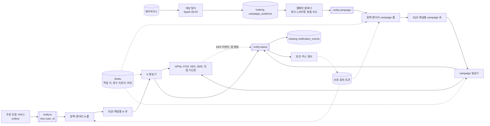

로그인 OTP와 배송 시작 알림은 몇 초 안에 나가야 하고, 오전 9시 캠페인은 같은 시각에 1,000만 명에게 나간다. 둘은 같은 FCM 프로젝트 쿼터와 같은 이메일 발송률을 나눠 쓴다. 공급자는 우리가 다시 보낸 요청을 걸러 주지 않고, 광고는 동의와 시간 규칙을 지켜야 한다. 캠페인이 몰려도 OTP가 기다리지 않게 하면서 같은 알림을 두 번 보내지 않는 것이 이 설계의 핵심이다.

기준: Kafka 4.4, Redis 8.10, Iceberg 1.12, APNs·FCM HTTP v1·Amazon SES·AWS End User Messaging SMS·Amazon SQS 문서, 정보통신망법과 같은 법 시행령 2026-10-02 시행본 (2026-11).

## 요구사항과 규모 가정

기능 요구사항은 여섯 가지다. 서비스들이 보낸 이벤트로 푸시, 이메일, SMS, 인앱 메시지를 만든다. 템플릿은 언어별로 두고 사용자 언어로 렌더링한다. 사용자는 카테고리와 채널별로 수신을 끄고, 방해 금지 시간을 정한다. 캠페인 대상은 웨어하우스 쿼리로 만든다. 발송, 도착, 열람 이벤트는 레이크로 모은다. 무효가 된 푸시 토큰과 이메일 주소는 다음 발송에서 빠진다. 비기능 요구사항은 OTP의 요청부터 공급자 접수까지 p99 3초, 푸시 캠페인 1,000만 건을 정각 회피로 닫는 시간을 빼고 30분 남짓에 끝내기(이메일 캠페인은 발송률에 맞춰 더 길다), 같은 멱등 키의 중복 발송 0에 가깝게(공급자 접수 직후 죽는 경우만 예외), 발송 이벤트 레이크 2년 보관이다. 아래 숫자는 모두 가정이다.

| 항목 | 계산 | 값 |
|---|---|---|
| 트랜잭션 알림 | 하루 1,500만 건 / 86,400 | 평균 약 174/s, 피크 ×5 약 870/s |
| OTP SMS | 하루 30만 건 / 86,400, 피크 ×10 | 평균 약 3.5/s, 피크 약 35/s |
| 9시 푸시 캠페인 | 1,000만 명 / 1,800초 | 약 5,556/s |
| 그중 FCM | Android 60%, 600만 / 1,800초 | 약 3,333/s, 프로젝트 기본 쿼터 분당 60만 = 10,000/s |
| 그중 APNs | iOS 40%, 400만 / 1,800초 | 약 2,222/s |
| 이메일 캠페인 | 400만 명 / 캠페인 몫 800/s(계정 발송률 1,000/s의 90%에서 tx 이메일 100/s를 뺀 값) | 5,000초, 약 83분 |
| 상태 이벤트 | (1,500만 + 캠페인 2,000만) × 요청·접수·도착·열람 4개 × 600B | 하루 1억 4,000만 건, 84GB/일 |
| Kafka 디스크 | 84GB × 1/4(압축) × 복제 3 × 보관 7일 | 441GB |
| 레이크 Parquet | 84GB × 1/8 | 10.5GB/일, 약 3.8TB/년 |
| 발송 워커 | 피크 5,556 + 870 = 6,426/s, 워커당 500/s | 13개, 존 하나가 빠져도 버티게 26개 |
| `notify.status` 파티션 | 피크 약 13,000/s, 컨슈머당 2,000/s | 7개 남짓 필요, 24개로 잡는다 |

## 전체 구조



서비스는 DB 트랜잭션과 함께 outbox 행을 쓰고, 그 행이 `notify.tx`로 나간다. [Kafka 멱등 프로듀서 글](/posts/kafka-idempotency/)대로 outbox 발행은 at-least-once라 받는 쪽이 이벤트 ID로 걸러야 한다. 캠페인은 06:00에 웨어하우스에서 대상을 뽑아 두고, 플래너가 9시부터 정해진 속도로 1,000명 단위 청크를 `notify.campaign`에 흘린다. 정책·렌더러는 수신 동의, 시간 규칙, 횟수 제한을 본 뒤 템플릿을 사용자 언어로 렌더링하고, 완성된 페이로드를 채널과 우선순위별 SQS 큐에 넣는다. 인앱 메시지는 공급자 대신 사용자별 수신함 테이블에 쓰고, 앱이 열릴 때 읽는다. 발송기의 결과와 SES 이벤트, 앱의 열람 이벤트는 `notify.status`를 거쳐 레이크에 쌓인다.

## 핵심 키워드

| 키워드 | 한 줄 뜻 |
|---|---|
| 멱등 키 | 같은 알림이면 몇 번 만들어져도 같은 값. tx는 `source_event_id:template:channel`, 캠페인은 `campaign_id:user_id:channel` |
| 템플릿 카테고리 | `security`, `info`, `ad` 중 하나. 동의와 시간 규칙이 이 값으로 갈린다 |
| 방해 금지 시간 | 사용자가 정한 알림을 미루는 시간대. 사용자 시간대 기준 |
| 야간 광고 동의 | 21:00부터 다음 날 08:00까지 광고를 받겠다는 별도 동의 |
| 횟수 제한 | 사용자 한 명이 하루에 받는 캠페인 수의 상한 |
| 토큰 버킷 | 초당 채워지는 토큰만큼만 보내는 속도 제한. 버킷 크기만큼 순간 몰림을 허용한다 |
| 공급자 쿼터 | FCM 프로젝트 분당 메시지 수, SES 초당 발송률, SMS 번호별 MPS |
| MPS | SMS 초당 메시지 파트 수. 긴 메시지는 파트 여러 개로 센다 |
| `expires_at` | 이 시각이 지나면 보내지 않고 버리는 기한. 재시도에도 그대로 실린다 |
| 무효 토큰 | APNs 410, FCM `UNREGISTERED`를 받은 기기 토큰 |

## 트랜잭션과 캠페인은 큐와 공급자 쿼터를 따로 쓴다

우선순위를 가르는 방법은 세 가지다. 한 큐에 우선순위 필드를 두는 방법은 워커가 높은 것부터 집어도, 이미 집어 간 캠페인 수천 건이 공급자 쿼터를 다 쓰면 OTP는 429를 받는다. 큐와 워커 풀을 나누는 방법은 대기열은 갈라도 공급자 쿼터는 여전히 같이 쓴다. FCM 쿼터는 프로젝트 단위이고, 토큰은 등록된 sender에 묶여 있어 다른 프로젝트로 보내면 `SENDER_ID_MISMATCH`가 나니, 캠페인용 프로젝트를 따로 만들어도 기존 토큰으로는 보낼 수 없다. 이 설계는 세 번째를 고른다. Kafka 토픽, SQS 큐, 워커 풀을 나누고, 공급자 쿼터도 버킷 두 개로 쪼갠다. FCM 분당 60만, 즉 초당 10,000 중 tx에 2,000/s를 떼어 두고 캠페인은 7,000/s까지만 쓴다. 남는 1,000/s는 쿼터가 분 단위로 계산되면서 생기는 오차 여유다. 대가는 tx가 한가한 시간에도 캠페인이 그 몫을 못 쓴다는 점이다.

서비스 이벤트를 받는 쪽은 Kafka다. 감사용 레이크 적재와 정책 단계가 같은 이벤트를 각자 읽고, 정책 버그가 나면 오프셋을 되돌려 다시 만들 수 있다. 키를 `user_id`로 두면 한 사용자의 결제 완료와 배송 시작이 정책 단계에 순서대로 들어온다. [파티션과 lag 글](/posts/kafka-partitions-and-lag/)대로 파티션 수는 늘릴 수만 있고 늘리면 키와 파티션의 대응이 바뀌니, `notify.tx`는 처음부터 피크의 몇 배인 12개로 잡는다.

건별 발송은 SQS로 넘긴다. 발송은 공급자 응답에 따라 건마다 다른 시각에 다시 시도해야 하는데, Kafka 파티션 하나에서는 한 건의 재시도가 뒤의 건을 막는다. SQS는 메시지마다 visibility timeout을 늘려 재시도 시각을 미룰 수 있고, 새로 넣는 메시지에는 message timer로 최대 15분까지 지연을 건다. `maxReceiveCount`를 넘긴 메시지는 DLQ로 간다. 워커 수도 파티션 수와 상관없이 늘린다. [메시지 큐와 분산 로그 글](/posts/message-queue-vs-log/)대로 Kafka 4.2부터 운영용인 share group도 레코드 단위 잠금과 배달 횟수를 주니, Kafka만으로 가려면 그쪽이 후보다. 대가는 SQS standard가 중복 배달을 하고 순서를 지키지 않는다는 점이다. 중복은 다음 절의 멱등 키로 막고, 인앱 수신함은 이벤트 시각으로 정렬해 순서 문제를 피한다.

## 공급자 한도는 채널별 토큰 버킷으로 지키고 응답 코드로 재시도를 가른다

| 공급자 | 한도 | 넘으면 |
|---|---|---|
| FCM HTTP v1 | 프로젝트당 분당 60만 메시지(기본), Android 기기 하나에 분당 240, 시간당 5,000 | 429 `QUOTA_EXCEEDED`, 다음 분에 다시 찬다 |
| APNs | 숫자를 공개하지 않는다. 같은 기기 토큰에 연달아 보내면 429 `TooManyRequests` | 지연 뒤 재시도. 4XX가 많으면 보내는 속도가 느려지고 연결이 끊긴다 |
| Amazon SES | 계정·리전별 24시간 발송량과 초당 발송률. 수신자 수로 센다 | `ThrottlingException`의 `Maximum sending rate exceeded`. 메시지는 버려지고 다시 보내지 않는다 |
| SMS (AWS End User Messaging SMS) | 발신 번호 종류와 국가별 MPS. 파트는 140바이트, 한글은 한 통 70자, 나눠지면 파트당 67자 | 초과분은 스로틀링된다 |

버킷은 공급자 × 우선순위마다 하나씩 Redis에 둔다. 1초짜리 키에 `INCRBY bucket:fcm:campaign:<초> 50`처럼 50개씩 빌려 가고(키에는 몇 초짜리 TTL을 함께 건다), 결과가 한도를 넘으면 다음 초까지 기다린다. 버킷 크기를 1초치로 둔 토큰 버킷을 초 단위 카운터로 근사한 것이다. 워커마다 매 건 Redis를 부르지 않으니 6,426/s에서 Redis 호출은 초당 130번 남짓이다. SES는 짧은 몰림은 받아 주지만 계속 넘기면 거절하므로 버킷 한도를 승인된 발송률의 90%로 둔다. SMS는 메시지가 아니라 파트 수로 토큰을 뺀다. OTP 템플릿은 한 파트(70자) 안에 들어가는지 등록할 때 검사한다.

재시도는 응답 코드로 가른다. FCM은 400, 401, 403, 404를 다시 보내지 않고, 429는 `Retry-After`만큼(없으면 60초) 기다리고, 500과 503은 지수 백오프에 지터를 섞는다. 요청 타임아웃은 10초 이상으로 둔다. APNs는 `BadDeviceToken`, `Unregistered`, `PayloadTooLarge` 같은 코드를 다시 보내지 않고, 5XX는 15분 뒤 재시도 대상이다. OTP에 15분은 의미가 없으니 tx 발송기는 OTP 푸시가 5XX나 타임아웃을 받으면 그 자리에서 SMS로 바꿔 보낸다. SES 스로틀링은 최대 10분 안에서 기다렸다가 다시 보낸다. 모든 재시도는 메시지에 실린 `expires_at`을 넘기면 멈추고 `expired`로 기록한다. FCM 메시지의 TTL은 0부터 2,419,200초 사이라 같은 기한을 공급자 쪽 TTL로도 넘기고, APNs에는 `apns-expiration`으로 넘긴다.

무효 토큰은 그 자리에서 지운다. APNs 410은 토큰이 무효로 확인된 시각을 밀리초로 돌려주므로, 토큰 저장소의 `updated_at`이 그보다 이를 때만 지운다. 그 사이 앱이 같은 토큰을 다시 등록했다면 지우면 안 되기 때문이다. FCM `UNREGISTERED`는 바로 지우고, `INVALID_ARGUMENT`는 같은 페이로드가 다른 기기에는 나갔을 때만 토큰 탓으로 보고 지운다. FCM은 한 달 동안 연결하지 않은 등록을 stale로 보고, Android는 270일 동안 활동이 없으면 만료시킨다. 그래서 캠페인은 60일 안에 갱신된 토큰에만 보내고(60일은 가정), tx는 모든 토큰에 보낸다. SES의 `Permanent` 반송을 받은 주소는 수신 금지 목록으로 옮긴다.

## 발송 전 검사는 멱등 키, 동의, 시간, 횟수 순서로 한다

중복은 세 군데서 생긴다. outbox가 같은 이벤트를 두 번 발행하는 경우, 정책 단계가 SQS에 넣은 뒤 Kafka 오프셋을 커밋하기 전에 죽는 경우, SQS가 같은 메시지를 두 번 주거나 발송이 visibility timeout보다 오래 걸리는 경우다. 앞의 둘은 정책 단계가, 마지막은 발송기가 막는다. 정책 단계는 처리 기록을 멱등 키로 남기고, 발송기는 공급자를 부르기 직전에 Redis에 키를 잡는다.

```text
SET send:<멱등 키> pending NX EX 120     # nil이면 GET: sent면 메시지를 지우고, pending이면 지우지 않고 visibility timeout 뒤 다시 받는다
(공급자 호출, 타임아웃 10초)
SET send:<멱등 키> sent EX 259200        # 접수되면 3일 동안 기억한다
```

`SET NX`로 확인과 저장을 한 명령으로 묶는 방법과 TTL이 지난 재전달을 못 거른다는 한계는 [Redis 중복 거르기 글](/posts/redis-dedup-and-windows/)에 있다. 처음부터 3일짜리 키를 잡으면, 키를 잡고 공급자를 부르기 전에 죽은 메시지는 영영 나가지 않는다. 그래서 `pending`은 요청 타임아웃보다 넉넉한 120초만 잡는다. 공급자가 접수한 직후, `sent`를 쓰기 전에 죽으면 120초 뒤 다시 나간다. 이 틈은 남는다. 푸시는 APNs `apns-collapse-id`(64바이트 이하)와 FCM Android 알림의 `tag`에 멱등 키의 해시를 넣어 같은 알림을 기기에서 하나로 합치게 하고, 이메일과 SMS는 드물게 두 번 나가는 것을 받아들인다.

동의 검사는 템플릿 카테고리로 갈린다. `security`(OTP, 로그인 알림)는 수신 설정과 시간 규칙을 보지 않는다. `info`(주문, 배송)는 사용자가 끈 채널을 건너뛰고, 방해 금지 시간이면 지연 테이블에 넣었다가 끝나는 시각에 다시 꺼낸다. SQS 지연은 15분까지라 몇 시간을 미루는 데는 쓰지 않는다. `ad`는 정보통신망법 제50조를 따른다. 거래 관계 예외를 빼면 명시적인 사전 동의가 있어야 하고, 수신 거부나 동의 철회 뒤에는 보내지 않는다. 21:00부터 다음 날 08:00 사이에는 별도의 사전 동의가 더 필요하고, 시행령 제61조 제2항이 이 시간 규칙의 예외 매체로 정한 것은 전자우편뿐이다. 광고에는 전송자 명칭과 연락처, 수신 거부 방법을 밝혀야 하니 `ad` 템플릿은 이 두 칸이 없으면 등록되지 않는다. 동의를 받은 날부터 2년마다 동의 여부를 확인해야 하므로(시행령 제62조의3) 선호 테이블에 `ad_consent_at`과 `night_ad_consent_at`을 따로 두고, 2년이 가까운 사용자에게 확인 메시지를 보내는 배치를 매일 돌린다. 이 설계는 한국 사용자의 야간 판단을 KST로 한다.

렌더링된 메시지가 SQS에서 기다리는 몇 분 사이에 사용자가 수신을 거부할 수 있다. 발송기는 최근 24시간에 수신을 거부한 사용자 집합을 Redis에서 한 번 더 보고, 거기 있으면 `suppressed`로 남기고 버린다. 횟수 제한은 캠페인만 센다. `INCR cap:<user_id>:<KST 날짜>`를 먼저 하고 결과가 2를 넘으면 버린다. 나중에 발송이 실패해도 카운터는 되돌리지 않으니 덜 보내는 쪽으로 틀린다. 검사를 통과한 뒤에야 렌더링한다. 템플릿은 `template_id`, 버전, 카테고리, 채널별·언어별 본문을 갖고, 언어는 `ko-KR`, `ko`, 기본 언어 순서로 찾는다. 렌더 결과가 APNs와 FCM 페이로드 한도인 4,096바이트를 넘으면 보내지 않고 `render_failed`로 남긴다.

## 9시 캠페인은 06:00에 대상을 고정하고 정각을 피해 속도를 올린다

대상을 고르는 시점은 셋 중 하나다. 9시에 웨어하우스를 직접 조회하면 쿼리가 늦어질 때 발송도 늦는다. 발송 워커가 사용자마다 조건을 다시 계산하면 서비스 DB가 9시에 몰린 읽기를 받는다. 이 설계는 06:00에 Spark로 세그먼트 쿼리를 돌려 `campaign_audience`에 `user_id`와 청크 번호(`hash(user_id) % 10,000`)를 쓰고, 그 커밋의 스냅샷 ID를 캠페인 행에 고정한다. 플래너가 재시작해도 `snapshot-id` 읽기 옵션으로 같은 대상을 다시 읽는다. 탈퇴 처리 중인 사용자는 이 단계에서 빠진다. [사용자 데이터 삭제 설계 글](/posts/design-user-data-deletion/)은 탈퇴한 사용자의 흔적을 Kafka, 레이크, 웨어하우스, 백업에서 지우는 흐름을 다룬다. 대가는 06:00 뒤에 조건을 만족하게 된 사용자가 빠진다는 점이다.

9시 정각에는 모두가 보낸다. FCM은 매시 정각 뒤 30초에서 2분 동안 트래픽이 두 배 넘게 몰린다고 밝히고, :00, :15, :30, :45 앞뒤 2분을 피하고 0에서 최대 속도까지 최소 60초에 걸쳐 올리라고 권한다. 그래서 FCM 캠페인 버킷은 09:02에 열고 5분에 걸쳐 0에서 3,500/s까지 올린다. 09:13부터 09:17, 09:28부터 09:32는 다시 닫는다. 열린 시간은 09:02~09:13, 09:17~09:28, 09:32~09:43의 33분이고, 다시 열 때마다 1분씩 올리면 600만 건을 09:43 전후에 끝낸다. APNs와 SES 버킷은 이 일정을 따르지 않고 09:00부터 연다. 캠페인 시작이 2분 늦어지는 것이 대가다.

플래너는 청크를 미리 다 넣지 않는다. 버킷 한도보다 조금 빠르게, 큐 깊이가 30초치를 넘지 않을 만큼만 흘린다. 캠페인을 멈추면 발송기가 5초 캐시로 상태를 보고 큐에 남은 메시지를 버리니 5초 남짓 안에 발송이 멈춘다. 그 검사가 없어도 큐에는 30초치만 있다. 렌더링된 메시지가 오래 쌓이지 않으니 수신 거부와 횟수 제한도 보내기 직전의 상태로 판단한다. 캠페인 `expires_at`은 캠페인 종료 시각과 21:00 중 이른 쪽이라, 장애로 밀린 광고가 야간 동의 없이 21시를 넘겨 나가는 일이 없다.

## 선택지 비교

| | 이 설계: Kafka 수집 + SQS 건별 발송 | Kafka만: 우선순위 토픽 + 재시도 토픽 | DB 발송 테이블 폴링 |
|---|---|---|---|
| 건별 재시도 지연 | visibility timeout, message timer | 지연 단계마다 재시도 토픽을 따로 둔다 | `next_attempt_at` 컬럼 |
| 한 건이 막힐 때 | 그 메시지만 늦어진다 | 같은 파티션 뒤 건이 기다린다 | 영향 없다 |
| 워커 확장 | 큐와 상관없이 늘린다 | 파티션 수까지(share group이면 넘어선다) | DB 잠금 경합이 한도다 |
| 중복 | standard 큐 중복 배달, 멱등 키로 거른다 | 리밸런스 뒤 재처리, 같다 | 행 잠금으로 적다 |

Kafka만 쓰면 운영할 시스템이 하나 줄고, 재시도 토픽은 지연 단계 수만큼 늘어난다. 하루 수만 건 규모라면 DB 테이블 하나로 충분하다.

## 장애와 재처리

| 장애 | 복구 |
|---|---|
| 공급자 5XX, 503 | 백오프로 다시 보낸다. OTP 푸시는 SMS로 바꾸고, 캠페인은 `expires_at`까지 재시도 |
| 쿼터 초과 429, SES 스로틀링 | 그 버킷 한도를 1분 동안 절반으로 내리고 메시지는 visibility timeout으로 미룬다 |
| 발송기가 접수 직후 죽음 | `pending` 120초가 지나 다시 나간다. 푸시는 collapse id와 `tag`로 합쳐진다 |
| Redis 장애 | tx는 멱등 검사 없이 보낸다(OTP 누락보다 중복이 낫다). 캠페인은 멈추고 Redis가 돌아오면 이어서 보낸다 |
| 렌더 실패, 페이로드 초과 | 정책 단계에서 `render_failed`로 남긴다. 발송기에서 5번 실패한 메시지는 DLQ로 간다 |
| 잘못된 대상이나 문구의 캠페인 | 캠페인 상태를 `cancelled`로 바꾸면 플래너가 방출을 멈추고, 발송기는 5초 캐시로 상태를 본다 |
| 정책 로직 버그 | Kafka 오프셋을 되돌리고 그 구간의 정책 처리 기록을 지운 뒤 tx를 다시 만든다. 발송기의 멱등 키가 3일 동안 남아 이미 나간 건은 다시 나가지 않는다 |

앱이 보내는 열람 이벤트는 [이벤트 로그 설계 글](/posts/design-event-log-pipeline/)처럼 SDK에서 `event_id`를 붙여 Kafka를 거쳐 레이크까지 오고, 발송 이벤트와 같은 `message_id`로 이어진다. 레이크의 `notification_events`는 `(message_id, status)`로 중복을 지운다. SES의 Open과 Click 이벤트에는 봇일 가능성을 나타내는 `isBotEvent`가 있어 열람률 계산에서 거른다.

지켜볼 지표는 여섯 개다. OTP의 요청부터 공급자 접수까지 p99, 캠페인 진행률과 계획 곡선의 차이, 공급자·응답 코드별 비율(429, 5XX, 410), 큐별 가장 오래된 메시지 나이, DLQ 깊이, SES 반송률과 수신 거부율이다.

## 규모가 10배가 되면

캠페인 1억 명이면 Android만 6,000만 건이다. 30분에 끝내려면 FCM에 33,333/s가 필요한데 프로젝트 기본 쿼터는 10,000/s라 쿼터가 먼저 막힌다. 쿼터 상향을 요청하거나 발송 시간을 늘린다. 캠페인 몫 7,000/s로는 약 143분이 걸린다. FCM은 전 세계 10만 RPS나 한 대륙 3만 RPS 규모로 발송 패턴을 바꿀 때 지원 팀에 연락하라고 하고, 33,333/s는 대륙 기준선을 넘는다. 이메일 4,000만 건은 캠페인 몫 800/s에서 약 14시간이 걸려 발송률 상향이 필요하다. 워커는 존 여유까지 260개, `notify.status`는 피크 13만/s라 컨슈머당 2,000/s로 65개 이상, 넉넉히 96개 파티션이 된다. Redis는 멱등 키가 하루 3억 5,000만 개, 키당 100바이트로 잡아 3일치 약 105GB가 되어 클러스터로 나눈다. 버킷 카운터 호출은 초당 1,300번 남짓이라 그대로 둔다. 대상 빌더는 청크 수를 10만으로 늘린다. 레이크는 하루 105GB, 1년 약 38TB가 된다.

## 참고 자료

- [Apple: Sending notification requests to APNs](https://developer.apple.com/documentation/usernotifications/sending-notification-requests-to-apns), [Handling notification responses from APNs](https://developer.apple.com/documentation/usernotifications/handling-notification-responses-from-apns)
- [Firebase: Throttling and quotas](https://firebase.google.com/docs/cloud-messaging/throttling-and-quotas), [Best practices when sending FCM messages at scale](https://firebase.google.com/docs/cloud-messaging/scale-fcm)
- [Firebase: FCM HTTP v1 ErrorCode](https://firebase.google.com/docs/reference/fcm/rest/v1/ErrorCode), [Best practices for FCM registration token management](https://firebase.google.com/docs/cloud-messaging/manage-tokens)
- [Amazon SES: Managing your sending limits](https://docs.aws.amazon.com/ses/latest/dg/manage-sending-quotas.html), [Errors related to sending quotas](https://docs.aws.amazon.com/ses/latest/dg/manage-sending-quotas-errors.html), [Event data contents](https://docs.aws.amazon.com/ses/latest/dg/event-publishing-retrieving-sns-contents.html)
- [AWS End User Messaging SMS: MPS limits](https://docs.aws.amazon.com/sms-voice/latest/userguide/sms-limitations-mps.html), [SMS character limits](https://docs.aws.amazon.com/sms-voice/latest/userguide/sms-limitations-character.html)
- [Amazon SQS delay queues](https://docs.aws.amazon.com/AWSSimpleQueueService/latest/SQSDeveloperGuide/sqs-delay-queues.html)
- [Apache Iceberg 1.12 Spark Queries (Time travel)](https://iceberg.apache.org/docs/latest/spark-queries/)
- [국가법령정보센터: 정보통신망법 제50조](https://www.law.go.kr/법령/정보통신망이용촉진및정보보호등에관한법률/제50조), [같은 법 시행령 제61조, 제62조의3](https://www.law.go.kr/법령/정보통신망이용촉진및정보보호등에관한법률시행령/제61조)

## English summary

This design sends push, email, SMS and in-app messages for both transactional events and large campaigns. Transactional and campaign traffic use separate Kafka topics, SQS queues, worker pools and provider quota buckets, because FCM counts its quota per project and tokens cannot move to another project. Each sender takes a Redis key for the idempotency key before calling a provider, holds it for 120 seconds while sending and for three days after the provider accepts it. Advertising messages follow the Korean rule that sending between 9 PM and 8 AM needs a separate consent, and campaign messages expire at 9 PM. I start the 9 AM FCM campaign at 9:02 and ramp it up because FCM traffic more than doubles in the first minutes of every hour.
