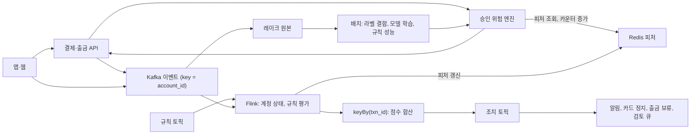

결제 승인은 100ms 안에 끝나야 하는데, 사기는 거래 하나가 아니라 순서에서 드러난다. 새 기기로 로그인하고, 비밀번호를 바꾸고, 출금 주소를 새로 등록한 뒤 30분 안에 잔액 전부를 출금한다. 네 이벤트 각각은 정상이다. 게다가 탐지 규칙은 매주 바뀌고, 어떤 거래가 사기였는지는 몇 달 뒤 차지백으로 확정된다. 그래서 승인은 늦추지 않으면서 계정 단위로 순서를 보고, 규칙은 재배포 없이 바꾸는 구조를 만든다.

기준: Kafka 4.4, Flink 2.3, Redis 8.10 (2026-11).

## 요구사항과 규모 가정

대상 이벤트는 결제, 이체, 출금과 로그인, 비밀번호·연락처 변경, 출금 주소 등록 같은 계정 이벤트다. 돈이 움직이는 거래는 처리 전에 통과, 추가 인증, 보류, 거절 중 하나로 판정한다. 사후 탐지는 몇 초 안에 알림, 카드 정지, 출금 보류 같은 조치를 낸다. 규칙은 운영자가 바꾸고, 판정마다 걸린 규칙 목록(reason code)을 남긴다. 규모 숫자는 모두 가정이다.

| 항목 | 목표 |
|---|---|
| 승인 경로 지연 | 위험 판정 p99 30ms, 승인 API 전체 100ms 안 |
| 사후 탐지 지연 | 이벤트 발생에서 조치까지 p99 5초 |
| 규칙 변경 | 재배포 없이 1분 안에 반영 |
| 설명 가능성 | 판정마다 점수, 걸린 규칙, 사용한 피처 값 보관 |

```text
거래 이벤트     하루 2,000만 건, 평균 2,000만 / 86,400 ≈ 230건/초, 피크 × 5 ≈ 1,200건/초
계정 이벤트     하루 1억 건, 평균 ≈ 1,160건/초, 피크 × 5 ≈ 5,800건/초
설계 피크       두 종류 합쳐 1만 건/초
이벤트 크기     1 KB → 피크 10 MB/s, 하루 1.2억 건 × 1 KB = 120 GB
Kafka 디스크    120 GB × 7일 × 복제 3 ≈ 2.5 TB
파티션          10 MB/s ÷ 파티션당 5 MB/s = 2개, 10배 여유를 보고 32개 (key = account_id)
계정 상태       최근 30일 활동 계정 1,000만 × 2 KB ≈ 20 GB (Flink RocksDB)
피처 저장소     1,000만 계정 × 500 B ≈ 5 GB (Redis)
승인 경로 조회  피크 1,200건/초 × Redis 조회 3회 ≈ 3,600회/초
규칙            활성 규칙 200개
```

## 전체 구조



승인 경로와 탐지 경로가 따로 있다. 결제·출금 API는 승인 위험 엔진을 동기로 부르고, 엔진은 Redis에서 계정 피처를 읽어 점수를 매긴다. Flink는 승인 경로에 없다. 모든 이벤트를 계정 키로 받아 상태를 갱신하고, 그 결과로 Redis 피처를 최신으로 유지하면서 사후 탐지 결과를 조치 토픽으로 보낸다. 레이크의 원본은 나중에 확정되는 라벨과 합쳐 모델과 규칙을 다시 맞추는 데 쓴다.

## 핵심 키워드

| 키워드 | 한 줄 뜻 |
|---|---|
| 승인 경로 / 탐지 경로 | 거래를 막을 수 있는 동기 판정과, 거래 뒤에 조치하는 비동기 판정 |
| 피처 | 규칙과 모델의 입력값. 최근 10분 결제 건수, 마지막 비밀번호 변경 시각 같은 것 |
| Broadcast State | 모든 병렬 인스턴스에 같은 상태(규칙)를 복제하는 Flink 패턴 |
| dynamic key | 이벤트 하나를 규칙마다 그 규칙의 그룹 키로 복제해 내보내는 방식 |
| reason code | 판정에 기여한 규칙 목록. 검토와 분쟁 대응의 근거 |
| 차지백 | 카드 소지자가 거래에 이의를 제기해 대금이 되돌아가는 것. 사기 라벨의 출처 |
| fail-open / fail-closed | 판정 시스템이 죽었을 때 통과시키는지, 막는지 |

## 승인 경로에 Flink를 두지 않는다

Flink는 이벤트를 모아 상태를 갱신하는 데는 맞지만, 요청 하나에 응답하는 RPC 서버가 아니다. 체크포인트와 재시작, 백프레셔가 승인 지연에 그대로 실린다. 그래서 승인은 무상태 서비스인 위험 엔진이 맡고, 엔진은 Redis 조회 몇 번과 메모리 안 규칙 평가만 한다.

대가는 피처가 몇 초 늦다는 점이다. 1초에 결제 10건을 몰아치는 공격이면, 10번째 승인 요청이 올 때 Flink는 앞의 이벤트를 아직 반영하지 못했을 수 있다. 그래서 짧은 속도 규칙은 엔진이 직접 센다. 승인할 때마다 Redis에서 계정별 분 단위 카운터를 올린다. `INCR`와 `EXPIRE`(10분)는 `MULTI`로 묶어 보내야, 둘 사이에 엔진이 죽어도 수명 없는 키가 남지 않는다. Flink를 거치지 않고 요청 안에서 바로 올리니 늦게 반영될 일이 없고, `INCR`가 원자적이라 동시 요청끼리 수를 잃지 않는다. 긴 창과 순서 패턴, 여러 이벤트 종류를 엮는 피처는 Flink가 만든다.

계정 피처는 계정마다 해시 하나로 둔다. `HSET risk:{acct_123}:features last_pw_change 1795000000 new_payee_7d 2`처럼 쓰고, 엔진은 `HGETALL` 한 번으로 읽는다. 속도 카운터 키에도 같은 해시 태그 `{acct_123}`을 붙여 클러스터에서 한 슬롯에 둔다. 클러스터 슬롯과 해시 태그는 [Redis 중복 거르기 글](/posts/redis-dedup-and-windows/)에 있다.

## 규칙은 데이터로 내려보낸다

규칙 하나는 이런 문서다.

```json
{"id": 7, "version": 3, "applies_to": ["withdrawal"], "group_by": ["account_id"],
 "agg": "sum(amount)", "window": "10m", "op": ">", "threshold": 3000000,
 "group": "velocity", "score": 40}
```

규칙 토픽을 Flink의 broadcast 스트림으로 연결하면 모든 병렬 인스턴스가 같은 규칙 맵을 갖는다. 이벤트가 오면 적용 대상인 규칙마다 `(규칙의 그룹 키 값, 이벤트, rule_id)`를 내보내고, 그 키로 `keyBy`한 다음 연산자가 키별 상태로 규칙을 평가한다. Flink 블로그의 사기 탐지 사례가 이 구조를 dynamic key라고 부르고, 이벤트가 규칙 수만큼 복제되는 비용도 함께 짚는다. 규칙 추가와 기준값 변경은 토픽에 문서 하나를 보내면 끝난다.

조심할 점이 셋이다. 첫째, broadcast state는 RocksDB에 두지 못하고 메모리에 있으며, 체크포인트에 병렬도만큼 복제된다. 규칙 200개 수준이면 문제가 없지만 규칙에 큰 목록(블랙리스트 수백만 건)을 넣으면 안 된다. 큰 목록은 Redis나 별도 조회로 뺀다. 둘째, broadcast 원소가 인스턴스마다 다른 순서로 도착할 수 있다. 그래서 규칙마다 `version`을 두고, 더 낮은 버전은 무시하게 해서 도착 순서와 상관없이 같은 상태가 되게 한다. 셋째, 새 집계 방식이나 새 순서 패턴처럼 코드가 필요한 규칙은 데이터로 못 바꾼다. 그런 규칙은 코드로 넣고, 문턱값만 broadcast 파라미터로 뺀다.

## 종류를 넘나드는 순서는 계정 상태로 잡는다

계정 탈취는 "새 기기 로그인, 비밀번호 변경, 출금 주소 등록, 30분 안 전액 출금"처럼 이벤트 종류를 넘나든다. 이벤트를 종류별 스트림으로 나누면 이 순서를 볼 수 없다. 그래서 토픽 하나에 `event_type` 필드를 두고 `account_id`로 나눈다. 계정 상태에는 최근 로그인 기기 목록, 마지막 비밀번호 변경 시각, 등록된 출금 주소와 등록 시각, 최근 입금 내역을 둔다.

순서 패턴은 FlinkCEP의 `begin().followedBy().within(Duration.ofMinutes(30))`로 쓸 수 있고, `within`이 끝난 부분 매치를 버려서 상태가 무한히 자라지 않는다. 다만 Flink 2.3 CEP 문서는 패턴을 잡 코드에서 만들고, 실행 중에 바꾸는 방법은 다루지 않는다. 그래서 바꾸려면 잡을 다시 띄운다고 보고 설계한다. 그래서 패턴이 자주 바뀐다면 `KeyedProcessFunction`으로 계정 상태와 타이머를 직접 다루는 쪽이 낫다. 이 설계는 자주 쓰는 순서 몇 개만 코드로 두고 시간 창과 점수는 파라미터로 뺀다. 시간 기준은 서버 수신 시각이고, 워터마크는 5초 뒤처지게 둔다. 계정 상태에는 30일 TTL을 걸어 한 달 넘게 활동이 없는 계정을 비운다. Flink의 state TTL은 처리 시간 기준이라, 재처리로 오래된 이벤트를 다시 읽어도 상태가 바로 지워지지 않는다. RocksDB 상태 백엔드에서는 컴팩션 필터가 만료된 값을 지운다. FlinkCEP 문서는 상태 정리를 `until()`이나 `within()`으로 하라고 하니, CEP 쪽 상태 크기는 `within`이 묶는다.

## 점수는 그룹별로 모아 합산한다

규칙마다 키가 다르다. 카드 규칙은 `card_id`, 기기 규칙은 `device_id`, 계정 규칙은 `account_id`로 평가된다. 그래서 거래 하나에 대한 결과가 여러 연산자에서 따로 나온다. 각 규칙 그룹은 `(txn_id, group, score, rule_id)`를 내보내고, 다음 연산자가 `keyBy(txn_id)`로 모은다. 모든 그룹이 보고하거나, 첫 결과 뒤 처리 시간 타이머 2초가 지나면 합산한다. 늦은 그룹은 빠진 채로 판정하고, 빠진 그룹도 기록한다.

합산은 그대로 더하지 않는다. "5분에 5건"과 "1시간에 20건"은 같은 행동에 같이 걸리므로, 같은 그룹 안에서는 최댓값만 쓰고 그룹끼리 더한 뒤 그룹마다 상한을 둔다. 블랙리스트 같은 하드 규칙은 점수와 상관없이 바로 막는다. 문턱은 거래 종류마다 다르다.

| 종류 | 되돌릴 수 있나 | 보류 | 거절 |
|---|---|---|---|
| 결제 | 대체로 가능 (취소, 차지백) | 60점 | 80점 |
| 이체 | 어려움 | 50점 | 70점 |
| 출금 | 거의 불가능 | 40점 | 60점 |

승인 엔진은 Redis 피처로 같은 규칙 그룹을 평가해 이 문턱으로 보류와 거절을 정하고, 사후 탐지는 Flink가 합산한 점수로 조치를 고른다.

되돌릴 수 없는 거래일수록 승인 경로에서 엄격하게 막는다. 결제는 일단 승인하고 사후 탐지로 취소할 여지가 있지만, 출금은 나가면 끝이다. 그래서 사후 탐지 결과를 승인 경로의 피처로 되돌린다. 예를 들어 새 기기 로그인이 잡히면 24시간 동안 출금 한도를 낮춘다.

## 라벨은 몇 달 늦게 온다

어떤 거래가 사기였는지는 차지백으로 확정된다. 카드 소지자는 카드 브랜드와 사유에 따라 다르지만 대개 거래일로부터 120일 안에 이의를 제기할 수 있고, 일부 사유는 540일까지 간다. 그래서 어제 거래로 모델을 학습하면 아직 라벨이 안 붙은 사기를 정상으로 배운다. 학습 데이터는 라벨이 대부분 들어온 4~5개월 전 거래로 만든다. 이 간격은 경험칙이라 실제로는 라벨이 도착하는 분포를 보고 정한다. 최근 구간은 검토 담당자의 판정과 사용자 신고로 빠르게 보정한다.

규칙 성능도 같은 데이터로 본다. 규칙마다 걸린 거래 수, 그중 확정된 사기 비율, 정상 거래를 막은 수를 매주 계산해서, 정밀도가 낮은 규칙은 점수를 낮추거나 끈다. 판정 기록에 reason code와 그때의 피처 값을 남겨야 이 계산이 된다.

## 장애와 재처리

Flink가 재시작하면 체크포인트에서 계정 상태와 Kafka 오프셋을 같이 되돌리고 그 뒤 이벤트를 다시 처리한다. Redis 피처 쓰기는 덮어쓰기라 결과가 같다. 조치 토픽은 `(txn_id, rule_id)`를 키로 두고 조치 서비스가 이미 처리한 키를 건너뛰어, 같은 알림이나 같은 정지가 두 번 나가지 않게 한다.

Flink가 몇 분 멈추면 Redis 피처는 오래된 값으로 남는다. 승인 엔진은 피처 해시에 들어 있는 갱신 시각을 보고, 5분 넘게 갱신이 없으면 엔진이 직접 센 카운터와 하드 규칙만으로 판정한다. 결제는 그대로 통과시키되(fail-open) 금액 상한을 낮추고, 출금은 일정 금액 위로 보류한다(fail-closed). Redis 자체가 죽으면 같은 정책을 피처 없이 적용한다. 둘 다 승인 API가 멈추지 않게 하는 선택이고, 출금 쪽은 보류된 거래를 검토 큐로 보낸다.

| 지표 | 경고 기준 |
|---|---|
| 승인 위험 엔진 p99 지연 | 30ms 초과 |
| 피처 신선도 (현재 시각 − 피처 갱신 시각) | 1분 초과 |
| Kafka 컨슈머 lag | 5분 넘게 증가 |
| 합산 타이머 만료 비율 (그룹이 빠진 판정) | 1% 초과 |
| 종류별 보류·거절 비율 | 지난주 같은 시간의 2배 |
| 규칙별 걸린 수 | 배포 직후 10배 이상 급증 |

## 선택지 비교

| | 승인 엔진 + Flink 피처 (이 설계) | 승인 서비스 안에서 전부 계산 | 배치 모델만 |
|---|---|---|---|
| 승인 지연 | Redis 조회 몇 번 | 요청마다 DB에서 이력 조회, 무거움 | 가장 빠름 (점수 조회만) |
| 순서 패턴 | 계정 상태로 몇 초 안 | 요청 시점에 과거 이력을 다시 읽어야 함 | 다음 배치까지 못 봄 |
| 규칙 변경 | broadcast로 1분 안 | 서비스 배포 | 모델 재학습 |
| 먼저 커지는 비용 | 상태와 운영 복잡도 | 원천 DB 부하 | 탐지 지연 |

## 규모가 10배가 되면

이벤트, 계정, 규칙이 모두 10배가 된다고 가정한다. 피크가 초당 10만 건, 100 MB/s가 되면 필요한 파티션은 20개라 처음 잡은 32개로 처리량은 버틴다. 파티션을 늘린다면 처리량보다 Flink source 병렬도를 더 올려야 할 때다. `account_id` 키라 파티션 수를 바꾸는 순간 같은 계정의 이벤트가 옛 파티션과 새 파티션에 나뉘고, Kafka의 파티션별 순서 보장도 그 시점에서 끊긴다. 순서 패턴은 이벤트 시각으로 판단하니 워터마크 5초 안의 뒤바뀜은 흡수하지만 그보다 큰 어긋남은 남는다. 그래서 파티션은 꼭 필요할 때 한 번에 늘린다. 먼저 커지는 건 dynamic key의 복제다. 규칙이 2,000개로 늘면 이벤트 하나가 규칙 수만큼 복제되니, 같은 그룹 키와 같은 창을 쓰는 규칙을 하나의 집계로 묶어 복제 수를 그룹 키 종류 수로 줄인다. 계정 상태는 200 GB가 되어 RocksDB 증분 체크포인트와 넉넉한 최대 병렬도가 필요하고, Redis 피처 50 GB는 클러스터 샤드를 늘려 나눈다. 승인 경로는 Redis 조회 수만 늘어서 가장 늦게 막힌다.

## 참고 자료

- [Apache Flink 2.3 Broadcast State Pattern](https://nightlies.apache.org/flink/flink-docs-release-2.3/docs/dev/datastream/fault-tolerance/broadcast_state/)
- [Apache Flink 2.3 FlinkCEP](https://nightlies.apache.org/flink/flink-docs-release-2.3/docs/libs/cep/)
- [Apache Flink 2.3 Process Function (timers)](https://nightlies.apache.org/flink/flink-docs-release-2.3/docs/dev/datastream/operators/process_function/)
- [Apache Flink 2.3 Working with State (State TTL)](https://nightlies.apache.org/flink/flink-docs-release-2.3/docs/dev/datastream/fault-tolerance/state/)
- [Alexander Fedulov, Advanced Flink Application Patterns Vol.1: Case Study of a Fraud Detection System (2020)](https://flink.apache.org/2020/01/15/advanced-flink-application-patterns-vol.1-case-study-of-a-fraud-detection-system/)
- [Alexander Fedulov, Advanced Flink Application Patterns Vol.2: Dynamic Updates of Application Logic (2020)](https://flink.apache.org/2020/03/24/advanced-flink-application-patterns-vol.2-dynamic-updates-of-application-logic/)
- [Redis HSET](https://redis.io/docs/latest/commands/hset/), [Redis EXPIRE](https://redis.io/docs/latest/commands/expire/)
- [Redis Cluster specification (hash tags)](https://redis.io/docs/latest/operate/oss_and_stack/reference/cluster-spec/)
- [Adyen, Dispute timeframes](https://docs.adyen.com/risk-management/understanding-disputes/dispute-timeframes)
- [EMVCo, EMV 3-D Secure](https://www.emvco.com/emv-technologies/3-d-secure/)

## English summary

This design detects fraud across payments, transfers and withdrawals without slowing down approval. A stateless risk engine answers each approval within tens of milliseconds by reading account features from Redis and counting short bursts itself with atomic counters. Flink is kept off the approval path: it keys every event by account, tracks cross-event sequences such as a new device, a password change and a full withdrawal within 30 minutes, and keeps the Redis features fresh. Rules arrive as data through broadcast state, so they change without a redeploy, and scores from different rule groups are merged per transaction with a short timer. Withdrawals get stricter thresholds and fail closed, because money that leaves cannot be pulled back.
