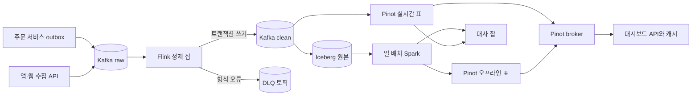

주문 수, 매출, 활성 사용자를 지역과 채널별로 분 단위로 보여 주는 대시보드를 만든다고 하자. 숫자는 수 초에서 1분 안에 화면에 올라와야 하고, 다음 날 아침 일 배치가 낸 공식 숫자와 같아야 한다. 어려운 건 빠르게 내는 일보다 빠르게 낸 숫자와 나중에 확정된 숫자가 어디서 갈리는지 미리 막아 두는 일이다.

기준: Kafka 4.4, Flink 2.3, Apache Pinot 1.6, ClickHouse 26.10, Apache Druid 39.0, Iceberg 1.12, Spark 4.3 (2026-11). Flink 2.3용 Kafka 커넥터는 아직 없어서, Kafka를 읽고 쓰는 Flink 잡은 Flink 2.2와 flink-connector-kafka 5.0.0-2.2로 돌린다고 본다.

## 요구사항과 규모 가정

기능 요구사항은 세 가지다. 분 단위 주문 수와 매출, 분 단위와 오늘 누적 활성 사용자 수를 지역 20개, 채널 5개로 자른다. 닫힌 날짜는 일 배치 숫자를 보여 준다. 날짜 경계는 KST 자정이다. 비기능 요구사항은 이렇게 둔다. 이벤트 발생부터 화면까지 p95 1분 이내, 대시보드 쿼리 p99 500ms 이내. 주문 수와 매출은 다음 날 배치와 1원, 1건까지 같아야 하고, 활성 사용자는 근사 오차 범위 안이면 된다. 실시간 서빙은 최근 3일, 일 단위 서빙은 90일, 원본은 레이크에 1년 이상 둔다. 아래 숫자는 모두 가정이다.

| 항목 | 가정 | 계산 |
|---|---|---|
| 주문 이벤트(생성, 결제, 취소) | 하루 300만 건 | |
| 활동 이벤트(화면 조회) | 하루 2억 건 | |
| 평균 처리량 | 하루 2.03억 건 | 2.03억 / 86,400 ≈ 2,350건/s |
| 피크 | 평균의 10배 | 약 23,500건/s, 1건 1KB면 23.5MB/s |
| 하루 바이트 | 1건 1KB | 2.03억 × 1KB = 203GB/일 |
| Kafka | raw, clean 두 토픽, 7일, 복제 3 | 203GB × 7 × 3 = 4.26TB, 두 토픽 약 8.5TB |
| 레이크 Parquet | 압축 뒤 1건 100B | 20.3GB/일, 1년 약 7.4TB |
| Pinot | 필요한 컬럼만, 압축 뒤 1행 40B, 복제 2 | 복제 전 8.1GB/일, 실시간 3일 약 49GB, 오프라인 90일 약 1.46TB |
| 파티션 | 따라잡기 여유 2배, 파티션당 2MB/s | 23.5 × 2 / 2 ≈ 24개 |
| 대시보드 | 동시 200명, 패널 8개, 10초마다 새로고침 | 200 × 8 / 10 = 160 QPS |

집계 결과의 크기는 작다. 하루 1,440분 × 지역·채널 100조합이면 144,000그룹이다. 무거운 건 결과가 아니라 그 결과를 만드는 2억 행과, 같은 쿼리를 반복하는 160 QPS다.

## 전체 구조



Flink 정제 잡은 집계하지 않는다. 형식을 검사하고, 테스트 계정 주문을 빼고, 주문 이벤트의 중복을 이벤트 ID로 지우고, 분 단위 시각 컬럼을 붙여 clean 토픽에 쓴다. Pinot 실시간 표와 Iceberg가 같은 clean 토픽을 읽으므로 두 층은 같은 정제 결과에서 출발한다. 일 배치는 Iceberg에서 공식 숫자를 만들고 같은 날짜를 Pinot 오프라인 표로 올린다. broker는 같은 이름의 두 표를 시간 경계로 나눠 읽는다. API는 (패널, 필터, 분) 단위로 5초 캐시를 두고 같은 키의 동시 요청은 한 번만 Pinot에 보낸다. 기본 필터에 몰려 서로 다른 키가 40개라면 Pinot에는 40 / 5 = 초당 8건만 간다.

## 핵심 키워드

| 키워드 | 한 줄 뜻 |
|---|---|
| 이벤트 시각, 수신 시각 | 사건이 일어난 시각과 서버가 받은 시각. 어느 쪽으로 분과 날짜를 자를지 먼저 정한다 |
| allowed lateness | Flink 이벤트 시간 윈도가 닫힌 뒤에도 늦은 레코드를 받아 다시 발화하는 기간. 기본 0 |
| 체크포인트 | Flink 상태와 source 오프셋을 함께 찍는 스냅숏. 트랜잭션 sink의 커밋 시점이 된다 |
| `read_committed` | 커밋된 트랜잭션의 레코드만 읽는 Kafka 컨슈머 격리 수준 |
| hybrid table | Pinot에서 같은 이름의 실시간 표와 오프라인 표를 broker가 이어 읽는 구성 |
| time boundary | hybrid table에서 오프라인과 실시간을 가르는 시각 |
| Pinot dedup | 실시간 표에서 같은 기본 키의 레코드를 버리는 기능. 키 맵을 JVM 힙에 둔다 |
| HyperLogLog | 고유 수를 고정 크기 스케치로 근사하는 구조. 합집합으로 합칠 수 있다 |
| star-tree index | Pinot에서 차원 순서대로 미리 집계해 둔 트리 |
| 대사 | 두 경로가 낸 같은 숫자를 키별로 비교해 차이를 찾는 일 |

## 분 집계를 Flink에서 할까, OLAP 엔진에 맡길까

선택지는 둘이다. Flink가 (분, 지역, 채널) 텀블링 윈도로 집계해 결과 행만 서빙 저장소에 쓰거나, 정제한 이벤트를 그대로 실시간 OLAP 엔진에 넣고 쿼리 때 집계한다. 엔진마다 적재 때 미리 해 두는 일이 다르다는 점은 [실시간 OLAP 엔진 글](/posts/realtime-olap-engines/)에 있다.

이 설계는 두 번째를 고른다. 이유는 세 가지 요구에서 나온다. 늦은 이벤트가 와도 쿼리 때 자기 분에 들어가므로 윈도를 닫고 다시 여는 규칙이 없다. 새 축(예: 결제 수단)을 더할 때 Flink 잡을 바꾸고 재처리하는 대신 컬럼만 쓰면 된다. 고유 사용자 수를 분, 시간, 오늘 누적 어느 범위로든 원본 `user_id`에서 바로 셀 수 있다.

대가는 저장과 쿼리 비용이다. 144,000그룹이면 될 결과를 2억 행으로 들고 있다. 그래서 오프라인 표에는 `dimensionsSplitOrder`를 (지역, 채널, 분)으로 둔 star-tree를 걸고 `COUNT`, `SUM`, `DISTINCT_COUNT_HLL`을 미리 집계한다. star-tree는 정확한 `DISTINCT_COUNT`를 지원하지 않으니 활성 사용자는 처음부터 HLL로 센다. Flink 집계를 고르면 반대가 된다. 저장소는 작아지지만, 고유 사용자 수는 분마다 낸 숫자를 더할 수 없어서 분 단위 스케치를 저장하고 읽을 때 합쳐야 한다. 일간 고유 수를 더하면 안 되는 이유와 스케치를 합치는 방법은 [근사 집계 글](/posts/approximate-aggregation/)에 있고, 그 글대로 쓰는 엔진과 읽는 엔진의 스케치 형식이 같아야 한다.

## 늦게 온 이벤트는 자기 분으로 들어간다

분과 날짜를 자르는 시계를 먼저 정한다. 주문은 주문 서비스가 찍은 생성·취소 시각으로, 활동은 수집 API의 수신 시각으로 자른다. 둘 다 서버 시계라서 늦음은 파이프라인 지연만큼이다. 단말 시각을 쓰면 오프라인이던 앱이 며칠 뒤 보낸 이벤트가 닫힌 날짜를 바꾼다. 받은 날로 자를지 사건이 일어난 날로 자를지의 대가는 [배치와 스트림 층 글](/posts/batch-and-stream-layers/)에 정리돼 있다. 시각은 epoch 밀리초로 두고 날짜는 KST로 자른다. KST 날짜 파티션이 타임스탬프 타입 때문에 9시간 밀리는 경우는 [타임스탬프와 시간대 글](/posts/timestamps-and-time-zones/)에 있다.

원본을 적재하는 구조에서는 늦은 이벤트가 문제를 덜 만든다. 장애 뒤 30분치 주문이 밀려 들어오면 Pinot에 쓰이는 순간 그 30분의 분 값이 바뀐다. 대신 화면은 최근 몇 분이 아직 바뀔 수 있다는 것을 알려야 한다. API가 파티션별로 Pinot에 들어온 최대 이벤트 시각 중 가장 작은 값을 함께 내려 주고, 그 뒤의 분은 흐리게 그린다.

Flink로 집계했다면 윈도 규칙이 필요하다. 이벤트 시간 윈도의 allowed lateness 기본값은 0이고, 늘리면 늦은 레코드가 올 때 윈도가 다시 발화해 갱신된 결과를 낸다. 그보다 늦은 레코드는 side output으로 뺀다. 다시 발화한 결과는 같은 키의 행을 덮어써야 하므로 서빙 저장소가 upsert를 받아야 한다.

일 배치에도 같은 문제가 있다. 배치가 D+1 03:00에 돌았는데 장애로 D의 이벤트가 그 뒤에 레이크에 들어오면 배치는 그 이벤트를 놓친다. 그래서 배치는 시각으로 시작하지 않는다. Flink 잡이 파티션별로 처리한 최대 이벤트 시각을 지표로 내고, 모든 파티션이 D+1 00:10을 넘고 Iceberg 커밋이 그 뒤로 이어졌을 때 배치를 시작한다.

## 서빙 저장소까지 한 번만 들어가게

중복이 들어오는 자리는 세 곳이다. 원천이 같은 이벤트를 두 번 보내는 경우(outbox 커넥터 재시작, 수집 API 재시도), Flink가 재시작하며 체크포인트 뒤의 출력을 다시 쓰는 경우, Pinot이 같은 오프셋을 두 번 읽는 경우다. 첫째는 Flink가 주문 이벤트 ID를 키로 한 keyed state로 거른다. state TTL을 2일로 두면 키는 300만 × 2 = 600만 개이고, 키 하나를 100B로 잡아도 600MB다. 활동 이벤트는 거르지 않는다. 같은 화면 조회가 두 번 와도 고유 사용자 수는 그대로이고, 활동 이벤트 건수는 대시보드에 없다. 주문을 Pinot dedup으로 거르는 방법도 있지만, 그러면 레이크로 가는 경로에는 중복이 남아 두 층의 출발점이 달라진다. Pinot dedup은 입력 스트림이 기본 키로 파티셔닝돼 있어야 하고, 라우팅은 `strictReplicaGroup`이어야 하며, 키 맵이 JVM 힙에 있다는 조건도 붙는다.

둘째는 Kafka 트랜잭션으로 막는다. Flink `KafkaSink`를 `EXACTLY_ONCE`로 두면 체크포인트 사이의 출력이 트랜잭션 하나에 들어가고 체크포인트가 끝날 때 커밋된다. 체크포인트 간격이 곧 지연이므로 10초로 둔다. 읽는 쪽(Pinot, Iceberg 적재)이 `read_committed`가 아니면 중단된 트랜잭션의 레코드까지 읽어 버린다. Pinot은 `stream.kafka.isolation.level` 기본값이 `read_uncommitted`라서 `read_committed`로 바꿔야 한다. Druid의 Kafka 적재는 기본이 `read_committed`다. 체크포인트와 2단계 커밋, 트랜잭션 timeout을 맞추는 문제는 [Flink 상태와 체크포인트 글](/posts/flink-state-and-checkpoints/)에 있다.

셋째는 엔진의 소비 방식에 기댄다. Pinot 문서는 소비 쪽 exactly-once를 따로 약속하지 않는다. 소비 중인 segment는 메모리에 있고, 다음 segment는 앞 segment의 다음 오프셋에서 시작하며, 소스를 보면 소비 중 segment는 메타데이터의 시작 오프셋부터 다시 채운다. 그래서 같은 오프셋이 두 번 쌓이지 않는다고 보지만, 이 부분은 대사 잡이 확인한다. Druid의 Kafka 태스크는 파티션과 오프셋으로 exactly-once 적재를 보장한다고 문서에 적혀 있다.

append와 upsert의 차이는 재처리 때 드러난다. 원본 이벤트를 append하는 구조는 각 이벤트가 한 번만 들어가면 합이 맞는다. Flink가 분 집계를 내는 구조에서 집계 행을 append하면, 다시 발화한 윈도나 재처리가 같은 분을 두 번 더한다. 그래서 집계 결과는 (분, 지역, 채널)을 키로 한 upsert로만 쓸 수 있다. Pinot upsert는 dedup과 같은 파티셔닝과 라우팅 조건이 붙고, ClickHouse ReplacingMergeTree는 병합 전 중복이 보여서 `FINAL`이나 다시 `GROUP BY`로 읽어야 한다.

## 다음 날 배치 숫자로 바꿔 끼우기

일 배치는 Iceberg의 clean 이벤트로 공식 숫자를 만든다. 실시간과 다른 정의(예: 환불 확정, 이상 주문 제외)가 배치에만 있으면 두 숫자는 매일 어긋난다. 그래서 정의는 Flink 정제 잡과 배치가 같은 참조 데이터(테스트 계정, 채널 매핑)를 읽게 하고, 배치에만 남는 규칙은 대시보드에 "확정 전" 표시로 드러낸다. 주문 수와 매출은 더할 수 있는 값이고 고유 사용자 수는 더할 수 없다는 구분은 [지표 테이블 grain 글](/posts/metric-table-grain/)에 있다. 매출은 원 단위 `BIGINT`로 두고 취소는 음수 금액 이벤트로 넣어 합이 그대로 순매출이 되게 한다.

대사 잡은 배치가 끝나면 (날짜, 지역, 채널)마다 두 숫자를 비교한다. 실시간 쪽은 hybrid table 이름 대신 `_REALTIME` 표를 직접 읽는다.

```sql
-- 구조만 보여 주는 스케치. 표와 컬럼 이름은 예시다. 범위는 2026-11-20 KST 하루
SELECT region, channel,
       SUM(order_delta)  AS orders,
       SUM(amount_delta) AS revenue,
       DISTINCTCOUNTHLL(user_id) AS active_users
FROM metrics_events_REALTIME
WHERE event_ms >= 1795100400000 AND event_ms < 1795186800000
GROUP BY region, channel
```

주문 수와 매출은 차이가 0이 아니면 경고한다. 활성 사용자는 배치가 정확한 `COUNT(DISTINCT)`를 내므로, HLL 표준 오차의 3배를 넘을 때만 경고한다. 차이가 나면 원인은 대개 넷 중 하나다. 배치에만 있는 정의, 배치 시작 뒤 들어온 이벤트, KST와 UTC가 섞인 날짜, Pinot 적재 누락이다.

대사가 끝나면 배치가 그 날짜의 오프라인 segment를 만들어 올린다. 여기서 Pinot의 time boundary 규칙을 알아야 한다. 오프라인 표의 적재 주기가 일 단위면 경계는 오프라인 segment의 최대 끝 시각에서 1일을 뺀 값이고, 오프라인 표는 경계 이하, 실시간 표는 경계 초과를 읽는다. 기본 규칙대로라면 D일 segment를 올려도 D일은 계속 실시간 표에서 읽힌다. 올리는 즉시 배치 숫자로 바꾸려면 0.12부터 있는 timeBoundary API로 오프라인 최대 끝 시각을 쓰게 하고, segment를 올릴 때마다 다시 부른다. 기본 규칙을 쓰든 API를 쓰든 실시간 표는 최소 2일을 들고 있어야 하므로 3일로 둔다. API 캐시는 이 전환에 맞춰 버린다. 닫힌 날짜의 응답은 길게 캐시하되, segment 업로드와 경계 변경이 끝나면 그 날짜의 키를 지운다. 배치가 원천을 바꾼 뒤 캐시를 언제 버릴지는 [읽기 API 캐시 글](/posts/read-api-caching/)에 있다.

## 선택지 비교

| | Flink 정제 + Pinot 원본 적재 (선택) | Flink 분 집계 + upsert 저장소 | ClickHouse 원본 적재 + materialized view |
|---|---|---|---|
| 늦은 이벤트 | 쿼리 때 자기 분에 들어감 | allowed lateness 안에서 다시 발화, 그 뒤는 side output | 원본에 들어가고 view가 블록 단위로 더함 |
| 중복 방어 | Flink 키 상태, 트랜잭션, `read_committed` | 윈도 결과를 키로 덮어씀 | Replicated*MergeTree가 같은 블록의 재시도를 해시로 거름. 블록을 다르게 자르거나 내용이 바뀐 재전송은 못 거름 |
| 고유 사용자 | 원본 `user_id`에 HLL | 분 단위 스케치를 저장하고 합침 | `uniqState`로 넣고 `uniqMerge`로 읽음 |
| 배치와 맞추기 | hybrid table이 날짜 단위로 바꿔 끼움 | 배치 결과로 같은 키를 덮어씀 | 파티션을 배치 결과로 교체 |
| 저장 | 원본 행만큼, 실시간 3일 49GB | 하루 144,000행 | 원본과 집계 표 두 벌 |
| 새 축 추가 | 컬럼이 있으면 바로 | 잡 수정과 재처리 | 원본으로 view 다시 채움 |

## 장애와 재처리

Flink 잡이 죽으면 마지막 체크포인트의 상태와 오프셋으로 돌아오고, 커밋되지 않은 트랜잭션은 중단된다. 그동안 화면은 멈추지만 틀리지는 않는다. API가 내려 주는 마지막 반영 시각으로 멈춘 것을 드러낸다. Pinot 서버 하나가 죽으면 복제본이 쿼리를 받고, 돌아온 서버는 소비 중이던 segment를 시작 오프셋부터 다시 채운다.

형식이 틀린 이벤트는 Flink가 DLQ 토픽으로 빼고 정상 흐름은 계속 간다. 레이크도 clean 토픽만 받으므로 배치 숫자에서도 같이 빠지고, DLQ 건수는 날짜별로 대사 보고서에 붙는다. 원인을 고친 뒤 DLQ를 다시 넣으면 Pinot에는 자기 분으로, 레이크에는 자기 날짜로 들어가고 그 날짜의 배치와 segment를 다시 만든다. 정제 로직이 바뀌면 7일 안은 raw 토픽을 처음부터 읽는 Flink 잡을 하나 더 띄워 새 clean 토픽과 새 Pinot 표를 채우고, 따라잡으면 API가 읽는 표를 바꾼다. 7일보다 오래된 날짜는 Iceberg 원본에서 배치를 다시 돌려 오프라인 segment를 다시 만든다. 지켜볼 지표는 여섯 개다.

| 지표 | 경고 기준 예 |
|---|---|
| 끝에서 끝 신선도 (현재 시각 - 파티션별 최대 이벤트 시각의 최솟값) | 2분 초과 |
| Flink, Pinot의 Kafka 컨슈머 lag | 5분치 초과 |
| 체크포인트 실패, 소요 시간 | 연속 3회 실패, 간격의 절반 초과 |
| DLQ 유입률 | 전체의 0.1% 초과 |
| 대사 차이 | 주문·매출 0 초과, 활성 사용자 3σ 초과 |
| Pinot 쿼리 p99, API 캐시 적중률 | 500ms 초과, 적중률 급락 |

## 규모가 10배가 되면

피크가 235,000건/s, 235MB/s가 된다. 처음 깨지는 건 Pinot 실시간 표다. 하루 20억 행을 받으려면 파티션을 240개 안팎으로 늘려야 하고, 소비 중인 segment도 그만큼 늘어 쿼리마다 훑는 segment가 많아진다. 활동 이벤트를 그대로 넣는 대신 Flink가 (사용자, 분, 지역, 채널)마다 첫 이벤트 한 줄만 내보내게 바꾼다. 고유 사용자 수는 그대로이고, 사용자가 한 분에 여러 화면을 보는 만큼 행이 준다. Flink 중복 제거 상태는 주문만 다루므로 10배여도 6GB 안쪽이고 RocksDB에 둔다. Kafka는 토픽당 42TB가 되어 raw 토픽 보관을 3일로 줄이고 7일 재처리는 Iceberg로 넘긴다. 대시보드 사용자가 10배가 되어도 캐시 키 수가 같으면 Pinot 부하는 거의 그대로다. 부하를 키우는 건 사용자 수보다 필터 조합 수다.

## 참고 자료

- Apache Pinot: [Table (hybrid table)](https://docs.pinot.apache.org/basics/components/table), [Time boundary](https://docs.pinot.apache.org/architecture-and-concepts/components/table/time-boundary), [Broker](https://docs.pinot.apache.org/basics/components/cluster/broker), [Dedup](https://docs.pinot.apache.org/manage-data/data-import/upsert-and-dedup/dedup), [Upsert](https://docs.pinot.apache.org/manage-data/data-import/upsert-and-dedup/upsert), [Star-tree index](https://docs.pinot.apache.org/basics/indexing/star-tree-index), [Stream ingestion](https://docs.pinot.apache.org/build-with-pinot/ingestion/stream-ingestion/stream-ingestion), [Stream ingestion connectors (isolation level)](https://docs.pinot.apache.org/configuration-reference/plugin-reference/stream-ingestion-connectors), [RealtimeSegmentDataManager.java (release-1.6.0)](https://github.com/apache/pinot/blob/release-1.6.0/pinot-core/src/main/java/org/apache/pinot/core/data/manager/realtime/RealtimeSegmentDataManager.java), [0.12 Configurable Time Boundary](https://pinot.apache.org/blog/2023/02/21/Apache-Pinot-0-12-Configurable-Time-Boundary/)
- [Apache Druid: Kafka ingestion](https://druid.apache.org/docs/latest/ingestion/kafka-ingestion)
- [ClickHouse: Deduplicating inserts on retries](https://clickhouse.com/docs/guides/developer/deduplicating-inserts-on-retries)
- [Apache Flink 2.3 Windows (allowed lateness, side output)](https://nightlies.apache.org/flink/flink-docs-stable/docs/dev/datastream/operators/windows/)
- [Apache Kafka 4.4 Topic Configs (retention.ms)](https://kafka.apache.org/44/configuration/topic-configs/)

## English summary

This design shows orders, revenue and active users per minute by region and channel, and the numbers must match the next day's batch. A Flink job only cleans the stream: it validates events, removes duplicate order events by ID, and writes to a clean Kafka topic in transactions, so Pinot and the Iceberg lake start from the same data. Pinot stores raw events, so late events fall into their own minute at query time, and active users are counted with HyperLogLog. After the daily batch, a reconciliation job compares both numbers per day, region and channel, and then the batch pushes an offline segment that replaces the realtime numbers in a hybrid table. By default Pinot puts the time boundary one day before the latest offline end time, so the realtime table must keep at least two days.
