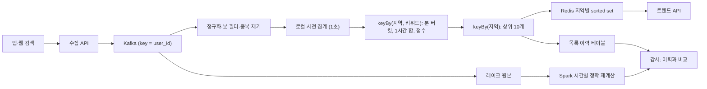

지역마다 최근 1시간 동안 많이 검색된 키워드 10개를 1분마다 새로 보여 주는 기능을 만든다. 초당 10만 건 가까이 들어오는 검색 이벤트에 키워드 종류는 수백만 개이고, 트래픽은 인기 키워드 몇 개에 몰리며, 봇 하나가 같은 검색어를 수천 번 넣어도 목록이 흔들리면 안 된다. 게다가 사람들이 보고 싶은 건 늘 많이 찾는 "날씨"가 아니라 지금 갑자기 늘어난 키워드다.

기준: Kafka 4.4, Flink 2.3, Redis 8.10, Spark 4.3 (2026-11).

## 요구사항과 규모 가정

지역별로 두 목록을 낸다. 최근 60분 검색 건수 상위 10개(인기)와, 평소보다 많이 늘어난 상위 10개(급상승)다. 목록은 1분마다 바뀌고, 운영자가 막은 키워드는 다음 갱신부터 빠진다. 비용 쪽에서는 스트림 상태를 수 GB 안에 둔다. 규모 숫자는 모두 가정이고 지역은 20개다.

| 항목 | 목표 |
|---|---|
| 신선도 | 분 경계가 지나고 30초 안에 새 목록 (p99) |
| 읽기 지연 | 트렌드 API p99 50ms 이하 |
| 정확도 | 늦게 온 이벤트를 빼면 사후 정확 재계산과 상위 10개가 같다 |
| 보관 | Kafka 3일, 원본 레이크 1년, 분마다 낸 목록 이력 1년 |

```text
일 이벤트      20억 건, 평균 20억 / 86,400초 ≈ 23,000건/초
피크           평균 × 4 ≈ 93,000건/초 → 설계 피크 10만 건/초
원본 크기      20억 × 300 B = 600 GB/일, 피크 대역 10만 × 300 B = 30 MB/s
Kafka 디스크   600 GB × 3일 × 복제 3 = 5.4 TB (압축 전)
레이크         Parquet로 1/5 → 120 GB/일, 1년 약 44 TB
파티션         30 MB/s ÷ 파티션당 5 MB/s = 6개, 10배 여유를 보고 64개
정확 카운트    분당 고유 (지역, 키워드) 100만 × 60분 = 최대 6,000만 항목 × 64 B ≈ 3.8 GB
중복 제거      10분 × 10만 건/초 = 최대 6,000만 (사용자, 키워드) × 50 B = 3 GB
출력           20개 지역 × 10개 × 2종 = 분당 400행
```

## 전체 구조



수집 API는 이벤트에 서버 수신 시각을 찍고 `user_id`를 키로 Kafka에 넣는다. 프로듀서는 키 해시로 파티션을 고르므로, 키워드를 키로 쓰면 인기 키워드 하나가 파티션 하나를 채운다. Flink는 걸러 낸 이벤트를 1분 단위로 세고, (지역, 키워드)마다 1시간 합과 점수를 들고 있다가 지역별로 상위 10개를 고른다. 결과는 Redis에 지역마다 sorted set 하나로 쓰고 같은 목록을 이력 테이블에도 남긴다. 원본은 레이크에도 쌓이고, Spark가 매시간 같은 규칙으로 다시 세어 이력과 맞춰 본다.

## 핵심 키워드

| 키워드 | 한 줄 뜻 |
|---|---|
| Count-Min Sketch | 해시 d개 × 너비 w 카운터 표. 추정이 실제보다 작지 않다 |
| Space-Saving | 카운터 m개를 두고 새 키에 가장 작은 카운터를 넘겨주는 요약 |
| Misra-Gries | 카운터가 차면 모두에서 1씩 빼는 요약. 추정이 실제보다 크지 않다 |
| 슬라이딩 윈도 | 이벤트마다 끝이 움직이는 창 |
| 호핑 윈도 | 크기 60분, 1분 간격처럼 정해진 간격으로 시작하는 겹치는 창 |
| 분 버킷 | 1분 단위 부분 합. 1시간 합은 버킷을 더하고 빼서 만든다 |
| 로컬-글로벌 집계 | 셔플 전에 부분 합을 내고 셔플 뒤에 합치는 두 단계 집계 |
| salting | 핫 키에 임의 접미사를 붙여 여러 태스크로 나눴다가 다시 합치기 |
| 기준선 | 키워드의 평소 시간당 건수. 급상승 점수의 분모 |

## 정확한 카운트를 고른 이유

후보는 셋이다. Flink 키 상태에 정확한 건수를 두는 방법, Count-Min Sketch와 힙, Space-Saving이나 Misra-Gries 같은 카운터 요약이다. Count-Min Sketch는 키를 해시 d개로 행마다 한 칸씩 올리고, 조회할 때 d칸 중 가장 작은 값을 낸다. 충돌은 더하기만 하므로 추정은 실제보다 작지 않다. w = ⌈e/ε⌉, d = ⌈ln(1/δ)⌉이면 확률 1−δ로 초과분이 εN 이하다(N은 전체 건수). 스케치는 키를 기억하지 않으니 후보 키는 힙에 따로 둔다. Space-Saving은 없는 키가 오면 가장 작은 카운터를 그 키에 넘기고 1을 더한다. 초과분은 N/m 이하이고, N/m보다 많이 나온 키는 반드시 남는다. Misra-Gries는 카운터 k개일 때 최대 N/(k+1)까지 덜 센다.

숫자를 넣으면 경계가 보인다. 피크 1시간에 한 지역 이벤트는 10만 × 3,600 / 20 = 1,800만 건이다. ε = 0.0001, δ = 0.01이면 w = 27,183, d = 5, 32비트 카운터로 약 544KB이고 초과분 상한은 1,800건이다. 카운터 1만 개짜리 Space-Saving도 상한이 1,800건이다. 10위 키워드가 시간당 수천 건이라면 이 오차로 9위와 12위가 뒤바뀔 수 있다. Redis의 Top-K는 HeavyKeeper 기반으로 감쇠하며 세는 같은 부류다. 명령 목록에 병합이 없어서 분 단위 스케치를 합쳐 1시간 창을 만들 수 없다.

이 설계는 정확한 카운트를 고른다. 상태는 3.8GB이고 subtask 64개에 나누면 하나당 60MB 정도다. 정확히 세면 배치 재계산과 목록이 그대로 같아야 하므로, 감사가 같은지 다른지만 보면 된다. 대가는 꼬리 키다. 한 번 검색된 키워드도 한 시간 동안 상태에 남고, 규모가 커지면 이 꼬리가 상태 대부분을 차지한다.

## 1시간 창은 분 버킷을 더하고 뺀다

슬라이딩 윈도는 이벤트가 올 때마다 창 끝이 움직이지만, 목록은 1분에 한 번만 읽힌다. 크기 60분, 간격 1분인 호핑 윈도면 요구사항을 채운다. Flink SQL로 바로 쓰면 이런 모양이다.

```sql
-- 구조만 보여 주는 스케치 (Flink 2.3 SQL). 테이블 이름은 예로 지었다
SELECT * FROM (
  SELECT *, ROW_NUMBER() OVER (
      PARTITION BY window_start, window_end, region ORDER BY cnt DESC) AS rn
  FROM (
    SELECT window_start, window_end, region, keyword, COUNT(*) AS cnt
    FROM TABLE(HOP(TABLE clean_searches, DESCRIPTOR(recv_time),
                   INTERVAL '1' MINUTE, INTERVAL '60' MINUTE))
    GROUP BY window_start, window_end, region, keyword))
WHERE rn <= 10;
```

`HOP`은 간격이 크기보다 작으면 한 행을 겹치는 여러 창에 넣는다. Window Top-N은 창이 끝날 때 한 번만 결과를 내고 중간 상태를 지운다. 인기 목록만 필요하면 이걸로 충분하다. 급상승 점수에는 1시간보다 긴 기준선이 필요해서, 이 설계는 1분 `TUMBLE` 집계까지만 SQL로 쓰고 그 뒤는 `KeyedProcessFunction`으로 짠다. (지역, 키워드)마다 분 버킷 맵과 누적 합을 두고, 새 분이 오면 더한 뒤 60분 뒤 이벤트 시간 타이머에서 그 버킷을 빼고 지운다. 창 길이와 상관없이 키마다 분당 일이 두 번이다. 이벤트 시각은 서버 수신 시각이고 워터마크는 10초 뒤처지게 둔다. 단말 시계를 믿지 않으니 늦은 이벤트는 파이프라인 지연에서만 생긴다. 워터마크와 늦은 데이터의 동작은 [Flink 시간과 윈도 글](/posts/flink-time-and-windows/)에 있다.

## 두 단계로 모으고 핫 키를 푼다

첫 단계는 사용자 키로 나뉜 필터 subtask 안에서 1초 또는 5,000건마다 (지역, 키워드, 분) 건수를 합쳐 내보낸다. 초당 5,000번 검색되는 키워드도 subtask 64개가 1초에 한 행씩, 초당 64행이 된다. 꼬리 키는 거의 줄지 않는다. SQL 쪽에서는 `table.optimizer.agg-phase-strategy`(기본 `AUTO`)를 `TWO_PHASE`로 두면 로컬 집계와 글로벌 집계로 나뉜다. 그룹 집계는 mini-batch가 켜져 있어야 하는데(`table.exec.mini-batch.enabled` 기본 `false`), 윈도 TVF 집계는 mini-batch가 늘 켜져 있다.

둘째 단계는 (지역, 키워드) 해시로 나뉘어 키마다 주인 subtask가 하나다. 1시간 합이 100건 이상인 키만 값이 바뀔 때 셋째 단계로 보내고, 100건 아래로 내려가면 삭제를 보낸다. 셋째 단계는 지역으로 나뉘어 지역별 맵을 들고, 워터마크가 분 경계를 넘으면 broadcast로 받은 운영자 차단 목록을 뺀 뒤 상위 10개를 고른다. 분당 수만 행이라 지역 20개가 키라도 부담이 없다. 10위가 100건보다 충분히 크기만 하면 이 목록은 정확하다. 반대로 source마다 따로 뽑은 상위 10개를 합치면 어디서나 11위인 키워드를 놓칠 수 있다. 사전 집계로도 못 버티는 키가 있으면 salting을 쓴다. 키를 (지역, 키워드, hash(user_id) % 8)로 나눠 세고, 다음 단계에서 (지역, 키워드)로 8개를 합친다. 셔플이 하나 늘고 분 합계는 워터마크가 그 분을 닫아야 나온다. 이 규모에서는 사전 집계로 충분하다. 핫 키는 subtask 하나만 바쁘고 그 위쪽이 백프레셔로 보이는 모양으로 드러나며, Web UI에서 읽는 법은 [Flink 런타임과 백프레셔 글](/posts/flink-runtime-and-backpressure/)에 있다.

## 많이 나온 것보다 갑자기 는 것

| 점수 | 식 | 얻는 것 | 문제 |
|---|---|---|---|
| 1시간 건수 | c | 단순하고 배치와 그대로 대조된다 | 늘 많은 키워드가 고정된다 |
| 시간 감쇠 건수 | Σ 건수 × 2^(−경과/h) | 최근 쪽에 가중을 준다 | 여전히 규모 순이다 |
| 기준선 대비 비율 | (c + α) / (b + α) | 평소 대비 증가를 잡는다 | 키마다 기준선 상태가 필요하다 |

급상승 목록은 비율을 쓴다. 기준선 b는 키마다 감쇠 합 D 하나로 만든다. 1시간 창에서 빠지는 분 버킷을 그때 D에 더하므로, 지금 급증한 건수가 기준선을 끌어올리지 않는다. 반감기 H분인 D는 분당 r건이 꾸준할 때 r·H/ln 2에 가까워지므로 b = 60·D·ln 2 / H로 되돌린다. H = 24시간, α = 50으로 두면 평소 시간당 40건이 900건이 된 키워드는 (900 + 50) / (40 + 50) ≈ 10.6, 평소 30,000건이 33,000건이 된 "날씨"는 33,050 / 30,050 ≈ 1.1이다. α는 2건이 10건이 되는 잡음을 누르고, c가 100건 아래면 후보에서 뺀다. 24시간 감쇠는 낮과 밤을 섞으니 매일 아침 오르는 키워드가 급상승으로 보일 수 있다. 그때는 배치가 4주치 같은 시간대 평균을 계산해 조회 테이블로 주는 쪽으로 바꾼다. 세지 않을 검색은 집계 전에 거른다. 유니코드 NFC, 소문자, 공백 정리로 같은 키워드가 여러 키로 갈라지지 않게 하고, 상류 봇 판정 플래그와 알려진 크롤러를 뺀다. 사용자(비로그인은 기기 ID)마다 분당 60건을 넘는 검색은 버리고, 같은 사용자의 같은 키워드는 10분에 1건만 센다. 10분 판정은 상태에 남긴 마지막 수신 시각과 비교하고, 상태 TTL은 청소에만 쓴다. 이러면 계정 하나가 키워드 하나에 보탤 수 있는 건 시간당 6건이다. 계정 여러 개로 나눠 넣는 조작은 이 필터로 막히지 않는다.

## 선택지 비교

| | Flink 정확 카운트 + Redis (이 설계) | Flink 스케치 (CMS + 힙, Space-Saving) | 실시간 OLAP에 원본을 넣고 매분 쿼리 |
|---|---|---|---|
| 상위 10개 | 늦은 데이터만 빼면 정확 | 경계 근처 순위가 오차 안에서 바뀐다 | 정확 |
| 메모리, 연산 | 키 수에 비례, 3.8GB | 지역·분마다 수백 KB로 고정 | 매분 1시간 원본(피크 3.6억 행)을 지역별로 집계 |
| 1시간 창 | 분 버킷 더하고 빼기 | CMS는 분 스케치끼리 더하고 뺀다. Space-Saving은 합칠 수만 있다 | 쿼리 시간 범위 |
| 먼저 커지는 비용 | 꼬리 키 상태 | 오차, ε를 줄이면 메모리 | 쿼리 연산량 |

## 장애와 재처리

Flink가 재시작하면 체크포인트에서 키 상태와 Kafka 오프셋을 같이 되돌린다. 이벤트 시간 창이라 다시 읽어도 분 버킷은 같은 값이 되고, Redis 쓰기는 덮어쓰기라 같은 분 목록을 두 번 써도 결과가 같다. 다만 재시작 직후에는 체크포인트 뒤의 분 목록을 다시 쓰느라 `asof`가 잠깐 뒤로 갈 수 있다. 읽는 쪽이 반쯤 바뀐 목록을 보지 않게 지우기와 쓰기는 트랜잭션 하나로 묶는다. Redis 트랜잭션의 명령은 순서대로 한 번에 실행되고, 그 사이에 다른 클라이언트 요청이 끼지 않는다.

```text
MULTI
DEL  trending:{seoul}:rising
ZADD trending:{seoul}:rising 10.6 "키워드a" 7.2 "키워드b" ...
SET  trending:{seoul}:asof 202611210622
EXEC
ZRANGE trending:{seoul}:rising 0 9 REV WITHSCORES
```

두 키에 같은 해시 태그 `{seoul}`을 붙여 클러스터에서도 한 슬롯에 둔다. 클러스터 슬롯과 키가 사라지는 경로는 [Redis 중복 거르기 글](/posts/redis-dedup-and-windows/)에 있다. API는 `asof`가 3분 넘게 멈추면 이력 테이블의 마지막 목록을 내고, 응답은 서버 로컬에 몇 초 캐시한다. 캐시를 어디에 둘지는 [읽기 API 캐시 글](/posts/read-api-caching/)에 정리했다. 10초보다 늦은 이벤트는 side output으로 빼서 세고, 파싱이 안 되는 이벤트는 잡을 멈추지 않고 DLQ 토픽으로 보낸다. 봇 규칙을 바꾸면 스트림은 앞으로만 적용되고 1시간 창은 60분 안에 새 규칙으로 바뀐다. 과거 이력은 Spark가 레이크에서 그 시간대를 다시 계산해 덮어쓴다. 체크포인트까지 잃으면 Kafka에서 마지막 1시간 남짓을 다시 읽어 창을 채우고, D는 배치가 레이크에서 계산해 초기 상태로 넣는다. D가 비어 있는 동안에는 모든 키의 b가 0이라 급상승 순서가 인기 순서와 같아진다. 감사 배치는 매시간 같은 정규화와 필터를 수신 시각 순서로 적용해 (지역, 키워드)를 세고 `ROW_NUMBER() <= 10`으로 자른다. `GROUP BY`의 집계는 셔플 앞에서 `partial_count`로 부분 합을 내서 핫 키가 덜 아프다. AQE가 `GROUP BY` skew를 쪼개 주지 않는다는 점은 [Spark 셔플과 skew 글](/posts/spark-shuffle-and-skew/)에 있다.

| 지표 | 경고 기준 |
|---|---|
| 결과 신선도, 현재 시각과 `asof`의 차이 | 3분 초과 |
| Kafka 컨슈머 lag | 5분 넘게 증가 |
| 늦어서 버린 이벤트 비율 | 0.1% 초과 |
| subtask `busyTimeMsPerSecond` 최댓값 / 중앙값 | 3배 넘게 10분 지속 |
| 감사 일치, 배치 상위 10개와 겹친 수 | 10개 중 9개 미만 |
| 필터로 버린 비율 | 지난주 같은 시간의 2배 |

## 규모가 10배가 되면

피크가 초당 100만 건, 300MB/s가 되면 파티션은 300 ÷ 5 = 60개가 필요해서 64개는 여유가 없다. 128개로 늘린다. 먼저 터지는 곳은 키워드 단계가 아니라 사용자 단계다. 키워드 핫 키는 사전 집계가 흡수하지만, 초당 1만 건을 넣는 봇 하나는 사용자 키로 나뉜 필터의 subtask 하나에 몰린다. 그래서 source subtask 안에서 키를 나누기 전에 사용자별 대략적인 속도 제한을 한 번 더 걸고, 반복되는 대량 발신은 수집 API에서 막는다. 중복 제거 상태도 30GB가 된다. 이때는 (사용자, 키워드) 정확 집합을 버리고 후보 키에만 분 단위 HyperLogLog로 사용자 수를 센다. HLL 스케치를 저장해 두고 긴 기간은 합쳐서 내는 방식은 [근사 집계 글](/posts/approximate-aggregation/)에 있다. 정확 카운트 상태는 38GB가 되고 대부분 꼬리 키다. 둘째 단계 subtask마다 분 단위 Count-Min Sketch를 두고, 그 분의 추정이 3 이상인 키만 정확한 버킷에 넣는다. 추정은 실제보다 작지 않으니 키마다 분당 최대 2건, 시간당 120건까지 덜 센다. 감사 기준도 같은지에서 시간당 120건 안인지로 바뀐다. Redis와 API는 분당 400행 그대로다.

## 참고 자료

- [Apache Flink 2.3 Windowing TVF](https://nightlies.apache.org/flink/flink-docs-release-2.3/docs/sql/reference/queries/window-tvf/)
- [Apache Flink 2.3 Window Top-N](https://nightlies.apache.org/flink/flink-docs-release-2.3/docs/sql/reference/queries/window-topn/)
- [Apache Flink 2.3 Performance Tuning (mini-batch, local-global)](https://nightlies.apache.org/flink/flink-docs-release-2.3/docs/dev/table/tuning/)
- [Apache Flink 2.3 Table Configuration](https://nightlies.apache.org/flink/flink-docs-release-2.3/docs/dev/table/config/)
- [Apache Kafka 4.4 Producer Configs (partitioner.class)](https://kafka.apache.org/44/configuration/producer-configs/)
- [Redis Transactions](https://redis.io/docs/latest/develop/using-commands/transactions/)
- [Redis Top-K](https://redis.io/docs/latest/develop/data-types/probabilistic/top-k/)
- [Cormode, Muthukrishnan, An Improved Data Stream Summary: The Count-Min Sketch and its Applications (2005)](https://www.cs.ox.ac.uk/people/graham.cormode/pubs/html/CormodeMuthukrishnan04CMJalg.html)
- [Metwally, Agrawal, El Abbadi, Efficient Computation of Frequent and Top-k Elements in Data Streams (2005)](https://www.cs.ucsb.edu/sites/default/files/documents/2005-23.pdf)
- [Misra, Gries, Finding Repeated Elements (1982)](https://doi.org/10.1016/0167-6423(82)90012-0)
- [Agarwal et al., Mergeable Summaries (2012)](https://www.cs.utah.edu/~jeffp/papers/merge-summ.pdf)

## English summary

This design shows the top 10 popular and rising search keywords per region over the last hour, refreshed every minute. Flink counts exactly in one-minute buckets keyed by region and keyword, keeps a rolling hourly sum by adding the new bucket and subtracting the expired one, and merges per-region candidates in a small final stage. Local pre-aggregation absorbs hot keywords, and the rising score divides the hourly count by a decayed baseline that only receives minutes after they leave the window. Results go to one Redis sorted set per region in a single transaction, and an hourly Spark job recounts the same data so the lists can be compared exactly. Sketches such as Count-Min come in only at ten times the load, where they keep the long tail of rare keywords out of state at a bounded undercount.
