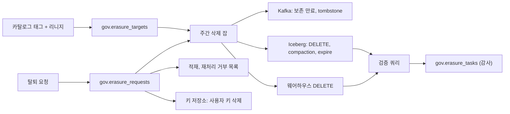

사용자가 계정을 지우면 서비스 DB의 행 하나는 바로 지워진다. 같은 사람의 흔적은 Kafka 토픽, 레이크의 원천 테이블과 파생 테이블, 웨어하우스, 피처 저장소, 로그, 백업에 따로 남아 있고, 레이크와 웨어하우스는 `DELETE`가 끝난 뒤에도 시간 여행으로 지운 행을 보여 준다. 정해진 기한 안에 모든 사본에서 읽을 수 없게 만들고, 그랬다는 기록을 남기는 것이 이 설계의 목표다.

기준: Kafka 4.4, Iceberg 1.12, Spark 4.3, Flink 2.3, BigQuery와 S3 문서(2026-11).

## 요구사항과 규모 가정

기능 요구사항은 네 가지다. 삭제 요청을 받아 기록하고, 그 사용자가 있는 모든 저장소를 찾아 지우고, 지워졌는지 쿼리로 확인하고, 무엇을 언제 어떻게 지웠는지 감사 기록을 남긴다. 법령이 보존을 요구하는 기록은 지우지 않고 따로 보관한다.

법은 큰 줄기만 적는다. GDPR 제17조는 정해진 사유가 있으면 지체 없이 지우라고 하고, 제12조 3항은 요청에 1개월 안에 답하되 복잡하면 2개월 더 늘릴 수 있게 하며, 제19조는 데이터를 받은 쪽에도 삭제를 알리게 한다. 개인정보 보호법 제21조는 필요 없어진 개인정보를 지체 없이, 복구나 재생이 안 되게 파기하고, 다른 법령으로 보존할 것은 분리해 저장하게 한다. 시행령은 전자 파일을 복원이 불가능한 방법으로 영구 삭제하라고 하고, 정정·삭제 요구를 받은 날부터 10일 안에 결과를 알리게 한다. 어떤 요청에 어느 기한과 예외가 걸리는지는 법무 판단이고, 아래 숫자는 설계용 내부 기한이다.

비기능 요구사항은 이렇다. 온라인 경로(서비스 DB, 온라인 피처, 검색)는 24시간 안에 막고, 분석용 사본은 요청 후 D = 30일 안에 물리적으로 없앤다. 삭제 작업은 두 번 돌려도 결과가 같아야 하고, 재처리나 백업 복구가 지운 사용자를 되살리면 안 된다. 비용은 레이크를 몇 주에 한 번 다시 쓰는 정도까지 허용한다. 규모는 가정이다.

```text
계정 2,000만, 이벤트 하루 5억 건, 평균 1KB, 피크는 평균의 3배
탈퇴 요청 월 0.2% = 40,000건 → 하루 약 1,330건, 주 약 9,300건
평균 5억 / 86,400 ≈ 5,800건/s, 피크 ≈ 17,400건/s ≈ 17MB/s
Kafka 하루 500GB, 보존 3일 × 복제 3 = 4.5TB, 파티션당 2MB/s 이하로 9개 이상 → 24개
레이크 Parquet(압축 1/10) 하루 50GB, 1년 보존 ≈ 18TB
256MB 파일로 하루 약 195개, 1년 약 7만 1천 개, 파일당 약 256만 행
```

마지막 줄이 문제의 크기를 정한다. 파일 하나에 많은 사용자의 행이 섞여 있으니, 한 주에 9,300명을 지우면 1년치 파일 대부분이 대상이 된다(가정에 따른 추론).

## 전체 구조



요청은 먼저 Iceberg 테이블 `gov.erasure_requests`에 한 행으로 들어간다. 식별자는 이메일이 아니라 가명 키 `pid`다. 같은 순간 키 저장소에서 그 사용자의 암호화 키를 지우고, 온라인 피처와 서비스 쪽에 삭제 이벤트를 낸다. 주간 삭제 잡(Airflow)은 그 주의 요청을 배치 하나로 묶어 `gov.erasure_targets`의 테이블마다 지우고, 검증 결과를 `gov.erasure_tasks`에 남긴다. 스트리밍 적재와 모든 재처리 잡은 요청 테이블을 거부 목록으로 읽는다.

## 핵심 키워드

| 키워드 | 한 줄 뜻 |
|---|---|
| 삭제 요청 로그 | 요청, 기한, 배치 번호를 담은 별도 테이블. 재처리와 복구 때 다시 적용하는 기준 |
| 삭제 대상 레지스트리 | 테이블마다 사용자 키 컬럼과 삭제 방법을 적은 목록 |
| 가명 키(pid) | 서비스 ID 대신 쓰는 무작위 대체 키. 매핑은 따로 둔다 |
| merge-on-read 삭제 | 데이터 파일은 두고 지운 위치만 따로 기록하는 행 단위 삭제 |
| 스냅샷 만료 | 오래된 스냅샷과 그것만 참조하던 파일을 지우는 작업 |
| tombstone | compact 토픽에서 값이 null인 레코드. 같은 키의 이전 값을 지운다 |
| crypto-shredding | 사용자별 키로 암호화해 두고, 키를 지워 모든 사본을 못 읽게 만드는 방식 |
| 감사 행 | 배치와 대상마다 커밋 ID, 지운 행 수, 검증 결과를 남긴 기록 |

## 지울 곳 목록은 카탈로그 태그와 리니지로 만든다

선택지는 팀마다 삭제 스크립트를 맡기는 방식, 사람이 관리하는 대상 목록, 카탈로그에서 만드는 목록이다. 앞의 둘은 새 테이블이 생길 때 빠진다. 이 설계는 사용자 키 컬럼에 `pii:user_key` 태그를 달고, 리니지를 따라 그 컬럼에서 파생된 테이블을 모두 찾는다. 리니지가 SQL 파싱과 실행 이벤트로 모이는 방식은 [카탈로그와 리니지 글](/posts/data-catalog-and-lineage/)에 있다.

찾은 테이블은 `gov.erasure_targets`에 `(table, key_column, method, owner)`로 들어간다. `method`는 `row_delete`, `crypto_shred`, `ttl_expiry`, `legal_hold`, `exempt_aggregate` 중 하나다. 배포 검사는 상류에 태그 컬럼이 있는데 레지스트리에 없는 테이블을 막는다. 리니지가 놓치는 UDF 내부나 동적 테이블 이름은 이 검사로도 못 잡으니, 테이블 생성 권한을 레지스트리 등록과 묶어 메운다(일반적인 추론이다).

사용자 키가 없는 집계 테이블은 `exempt_aggregate`다. 국가별 일 활성 사용자 수 같은 표는 지운 사람이 빠져도 다시 계산하지 않는다. 대신 칸 하나가 몇 명뿐이면 사람을 다시 알아볼 수 있으니 셀 인원이 k(여기서는 20) 미만인 행은 집계할 때 숨긴다. 원천에서 다시 계산하면 과거 숫자가 조금 줄어드는 것은 받아들인다. 가명 키는 삭제 범위를 좁히지만 없애지는 않는다. GDPR 전문 26항은 추가 정보로 다시 연결할 수 있는 가명 데이터를 여전히 개인정보로 본다. 매핑 행을 지운 뒤에도 `pid`로 묶인 행동 기록은 삭제 대상에 남는다.

## 레이크는 주간 merge-on-read 삭제와 격주 compaction으로 지운다

Iceberg 1.12의 `write.delete.mode` 기본값은 copy-on-write다. 이대로 매주 지우면 파일 대부분이 걸려 18TB를 주마다 다시 쓴다. 그래서 대상 테이블을 format v3, merge-on-read로 바꾼다. 주간 `DELETE`는 파일마다 deletion vector만 쓰고, 격주 compaction이 delete가 붙은 파일을 다시 써서 행을 물리적으로 뺀다. 두 방식의 비용과 compaction 옵션 기본값은 [행 단위 삭제 글](/posts/iceberg-row-level-deletes/)에 있다.

```sql
-- 구조만 보여 주는 스케치, Spark 4.3 + Iceberg 1.12. 이름은 예시다
ALTER TABLE lake.raw.events SET TBLPROPERTIES ('format-version'='3', 'write.delete.mode'='merge-on-read');
DELETE FROM lake.raw.events AS e WHERE EXISTS (
  SELECT 1 FROM lake.gov.erasure_requests r WHERE r.batch_id = '2026-W47' AND r.pid = e.pid);
-- 격주: delete가 하나라도 붙은 파일을 다시 쓰고, 그 커밋 시각 이전 스냅샷을 지운다
CALL lake.system.rewrite_data_files(table => 'raw.events', options => map('delete-file-threshold', '1'));
CALL lake.system.expire_snapshots(table => 'raw.events', older_than => TIMESTAMP '2026-12-06 03:00:00', retain_last => 1);
CALL lake.system.remove_orphan_files(table => 'raw.events');
```

`DELETE`가 끝나도 지운 행은 두 군데에 남는다. 현재 스냅샷에서는 deletion vector에 가려졌을 뿐 데이터 파일 안에 있고, 이전 스냅샷으로 시간 여행하면 그대로 보인다. compaction이 그 행 없는 파일을 새로 쓴 뒤 그 커밋 시각으로 `expire_snapshots`를 돌려야 옛 파일이 지워진다. v2로 남은 테이블은 delete 파일도 `remove-dangling-deletes`나 `rewrite_position_delete_files`로 정리한다. 만료 규칙과 metadata.json이 따로 남는 점은 [스냅샷과 브랜치 글](/posts/iceberg-snapshots-and-branches/)에 있다.

막히는 곳이 셋 더 있다. 브랜치와 태그의 기본 보존은 영구라서 학습 데이터 고정용 태그 하나가 지운 행을 계속 붙잡는다. 개인정보 테이블에서는 태그를 `RETAIN 14 DAYS` 이하로만 만들게 한다. `remove_orphan_files`는 기본으로 3일보다 오래된 파일만 지우니 실패한 compaction이 남긴 파일은 그만큼 늦게 사라진다. 버킷 버전 관리가 켜져 있으면 지운 객체가 이전 버전으로 남으므로 수명 주기의 `NoncurrentVersionExpiration`에서 `NoncurrentDays`를 1로 둔다. 다만 S3 문서는 수명 주기가 완료 시각을 보장하지 않아 기한 있는 삭제에 그것만 믿지 말라고 하니, 만료 잡이 지운 경로의 이전 버전을 버전 ID로 직접 지우고 S3 Inventory로 남은 버전을 확인한다. Athena에서 같은 단계를 밟는 방법과 `VACUUM` 기본값은 [접근 제어와 개인정보 글](/posts/data-access-control-and-pii/)에 있다.

최악의 일정은 요청이 주간 잡 직후에 올 때다. 7일 뒤 `DELETE`, 최대 14일 뒤 compaction과 만료, 하루 안에 이전 버전 직접 삭제와 확인으로 22일째에 끝나고, D까지 남는 8일이 재시도 몫이다. 대가는 격주 18TB 재작성, 하루 평균 약 1.3TB다. `rewrite_data_files`는 작은 파일도 함께 합치니 정기 compaction 잡과 하나로 묶는다(엔진별 도구는 [작은 파일 글](/posts/small-files-and-compaction/)).

웨어하우스도 같은 배치로 `DELETE`를 돈다. BigQuery는 시간 여행 기간이 기본 7일이고 데이터셋이나 프로젝트 단위로 2일까지 줄일 수 있으며, 그 뒤 fail-safe 7일은 바꿀 수 없다. 2일로 줄여도 지운 데이터는 9일 더 보관되니 최악 7 + 9 = 16일이다.

## Kafka와 백업은 건별로 지우지 않고 만료와 키 삭제로 끝낸다

`cleanup.policy=delete`인 이벤트 토픽에는 레코드 하나만 골라 지우는 길이 없으니(`DeleteRecords`는 오프셋 앞을 통째로 자른다) 기한보다 짧은 보존을 고른다. `retention.ms`와 `segment.ms` 기본값이 모두 7일이라 그대로 두면 한산한 토픽에서 레코드가 14일 가까이 남는다. 원천 토픽은 `retention.ms` 3일, `segment.ms` 1일로 두어 최악 약 4일에 사라지게 한다. 재처리는 레이크에서 하니 짧은 보존이 잃는 것은 크지 않다.

사용자 프로필 같은 compact 토픽은 tombstone으로 지운다. 키가 `pid`라서 tombstone에 이메일 같은 값이 실리지 않는다. 클리너는 active segment를 건드리지 않으니 `max.compaction.lag.ms`를 1일로 두고 `min.compaction.lag.ms`는 기본값 0을 유지하며, tombstone 자체는 `delete.retention.ms`(기본 1일)가 지나야 사라진다. 클리너가 tombstone을 버리는 시점은 [Kafka 보존과 compaction 글](/posts/kafka-log-retention-and-compaction/)에 있다. 이 토픽으로 만든 캐시도 tombstone을 받으면 키를 지운다.

서비스 DB 스냅샷은 35일 보존이라 D보다 길고, 백업 파일 속 행은 고칠 수 없다. 그래서 이메일, 전화번호, 이름 같은 직접 식별 컬럼은 쓰는 쪽에서 사용자별 데이터 키로 암호화하고, 데이터 키는 KMS 마스터 키로 감싸 키 저장소에 둔다. 탈퇴 요청이 오면 키 행을 지운다. Kafka, 레이크의 옛 스냅샷, 백업, 로그에 남은 암호문이 한 번에 못 읽는 값이 된다. 대가도 있다. 쓰기와 읽기마다 키 조회가 붙어 캐시가 필요하고, 키 저장소가 핵심 의존성이 된다. 키 저장소의 백업에 키가 남으면 효과가 없으니 그 백업 보존은 7일로 짧게 두고, 키 저장소를 잃으면 모든 식별 컬럼을 잃는다. 암호화된 컬럼으로는 `GROUP BY email` 같은 분석을 못 하고, 행동 기록은 암호화 대상이 아니라서 행 삭제가 여전히 필요하다.

키를 지운 암호문을 법이 삭제로 보는지는 이 글이 판단하지 않는다. 시행령은 영구 삭제가 기술적으로 현저히 곤란하면 법 제58조의2의 정보, 곧 다른 정보를 써도 더 이상 개인을 알아볼 수 없는 정보로 처리하라고 적는다. 이 설계에서 crypto-shredding은 백업처럼 건별 삭제가 안 되는 곳만 맡고, 고칠 수 있는 사본은 행을 실제로 지운다.

ML 피처의 온라인 저장소는 요청 이벤트를 받아 키를 바로 지우고, 오프라인 피처 테이블은 레이크와 같은 주간 배치에 들어간다. 이미 학습된 모델을 다시 학습할지는 이 설계가 정하지 않고, 다음 정기 학습부터 그 사용자의 행이 빠진다. 애플리케이션 로그에는 `pid`만 남기고 식별 값은 로거에서 지우며, 로그 보존은 14일이다.

## 삭제가 끝났다는 증거는 검증 쿼리와 감사 행으로 남긴다

잡이 성공했다는 것과 데이터가 사라졌다는 것은 다르다. 레이크 테이블은 아래 세 쿼리가 모두 0행이어야 통과다.

```sql
-- 구조만 보여 주는 스케치
SELECT count(*) FROM lake.raw.events e WHERE EXISTS (
  SELECT 1 FROM lake.gov.erasure_requests r WHERE r.batch_id = '2026-W47' AND r.pid = e.pid);
-- compaction 커밋보다 오래된 스냅샷이 남았나
SELECT count(*) FROM lake.raw.events.snapshots WHERE committed_at < TIMESTAMP '2026-12-06 03:00:00';
-- 보존이 긴 태그나 브랜치가 옛 스냅샷을 잡고 있나
SELECT name, type, snapshot_id FROM lake.raw.events.refs WHERE name <> 'main';
```

Kafka는 레코드를 키로 찾기 어려우니 토픽 설정(`retention.ms`, `segment.ms`, `max.compaction.lag.ms`)과 요청 뒤 지난 시간으로 확인하고, 백업은 키 저장소에 그 사용자의 키 행이 없는지를 본다. 감사 행은 `gov.erasure_tasks`에 배치와 대상마다 하나씩 쌓는다. 열은 `batch_id`, `target_table`, `method`, 삭제 커밋의 스냅샷 ID, 지운 행 수, compaction 스냅샷 ID, 만료 실행 시각, 검증 결과다. 지운 행 수는 Spark 4.2부터 `DELETE` 커밋의 스냅샷 요약에 `spark.delete.num-deleted-rows`로 남으니 그 값을 옮긴다. 감사 기록에는 `pid`와 시각만 두고, 요청 로그와 감사 기록의 보관 기간은 법무가 정한다.

## 선택지 비교

| | 모든 사본 행 삭제 | crypto-shredding만 | 짧은 보존만 | 이 설계(혼합) |
|---|---|---|---|---|
| 레이크 비용 | 매주 18TB 재작성 | 재작성 없음 | 1년 분석 불가 | 격주 18TB 재작성 |
| 백업, Kafka | 처리 불가 | 키 삭제로 해결 | 보존이 D 이하면 해결 | 키 삭제 + 짧은 보존 |
| 행동 기록 | 지워짐 | 남음 | 기한 뒤 지워짐 | 지워짐 |

## 장애와 재처리

삭제 잡이 중간에 죽으면 같은 `batch_id`로 다시 돌린다. `DELETE ... WHERE EXISTS`는 이미 지운 행에는 아무것도 하지 않으니 두 번 돌려도 결과가 같다. compaction이 스트리밍 writer와 충돌하면 파티션 범위를 나눠 다시 시도한다. 실행 역할에 객체 삭제 권한이 없으면 만료가 성공처럼 끝나고 파일이 남을 수 있어, 스냅샷 쿼리와 별도로 만료 출력의 삭제 파일 수가 0인 실행을 경고로 잡는다. 더 위험한 것은 되살아나는 경로다. Kafka를 처음부터 다시 읽거나 외부 원천을 다시 받으면 지운 사용자가 들어올 수 있으니, 모든 적재와 재처리 잡은 `gov.erasure_requests`를 거부 목록으로 조인한다. Flink 적재 잡은 이 목록을 broadcast state로 들고, 탈퇴 뒤 오프라인 단말이 늦게 보낸 이벤트도 여기서 버린다. 서비스 DB를 백업에서 복구하면 서비스를 열기 전에 복구 시점 이후의 요청을 다시 적용한다. 요청 로그를 별도 테이블로 둔 이유가 이 재적용이다.

| 지표 | 경고 조건 |
|---|---|
| 열린 요청 중 가장 오래된 것의 나이 | 23일 초과 |
| 검증 쿼리에서 나온 행 수 | 1 이상 |
| 개인정보 테이블의 가장 오래된 스냅샷 나이 | 16일 초과 |
| `main` 밖 참조의 보존 기간 | 14일 초과 |
| 토픽 설정 이탈 | `retention.ms` 3일 초과 |
| 키 저장소 삭제 지연 | 요청 후 24시간 초과 |

## 규모가 10배가 되면

이벤트가 하루 50억 건이 되면 레이크는 1년 180TB가 되고 격주 재작성도 180TB가 된다. 먼저 깨지는 곳이 이 재작성이다. 정렬로 대상 파일을 좁히는 방법은 잘 듣지 않는다. 지금 가정에서도 한 달치 파티션(약 1.5TB, 파일 약 6,000개)을 `pid`로 정렬해 두면, 한 주에 흩어진 9,300명이 파일의 약 79%를 건드린다(1 - e^(-9300/6000), 가정에 따른 계산). 그래서 식별 가능한 원천 테이블의 보존을 1년에서 90일로 줄이고, 그보다 오래된 분석은 `exempt_aggregate` 집계 테이블로 옮긴다. 재작성 대상은 약 45TB로 준다. 요청이 주 9만 3천 건이 돼도 `pid` 목록은 몇 MB라 조인은 문제가 아니고, 비용은 스캔과 재작성에 남는다. Kafka 쪽은 보존 기간이 기한을 정하니 규모와 상관없이 그대로이고, 키 저장소는 조회가 10배로 늘어 캐시 적중률이 먼저 보이는 지표가 된다.

## 참고 자료

- [GDPR (EU) 2016/679 전문, EUR-Lex](https://eur-lex.europa.eu/legal-content/EN/TXT/HTML/?uri=CELEX:32016R0679)
- [개인정보 보호법](https://www.law.go.kr/법령/개인정보보호법), [시행령](https://www.law.go.kr/법령/개인정보보호법시행령), 국가법령정보센터
- [Iceberg 1.12 Configuration](https://iceberg.apache.org/docs/latest/configuration/), [Spark Procedures](https://iceberg.apache.org/docs/latest/spark-procedures/), [Spark Writes](https://iceberg.apache.org/docs/latest/spark-writes/), [Spark Queries](https://iceberg.apache.org/docs/latest/spark-queries/), [Branching and Tagging](https://iceberg.apache.org/docs/latest/branching/)
- [Apache Kafka 4.4 Topic Configs](https://kafka.apache.org/44/configuration/topic-configs/)
- [BigQuery Data retention with time travel and fail-safe](https://docs.cloud.google.com/bigquery/docs/time-travel)
- [Amazon S3 Lifecycle configuration examples](https://docs.aws.amazon.com/AmazonS3/latest/userguide/lifecycle-configuration-examples.html), [Lifecycle considerations](https://docs.aws.amazon.com/AmazonS3/latest/userguide/how-to-set-lifecycle-configuration-intro.html)

## English summary

A user's account deletion has to reach every copy: Kafka topics, raw and derived Iceberg tables, the warehouse, feature stores, logs, and backups. I keep the requests in their own table, build the target list from catalog PII tags and lineage, and delete lake rows weekly with merge-on-read, then compact every two weeks and expire snapshots, because deleted rows stay readable through time travel until then. Kafka event topics expire within about four days, compacted topics get tombstones, and backups rely on deleting a per-user encryption key. Every writer and replay job joins the request table as a deny list, which is why the request log is a separate table that survives the deletion itself.
