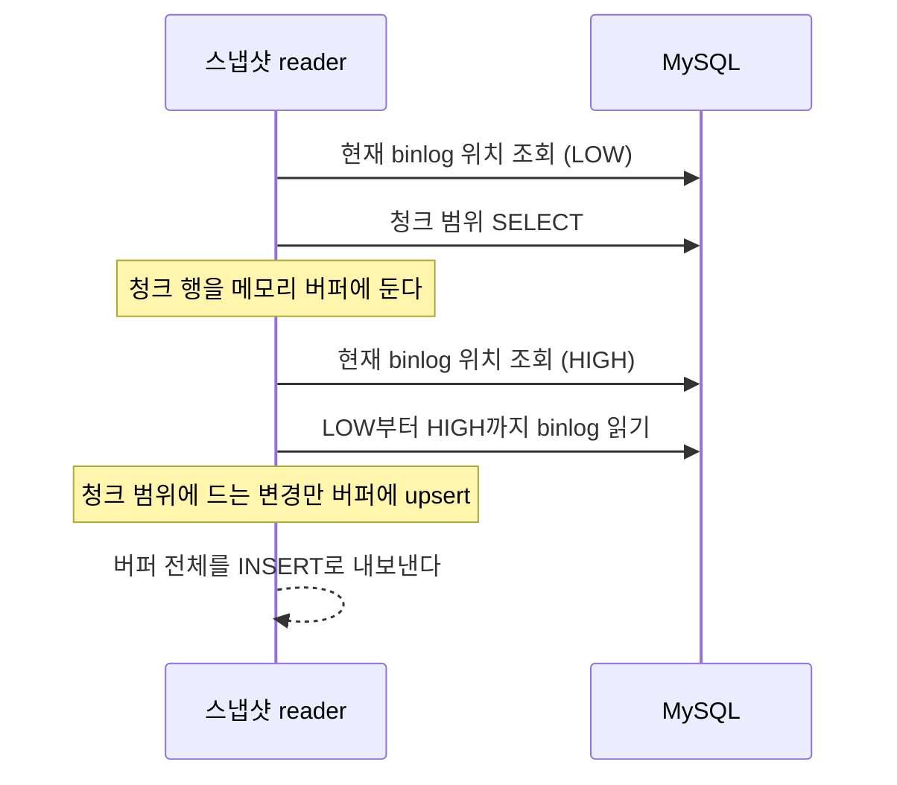

MySQL 테이블을 처음 레이크로 옮기는 동안에도 binlog에는 변경이 계속 쌓인다. 읽는 사이 바뀐 행을 어떻게 합칠지, 읽다 죽으면 어디부터 다시 읽을지가 초기 적재의 문제다. Debezium으로 푼다면 태스크 하나로 도는 source에 signal을 넣어 테이블마다 incremental snapshot을 건다. Apache Flink CDC는 같은 문제를 여러 reader가 청크를 나눠 읽고 진행 상황을 Flink 체크포인트에 남기는 방식으로 푼다.

버전은 Flink CDC 3.7.0, 예제의 Flink는 1.20.3 기준이다.

## binlog를 해석하는 건 안에 든 Debezium이다

Flink CDC의 MySQL source는 binlog 해석을 Debezium MySQL 커넥터 코드에 맡긴다. [Kafka Connect 글](/posts/kafka-connect-workers-tasks/)의 워커와 태스크 없이, Flink 태스크 안에서 Debezium reader를 돌린다. 그래서 binlog 설정과 계정 권한(`SELECT`, `SHOW DATABASES`, `REPLICATION SLAVE`, `REPLICATION CLIENT`)은 Debezium과 거의 같다. Flink CDC가 얹은 것은 스냅샷을 나눠 읽는 프레임워크, 체크포인트에 들어가는 읽기 위치, YAML 파이프라인이다. 3.7은 Flink 1.20.x와 2.2.x에서 돈다.

쓰는 방법은 둘이다. Flink SQL `mysql-cdc`나 DataStream `MySqlSource`로 잡 안의 changelog 스트림을 받아 뒤의 연산과 sink를 직접 짜거나, `source`, `transform`, `route`, `sink`, `pipeline` 블록의 YAML을 `flink-cdc.sh`로 제출해 DDL까지 스키마 변경 이벤트로 흘린다.

## 청크는 PK 첫 컬럼으로 자른다

incremental snapshot은 테이블을 chunk key의 범위로 나눈다. 기본 chunk key는 PK의 첫 컬럼이고, 청크 크기는 `scan.incremental.snapshot.chunk.size`(기본 8096행)다. 숫자형 자동 증가 키는 최솟값과 최댓값 사이를 고정 간격으로 자른다. 다른 타입은 `SELECT MAX(key) FROM (SELECT * FROM t WHERE key > ? ORDER BY key LIMIT n)` 꼴의 쿼리로 다음 경계를 하나씩 찾는다. 첫 청크와 마지막 청크는 `(-∞, 첫 경계)`, `[마지막 경계, +∞)`처럼 한쪽이 열려 있다. 키 값이 범위에 고르게 퍼져 있지 않으면 고정 간격 청크의 행 수가 들쭉날쭉해져 reader 사이 일이 기운다.

PK가 없는 테이블은 `scan.incremental.snapshot.chunk.key-column`에 NOT NULL 컬럼을 지정해야 한다. 그 컬럼이 UPDATE로 바뀌지 않으면 exactly-once, 바뀌면 at-least-once다. PK가 있는 테이블에서 PK가 아닌 컬럼을 chunk key로 고르면 더 위험하다. `id=0` 행의 `pid`가 2에서 4로 바뀌는 순간 두 reader가 `pid` 범위 (1, 3]과 (3, 5]를 각각 읽고 있으면, 두 청크에 같은 `id`가 서로 다른 값으로 들어가고 어느 쪽이 나중에 반영될지 정해지지 않는다.

## 청크 하나는 LOW와 HIGH 사이의 binlog로 보정한다

reader는 청크마다 다음 순서로 일한다.



SELECT가 binlog의 어느 위치에 해당하는 상태를 읽었는지는 알 수 없다. LOW 뒤, HIGH 앞이라는 것만 안다. 그래서 그 구간의 변경을 전부 버퍼에 덮어쓴다. SELECT가 이미 본 변경을 한 번 더 적용해도 같은 키에 같은 행이 덮일 뿐이고, 못 본 변경은 이때 채워진다. 결과는 HIGH 시점의 청크다(알고리즘에서 따라 나오는 추론이다). 버퍼의 행은 모두 INSERT, Flink 안에서는 `+I` 행으로 나간다. 변경 종류가 Flink 행에 붙는 방식은 [RowKind 글](/posts/flink-changelog-and-rowkind/)에 있다.

이 알고리즘은 Netflix의 DBLog 논문에서 왔다. 차이는 워터마크를 만드는 방법에 있다.

| | DBLog | Debezium incremental snapshot | Flink CDC |
|---|---|---|---|
| 워터마크 | 원천 DB의 watermark 테이블에서 UUID 행을 UPDATE | signal 테이블에 쓴다. GTID를 켜면 read-only 방식도 있다 | 현재 binlog 위치를 조회만 한다 |
| 원천에 쓰기 | 필요 | 기본 방식은 필요 | 필요 없음 |
| 윈도 안에서 키가 겹치면 | 청크에서 그 키의 행을 지운다 | 버퍼에서 그 키의 행을 버린다 | 로그의 변경을 버퍼에 upsert한다 |

세 방식 모두 테이블 잠금을 쓰지 않는다. Flink CDC는 `FLUSH TABLES WITH READ LOCK`을 걸지 않으니 `RELOAD` 권한도 필요 없다. Debezium 쪽 윈도 동작은 [CDC 개념 글](/posts/change-data-capture/)에 그림으로 있다. Debezium signal 테이블에 쓰려면 쓰기 권한이 있는 계정이 필요하지만, 위치를 조회만 하는 Flink CDC에는 그런 계정이 필요 없다.

## 스냅샷이 끝나면 binlog reader 하나가 이어받는다

청크가 다 끝나면 source는 binlog를 태스크 하나로 읽는다. binlog는 서버마다 순서가 정해진 로그 하나라서, 나눠 읽으면 순서를 다시 맞춰야 한다(일반적인 추론이다). 3.7.0 코드에서 binlog reader는 청크들의 HIGH 가운데 가장 이른 위치에서 시작한다. 이벤트마다 그 키가 속한 청크를 찾아, 위치가 그 청크의 HIGH 뒤일 때만 내보낸다. 테이블의 가장 늦은 HIGH를 지나면 거르지 않는다. 그래서 키마다 스냅샷 행과 binlog 변경이 빠짐도 겹침도 없이 이어진다.

binlog reader는 청크가 모두 끝난 뒤 체크포인트가 한 번 완료될 때까지 기다렸다가 시작한다. 스냅샷 데이터를 아래 연산자가 다 받았다는 확인이다. 이 동작에서 운영 조건 두 가지가 나온다(코드에서 읽은 추론이다).

- 첫 청크의 HIGH부터 스냅샷이 끝날 때까지의 binlog가 원천에 남아 있어야 한다. 스냅샷이 binlog 보존 기간보다 오래 걸리면, MySQL 에러 1236처럼 시작할 파일이 없다.
- 스냅샷 중에 끝난 청크의 새 변경은 binlog 단계가 시작돼야 나간다. 큰 테이블의 초기 적재 동안 sink 쪽 데이터는 청크를 읽은 시점에 머문다.

체크포인트도 두 단계가 다르다. 스냅샷 단계는 청크 단위로 끝난 청크 목록을 상태에 넣고, 장애가 나면 끝나지 않은 청크부터 다시 읽는다. binlog 단계는 읽은 binlog 위치를 상태에 넣는다. 복구할 때 source 위치를 체크포인트에서 가져오는 원리는 [Flink 체크포인트 글](/posts/flink-state-and-checkpoints/)과 같다. 스냅샷이 끝난 뒤 놀게 되는 reader는 `scan.incremental.close-idle-reader.enabled`로 닫는다.

## server-id는 reader 수만큼 범위로 준다

Debezium의 `database.server.id`는 커넥터가 복제 클라이언트로 붙을 때 쓰는 자기 ID다. Flink CDC도 같지만, 청크마다 binlog를 읽는 스냅샷 reader가 각자 클라이언트로 붙는다. 그래서 `server-id`에 범위를 주고, 범위에 든 ID 수가 병렬도보다 적으면 안 된다. 병렬도가 4면 `5401-5404`처럼 준다. 비워 두면 5400에서 6400 사이 임의 값이 잡힌다. 두 잡이 같은 ID를 쓰면 MySQL이 연결과 binlog 위치를 ID로 관리하므로 엉뚱한 위치를 읽을 수 있다. 같은 DB에 Debezium 커넥터와 Flink CDC 잡이 함께 붙는다면 서로의 범위도 겹치면 안 된다.

## 시작 모드는 Debezium snapshot.mode와 짝이 맞는다

`scan.startup.mode`의 `initial`(기본)은 청크 스냅샷 뒤 binlog로 Debezium `initial`, `latest-offset`은 `no_data`, `snapshot`은 `initial_only`와 가깝다. `earliest-offset`, `specific-offset`, `timestamp`는 스냅샷 없이 지정 위치(파일과 위치, GTID 집합, 시각)부터 읽고 Debezium에 짝이 없다.

지정 위치에서 시작할 때는 그 뒤에 DDL이 있었는지 봐야 한다. 내장 Debezium reader가 현재 테이블 구조만 들고 있어서, 옛 구조로 쓰인 binlog 레코드는 해석하지 못하고 실패한다. 변경이 드문 테이블 때문에 마지막 위치의 binlog가 지워지는 일은 `heartbeat.interval`(기본 30초)이 위치를 앞으로 밀어 막는다.

나중에 테이블을 추가하는 방법은 Debezium과 다르다. MySQL source의 새 테이블 스캔(파이프라인 `scan.newly-added-table.enabled`, DataStream `scanNewlyAddedTableEnabled`)은 세이브포인트나 체크포인트에서 다시 시작할 때만 동작한다. 잡을 세이브포인트로 멈추고 테이블 목록을 넓혀 다시 띄우면 새 테이블만 스냅샷부터 읽는다. Debezium signal은 커넥터를 멈추지 않고 테이블 하나에 스냅샷을 건다.

## YAML 파이프라인으로 MySQL에서 Iceberg까지

로컬에서 돌려 볼 수 있는 구성이다. MySQL 8.4는 binlog가 기본으로 켜져 있고 형식도 ROW다.

```sql
-- MySQL 8.4
CREATE DATABASE app_db;
CREATE TABLE app_db.orders (
  id BIGINT PRIMARY KEY, status VARCHAR(16), amount DECIMAL(10, 2), paid TINYINT(1)
);
INSERT INTO app_db.orders VALUES (1, 'paid', 1200.00, 1), (2, 'created', 300.00, 0);
```

```yaml
# mysql-to-iceberg.yaml (Flink CDC 3.7.0, Flink 1.20.3)
source:
  type: mysql
  hostname: 127.0.0.1
  port: 3306
  username: root
  password: 123456
  tables: app_db.orders
  server-id: 5401-5404
  server-time-zone: UTC

transform:
  - source-table: app_db.orders
    projection: \*, UPPER(status) AS status_code

route:
  - source-table: app_db.orders
    sink-table: ods.orders

sink:
  type: iceberg
  catalog.properties.type: hadoop
  catalog.properties.warehouse: file:///tmp/iceberg-warehouse

pipeline:
  name: mysql-to-iceberg
  parallelism: 4
  schema.change.behavior: lenient
  flink-conf:
    execution.checkpointing.interval: 10s
```

```bash
# Flink 1.20.3 클러스터를 띄우고 flink-cdc-3.7.0/lib에 mysql, iceberg 파이프라인 커넥터 jar를 넣는다
bash bin/flink-cdc.sh mysql-to-iceberg.yaml \
  --jar mysql-connector-java-8.0.27.jar \
  --jar iceberg-flink-runtime-1.20-1.10.0.jar \
  --jar flink-shaded-hadoop-2-uber-2.8.3-10.0.jar
```

Iceberg sink는 테이블이 없으면 만들고, 원천 테이블에 PK가 있어야 한다. exactly-once는 지원하지 않고 at-least-once에 PK 기준 멱등 쓰기로 맞춘다. 3.7.0 코드의 writer는 PK를 identifier 필드로 둔 upsert 모드라서, 커밋마다 equality delete가 쌓인다([Iceberg 행 단위 삭제 글](/posts/iceberg-row-level-deletes/)). `paid`는 `treat-tinyint1-as-boolean.enabled`(기본 `true`) 덕에 BOOLEAN으로 간다.

`schema.change.behavior`는 `exception`(변경이 오면 예외), `evolve`(전부 적용, 실패하면 잡 failover), `try_evolve`(sink가 못 하는 변경은 넘기고 이후 레코드를 변환, 손실 가능), `lenient`(기본, 데이터가 사라지지 않게 바꿔 적용, `truncate.table`과 `drop.table`은 보내지 않음), `ignore`(변경을 버림) 다섯 가지다.

3.7.0 코드의 lenient는 컬럼을 지우지 않는다. 컬럼 추가는 nullable로 넣고, 삭제는 옛 컬럼을 nullable로 바꿔 남기고, 이름 변경은 새 이름의 컬럼을 하나 더 만든다. 타입 변경은 그대로 sink로 넘어간다. Iceberg sink는 이를 `updateColumn`으로 적용하는데, Iceberg가 허용하는 승격은 넓히는 방향뿐이다([Iceberg 스키마 진화 글](/posts/iceberg-schema-and-partition-evolution/)). 정수에서 문자열 같은 변경은 여기서 실패하고, evolve와 lenient는 이 실패를 넘기지 않아 잡이 멈춘다. try_evolve가 넘기는 것도 sink가 지원하지 않는다고 밝힌 이벤트뿐이라, Iceberg sink에서는 같은 결과다(코드에서 읽은 추론이다). 컬럼 삭제를 아예 막으려면 sink 블록에 `exclude.schema.changes: [drop.column]`을 둔다.

## Kafka를 거칠지, 잡 하나로 끝낼지

Kafka를 두는 구성은 같은 변경을 여러 곳이 읽거나, source와 sink가 따로 죽고 따로 살아나야 할 때 맞는다. Debezium과 Kafka Connect 구성이라면 sink 태스크가 죽어 lag가 쌓이는 동안에도 source는 토픽에 계속 쓰고, 테이블 하나는 signal로 다시 받을 수 있다. 그 대가로 토픽, Schema Registry subject, 컨슈머 그룹을 테이블마다 관리해야 하고, 테이블을 처음부터 다시 받을 때는 이 셋과 Iceberg 테이블을 함께 정리해야 한다.

Flink CDC는 레이크가 유일한 소비자이고 큰 테이블의 초기 적재가 병목일 때 맞는다. 잡 하나에서 병렬 스냅샷, 라우팅, 스키마 변경 규칙이 끝난다. 대신 Flink 클러스터와 체크포인트 저장소를 운영해야 하고, 잡이 오래 멈추면 Debezium source가 멈췄을 때와 똑같이 binlog purge 위험이 생긴다. Iceberg sink가 at-least-once라서 같은 키를 두 번 받을 수 있다는 전제도 그대로이고, 그걸 흡수하는 것은 PK upsert다.

## 참고 자료

- [Flink CDC 3.7 MySQL CDC Connector (incremental snapshot, chunk splitting, server-id, startup modes, tables without primary keys)](https://nightlies.apache.org/flink/flink-cdc-docs-stable/docs/connectors/flink-sources/mysql-cdc/)
- [Flink CDC 3.7 MySQL Pipeline Connector (treat-tinyint1-as-boolean.enabled, scan.newly-added-table.enabled)](https://nightlies.apache.org/flink/flink-cdc-docs-stable/docs/connectors/pipeline-connectors/mysql/)
- [Flink CDC 3.7 Iceberg Pipeline Connector](https://nightlies.apache.org/flink/flink-cdc-docs-stable/docs/connectors/pipeline-connectors/iceberg/)
- Flink CDC 3.7 core concepts: [Data Pipeline](https://nightlies.apache.org/flink/flink-cdc-docs-stable/docs/core-concept/data-pipeline/), [Schema Evolution](https://nightlies.apache.org/flink/flink-cdc-docs-stable/docs/core-concept/schema-evolution/), [Route](https://nightlies.apache.org/flink/flink-cdc-docs-stable/docs/core-concept/route/), [Transform](https://nightlies.apache.org/flink/flink-cdc-docs-stable/docs/core-concept/transform/)
- [BinlogSplitReader.java (release-3.7.0)](https://github.com/apache/flink-cdc/blob/release-3.7.0/flink-cdc-connect/flink-cdc-source-connectors/flink-connector-mysql-cdc/src/main/java/org/apache/flink/cdc/connectors/mysql/debezium/reader/BinlogSplitReader.java), [MySqlHybridSplitAssigner.java](https://github.com/apache/flink-cdc/blob/release-3.7.0/flink-cdc-connect/flink-cdc-source-connectors/flink-connector-mysql-cdc/src/main/java/org/apache/flink/cdc/connectors/mysql/source/assigners/MySqlHybridSplitAssigner.java). [SchemaDerivator.java](https://github.com/apache/flink-cdc/blob/release-3.7.0/flink-cdc-runtime/src/main/java/org/apache/flink/cdc/runtime/operators/schema/common/SchemaDerivator.java)
- [DBLog: A Watermark Based Change-Data-Capture Framework (arXiv 2010.12597)](https://arxiv.org/abs/2010.12597)
- [Debezium MySQL connector (snapshot.mode, incremental snapshots)](https://debezium.io/documentation/reference/stable/connectors/mysql.html)

## English summary

Flink CDC's MySQL source runs Debezium's binlog reader inside Flink tasks and adds its own incremental snapshot framework. Several readers split a table into primary key chunks, record the binlog position before and after each chunk query, and upsert the changes between those two positions into the chunk, so no lock and no writes to the source are needed. After all chunks finish, one binlog reader starts from the earliest high watermark and skips events its chunk already covered, which means the binlog must survive the whole snapshot. The alternative is Debezium on Kafka Connect with signal-based snapshots per table. Kafka costs topics and schema subjects to manage, but it lets the source keep writing while a sink task is down and lets one table be re-snapshotted without stopping anything, while Flink CDC gives a faster parallel first load in a single job that fails as one unit.
