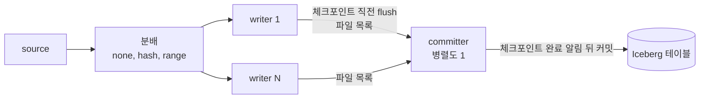

Flink 잡은 레코드를 계속 처리하고 S3에는 Parquet 파일이 쌓이는데, Iceberg 테이블을 조회하면 방금 들어온 행이 없다. Flink Iceberg sink의 writer가 쓴 파일은 체크포인트가 완료된 뒤 committer가 커밋해야 테이블 메타데이터에 들어간다. 그 전까지는 아무 스냅샷도 가리키지 않는 파일일 뿐이다.

MySQL CDC를 Iceberg에 넣는 방법으로 Kafka Connect Iceberg sink가 있다. Flink sink는 같은 일을 Kafka 대신 체크포인트에 묶어서 한다. 커밋 시점, 키 처리, 복구 방식이 모두 그 차이에서 나온다.

버전은 Iceberg 1.12.0의 Flink 2.3 모듈 기준이다. 1.12.0은 Flink 1.20, 2.1, 2.2, 2.3용 모듈을 함께 낸다.

## writer는 파일을 쓰고, committer 하나가 체크포인트 뒤에 커밋한다



체크포인트 배리어가 오기 직전(`prepareSnapshotPreBarrier`) writer는 열린 파일을 닫고 그 목록을 committer로 보낸다. committer는 병렬도 1로 고정돼 있고, 자기 상태를 저장할 때 그 체크포인트의 파일들로 manifest를 써서 체크포인트 ID별로 상태에 넣는다. 실제 Iceberg 커밋은 Flink가 체크포인트 전체가 끝났다고 알려 줄 때(`notifyCheckpointComplete`) 한다. 상태 저장이 1단계, 커밋이 2단계다. Kafka sink가 같은 구조로 트랜잭션을 커밋하는 방식은 [Flink 상태와 체크포인트 글](/posts/flink-state-and-checkpoints/)에 있다.

| 상황 | 결과 |
|---|---|
| 스트리밍 잡에 체크포인트가 꺼져 있음 | 커밋하지 않는다. bounded 입력만 끝에서 한 번 flush한다 |
| 체크포인트는 성공, Iceberg 커밋은 실패 | 파일은 committer 상태에 남고, 다음 체크포인트에서 그때까지의 것을 함께 커밋한다 |

두 번째 줄 때문에 Flink 체크포인트 성공률만 보면 커밋 실패를 놓친다. committer가 내보내는 `elapsedSecondsSinceLastSuccessfulCommit` 게이지가 그 자리를 잡는 지표다.

## 체크포인트 주기가 지연과 파일 수를 같이 정한다

체크포인트마다 writer가 파일을 닫으니, 데이터가 테이블에 보이기까지의 지연은 대략 체크포인트 주기와 커밋 시간을 더한 값이다. 반대로 체크포인트 한 번이 만드는 파일 수는 writer 수와 각 writer가 건드린 파티션 수의 곱에 가깝다. 주기를 1분에서 10초로 줄이면 파일과 스냅샷도 그만큼 늘어난다. `target-file-size-bytes`는 파일이 커질 때 끊는 상한이라서 작은 파일을 막지 못한다.

writer 앞의 분배 방식이 파티션당 파일 수를 정한다. `write.distribution-mode`의 Flink 기본값은 `none`이다.

| 모드 | 동작 | 한계 |
|---|---|---|
| `none` | 섞지 않는다. 단, equality 필드가 있으면 그 키로 `keyBy` 한다 | writer마다 모든 파티션에 파일을 쓸 수 있다 |
| `hash` | 파티션 키로 `keyBy` (파티션 없는 테이블은 equality 필드로) | 쏠린 파티션을 못 나눈다. 키 종류가 10개면 writer도 10개만 일한다 |
| `range` | 체크포인트마다 모은 통계로 파티션이나 정렬 키 범위를 나눈다 | 실험 기능. 파일 안의 행은 정렬하지 않는다. equality 필드가 있으면 그 키 `keyBy`로 돌아간다 |

## upsert는 키마다 equality delete를 먼저 쓴다

upsert는 v2 이상 테이블에서 primary key(identifier 필드)를 두고 `write.upsert.enabled` 테이블 속성이나 `upsert-enabled` 쓰기 옵션으로 켠다. `overwrite`와 함께 켤 수 없다. writer가 RowKind별로 하는 일은 이렇다.

| RowKind | upsert 꺼짐 | upsert 켜짐 |
|---|---|---|
| `INSERT`, `UPDATE_AFTER` | 행 추가 | 키로 delete를 쓰고 행 추가 |
| `UPDATE_BEFORE` | 그 행 delete | 무시 (같은 행을 두 번 지우지 않게) |
| `DELETE` | 그 행 delete | 키로 delete |

지울 키가 같은 체크포인트에서 같은 writer가 쓴 행이면 writer는 파일 경로와 위치를 기억하고 있어서 position delete를 쓴다. 그 밖에는 equality delete를 쓴다. 새 키도 이전 커밋 어딘가에 있었을 수 있으니, upsert 테이블은 거의 모든 커밋에 equality delete 파일을 더한다. 그 파일이 읽기를 어떻게 느리게 하는지는 [Iceberg 행 단위 삭제 글](/posts/iceberg-row-level-deletes/)에 있다. delete 파일이 든 커밋은 체크포인트마다 따로 `RowDelta`로 한다. 뒤 체크포인트의 equality delete가 앞 체크포인트의 데이터 파일에 걸리려면 sequence number가 더 커야 하기 때문이다.

파티션 테이블에서는 파티션 필드의 원본 컬럼이 equality 필드에 들어 있어야 한다. 파티션이 `days(ts)`면 `ts`가 키에 있어야 한다. equality delete는 같은 파티션의 데이터 파일에만 적용되므로, 키에 파티션 컬럼이 빠져 있으면 파티션 A의 옛 행을 파티션 B로 간 새 행이 지울 수 없다. `FlinkSink`는 이 조건을 잡을 만들 때 검사하고 실패시킨다. 원천의 `updated_at`처럼 바뀌는 컬럼으로 파티셔닝하면 키가 `(id, updated_at)`이 되어 사실상 upsert가 안 되니, 파티션은 생성 시각처럼 바뀌지 않는 컬럼으로 잡는다.

## 재시작해도 같은 파일을 두 번 커밋하지 않는다

committer는 커밋할 때마다 스냅샷 요약에 세 값을 남긴다.

| 요약 키 | 값 |
|---|---|
| `flink.job-id` | 커밋한 Flink 잡 ID |
| `flink.operator-id` | committer 연산자 ID (한 테이블에 sink가 여럿일 때 구분) |
| `flink.max-committed-checkpoint-id` | 이 커밋까지 반영한 체크포인트 ID |

잡이 체크포인트나 savepoint에서 다시 뜨면 committer는 상태에서 이전 잡 ID를 꺼내고, 테이블의 현재 스냅샷부터 부모 쪽으로 거슬러 올라가며 그 잡 ID와 연산자 ID가 같은 첫 스냅샷의 `max-committed-checkpoint-id`를 찾는다. 상태에 남은 manifest 가운데 그보다 큰 ID만 커밋한다. 커밋은 성공했는데 체크포인트 완료 전에 죽은 경우에도 같은 파일이 두 번 들어가지 않는 이유다. 체크포인트 ID는 새 잡에서도 이어서 증가하므로 이전 잡의 값을 그대로 기준으로 쓴다.

이 장치가 깨지는 자리도 소스에 드러난다.

- committer의 uid가 바뀌면 상태를 못 찾는다. `allowNonRestoredState`로 띄우면 경고만 남기고 커밋 안 된 파일을 버린다. `FlinkSink`는 `uidPrefix`, `IcebergSink`는 `uidSuffix`로 uid를 고정한다. uid가 savepoint 복구에서 하는 일은 체크포인트 글에 있다.
- 스냅샷 만료가 Flink 잡의 마지막 스냅샷까지 지우면 기준값을 잃는다. 미참조 파일 삭제는 아직 커밋 전인 임시 파일을 지울 수 있으니 충분히 오래된 파일만 지운다.

## 작은 파일은 sink 뒤에 붙이는 maintenance로 줄인다

`IcebergSink`(Iceberg 1.12.0, iceberg-flink 2.3 모듈)는 `.rewriteDataFiles()`, `.expireSnapshots()`, `.deleteOrphanFiles()`, `.convertEqualityDeletes()`를 빌더에 붙여 커밋이 끝날 때마다 같은 잡 안에서 테이블 maintenance를 돌릴 수 있다. `.upsert(true)`, `.equalityFieldColumns(...)`, `.uidSuffix(...)`도 이 빌더에 있다.

`convertEqualityDeletes()`는 equality delete를 deletion vector로 바꾸며 v3 테이블이 필요하다. 이 변환기는 기본 키 인덱스를 Flink 상태에 두고 살아 있는 행 수만큼 커지니 RocksDB 상태 백엔드를 권한다. 같은 테이블에서 maintenance가 겹치지 않도록 lock을 쓰고, 테이블당 maintenance 잡이 하나뿐이면 Flink 안에서 관리하는 lock으로 충분하다. 별도의 `TableMaintenance` 잡으로 떼어 돌릴 수도 있다.

## 로컬에서 upsert 테이블을 만들고 스트림으로 읽어 본다

Flink 2.3 SQL Client에 `iceberg-flink-runtime-2.3-1.12.0.jar`를 넣고, Hadoop catalog를 쓰려면 `HADOOP_CLASSPATH`를 잡은 뒤 띄운다.

```sql
SET 'execution.checkpointing.interval' = '30s';

CREATE CATALOG lake WITH (
  'type' = 'iceberg', 'catalog-type' = 'hadoop',
  'warehouse' = 'file:///tmp/iceberg-wh');
CREATE DATABASE IF NOT EXISTS lake.db;

-- 파티션 컬럼 order_date가 PK에 들어가야 upsert가 시작된다
CREATE TABLE lake.db.orders (
  order_id BIGINT, status STRING, amount INT, order_date DATE,
  PRIMARY KEY (order_id, order_date) NOT ENFORCED
) PARTITIONED BY (order_date)
WITH ('format-version' = '2', 'write.upsert.enabled' = 'true');

CREATE TEMPORARY TABLE gen (order_id BIGINT, status STRING, amount INT) WITH (
  'connector' = 'datagen', 'rows-per-second' = '5',
  'fields.order_id.min' = '1', 'fields.order_id.max' = '20',
  'fields.status.length' = '1');

INSERT INTO lake.db.orders SELECT order_id, status, amount, CURRENT_DATE FROM gen;
```

키가 1부터 20까지라 몇 분을 돌려도 batch 조회의 행 수는 날짜당 20을 넘지 않는다. 스냅샷 메타데이터 테이블에서 커밋마다 남는 값을 볼 수 있다.

```sql
SET 'execution.runtime-mode' = 'batch';
SELECT count(*) FROM lake.db.orders;
SELECT committed_at, operation,
       summary['flink.max-committed-checkpoint-id'] AS ckpt,
       summary['total-equality-deletes']            AS eq_deletes
FROM lake.db.orders$snapshots;
```

이 테이블을 스트림으로 읽어도 새 행은 나오지 않는다.

```sql
SET 'execution.runtime-mode' = 'streaming';
SELECT * FROM lake.db.orders /*+ OPTIONS('streaming'='true', 'monitor-interval'='10s') */;
```

`IcebergSource`의 스트리밍 읽기는 `monitor-interval`(기본 60초)마다 새 스냅샷을 찾는데, incremental append scan이라 operation이 `append`인 스냅샷의 추가 파일만 읽는다. delete 파일과 데이터 파일을 함께 더한 `RowDelta` 커밋은 `overwrite`로 기록되므로 통째로 건너뛴다. 위 조회의 `operation` 열이 `overwrite`로 찍히는 것이 그 이유다. CDC 읽기는 아직 지원하지 않는다. upsert 테이블의 변경을 다음 잡이 받아야 한다면 Kafka 같은 changelog에서 읽는 편이 맞다.

## Kafka Connect Iceberg sink와 나란히 놓으면

| | Flink Iceberg sink | Kafka Connect Iceberg sink |
|---|---|---|
| 커밋 시점 | 체크포인트 완료 뒤 | 코디네이터가 `iceberg.control.commit.interval-ms`(기본 5분)마다 |
| 파일 목록이 모이는 곳 | committer 연산자 상태 | control 토픽 |
| 중복 커밋 방지 기준 | 요약의 `flink.max-committed-checkpoint-id` | 요약의 `kafka.connect.offsets.<control 토픽>.<그룹>` |
| 소비 오프셋 | Flink 체크포인트 | 같은 Kafka 트랜잭션으로 커밋 (KIP-447) |

Connect sink의 lag가 커밋 주기를 따라 톱니 모양을 그리는 이유도 이 표의 첫 줄에 있다([Kafka Connect 워커와 태스크 글](/posts/kafka-connect-workers-tasks/)). Connect sink는 Flink 클러스터 없이 설정만으로 여러 토픽을 테이블로 퍼 나르고, Flink sink는 그 앞에 조인, 집계, 키 정리 같은 변환을 같은 체크포인트 안에 둘 수 있다. Flink를 고르면 체크포인트 주기 하나가 지연, 파일 수, 커밋 횟수를 함께 정하고, 그 손잡이와 상태 백엔드 운영이 같이 따라온다.

## 참고 자료

- [Iceberg Flink Writes (UPSERT, Distribution mode, Notes, Sink V2, Dynamic Sink)](https://iceberg.apache.org/docs/latest/flink-writes/)
- [Iceberg Flink Queries (streaming read, metadata tables)](https://iceberg.apache.org/docs/latest/flink-queries/)
- [Iceberg Flink Configuration (read options, write options)](https://iceberg.apache.org/docs/latest/flink-configuration/)
- [Iceberg Flink Table Maintenance (post-commit integration, ConvertEqualityDeletes, locks)](https://iceberg.apache.org/docs/latest/flink-maintenance/)
- [Iceberg Kafka Connect](https://iceberg.apache.org/docs/latest/kafka-connect/)
- [apache/iceberg 1.12.0 IcebergFilesCommitter.java (Flink 2.3)](https://github.com/apache/iceberg/blob/apache-iceberg-1.12.0/flink/v2.3/flink/src/main/java/org/apache/iceberg/flink/sink/IcebergFilesCommitter.java)
- [apache/iceberg 1.12.0 FlinkSink.java (Flink 2.3)](https://github.com/apache/iceberg/blob/apache-iceberg-1.12.0/flink/v2.3/flink/src/main/java/org/apache/iceberg/flink/sink/FlinkSink.java)

## English summary

The Flink Iceberg sink runs parallel writers that close their files right before each checkpoint and a single committer that commits them to the table only after Flink reports the checkpoint complete, so the checkpoint interval sets both latency and the number of small files. Upsert mode writes an equality delete for the key before every insert, which is why partition source columns must be part of the key. After a restart the committer reads `flink.job-id` and `flink.max-committed-checkpoint-id` from snapshot summaries so it never commits the same files twice. A streaming `IcebergSource` reads only append snapshots, so it skips the overwrite commits an upsert table produces. The Kafka Connect Iceberg sink commits on a timer through a control topic; a Flink sink lets transformations share the same checkpoint, at the cost of one interval that controls latency, file count and commit rate together.
