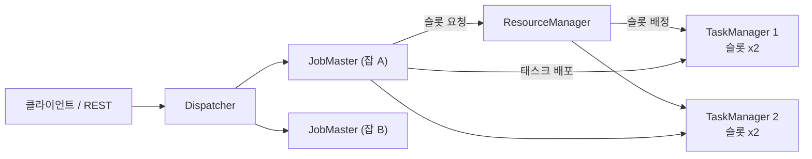

Kafka lag이 계속 늘어서 Flink Web UI를 열면 source 태스크가 검은색으로 칠해져 있다. 이때 source 병렬도를 올리면 대개 아무것도 나아지지 않는다. 백프레셔는 느린 태스크에서 위쪽으로 번지기 때문에, 검게 보이는 태스크는 원인이 아니라 정체의 맨 뒤다. 어디가 진짜 병목인지 읽으려면 잡이 어떤 태스크로 묶이고, 어느 슬롯에 올라가고, 태스크 사이로 데이터가 어떻게 넘어가는지 알아야 한다.

버전은 Flink 2.3 기준이다.

## 핵심 키워드

| 키워드 | 한 줄 뜻 |
|---|---|
| JobManager | Dispatcher, ResourceManager, 잡마다 하나인 JobMaster를 담은 조정 프로세스 |
| TaskManager | subtask를 스레드로 돌리는 JVM. 태스크 슬롯 수만큼 일을 받는다 |
| 태스크 슬롯 | TaskManager의 managed memory를 나눈 칸. CPU는 나누지 않는다 |
| 슬롯 공유 | 같은 잡의 서로 다른 연산자 subtask가 한 슬롯에 같이 들어간다. 필요한 슬롯 수는 가장 큰 병렬도 |
| 연산자 체이닝 | forward로 이어지고 병렬도가 같은 연산자를 한 스레드의 한 태스크로 합친다 |
| JobGraph, ExecutionGraph | 클라이언트나 JobManager가 만든 논리 그래프와, JobMaster가 병렬도만큼 펼친 실행 그래프 |
| max parallelism | key group 수. 키 상태를 옮길 수 있는 병렬도의 상한 |
| credit 기반 흐름 제어 | 받는 쪽이 빈 버퍼 수만큼 credit을 주고, 보내는 쪽은 그만큼만 보낸다 |
| busy, backpressured, idle | subtask가 1초 중 일한 시간, 출력 버퍼가 없어 기다린 시간, 입력이 없어 쉰 시간 |
| failover region | pipelined 교환으로 이어진 태스크 묶음. 장애 때 이 단위로 재시작한다 |
| application, session 모드 | 잡 하나가 클러스터를 독점하는 배포와 여러 잡이 클러스터를 나눠 쓰는 배포 |
| adaptive scheduler | 받은 슬롯에 맞춰 병렬도를 정하고, 슬롯이 늘거나 줄면 잡을 다시 띄운다 |

## JobManager 안의 세 역할



Dispatcher는 잡 제출 REST 엔드포인트와 Web UI를 맡고, 잡이 들어오면 JobMaster를 하나 띄운다. JobMaster는 받은 JobGraph를 ExecutionGraph로 펼쳐 실행한다. JobGraph의 정점(JobVertex) 하나가 ExecutionJobVertex가 되고, 그 아래에 병렬도만큼 ExecutionVertex가 생긴다. 장애로 다시 돌면 같은 ExecutionVertex에 새 Execution 시도가 붙는다. ResourceManager는 슬롯을 관리한다. YARN이나 Kubernetes 위에서는 TaskManager를 새로 띄울 수 있지만, standalone에서는 이미 떠 있는 TaskManager의 슬롯만 나눠 준다.

슬롯은 managed memory만 나눈다. 슬롯 세 개짜리 TaskManager라면 슬롯마다 managed memory의 1/3을 갖고, CPU는 같은 JVM 안에서 모두가 나눠 쓴다. Spark executor의 코어 수가 동시에 도는 태스크 수를 정하는 것([Spark on YARN 자원 글](/posts/spark-on-yarn-resources/))과 비슷해 보이지만, Flink 슬롯 하나에는 서로 다른 연산자의 subtask가 여러 개 들어간다. 슬롯 공유 덕분에 잡에 필요한 슬롯 수는 연산자 병렬도 중 가장 큰 값이다.

## 체이닝이 끊기는 자리

연산자 두 개가 한 태스크로 합쳐지려면 조건이 다 맞아야 한다. 아래쪽 연산자의 입력이 하나뿐이고, 두 연산자의 병렬도와 슬롯 공유 그룹이 같고, 사이의 파티셔너가 forward이고, 둘 다 체이닝을 막지 않아야 한다. 파티셔너를 따로 주지 않으면 병렬도가 같을 때 forward, 다를 때 rebalance가 붙는다.

```java
// Flink 2.3 DataStream API, 구조만 보여 주는 스케치. env 병렬도 4
DataStream<Click> clicks = env
    .fromSource(source, WatermarkStrategy.noWatermarks(), "clicks")
    .map(Click::parse)            // forward, 병렬도 4: source와 한 체인
    .filter(Click::isValid);      // 같은 체인

clicks
    .keyBy(Click::ip)             // hash 파티셔너: 체인이 끊긴다
    .process(new CountPerIp())
    .map(Alert::of)               // forward: process와 한 체인
    .sinkTo(alertSink)
    .setParallelism(1);           // 병렬도가 달라 rebalance: 또 끊긴다
```

| 태스크 | 들어 있는 연산자 | 병렬도 |
|---|---|---|
| 1 | source, map, filter | 4 |
| 2 | process, map | 4 |
| 3 | sink | 1 |

subtask는 9개지만 슬롯은 4개면 된다. 체인을 일부러 끊는 방법도 있다. `disableChaining()`은 그 연산자를 앞뒤 어느 쪽과도 묶지 않고, `startNewChain()`은 그 연산자부터 새 체인을 시작한다. 잡 전체는 `pipeline.operator-chaining.enabled: false`로 끈다. 체인이 끊긴 자리에서는 레코드가 직렬화되어 네트워크 버퍼를 거치므로, 끊는 쪽이 비용이다.

`keyBy`는 키 해시로 key group을 고르고, key group 번호로 subtask를 고른다. key group 수가 max parallelism이다. 지정하지 않으면 병렬도의 1.5배를 2의 거듭제곱으로 올린 값을 128과 32768 사이로 자른 값이 된다. 병렬도 85까지는 128, 86부터는 256이다. 상태가 key group 단위로 옮겨 가는 원리와, max parallelism을 상태 없이는 바꿀 수 없는 이유는 [Flink 상태와 체크포인트 글](/posts/flink-state-and-checkpoints/)에 있다.

## credit이 없으면 위로 번진다

체인이 끊긴 자리에서 보내는 쪽 subtask는 결과를 32KB 메모리 세그먼트 버퍼에 담아 보낸다. 같은 TaskManager 쌍 사이의 여러 논리 채널은 TCP 연결 하나를 나눠 쓴다. Flink 1.5 전에는 받는 쪽 하나가 버퍼를 못 구하면 그 TCP 연결 전체를 읽지 않아서, 여유 있는 다른 subtask까지 같이 멈췄다.

credit 기반 흐름 제어는 이걸 채널 단위로 바꿨다. 받는 쪽은 입력 채널마다 전용 버퍼 2개를 두고, 비어 있는 버퍼 수를 credit으로 보낸 쪽에 알린다. 보내는 쪽은 credit이 있을 때만 버퍼를 보내고, 대기 중인 버퍼 수(backlog)를 함께 알린다. 받는 쪽은 backlog를 보고 입력 게이트가 공유하는 floating 버퍼 8개에서 더 가져온다. 2.0부터 이 2개와 8개는 설정으로 바꿀 수 없다. credit이 0이 된 채널만 멈추고, 보내는 쪽 출력 버퍼가 다 차면 그 subtask는 레코드를 더 못 쓰고 기다린다. 그 subtask가 입력을 덜 읽으니 그 위도 같은 식으로 막힌다. 이렇게 source까지 올라가면 source가 Kafka에서 덜 가져오고, lag이 쌓인다.

버퍼가 다 차지 않아도 `execution.buffer-timeout.interval`(기본 100ms)마다 내보낸다. 트래픽이 적은 채널에서는 이 값이 지연의 상한이 된다. 네트워크 버퍼 메모리는 Total Flink Memory의 10%(최소 64MB)가 기본이다.

## Web UI에서 병목 찾기

subtask마다 `busyTimeMsPerSecond`, `backPressuredTimeMsPerSecond`, `idleTimeMsPerSecond`가 나오고 셋을 더하면 약 1000ms다. Back Pressure 탭은 backpressured 비율을 0~10% OK, 10~50% LOW, 50% 초과 HIGH로 칠한다. 잡 그래프의 정점 색은 subtask 중 가장 높은 값을 보여 준다. 위 예시 잡에서 이렇게 보였다고 하자.

| 태스크 | busy | backpressured | idle |
|---|---|---|---|
| source, map, filter | 10% | 85% | 5% |
| process, map | 95% | 0% | 5% |
| sink | 15% | 0% | 85% |

source는 출력 버퍼를 기다리느라 85%를 썼다. 병목은 backpressured가 낮으면서 busy가 높은 첫 태스크인 process 체인이다. sink는 놀고 있으니 sink 병렬도를 올려도 소용없다. process 체인의 subtask 중 하나만 busy가 높다면 병렬도보다 키 쏠림을 먼저 의심한다. 수치가 몇 초 평균이라 부하가 출렁이면 실제보다 고르거나 거칠게 보일 수 있다.

지표는 태스크 단위라서 체인 안의 어느 연산자가 느린지는 바로 안 나온다. 원인을 좁힐 때만 의심 가는 연산자에 `disableChaining()`을 걸어 따로 재 보거나, `rest.flamegraph.enabled: true`(기본 false)로 flame graph를 켜서 스택을 본다. 체인을 끊으면 직렬화 비용이 생겨 수치 자체가 달라진다는 점은 감안해야 한다.

백프레셔는 체크포인트도 늦춘다. aligned 체크포인트의 배리어는 버퍼에 쌓인 레코드 뒤에 줄을 서므로, 버퍼가 꽉 찬 채널에서는 배리어도 늦게 도착한다. unaligned 체크포인트는 배리어가 앞질러 가는 대신 그 버퍼 안의 데이터를 체크포인트에 저장해서 크기가 커진다. 버퍼 디블로팅(`taskmanager.network.memory.buffer-debloat.enabled`, 기본 false)은 측정한 처리량에 맞춰 버퍼에 담는 데이터를 1초 분량(기본 target)으로 줄여 배리어가 기다리는 시간을 줄인다.

## 재시작은 region 단위, 기본은 지수 지연

체크포인트를 켜면 재시작 전략 기본값은 `exponential-delay`다. 1초에서 시작해 1.5배씩 늘려 최대 1분까지 기다리고, 지터 0.1을 섞으며, 1시간 동안 장애가 없으면 대기 시간을 처음으로 돌린다. 시도 횟수 제한은 없다. 체크포인트를 끄면 기본은 재시작하지 않는 것이다. 몇 번 실패하면 잡을 멈추게 하려면 `fixed-delay`나 `failure-rate`를 고른다.

`jobmanager.execution.failover-strategy`의 기본값 `region`은 실패한 태스크가 속한 region만 다시 띄운다. 스트리밍에서는 모든 데이터 교환이 pipelined라서 region은 서로 연결된 태스크 묶음 전체다. 한 줄로 이어진 잡에 `keyBy`가 하나라도 있으면 모든 subtask가 서로 연결되어 잡 전체가 한 region이 되고, 결과는 전체 재시작과 같다. map과 filter만 forward로 이어진 잡이라야 병렬 파이프라인 하나씩 따로 재시작된다.

## 배포 모드와 adaptive scheduler

2.0에서 per-job 모드가 없어져서 남은 건 둘이다. application 모드는 잡의 `main()`을 JobManager에서 실행하고, 클러스터 수명이 그 애플리케이션과 같다. session 모드는 오래 떠 있는 클러스터에 여러 잡을 제출한다. 시작이 빠른 대신, TaskManager 하나가 죽으면 거기에 태스크가 있던 모든 잡이 함께 실패한다. CLI나 SQL Client로 session에 제출하면 `main()`은 클라이언트에서 돌고, JobGraph만 클러스터로 간다.

광고 플랫폼에서 배포한 Flink 잡은 Flink 1.15 이미지의 Flink 홈 아래에 잡 jar를 넣었고, 잡과 환경마다 Helm values 파일의 이미지 태그를 바꿨다. 한 모듈을 설정만 달리해 잡 두 개로 띄웠다.

`jobmanager.scheduler: adaptive`를 켜면 스케줄러가 먼저 필요한 슬롯을 선언하고, 받은 만큼으로 병렬도를 정한다. TaskManager를 잃으면 병렬도를 낮춰 계속 돌고, 슬롯이 돌아오면 설정한 병렬도까지 다시 올린다. 실행 중인 잡의 정점별 병렬도 범위는 `PUT /jobs/<job-id>/resource-requirements`로 바꿀 수 있다. 대가도 분명하다. 스트리밍 잡에서만 쓰고, 부분 재시작 없이 장애마다 잡 전체를 다시 띄우며, 병렬도가 바뀔 때마다 마지막 체크포인트에서 재시작한다. 스트리밍 잡의 기본 스케줄러는 여전히 `Default`다.

reactive 모드(`scheduler-mode: reactive`)는 adaptive scheduler 위에서 클러스터의 슬롯을 전부 쓰게 한다. TaskManager를 늘리면 잡이 커지고 줄이면 작아지며, 코드나 설정의 병렬도는 무시된다. standalone application 배포에서만 되고, YARN이나 native Kubernetes, session 클러스터에서는 안 된다. 병렬도를 막는 수단은 max parallelism 하나뿐이고, 키 상태가 있는 연산자는 key group 수보다 넓게 퍼질 수 없다. Kafka source는 [Kafka 파티션 글](/posts/kafka-partitions-and-lag/)에서 본 컨슈머 그룹처럼 파티션보다 많은 subtask가 일을 받지 못하니, 늘린 슬롯이 source에서는 놀 수 있다.

## 참고 자료

- [Apache Flink 2.3 Flink Architecture](https://nightlies.apache.org/flink/flink-docs-stable/docs/concepts/flink-architecture/)
- [Apache Flink 2.3 Jobs and Scheduling](https://nightlies.apache.org/flink/flink-docs-stable/docs/internals/job_scheduling/)
- [Apache Flink 2.3 Monitoring Back Pressure](https://nightlies.apache.org/flink/flink-docs-stable/docs/ops/monitoring/back_pressure/)
- [Apache Flink 2.3 Network Memory Tuning Guide](https://nightlies.apache.org/flink/flink-docs-stable/docs/deployment/memory/network_mem_tuning/)
- [Apache Flink 2.3 Task Failure Recovery](https://nightlies.apache.org/flink/flink-docs-stable/docs/ops/state/task_failure_recovery/)
- [Apache Flink 2.3 Elastic Scaling](https://nightlies.apache.org/flink/flink-docs-stable/docs/deployment/elastic_scaling/)
- [Apache Flink 2.3 Deployment Overview](https://nightlies.apache.org/flink/flink-docs-stable/docs/deployment/overview/)
- [Apache Flink 2.3 Configuration](https://nightlies.apache.org/flink/flink-docs-stable/docs/deployment/config/)
- [Flink 2.0 Release Notes](https://nightlies.apache.org/flink/flink-docs-stable/release-notes/flink-2.0/)
- [A Deep-Dive into Flink's Network Stack (Flink 블로그)](https://flink.apache.org/2019/06/05/a-deep-dive-into-flinks-network-stack/)
- [StreamingJobGraphGenerator.java, release-2.3 (apache/flink)](https://github.com/apache/flink/blob/release-2.3/flink-runtime/src/main/java/org/apache/flink/streaming/api/graph/StreamingJobGraphGenerator.java)
- [KeyGroupRangeAssignment.java, release-2.3 (apache/flink)](https://github.com/apache/flink/blob/release-2.3/flink-runtime/src/main/java/org/apache/flink/runtime/state/KeyGroupRangeAssignment.java)

## English summary

A Flink JobManager runs a Dispatcher, a ResourceManager and one JobMaster per job, and the JobMaster expands the JobGraph into an ExecutionGraph whose subtasks run in TaskManager slots that split managed memory but not CPU. Operators chain into one task only across forward edges with equal parallelism, so `keyBy` and a parallelism change start a new task, and between tasks credit-based flow control stops a sender when the receiver has no free buffers, which is how backpressure climbs to the source. In the Web UI the bottleneck is the first task that is busy but not backpressured, and chaining hides which operator inside it is slow. In my previous ad platform work, the Flink jobs shipped as their own images with per-job Helm values. Adaptive scheduling adds rescaling on lost or new slots, but it trades away region failover and restarts the whole job on every scale change.
